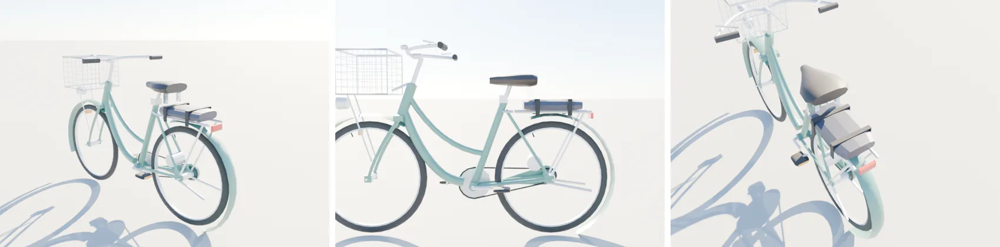

# 腳踏車的載妹墊（後座軟墊）＋乘客定位節點——MODEL_READY（LAWWW2-B 2026-10-16）

- 需求：使用者試玩第 6 項「腳踏車要可以載人（載妹墊）」；LAWWW-B 佇列③（AA_137 §5）。
- 檔案：`assets/models/env/bike_ride.glb`（同一個 GLB 加東西，節點名稱、樞紐都沒改）。
  - 248 KB；frame 從 1,330 增加到 1,504 個三角形。
  - 尺寸表 `bike_ride.json`。
  - 腳本 `tools/blender/env_second/bike_ride.py`。
- 軟墊：
  - 綁在原本的後貨架上，深藍灰合成皮，0.33 m（前後）× 0.21 m（左右）× 6 cm，圓角，兩條黑色綁帶。
  - 是台灣學生淑女車常見的那種。
- **坐墊頂面中心（車的座標，車頭 +z、地面 y=0）：(0, 0.784, −0.50)**，在後輪軸正上方。
  - 前緣 z −0.335、後緣 z −0.665。
  - 騎士的座墊頂是 (0, 0.935, −0.31)。
- **定位節點**（空節點，frame 的子節點，位置在 json 的「載妹墊定位節點」）：

| 節點 | 位置 | 用途 |
|---|---|---|
| `passenger_side` | (0.03, 0.784, −0.52) | 側坐（女生）的坐骨點；身體朝 +x（車的左邊），兩腿垂在左邊 |
| `passenger_astride` | (0, 0.784, −0.54) | 跨坐（男生）的坐骨點；朝 +z，雙手放膝 |
| `grip_cushion_L`／`grip_cushion_R` | (±0.105, 0.774, −0.40) | 手扶座墊邊緣 |
| `rider_waist` | (0, 1.02, −0.38) | 扶腰的參考點（騎士腰的中心）；手放在左右各約 15 cm |
| `mount_point` | (0.55, 0, −0.75) | 上車前站的位置（車的左後方，地面） |

- 姿勢和 1.5 秒的上下車動作由 LAWWW-B 在遊戲端用程序化骨架做（LAWWW-B 00:31Z 確認，不用 Blender clip）。

左起：後方 45°、側面、上方。Blender Cycles 預覽，**不是遊戲畫面**。

## 還沒做到的

- 軟墊沒有車縫線、皺褶等細節。
- 沒有在遊戲裡和人物一起看過：坐骨點是照一般人的體型估的，要等 LAWWW-B 接上後看側坐時腳會不會碰到後輪。
