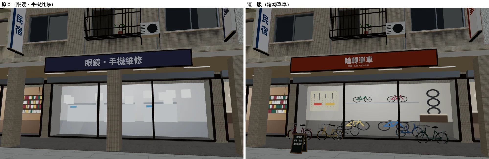
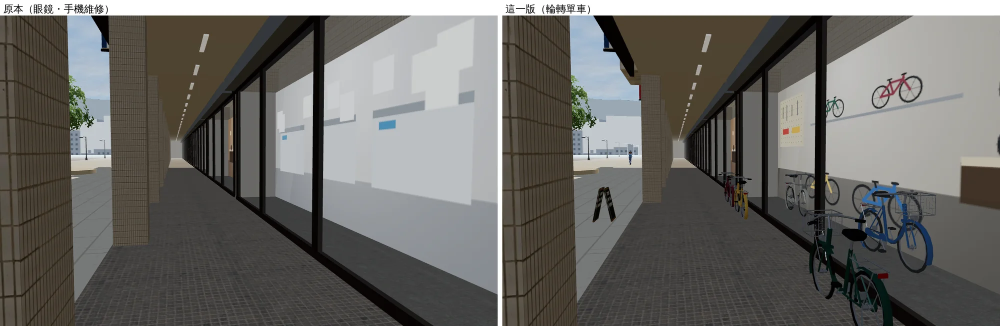
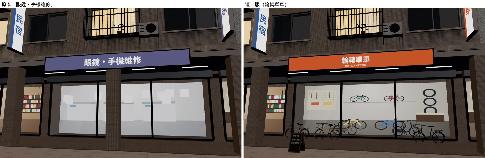
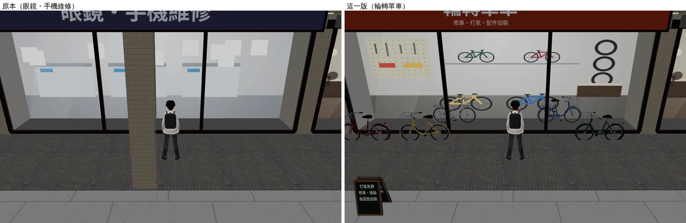
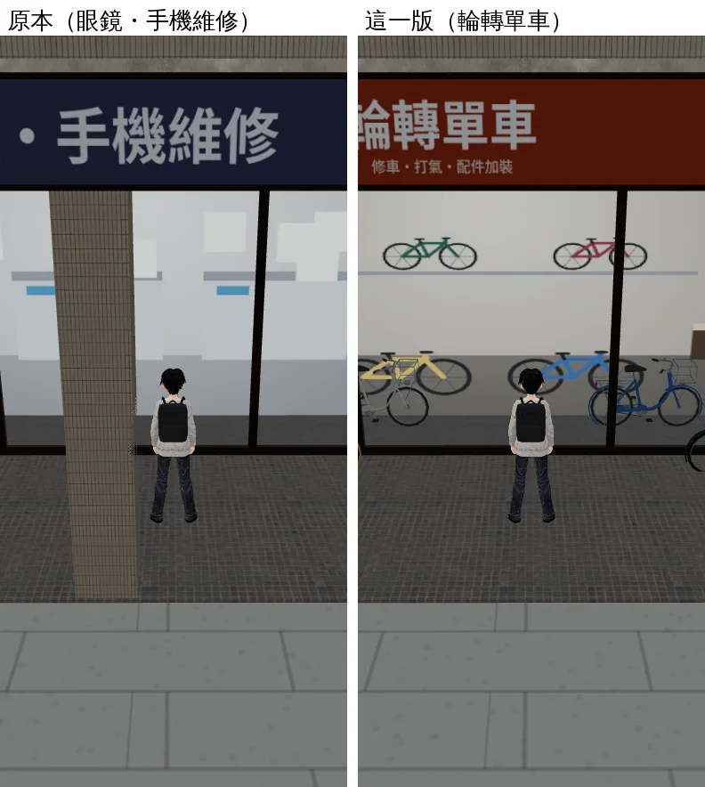
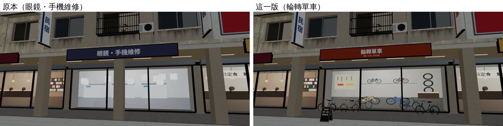

# 公館腳踏車行「輪轉單車」（READY_FOR_ART_REVIEW；LAWWW2-B 2026-10-16）

> **使用者更正（D78，2026-10-16 01:12 UTC，經 LAWWW-B）**：「一開始腳踏車就有載妹墊，不用加裝，學姊也要給我載。」→ 這間店**只當公館的街景**：不接購買流程、不需要店門口互動點、不做 2D 背景。下面「給 LAWWW-B：店門口互動點」一節留作紀錄，**不用加**。立牌上的「後座墊加裝」只是車行的服務項目，沒有對應的遊戲功能。

- **需求**：LAWWW-B 佇列「後備 A ①」——公館的腳踏車行，是加裝載妹墊的地方（AA_137 §5：開局的車沒有載妹墊，到公館車行加裝 300 元）。要在公館南側騎樓挑一間改成腳踏車行外觀，用原創店名，門口停幾台車，並告訴 LAWWW-B 店門口座標。
- **位置**：G06（第 7 間，x −4.8～5.4）。原本是沒有互動的「眼鏡・手機維修」，**正對台大校門**（公館的校門在 x=0）。從學校走出來、過馬路就是。

## 店名（D77）

| 遊戲裡 | 真實對應 | 說明 |
|---|---|---|
| 輪轉單車（橫招牌小字：修車・打氣・配件加裝；直立招牌：單車） | 無（原創） | 不是照真實店家取的。「輪轉」是台語「流利、順暢」的意思，也是輪子在轉。不用真實車行或品牌的名字、商標、配色；招牌是酒紅底白字，不是任何自行車品牌的配色 |

## 改了什麼

| 檔案 | 改動 |
|---|---|
| `src/zones3d.js` gongguan 區塊（LAWWW2 認領的區塊） | `shops` 第 7 筆改成 `{n:'輪轉單車', type:'bike', it:'bike', sub, v:'單車'}`。 騎樓靠櫥窗停三台腳踏車（`W3.bike`，正式模型 street_props 的 `bike_city`），和店面平行，z=FZ+2.55；店門口 x −2.1～1.7 不放車。 櫥窗裡兩台（不用導航）。 騎樓外一塊立牌：打氣免費／修車・換胎／後座墊加裝，位置 (2.6, FZ−0.6)。 車和立牌都加了導航阻擋。 |
| `src/townkit3d.js` | `TK.interiorTex` 加 `bike` 種類（店內景深卡）：洞洞板工具牆、牆架上掛兩台車、右邊掛輪胎、地上兩台車、櫃台。 |
| `tools/blender/env_second/wz_street.py`（`--set gongguan`） | 同一筆店家資料。 `gongguan_shops.glb` 重建：招牌板面的自訂屬性換新店名，店內景深卡種類改成 `bike`。 店門口那根柱子拿掉（`type` 不是 `none` 的店門口本來就不放柱子，和麵店、書店相同），少 12 個三角形。 |

## 給 LAWWW-B：店門口互動點（依 D78 不需要，留作紀錄）

- **(x −0.3, z 21.0)**，和其他店一樣是 `FZ+2`，`x` 是 `X0+w/2`，建議半徑 2.2。
- 加法和麵店、書店相同：在 shops.forEach 裡加一行 `if(s.type==='bike') E.interactables.push({x:ix,z:FZ+2,radius:2.2,label:'…'});`。也可以在下面那個「輪轉單車」區塊裡直接加。這一行我沒有加，加裝載妹墊的流程由 LAWWW-B 決定。
- 從店裡「出來」的位置：這間沒有室內區域，不需要。

## 測試（Playwright＋SwiftShader，手機模擬，**不是實機**）

| 測試 | 結果 |
|---|---|
| `tests/gongguan_layout_nav.py` | **ALL PASS**：主要地點站得住、走得到；騎樓 z=20.5 整排連續；柱子、店裡不能走；四間店的互動點不變；舊存檔、麵店進出、往溫州街；沒有 JS 例外。 |
| `tests/gongguan_glb_integration.py` | **ALL PASS**：正式模型和 `?nobldg` 的導航格、鏡頭碰撞、互動點完全相同。 效能：每個鏡頭的 draw call 是 `?nobldg` 的 1.07 倍，三角形 ≤ 42 萬。 |
| 另外檢查（`tools/blender/env_second/shots/bike_shop_door_check.py`，網址寫死 8842） | 店門口 (−0.3, 21) 站得住、從公館出生點走得到；三台車、立牌都擋住。 `E.simWalk`（引擎真正的移動模擬）三條路線都 ok：騎樓 x −7 → 7（從停的車旁邊走過）、x 7 → 店門口、人行道 (−0.3, 12) → 店門口。 沒有 JS 例外。 |

## 遊戲截圖（左＝原本、右＝這一版）

基準：原本＝`6c3ab9b`（worktree），這一版＝本分支。時間 14:00；夜景 20:00。

| 鏡頭 | 對照 |
|---|---|
| 人行道看店面 |  |
| 騎樓裡 |  |
| 晚上 |  |
| 玩家站在店門口（跟隨鏡頭） |  |
| 手機直向 |  |
| 手機橫向 |  |

## 自評（還不到參考品質的地方）

- 店內是景深卡（Canvas 畫的平面），和公館其他店相同：白天會自己發一點光（`dayI 0.6`），看起來偏平、偏亮。只有櫥窗裡兩台車是立體的。要更像真的車行，需要一個小的 Blender 室內（牆架、工具牆、打氣機、維修架），可以排進後備。
- 櫥窗裡和騎樓的車都是同一款淑女車（`bike_city` 換顏色），沒有公路車、登山車。
- 手機直向那張，玩家擋住一部分櫥窗（鏡頭跟在後面），屬於正常的跟隨視角。
- 美術由使用者確認，**不標 ART_APPROVED**。
