# 腳踏車 v2：7 款（使用者 2026-10-16 20:2x：「腳踏車機車全部都是同一個款式……路上不會全部都一樣，不要只改顏色」）

- **做的人**：LAWWW2-B（D89）。
- **狀態**：`READY_FOR_ART_REVIEW`（場景美術的 `ART_APPROVED` 由使用者決定）。
- **交付**：
  - 模型 `assets/models/env/second_ai/street_props.glb`（＋`.json`）：多了 6 個節點，其他道具不變。
  - 遊戲端 patch `docs/art-rebuild/second_ai/patches/bikes_v2.patch`（LAWWW-B 整合；疊在 `scooters_v2.patch` 之後）。
- 機車 v2 見 `../scooters_v2/README.md`。

## 1. 問題（修改前）
- `street_props.glb` 只有 `bike_city`（淑女車）一款。
- 停車架、路邊、腳踏車行全部都是同一台淑女車，只換車架顏色，每台前面都掛同一種鐵絲籃。

## 2. 參考
- `docs/art-rebuild/second_ai/research/vehicles_research.md`：台灣校園、街上常見的腳踏車種類。
- 只參考種類，不放品牌、商標、字。公共單車只做「形式」：粗彎管、方形籃、全包鍊條蓋；**不做任何系統的標誌、配色細節、編號**。

## 3. 修改前後（遊戲內，同鏡頭、11:00；左舊右新）
校園停車架：
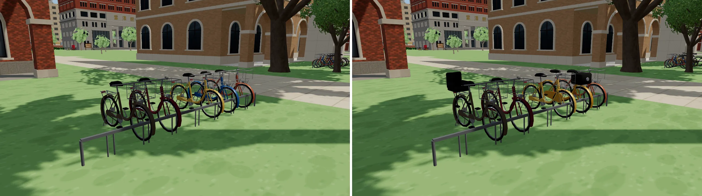

校園一排車（霖澤館旁）：
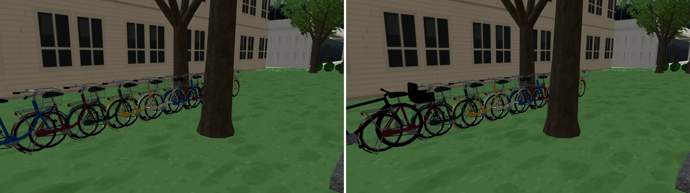

公館腳踏車行（輪轉單車）：騎樓擺登山車、淑女車、公路車；櫥窗擺小折、公路車。
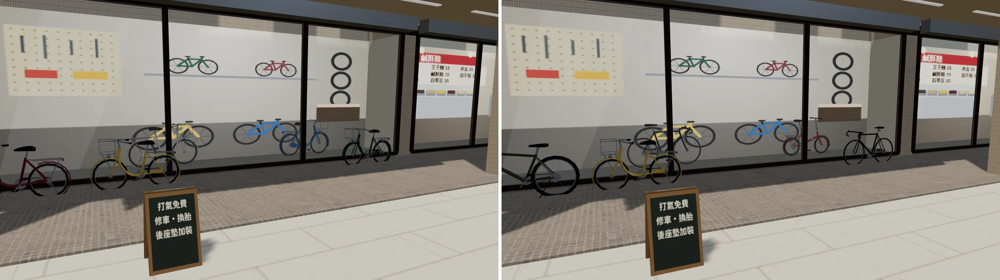

溫州街：
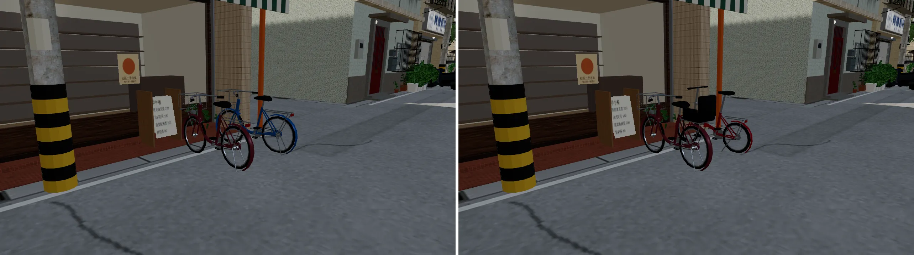

- 測試工作樹：開發分支 `dd24edbb`＋機車 v2＋腳踏車 v2。
- 「修改前」：
  - 校園、溫州街：同一個工作樹，換腳踏車之前拍的（機車已經是 v2）。
  - 公館腳踏車行：開發分支原樣 `62cb7307`，所以機車也是舊的。
- Playwright 手機模擬，**不是真機**。

## 4. 做法（`tools/blender/env_second/street_props.py`）
```bash
/opt/blenv/bin/python tools/blender/env_second/street_props.py                                         # → assets/models/env/second_ai/street_props.glb
/opt/blenv/bin/python tools/blender/env_second/street_props.py -- --out <glb> --render                  # 渲染用：腳踏車沿車身方向一台接一台排
```
- **共用**：
  - 約定照淑女車：沿 z 建模、地面 y＝0。
  - 車架材質 `bike_frame` 是白色，遊戲乘上每台的顏色。
  - 其他四個材質共用：`bike_dark`、`bike_metal`、`bike_reflector`、`bike_alpha`（鋼絲、籃子網是透明貼圖）。
  - **停車架整排合併不加 draw call**。
- **函式**：
  - `bk_wheel`：車胎截面圓，或寬而方（登山車）；輪圈、花鼓、鋼絲貼圖。
  - `bk_drive`：齒盤、曲柄、踏板、鍊條，可以加全包鍊條蓋。
  - `bk_saddle`：座墊斷面放樣，窄或寬。
  - 車架都用 `sweep`（沿折線掃管子）、`bez`（彎管）。

| 節點 | 車型 | 特徵 | 三角形 |
|---|---|---|---|
| `bike_city` | 淑女車（原本那台） | 低跨彎下管、前籃、擋泥板、後貨架 | 1,484 |
| `bike_city_child` | 媽媽車 | 淑女車＋後座兒童座椅（深灰塑膠殼、腳踏） | 1,772 |
| `bike_share` | 公共單車形式 | 粗的單一彎下管、24 吋、車架上的方形塑膠籃、全包鍊條蓋、寬座墊、中柱 | 1,628 |
| `bike_road` | 公路車 | 700C 細胎、菱形車架細管、彎把（纏把帶）、窄座墊、沒有擋泥板 | 1,560 |
| `bike_mtb` | 登山車 | 27.5 吋寬胎、粗下管、斜上管、前避震（內管銀、外管黑）、碟煞、寬平把、側腳架 | 1,564 |
| `bike_fold` | 小折 | 20 吋小輪、一根粗主管＋折疊鉸鏈、長座管、龍頭立管、小後架 | 1,380 |
| `bike_old` | 老鐵馬 | 28 吋、菱形車架（上管水平）、大後貨架、全包擋泥板、全包鍊條蓋、彈簧座墊、往後彎的把手、桿式煞車、車頭燈 | 1,708 |

## 5. 遊戲端（`patches/bikes_v2.patch`）
- **`world3d.js`**：
  - `formalBike(color, kind)`：照款式取節點。
  - 新的 `W3.bikeAny(color, seed, kind)`：
    - 照 `seed` 算雜湊挑款式，比例：淑女車 0.33、公共單車 0.22、公路車 0.11、登山車 0.12、小折 0.09、老鐵馬 0.07、媽媽車 0.06；
    - 每一款有自己常見的車架顏色：公共單車固定芥末黃，老鐵馬黑、深綠、深棕；淑女車照呼叫者給的顏色；
    - `kind` 可以指定款式。
  - `bikeRack` 改用 `bikeAny`：每個停車架的 seed 不同。
  - **`W3.bike()` 不變**（淑女車）：NPC 騎的車照舊用它，座墊、把手的位置要和騎車的姿勢對得上。
- **`zones3d.js`**：
  - 路邊停的車改 `bikeAny`：校園 5＋9 台、溫州街 3 台、公館 2 台。
  - 腳踏車行指定款式：騎樓公路車、淑女車、登山車；櫥窗小折、公路車。
- **`tests/street_props_integration.py`**：加一項「60 台裡至少 5 款、淑女車最多、全部是正式模型」。原本 `W3.bike` 的約定檢查照舊。

## 6. 八項驗收紀錄（ART_SOP 第 3-2 節）
| 項目 | 結果 | 說明 |
|---|---|---|
| 輪廓與倒角 | 通過 | 管子都是 `sweep` 掃出來的圓管（5～8 邊），彎的地方用 `bez`；車胎、輪圈是旋轉體 16～20 邊。 |
| 材質 | 通過 | 共用原本五個材質。<br>• 金屬 0.55（原本淑女車的設定）。<br>• 鋼絲、籃子網是透明貼圖。 |
| AO | **沒做** | 和原本的淑女車一樣：靠遊戲的陰影。 |
| 磨損 | **沒做** | 所有車都是新的。老鐵馬應該有鏽、褪色——下一版。 |
| 生活痕跡 | 部分 | 兒童座椅、公共單車的籃子。<br>車籃裡的東西、掛在把手的塑膠袋、鎖在欄杆上的大鎖——還沒做。 |
| 比例 | 通過 | 輪徑：20 吋 0.50 m、24 吋 0.62 m、26 吋淑女車 0.60 m、27.5 吋 0.72 m、700C 0.67 m、28 吋 0.70 m。<br>座高 0.86～0.95 m；軸距 0.94～1.16 m。 |
| 效能 | 通過 | 每台 1,380～1,772 三角形（淑女車 1,484）。draw call 不變（共用材質）。<br>校園兩個鏡頭三角形 +1.7 萬（停車架那一鏡 54.6 → 56.3 萬；一排車那一鏡 45.2 → 47.0 萬），溫州街、公館 +0.1 萬左右。 |
| 遊戲截圖 | 通過 | 校園停車架、校園一排車、公館腳踏車行、溫州街（第 3 節）。 |

## 7. 還沒到的地方
1. **淑女車還是最多**（比例照實際）。單一一個停車架裡，有時候大部分還是淑女車，只是車架顏色不同。淑女車本身還可以再分：沒籃子、塑膠籃、不同的後架。
2. **老鐵馬、登山車比淑女車長**（車長約 1.86 m、1.83 m，導航阻擋是 1.7 m）。路邊單停的那幾台，車頭或車尾可能多出 8 cm。停車架不受影響。
3. 磨損、AO、籃子裡的東西沒做。
4. **測試**：
   - `street_props_integration.py`：
     - formal、nobldg 兩組全部通過，包括新的「腳踏車多款式」：60 台 7 款、淑女車 23 台最多、全部是正式模型；停車架整排 6 個網格。
     - **broken 組失敗**（擋掉 `street_props.glb`，遊戲 183 秒沒載入完，讀檔時 `applySave` 的 `busy` 是 null）。
     - 開發分支 `62cb7307` **原樣也一模一樣失敗**（183.1 秒、同一行），不是腳踏車造成的，已回報 LAWWW-B。
   - `campus_glb_integration.py`：**沒跑**。

---

# ART-BIKES2-F：腳踏車 v2 後續（LAWWW2-C 2026-10-17；狀態 READY_FOR_ART_REVIEW）

接第 7 節「還沒到的地方」。**取代 `patches/bikes_v2.patch`**：新的遊戲端 patch 是 `patches/bikes_v2f.patch`（包含 bikes_v2 的全部內容，對開發分支 `claude/adoring-meitner-mqzst8` `a39a6812`；要和機車一起套的話，先套 `patches/scooters_v2_a39a6812.patch` 再套這份，兩份依序 `git apply --check` 都過）。

## 1. 改了什麼
| 項目 | 做法 |
|---|---|
| 淑女車再分款 | `bike(name, basket=, load=)`：新節點 `bike_city_open`（拆掉籃子、只剩前燈，1,374 三角形）、`bike_city_pbask`（深灰塑膠籃：五片倒角板、開口朝上、上緣加厚的唇、前面三道長孔，1,674）、`bike_city_load`（鐵絲籃裡有東西，1,680）。遊戲端淑女車四款合計 0.33（鐵絲籃 0.15、有東西 0.07、沒籃子 0.06、塑膠籃 0.05），整體比例不變 |
| 籃子裡的東西（生活痕跡） | `bike_city_load`：鼓起來、上半往一邊塌的白色塑膠袋、斜放的深藍摺疊傘、手搖飲杯（奶茶色＋白蓋）。頂點色（`prop_vc`，和花台、公告欄共用的材質） |
| 老鐵馬的鏽、褪色 | 擋泥板、大後貨架改成新材質 `bike_oldmetal`（頂點色、粗糙度 0.75）：黑烤漆，越低、越靠末端鏽越多（擋泥板下緣、貨架尾端），同一處有深淺兩種鏽色，不是均勻撒。車架顏色（遊戲端）改成褪色的四種：灰黑 `#3a3d3a`、褪綠 `#4a5a4c`、褪棕 `#55463d`、灰藍 `#3e4650`（原本是新漆的黑、深綠、深棕） |
| 長車超出導航阻擋 | `W3.bikeAny(color, seed, kind, maxLen)`：校園五個路邊單停的位置（阻擋 1.7 m）傳 `maxLen=1.7`，抽到老鐵馬（1.86 m）、登山車（1.83 m）就換成淑女車；腳踏車行騎樓那台指定的登山車，阻擋從 1.75 改成 1.85 m（和旁邊淑女車的阻擋還隔 5 cm，不會留下孤島格）。溫州街的路邊阻擋 1.8＋0.1 本來就夠 |
| 金屬度 | `bike_metal` 0.55 → **0.45**（ART_SOP 2-3、`b3lib.MAX_METAL`；原本超過上限），底色 `#b9bdc3` → `#a9adb3`（暖光下不偏白） |
| 測試 | `tests/street_props_integration.py` 的多款式檢查改成「淑女車（四款合計）最多、淑女車至少 3 款」 |

- `street_props.glb`：16 個節點（+3）、三角形 13,606 → 18,334（新的三款）、材質 16 → 17（`bike_oldmetal`）、864 KB → 1.16 MB。每台 1,374～1,772 三角形，和原本的範圍一樣。
- 停車架整排合併：多一個材質＝有老鐵馬的那一排多 1 個 draw call、有 `bike_city_load` 的那一排多 1 個（`prop_vc`）。

## 2. 圖
**Blender 渲染**（`render_cycles.py`，Standard、曝光 −3；車架在遊戲裡才上色，這裡是白的）：

塑膠籃（第二版：四面格孔、上緣四條框、開口朝上——第一版側面是實心灰盒、上面一整片像蓋子，自己退件重做）：
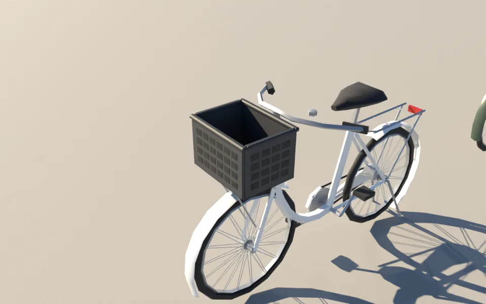

老鐵馬（擋泥板、貨架黑烤漆＋一塊一塊的鏽；第一版整個下緣都是鏽，像廢棄車，改掉）：
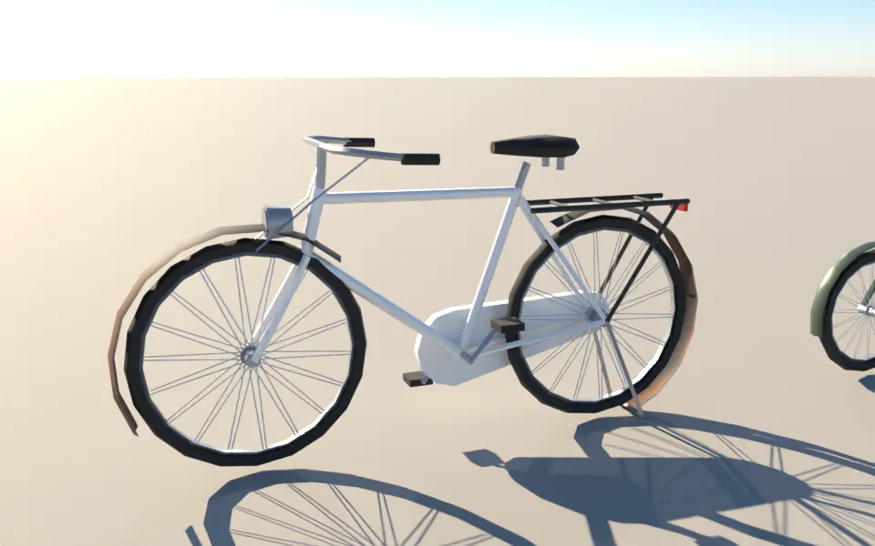
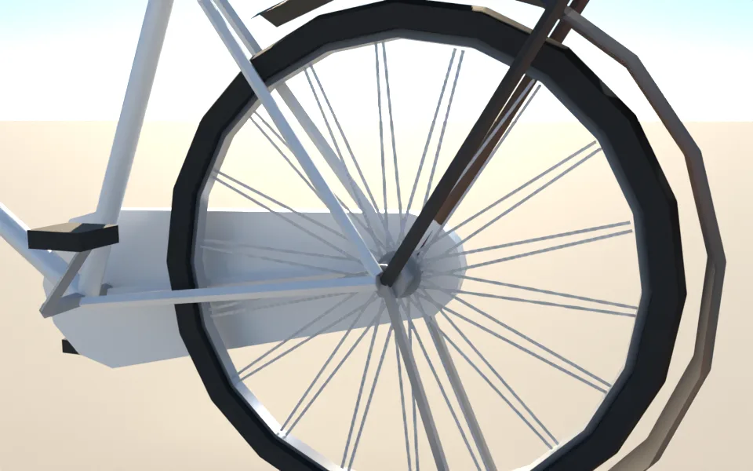

籃子裡的東西（塑膠袋、摺疊傘、手搖飲）、拆掉籃子的淑女車：
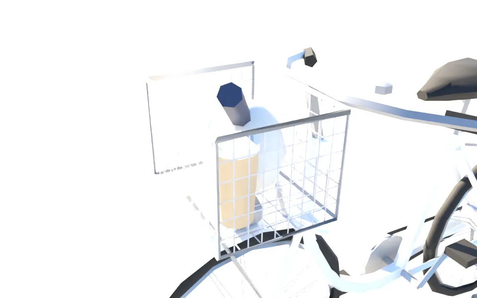
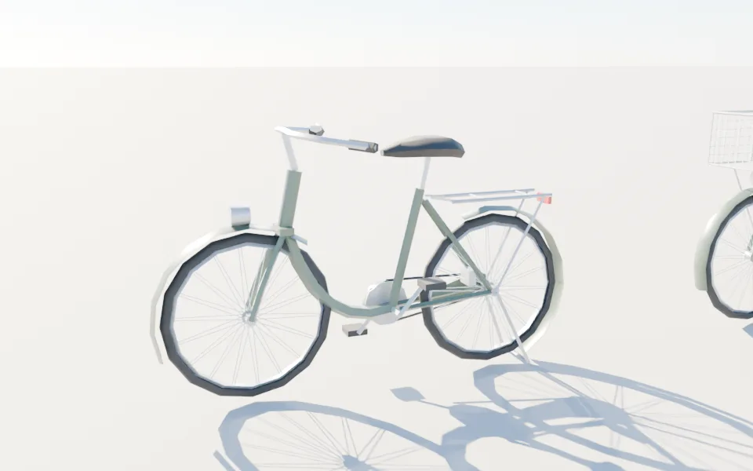

**遊戲內前後**（11:00、1280×720；開發分支 `a39a6812`＋`bikes_v2.patch`＋舊 GLB vs `bikes_v2f.patch`＋新 GLB；Playwright＋SwiftShader，**不是真機**；8 張都沒有頁面錯誤）：
- 校園路邊單停（抽到「籃子裡有東西」的淑女車）：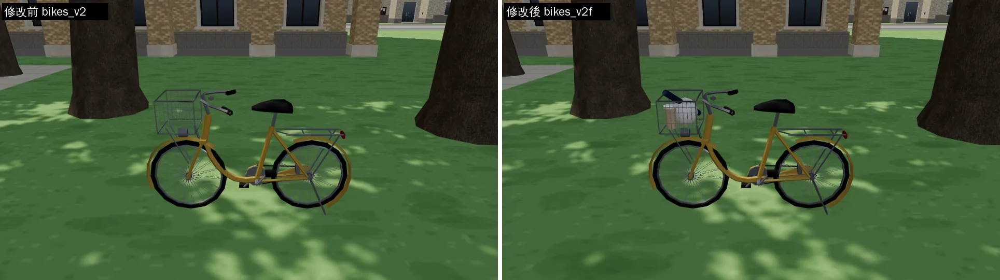
- 校園路邊單停（東側）：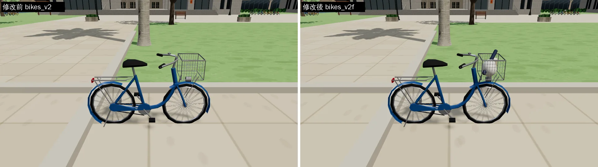
- 校園停車架：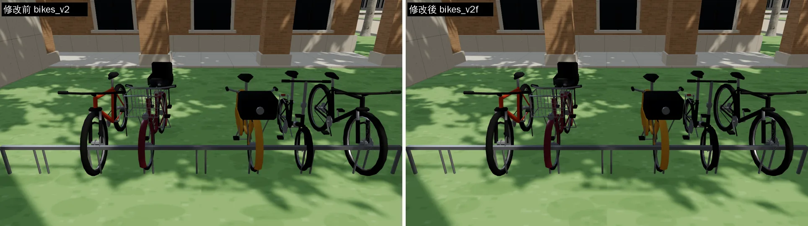
- 牆邊一排九台（中間被樹幹擋住；左右兩端看得到款式混搭）：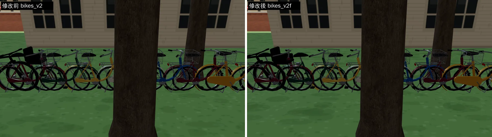
- **注意**：遊戲內這 4 組是塑膠籃「蓋子」、老鐵馬「整片鏽」修正**之前**的 GLB 拍的（`2de7d2de`），而且這四個鏡頭剛好沒有塑膠籃和老鐵馬；修正後的樣子看上面的 Blender 渲染。整合後在遊戲裡補拍。

## 3. 八項（ART_SOP 3-2）
| 項目 | 結果 | 說明 |
|---|---|---|
| 輪廓與倒角 | 通過 | 塑膠籃五片板＋上緣框都是倒角方塊（r 5～6 mm）、四面格孔；塑膠袋是變形的橢球（上半塌向一邊）；傘、杯是圓柱 7～10 邊 |
| 材質 | 通過 | 新材質 `bike_oldmetal`（頂點色、粗糙度 0.75）；`bike_metal` 金屬度 0.55 → 0.45（符合上限） |
| AO | 沒做 | 和原本的腳踏車一樣靠遊戲陰影 |
| 磨損 | 部分 | 老鐵馬：一塊一塊的鏽（低處、末端多）＋褪色車架色；其他車還是新的 |
| 生活痕跡 | 通過 | 籃子裡的東西（`bike_city_load`）、拆掉籃子的車（只剩前燈）、塑膠籃 |
| 比例 | 通過 | 塑膠籃 34×23×26 cm（和鐵絲籃同一個位置與大小）；傘長約 37 cm、飲料杯 15 cm 高 |
| 效能 | 通過 | 每台 1,374～2,598 三角形（塑膠籃 2,598 最多，SOP 小道具 0.5～3k）；停車架合併後，有老鐵馬或有東西的那一排各多 1 個 draw call |
| 遊戲截圖 | 部分 | 4 組前後（見上，修正前的 GLB）；整合後補拍塑膠籃、老鐵馬 |

## 4. 測試
- `node --check`（world3d.js、zones3d.js）、`py_compile`（street_props_integration.py）通過。
- **`tests/street_props_integration.py` 沒有跑**（瀏覽器排隊中、而且 bikes_v2 原本就有的 broken 組失敗和腳踏車無關，見第 7 節）；請 LAWWW 整合時跑。
- 兩份 patch 依序對 `a39a6812` `git apply --check` 都通過：`scooters_v2_a39a6812.patch` → `bikes_v2f.patch`。
