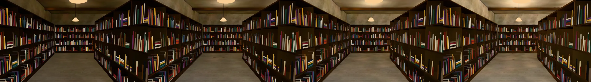
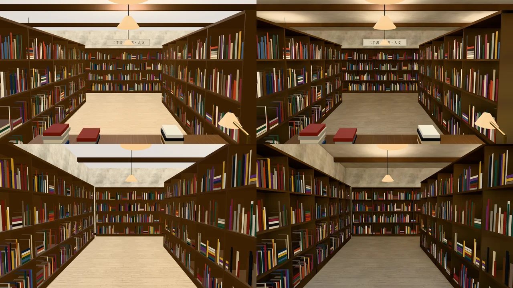
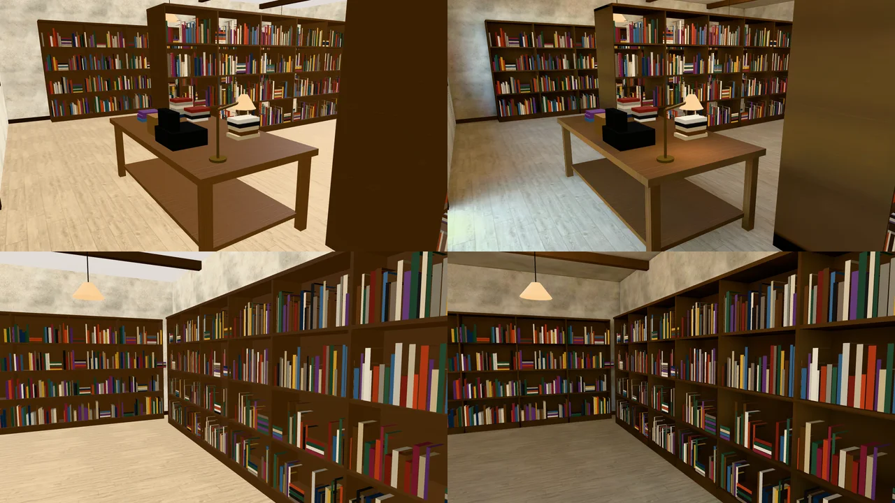
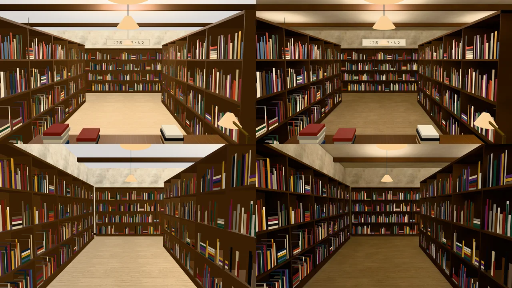
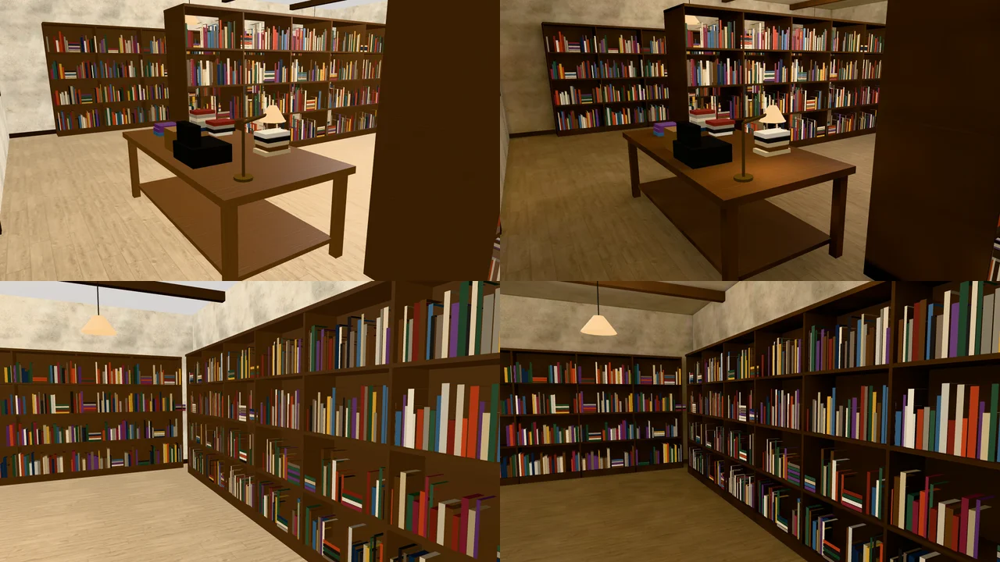

# 舊路書房（二手書店）室內光照烘焙（INTERIOR-AAA-REVIEW-1028；LAWWW2-B 2026-10-31）

- **起因**：INTERIOR-AAA-REVIEW-1028 第 5 節 P1（光照）。照「玩家多常去」的順序，便利商店（已整合 `d5bfed485`）之後是書店（LAWWW-B 09:07 同意）。
- **狀態**：`READY_FOR_ART_REVIEW`。建築、場景只有使用者能標 `ART_APPROVED`。
  - 截圖是 Playwright＋SwiftShader（電腦 1280×720），不是實機。
  - 讀檔放位置、藏玩家和 NPC 是 [捷徑]。
- **這一包只做光照（P1）**，擺設（P4）沒做。

## 一、怎麼套（給 LAWWW-B）

1. **換二進位**：
   - `assets/models/env/second_ai/bookstore_interior.glb`（＋`.json`）；
   - 新的 `bookstore_interior_lm_day.webp`、`bookstore_interior_lm_night.webp`。
   - 模型和開發分支一樣（重匯的白模和部署的 GLB 同大小），只多光照 UV 和 extras.lightmap。節點、三角形不變。
   - 開發分支的 `bookstore_interior.json` 統計是舊的（bytes 寫 1,393,400，實際 1,384,772），這次一起更新。
2. **patch**：`docs/art-rebuild/second_ai/patches/bookstore_lm_1031.patch`（對開發 `d5bfed485`；最新 `f79dc8b9e` 也套得上）。
   - `src/zones3d.js` 的 `attachBookstoreInterior` 改一行：有光照貼圖的材質不加補光（`BK_BOUNCE`）。和便利商店 `CVS_BOUNCE` 同一個理由：均勻的自發光會把影子洗掉。
   - 新測試 `tests/bookstore_interior_lm_unit.js`：
     - 光照貼圖兩張都在；
     - 地板、天花板、樑、四面牆、書架、櫃台桌有第二套 UV；
     - 書、燈罩、黃銅、手寫牌照舊即時光；
     - 有光照貼圖時不加補光。
     - 開發分支原樣 FAIL，改後 ALL PASS。
   - 新工具 `tools/blender/env_second/lightbake/bake_bookstore.sh`、烘焙紀錄 `bookstore_interior_lm.json`。

## 二、參數（遊戲內試了四版）

- 燈：七盞吊燈（暖色燈罩，燈罩裡一顆點光源、燈罩頂上漏一點光到天花板）＋櫃台的黃銅檯燈。店面朝東，太陽照不進來，白天只有店面的天光。
- **第一版**（吊燈 30 W、天光 0.5）：整間偏暗，淺色木地板看起來是深咖啡色——D112（不要深色木地板）不能這樣。
  - 原因：四面牆、中間兩排都是深色木書架，光幾乎都被吃掉，光照貼圖平均只有便利商店的四分之一。
- 第二、三版（吊燈 80、160 W）：還是偏暗。
- **定案（第四版）**：
  - 吊燈 400 W、燈罩上面 40 W、天光 2.0；
  - 暖色從 1.0,0.8,0.56 改成 1.0,0.86,0.68（晚上地板太橘）。
- 參數都寫在 `bake_bookstore.sh` 開頭。

## 三、改前改後（同角度；左＝開發分支原樣，右＝光照烘焙）

- 鏡頭：`tools/blender/env_second/shots/bookstore_lm_shots.py`。①門口往裡看 ②左邊走道 ③櫃台桌 ④右牆書架。

### 看得到的差別

- 吊燈底下亮一圈、書架之間的走道暗一點、牆角和天花板邊緣暗。改前整間一樣亮，像攝影棚。
- 晚上是暖色的燈，有二手書店的感覺；櫃台的檯燈照亮桌面。
- 白天店面進來的天光偏冷，地板靠門口那一段比較亮。

### 還不夠的（照實寫）

- **地板比改前暗**：左邊走道的地板取樣白天 (221,194,154) → (131,115,91)，晚上 (203,171,128) → (109,79,35)。
  - 材質照舊是淺色木地板。暗是因為走道兩邊是 2.4 m 高的深色書架，吊燈的光被擋住、被吃掉。
  - 晚上在暖色燈下看起來是蜂蜜色。**要再亮一點的話請說**：可以再加燈、或把書架改淺一點的木色。
- 書（一萬五千多個三角形）照舊即時光：晚上書比旁邊的書架亮一點。
- 擺設（P4）沒做：店員、正在整理的書堆、門口的特價推車。

## 四、檢查、效能

- `lm_squash_scan.py`：朝室內被壓扁 **0 m²**。
- 效能（藏路人；`interior_perf.py` `HIDE_NPC=1`；14:00；SwiftShader，手機實機沒量）：門口、左邊走道各四個方向，draw call、三角形和改前**完全一樣**。
- 光照貼圖兩張共約 170 KB（1024²）。

## 五、測試

- **全部 Node**（開發 `d5bfed485`＋這一包）：**786 過、0 失敗**。
- 對最新開發 `f79dc8b9e` `git apply --check` 通過。
