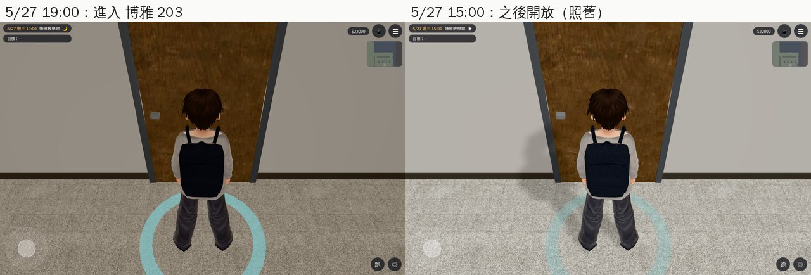
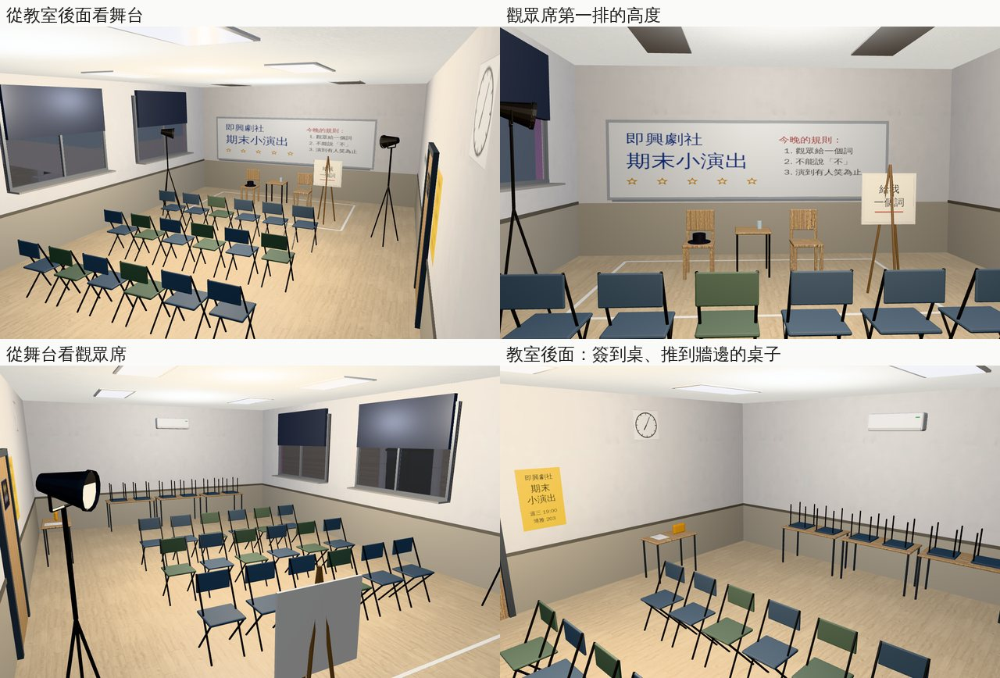
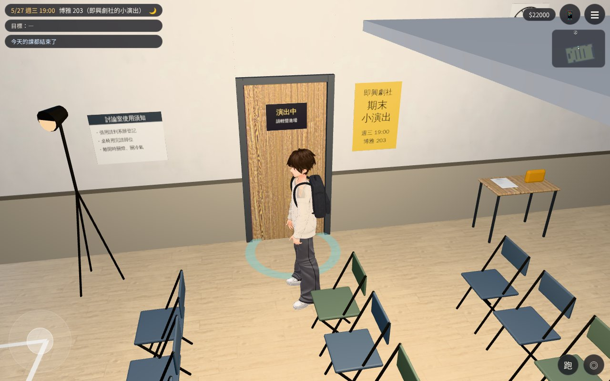

# 博雅 203：即興劇社的期末小演出（AA_399 第 10 節；任務 #82 第四間）

- **企劃**：AA_399 第 10 節（AA-B，企劃線 `5d09bb725`）。
  - 博雅 203：SK07 唐睿的即興劇（`events.js` 的 `ev_sk07_improv`），2026-05-27 19:00，現在是 2D「博雅・教室」。只有那一晚開。
  - 事件原文：「即興劇社借了博雅的教室，辦期末的小演出。品妤坐在第一排，沒有表情。阿哲是被你拉來的。」「輪到『觀眾給一個詞』。」
  - 其他時間：門牌照舊（`boya_layout.js` 的 203「之後開放」）。
- **博雅 103**：不做。LAWWW-B 10-24 06:11 決定照 A：K11 和 BB_105 的「博雅大教室」都用現成的 101，103 照舊關著；房號的事 LAWWW-B 告訴 AA。
- **派工**：LAWWW-B 10-24 03:53（P2），任務 #82 第四間。
- **做的人**：LAWWW2-B。
- **狀態**：`READY_FOR_ART_REVIEW`。場景美術的 `ART_APPROVED` 只有使用者能標。
- **Patch**：`docs/art-rebuild/second_ai/patches/boya_203_1024.patch`，對開發 `7ce1142e2` 做的（前三間已經整合在裡面）。模型在我的分支。

## 做了什麼

- **模型**（Blender bpy，`tools/blender/env_second/boya_203.py` → `assets/models/env/second_ai/boya_203.{glb,json,layout.json}`）：
  - 0.82 MB、9,038 個三角形；房間 10.8 × 6.4 m，和 `boya_layout.js` 的 203（10.9 × 6.5 m）一樣大。
  - 門在走廊那一側的中間，和走廊上那扇門同一個位置。南面三扇窗，窗景借 `boya_2f_south`（203 的窗朝南）。地板淺色木紋。
  - 布置是借來的討論室，臨時改成小劇場：
    - **舞台**（西邊）：地上白色膠帶圍一塊、兩張木椅＋一張小桌（椅子上一頂帽子、桌上一瓶水）。
    - **畫架**：板子寫「給我一個詞」，對著觀眾。
    - **西牆白板**：「即興劇社　期末小演出」「今晚的規則」，加幾顆星星塗鴉。
    - **燈**：兩支三腳架夾燈對著舞台；舞台上面兩盞日光燈關著，只開觀眾席那兩盞。
    - **觀眾席**：三排、每排六張摺疊椅，面向舞台；門那一側留一條走道。
    - **其他**：原本的桌子推到東牆、椅子倒放在桌上；教室後面一張小桌放簽到表、一袋零食；門的裡面貼「演出中　請輕聲進場」；門邊的海報（週三 19:00、博雅 203）；討論室使用須知、時鐘、冷氣。
    - **窗**：深色捲簾拉下一半（晚上）。
  - 字都是虛構的一般用語（社團、演出是遊戲裡的；沒有真實社團名稱、商標）。白板上「今晚的規則」三條是布景，AA 要改字就改 `make_tex()`。
- **配置**（`room_glb_layouts.js` 的 `boya_203`）：
  - `open`：`{days:['2026-05-27'], dayHours:[18.5,21.5], daysOnly:true}`。只有那一晚 18:30～21:30 開。
    - 那一天＝大一下第 14 週週三，就是 SK07 排的那一晚（`story3d.js` 的 `termDay('Y1S2',14,3)`）；測試有核對。
  - `spots`（劇情放人用）：
    - `tang`：唐睿，舞台中間、道具前面，面向觀眾。
    - `member`×2：舞台邊的社員、簽到桌旁的社員。
    - `pinyu`：品妤，第一排正中間。
    - `me`：玩家，品妤旁邊。
    - `zhe`：阿哲，玩家另一邊。
    - `audience`：其他觀眾，坐姿。
  - `interact`：白板、畫架、簽到表（顯示的字等 AA 寫，現在顯示名稱）。
  - `back_spawn`：「離開 203」回到博雅 2F、203 門前面（lv 1）。
- **程式**：
  - `rooms_glb3d.js`：`open` 多一個 `dayHours`，`days` 那幾天只在這段時間開。研討室 B、系辦、考場的設定沒有 `dayHours`，行為不變。
  - `teach3d.js`：關著的房間如果有正式房間（`ROOM_GLB_LAYOUTS` 的 `host_door`＝`{zone:'boya', id:'203'}`），門口是兩個互動點，照時段藏一個：
    - 開放時段：「進入 博雅 203」；
    - 其他時間：原本的「博雅 203 討論室（之後開放）」。
    - 其他關著的房間（103、普通、共同的）照舊。

## 給劇情接線（LAWWW-B）

- SK07 那一晚：玩家從博雅 2F 走進 203，坐 `spots.me`；品妤、阿哲、唐睿照 `spots` 放。對話照現在的 `ev_sk07_improv`（背景從 2D `classroom_small` 換成 3D）。
- 沒去的那條（品妤 21:30 傳影片）不用改。
- 博雅前的海報（另一個觸發，`events.js` 的註解說「海報是場景的東西」）：還沒做。要的話我做。

## 截圖（遊戲內，Playwright＋SwiftShader；不是 iPhone 實機）

開發 `7ce1142e2`＋這份 patch，2026-05-27（三）。每張的 `post` 都確認：區域、最近的互動點、開放時段、正式模型載入。

### 博雅 2F 走廊的門：19:00「進入 博雅 203」、15:00 照舊

### 房間（從教室後面、從觀眾席、從舞台、往教室後面）

### 玩家進門的畫面（跟隨鏡頭）

## 測試

- `tests/boya_203_unit.js`（新，15 項；改之前第 1 項就失敗）：
  - 區域、正式模型；
  - 開放時段：
    - 2026-05-27＝大一下第 14 週週三；
    - 那一晚 18:30、19:00、21:00 開；
    - 同一天 12:00、18:00、21:30、23:00 關；
    - 前一天、後一天、前後一週的週三關。
  - 博雅 2F 的 203 門：
    - 那一晚只有「進入 博雅 203」；
    - 同一天下午、隔天只有原本的門。
  - 進去的落點＝spawn；回來的落點＝門口的互動點，站得住。
  - 其他關著的房間照舊。
  - 引擎的 `simWalk`：
    - 18 個座位的走近點、白板、畫架、簽到表、出口都從門口走得到；
    - 品妤、玩家、阿哲、觀眾都坐在座位上；
    - 唐睿、社員站得住；
    - 唐睿面向觀眾。
- 開發 `7ce1142e2`＋這份 patch：用到 `teach3d`／`rooms_glb3d`／`room_glb_layouts` 的 25 個單元測試都 ALL PASS（包括前三間的 `wancai_semb_unit`、`linze_office_unit`、`gongtong_3f_unit`，以及 `teach_doors_unit`、`nav_teach_unit`、`rooms_glb_unit`、`x78_rooms_unit`）。

## 截圖時改的

- 第一輪截圖找到兩個問題，都修了：
  - 畫架板子的字左右反了（鏡像）：貼圖四個角的順序改過來。
  - 三腳架燈的燈面是米色圓盤，從觀眾席看像一顆蛋：燈罩加長、前緣加一圈黑框、燈面改成暖白、加 U 形支架。
- 倒放在桌上的椅子沒有椅背（椅背會卡進桌面）：是背景，先這樣。

## 還沒做／已知

- 人（唐睿、社員、品妤、阿哲、觀眾）沒有放：位置在 `spots`（LAWWW-B）。
- 「看」的字等 AA 寫。
- 走廊上的門畫的是關著的門（開放時段也一樣），走近按「進入」就進去。
- 手機效能沒實測（這間 9,038 個三角形、繪製呼叫 36～46）。
