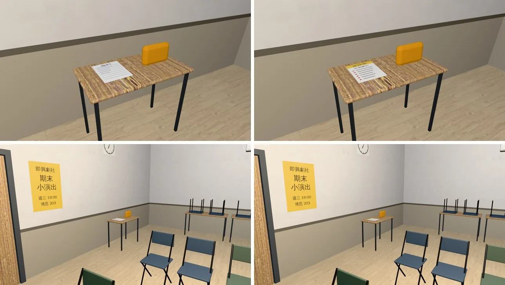
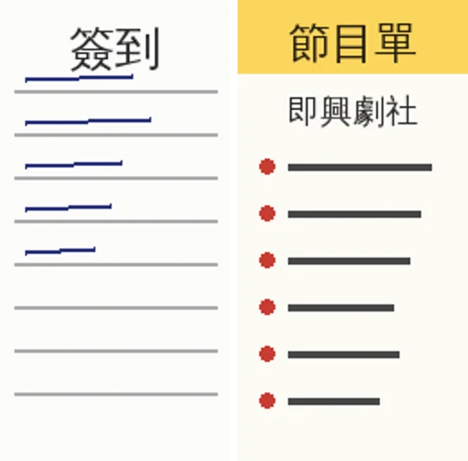

# 博思 203（即興劇社的小演出）：桌上的簽到表換成節目單（ATTEND-ROLLCALL-1102 的美術小項；LAWWW2〔帳號 A〕2026-11-02）

- **起因**：LAWWW 11-02 06:05（P2）。
  - 使用者 11-02 決定「非上課的簽到只留補習班」（AA_574，企劃線 5964f6be5）。
  - 劇社演出那間教室桌上的「簽到表」貼圖拿掉或換成節目單；遊戲裡的「簽到表」互動由 LAWWW 拿掉。
- **狀態**：交件，給 LAWWW 整合。
  - 場景美術由 BB 驗收（D120）。
  - 截圖是 Playwright＋SwiftShader（電腦 1280×720），不是實機。
  - 讀檔放位置、藏玩家和 NPC 是 [捷徑]。

## 改了什麼

1. **貼圖**（`tools/blender/env_second/boya_203.py`，`boya_203_print.png` 的那一格）。
   - 教室後面小桌上的「簽到」換成「節目單」：
     - 黃色抬頭，和門口海報同一色；
     - 「即興劇社」；
     - 六行印刷的節目，小到看不清楚的灰色橫條，沒有寫新的劇情內容。
2. **配置**（`boya_203.layout.json`）。
   - 拿掉互動點 look `signup`（「簽到表」）。
   - 桌子的導航阻擋 `why` 改成 `program_table`，位置、大小不變。
   - 桌旁社員的備註改成「節目單桌旁的社員」。
   - 其他互動點、座位、出口、站位都沒動。
3. **GLB 重匯**。
   - 25 個網格、三角形和部署中的 `boya_203.glb`（`249b7e60`）完全一樣，材質名稱一樣，只差貼圖。
   - 先用沒改的腳本重匯過一次確認：除了貼圖編碼，和部署中的相同。部署中那個是 D115 用 `glb_patch.py` 換貼圖的版本，貼圖上的字已經是「博思」。
   - 新檔：833,840 bytes，md5 `a05ab163998527eadf1cd0d958d37689`。

## 怎麼套（給 LAWWW）

1. 換二進位（從我的分支 `claude/second-ai-env-art` 拿）：
   - `assets/models/env/second_ai/boya_203.glb`
   - `assets/models/env/second_ai/boya_203.layout.json`
   - `assets/models/env/second_ai/boya_203.json`
2. `src/data/room_glb_layouts.js` 的 boya_203 那一筆照新的 layout 換掉。
   - 有 patch：`docs/art-rebuild/second_ai/patches/boya_203_program_1102.patch`。
   - 檔案是一整行，patch 有 157 KB；在 `f2105305b`、`94c89e8e6` 都 `git apply --check` 乾淨。
   - 如果你那邊已經改過這個檔，用下面這段重新產生 boya_203 那一筆比較穩：

```
python3 - <<'EOF'
import json
p='src/data/room_glb_layouts.js'; s=open(p).read(); i=s.index('{'); j=s.rindex('}')
D=json.loads(s[i:j+1]); D['boya_203']=json.load(open('assets/models/env/second_ai/boya_203.layout.json'))
open(p,'w').write(s[:i]+json.dumps(D,ensure_ascii=False)+s[j+1:])
EOF
```

3. 「簽到表」的互動、台詞由你那邊拿掉。配置裡已經沒有 `signup`。

## 改前改後（左＝開發分支原樣，右＝改後）

- 上：教室後面的小桌（近看）；下：從舞台那一邊往門口看。19:36。



- 貼圖那一格（左＝原本的「簽到」，右＝節目單）：



## 測試

- 開發分支最新 `94c89e8e6`＋新 GLB、layout、`room_glb_layouts.js`：
  - 用到 boya_203 或 `ROOM_GLB_LAYOUTS` 的 19 支 Node 全部 ALL PASS：
    - `boya_203_unit`、`rooms_ab3_people_unit`、`rooms_glb_unit`、`aa399_closed2_unit`、`class_teacher_unit`、`dorm_205_unit`；
    - `dorm_laundry_unit`、`gongtong_3f_unit`、`library_media_unit`、`linze_office_unit`、`loadgen_locks_unit`、`phone_unify_unit`；
    - `room_map_labels_unit`、`us_bed_c_unit`、`us_lawlib_2f_unit`、`us_life_unit`、`wancai_semb_unit`、`windowless_night_unit`、`x78_rooms_unit`。
  - `boya_203_unit` 第 6 項的說明文字還寫著「簽到表」，不影響判斷（它照配置的互動點逐一走一遍；`signup` 拿掉以後少走一個）。
    - 要不要改那行字是你的檔，我沒動。
- 沒跑：全部 Node、瀏覽器的真實流程。這次只改了貼圖和配置裡的一個互動點，導航格沒變。
