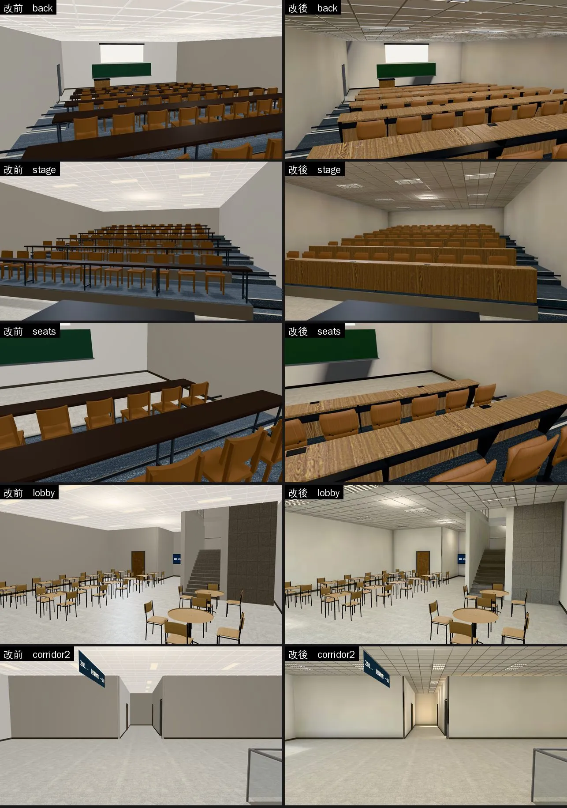
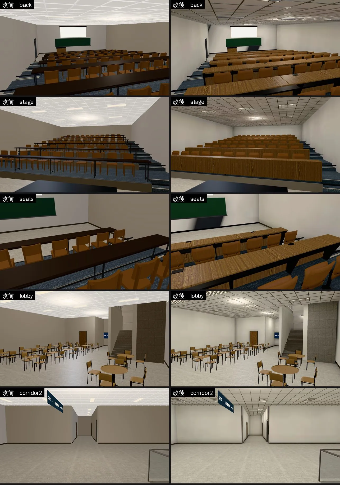
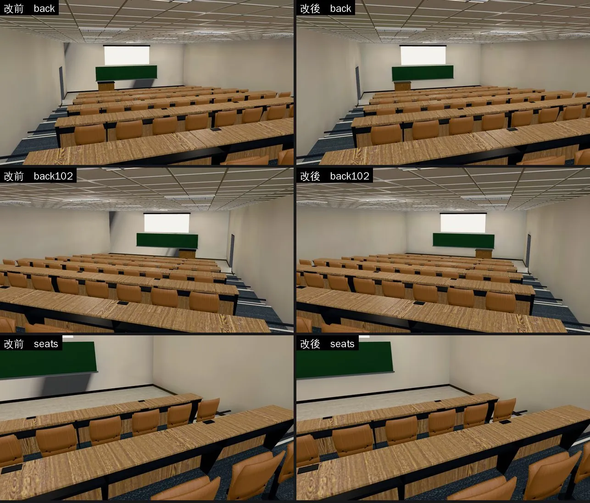
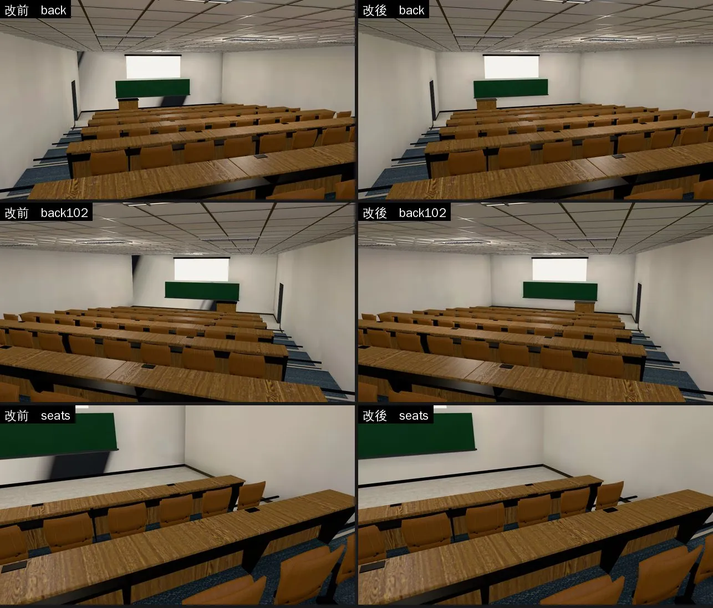
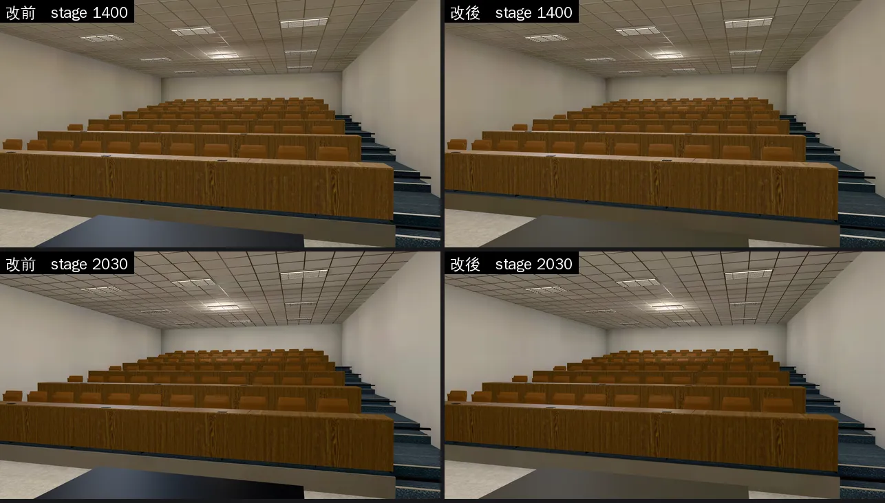

# 博思教學館室內：階梯教室換桌椅、天花板換燈具、光照烘焙（BOYA-LM-1030；LAWWW2-B 2026-10-30）

- **起因**：
  - LAWWW-B 10-30 派工：D99 第一優先是經濟系那一年；照 `INTERIOR_AAA_REVIEW_1028.md` 第 5 節，P1 光照＋P5 燈具。
  - 經濟系第一堂經原就在博思 101。
  - 派工內容：
    - 101／102 階梯教室＋走廊光照烘焙。
    - 照 202 v2 換家具、天花板（翻椅、輕鋼架＋T5）。
    - layout、座位、碰撞都不動。
- **狀態**：`READY_FOR_ART_REVIEW`。建築、場景的 `ART_APPROVED` 只有使用者能標。
- **截圖條件**：
  - 遊戲內固定鏡頭（藏玩家、NPC），1280×720。
  - Playwright＋SwiftShader 模擬，**不是 iPhone 實機**。讀檔放位置是 [捷徑]。
  - 改前＝開發 `dd8b216c0` 原樣；改後＝開發 `dd8b216c0`＋這一包。

## 一、交付

| 檔案 | 內容 |
|---|---|
| `assets/models/env/second_ai/boya_interior.glb` | 101／102 的長桌、翻椅（新）；T5 格柵燈具；多一套 UV（TEXCOORD_1）、`extras.lightmap`。1.32 → 4.51 MB |
| `assets/models/env/second_ai/boya_interior_lm_day.webp`、`_night.webp` | 光照貼圖 1024，76 KB＋67 KB |
| `assets/models/env/second_ai/boya_interior.json` | 統計（三角形 11,384 → 76,602） |
| `docs/art-rebuild/second_ai/patches/boya_lecture_furn_1030.patch` | **要套**：`src/teach3d.js`＋兩支測試（下面說明） |
| `tools/blender/env_second/teach_interior.py` | 產生器：階梯教室桌椅、燈具（`--set boya`；普通照舊） |
| `tools/blender/env_second/lightbake/bake_boya.sh`、`boya_interior_lm.json` | 建模＋烘焙＋WebP（512 取樣約 30 分鐘）、這次的參數紀錄 |
| `tools/blender/env_second/shots/boya_lm_shots.py`、`boya_perf.py`、`boya_fold_check.py` | 截圖鏡頭、效能量測、翻椅功能檢查（遊戲內） |

- **patch（`boya_lecture_furn_1030.patch`，對開發 `dd8b216c0`，`git apply --check` 通過）**：
  - `src/teach3d.js`：
    - 階梯教室的備用方塊桌椅（Z3.desk／Z3.chair）放進自己的群組 `lecture_furniture`（一間一組）。
    - 正式模型裡有 `SEATPANS` 時，整組藏起來，並接上 `Z3.seatFold`：沒有人坐的椅面掀起來，和法律系館A 201 同一套。
    - 沒有正式模型（載入中、載入失敗）時照舊是方塊桌椅。座位、導航、互動點都不變。
  - `tests/desk_furniture_unit.js`：C 項原本到 `furniture0` 底下找 101 的長桌量高度，現在長桌在 `lecture_furniture` 底下。只改找的地方，量法不變。
  - `tests/boya_lecture_glb_unit.js`（新）：檢查模型和配置對得上。
    - ① 節點沒有被合併。
    - ② 132 個座位都分得到椅面頂點，用 seatFold 的分組規則。
    - ③ 12 排長桌的桌面都在平台上 0.75 m。
    - ④ 光照貼圖兩張都在。
    - 開發分支原樣 4 項全 FAIL；這一包 ALL PASS。
- **光照**：`attachFormal` 看到 `extras.lightmap` 就接，和法律學院圖書館同一套，不用另外改程式。

## 二、改了什麼

### 1. 階梯教室（101、102）：長桌、翻椅做進模型（照法律系館A 201 v2）

- **原本**：遊戲用方塊拼的桌椅。
  - 很深的長桌（#3b3330）。
  - 木頭方塊椅，每張一模一樣、都是放下的。
- **翻椅（132 張）**：
  - 結構：地上的固定座、中柱、轉軸座，模壓夾板的椅背（弧形、往後仰、左右往前包），兩支斜撐托住椅背下緣。
  - 椅面另外一個網格（`SEATPANS`）：
    - 沒有人坐的掀起來；有人坐（玩家、同學、遠處的替身）就放下。
    - 人離開 0.5 秒後再掀回去。
  - 椅面上緣 0.475 m（和 201 一樣，坐姿高度不變）。
- **長桌（每排 8 m、12 排）**：
  - 桌板：淺橡木色木紋美耐板，分四段（看得到接縫）、圓角。
  - 擋板朝講台，也是木紋。
  - 桌腳：懸臂鋼板，在兩個座位中間，膝蓋不會撞到。
  - 桌下有置物架，桌上有電源盒（兩個位子共用一個）。
  - 桌面在平台上 0.75 m（`LECT_DESK_TOP`，替身的手、桌上小物照這個高度）。
- **試做時改掉的兩點**：
  - 第一版桌面用對比很高的木紋，看起來斑斑點點、像髒的；擋板深灰，從講台看是一條條黑帶。
  - 第一版椅背後面是一根直管＋固定板，從後排看每張椅背都是一個黑十字。

### 2. 天花板：T5 格柵燈具（兩層樓）

- **原本**：1.2×0.3 的平板燈貼在格子上，對不上格子線。
- **現在**：
  - 1.2×0.6 的格柵燈具，佔兩格：外殼、發光面、格柵，和 202、多功能教室同一套。
  - 格子線改成 x＝0.6k、z＝0.6k＋0.1，配置的燈位剛好落在格子裡。只有 z 7.2 那一排移到 7.0。
  - 發光面單面朝下（`room_ceiling_unit.js`）。

### 3. 光照烘焙（512 取樣）

- **燈**：
  - 每盞燈具一個 1.14×0.54 的面光源：一樓 14 W（天花板 4.2 m）、二樓 12 W（3.8 m）。
  - 每盞燈具下方 0.9 m 再加一顆 8 W 的點光源（理由見「試烘焙」第三點）。
- **白天**：
  - 天光＋下午的太陽（方位 200°、仰角 38°），從大廳南面的窗、二樓南北兩排長窗進來。
  - 燈照樣開。
  - 101／102 沒有窗：白天、晚上都只有燈（真的階梯教室也是這樣）。
- **晚上**：只有燈。
- **照舊即時光**：
  - 桌椅（椅面會掀起來，不能烘）、燈具、格柵、輕鋼架、鋼件、窗框、止滑條、小零件。
  - 晚上的亮度由已整合的 RT-NIGHT-1028 跟著調暗。
- **試烘焙（64 取樣，三次）**：
  - 第一次：101／102 的天花板整片暗、偏咖啡色。燈只往下照，天花板只吃到木桌、地毯反彈上來的光，遊戲裡看起來像髒的。
  - 第二次：燈具下方 0.4 m、3 W 的點光源，結果天花板上只有一個一個小亮點。
  - 第三次：改成 0.9 m、8 W，天花板在燈的四周亮一圈、整體是灰的。正式版用這個。

## 三、改前改後（同鏡頭；左＝改前、右＝改後）

五個鏡頭：
- 101 最後一排往講台看；
- 101 講台往座位看；
- 座位近看（翻椅、長桌）；
- 一樓大廳；
- 二樓走廊。

- **階梯教室**：
  - 方塊椅、很深的長桌，換成翻椅（沒人坐的掀起來）和木紋長桌。
  - 天花板看得到一盞一盞的格柵燈具。
  - 牆角、桌子底下、講台後面的牆有陰影；原本整間一樣亮。
- **大廳**：南面的窗那一側比較亮、樓梯間比較暗；天花板燈具的四周亮一圈。
- **二樓走廊**：有遠近深淺，走廊盡頭被燈照亮；原本一整片平的。
- **晚上**：階梯教室和白天差不多（沒有窗）；大廳、走廊比白天暗一點。

## 四、測試、效能

- **全部 Node**：測試樹＝開發 `dd8b216c0`＋這一包＋patch；企劃線已 fetch。**771 支過、0 支 FAIL**，含新測試 `boya_lecture_glb_unit.js`。
  - 第一次跑是 768／2：`room_ceiling_unit`（發光面不是單面朝下）、`desk_furniture_unit`（長桌換了群組）。兩支都修了，見上面。
- **翻椅功能（遊戲內，`boya_fold_check.py`）**：
  - **ALL PASS**：
    - 正式模型＋光照貼圖接上、備用方塊桌椅兩組都藏起來。
    - 132 張都分到椅面、沒人坐的掀著。
    - 玩家坐下的那一張放下、其他照舊；起身後掀回去。
  - 開發分支原樣：FAIL（沒有 SEATPANS、沒有光照貼圖）。
  - [捷徑] 坐下是直接設定座位，不是走過去按互動。
- **效能**：`boya_perf.py`，玩家鏡頭，前、左、右、後四個方向，14:00。SwiftShader 量的，**手機實機沒有量**。

| 位置 | draw call（改前 → 改後） | 三角形（改前 → 改後） |
|---|---|---|
| 一樓大廳（入口） | 136／139／131／133 → 139／138／130／128 | 16.6／17.3／17.7／18.8 萬 → 18.6／17.4／17.8／16.9 萬 |
| 101 講台前 | 111／100／154／122 → 110／99／157／121 | 15.3／15.6／15.9／14.3 萬 → 15.3／15.6／17.8／14.3 萬 |
| 101 最後一排 | 131／138／88／88 → 128／139／85／85 | 15.3／15.5／13.7／13.7 萬 → 15.1／17.2／13.5／13.5 萬 |
| 二樓走廊 | 158／157／121／125 → 155／154／122／122 | 17.1／17.4／17.0／17.9 萬 → 17.0／17.2／18.7／17.7 萬 |

- draw call 差不多（多數少 1～3 次）。
- 三角形：最多多 2 萬（看得到整間階梯教室的方向）。
  - 模型本身 1.1 萬 → 7.7 萬，多出來的大多是 132 張翻椅（椅面一個網格 2.2 萬）。
  - 遊戲原本的方塊桌椅藏起來，不畫。
- 檔案 1.32 → 4.51 MB。大部分是椅子、桌腳的網格（沒有用壓縮：專案的 GLB 都沒有 meshopt／Draco）。

## 五、還沒做到的

- 人物、桌椅照即時光：晚上人物、桌子會比旁邊的地板亮一點，和 Café、宿舍 203、法律學院圖書館一樣。
- 烘焙的太陽不會動：白天都是下午的位置。
- 二樓 201／202 平面教室的桌椅照舊是遊戲的方塊桌椅（這次的範圍是 101／102＋走廊）。
- 生活感擺設（檢討報告 P4：桌上的書、水壺、外套）這一輪沒做。
- 椅子沒有做低面數版本（`_lod1`）：鏡頭看到整間階梯教室時三角形多 2 萬。實機如果吃緊，可以再做。

## 六、BB-B n19 兩點（10-30 第二次交件，和 SOCLIB-LM-1030 一起）

- **起因**：BB-B n19 看了第一次交件的畫面，兩點：
  1. 講台往座位那幾張講桌，桌面很深、接近黑。
  2. 晚上 20:30，101 講台前（講桌右邊、黑板右半邊底下到地上）一塊深藍色、斜的影子。
- LAWWW-B：「是問題的話，排在 SOCLIB-LM 之後順手修，一起交件就好」。兩點都是問題，都修了。
- **截圖條件**：遊戲內固定鏡頭（藏玩家、NPC），Playwright＋SwiftShader，**不是 iPhone 實機**。改前＝開發 `753e32cd3`（第一次交件已整合 a63eb8072）原樣；改後＝開發 `753e32cd3`＋這一包。

### 1. 講桌桌面

- 原本是深色美耐板 `tb_dark`（#26282b），和黑板邊框同一個材質。
- 改成深灰美耐板 `tb_lectern_top`（#5c5953）：還是看得出是講桌桌面，不是一塊黑的。只改博思（`--set boya`）。

### 2. 講台前斜的深色影子：烘焙工具的 bug（不是燈的問題）

- **一開始以為是燈**：補光的點光源半徑 6 cm 太硬，改成 60 cm（`bake_room.py --points` 第 8 個數）重烘。影子還在。
- **查出來的原因**：
  - 講台那面牆（101、102 都是）是一整片 11.6 × 4.8 m 的四邊形，兩個三角形，從左下到右上一條對角線分開。
  - `bake_room.py` 烘完以後，會把「夾在零件中間、烘成全黑」的面收成一點（男一舍門框上方那種點狀黑線的修法），原本只看面中心那一個像素。
  - 右下那個三角形（28 m²）的中心剛好在黑板後面（被黑板擋住，黑的），整個三角形被收掉。
  - 後處理 `lm_fix_hidden.py` 再把它接到共用的那條邊（對角線）上：右下半面牆的光，變成對角線那一條光往旁邊拉開——就是那塊從黑板右半邊底下斜到地上的深色影子。
  - 白天也有，晚上牆比較暗、比較看得出來。
- **改法**：`collapse_black` 判斷「全黑」改成看整面（中心、角、邊的中點，大的面再加一張格子，取最亮的），和 `lm_fix_hidden.py` 一樣。重烘。
- **結果**（`tools/blender/env_second/lightbake/lm_squash_scan.py`：朝室內、看得到、光照被壓扁的大面）：
  - 開發分支原樣 148 m²（101、102 講台那面牆各 28 m²、大廳樓梯旁的隔間牆 58 m²…）→ **56 m²**。
  - 剩下的是平台立面（桌子正後面）、樓梯旁的石材（樓梯後面 20～30 cm）：整面真的全黑、照不到光的面，`lm_fix_hidden.py` 照原本的做法接到旁邊同方向的面，不是這個 bug。
- 社科圖地板一半也是同一個原因（`soclib_lm_1030/README.md` 第二節第 3 點）；其他已經交的房間清單也在那裡。

### 3. 改前改後

三個鏡頭：101 最後一排往講台看、102 最後一排往講台看（新加的鏡頭，和 101 左右對稱）、101 座位近看。

講桌桌面（101 講台往座位看）：

### 4. 測試

- 全部 Node：**772 支過、0 支 FAIL**（測試樹＝開發 `753e32cd3`＋這一包＋SOCLIB-LM-1030，兩包一起；見 `soclib_lm_1030/README.md` 第四節）。含 `boya_lecture_glb_unit.js`、`room_ceiling_unit.js`、`desk_furniture_unit.js`。
- 效能：模型、三角形數沒變（講桌桌面只換材質、修 `collapse_black` 只改光照 UV），沒有重量。
- 只換二進位（`boya_interior.glb`、兩張光照貼圖、`boya_interior.json`），不用改程式、不用套 patch。
