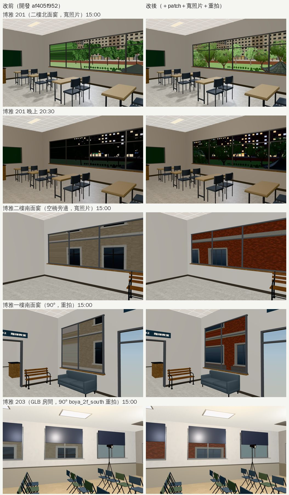

# 博雅教學館：窗外景改寬照片＋過時的照片重拍（#85，接著 #61 的普通、共同）

- **來源**：
  - 普通、共同的教室窗景（`teach_views_1024`，LAWWW-B 已整合 `aef97e506`）做的時候發現：90° 的照片斜著看長窗，會在照片的左右邊拉出一條條橫紋。
  - LAWWW-B 09:52：博雅同做法重拍，排在經濟系路線截圖之後。
- **做的人**：LAWWW2-B。
- **狀態**：`READY_FOR_ART_REVIEW`。場景美術的 `ART_APPROVED` 只有使用者能標。

## 做了什麼

1. **二樓的長窗改用寬照片**：
   - 南面 7 m、北面 201／202 各 8.2 m。
   - 新照片 `boya_2f_south_w`、`boya_2f_north_w`：2048×512、水平約 127°，用 `tools/blender/env_second/shots/boya_views.py` 拍。
   - 配置（`tools/layout/boya_layout_gen.py`）的二樓窗改成 `_w`＋`photoWide`。
   - `teach3d.js` 的 `photoWide` → `sxy (0.5, 1)` 已經在開發分支（`aef97e506`），這次不用改程式。
2. **一樓南面兩扇窗照舊用 90°**：每扇只有 3 m；寬照片會拍到博雅自己的門廊，左右邊是黑色的直條。
3. **兩張 90° 的照片重拍**：`boya_south`、`boya_2f_south`。
   - 舊照片拍的是普通教學館以前的套件外觀（米色）。
   - 現在遊戲裡普通是紅磚的正式模型（`campus_putong.glb`），從博雅往南看到的應該是紅磚。
   - `boya_2f_south` 博雅 203（即興劇社的教室，GLB 房間）也在用，所以 90° 的版本保留、只重拍。
   - `boya_2f_north`（90°）沒有用到，沒重拍。

## 交付

- **照片**：
  - 新的：`assets/models/env/views/boya_2f_south_w_{day,night}.webp`、`boya_2f_north_w_*`；
  - 重拍：`boya_south_*`、`boya_2f_south_*`；
  - 一共 8 張。
- **patch**：`docs/art-rebuild/second_ai/patches/boya_views_wide_1024.patch`，對開發 `af405f952`：
  - `boya_layout_gen.py`＋重新產生的 `src/data/boya_layout.js`，只有 `windows` 變；
  - 先用沒改的產生器重跑，和開發分支一模一樣。

## 截圖（遊戲內，Playwright＋SwiftShader；不是 iPhone 實機）

開發 `af405f952`，經濟系那一年 10/15（二）。左邊改前，右邊改後。

## 測試

套上 patch 以後：

- `boya_203_unit`、`boya_lecture_unit`、`nav_teach_unit`、`teach_cam_walls_unit`、`teach_class_unit`、`teach_doors_unit`、`teach_perf_unit`、`classes_unit`、`indoor_crowd_unit`：ALL PASS。
- 繪製呼叫和改前一樣（同一個鏡頭）。

## 還沒做／已知

- **博雅 203**：GLB 房間的窗（`zones3d.js` 的 `room()`）沒有 `sxy`，照舊 90°。窗小、分開，看不到橫紋。
- **手機效能沒實測**：兩張寬照片多約 0.5 MB 的貼圖。
