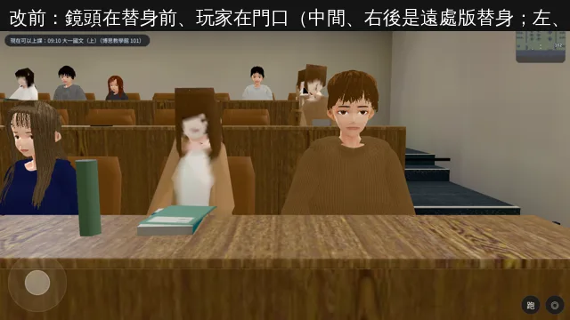
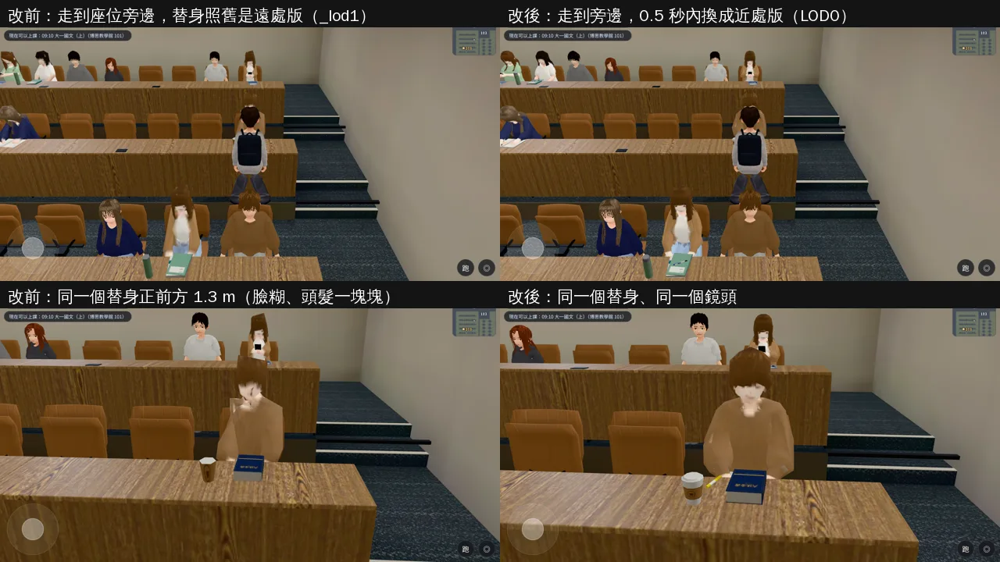

# 博思 101 上課時「披頭散髮很可怕」的同學（BUG-03／C24；LAWWW2-B 2026-11-01）

- **起因**：使用者 10-15 第 17 項：「博雅 101 國文課：郭沛珊有說話，但上課前教室沒人、一下課就坐滿，很多人固定在那邊，披頭散髮很可怕。」LAWWW-B 11-01 02:53 派工（P2）。
  - 「上課前沒人、一下課坐滿」另外已經修過（`classes3d.js` 的 `arriveFrac`：上課前 10 分鐘陸續進來）；這裡只處理「披頭散髮很可怕」。
- **狀態**：
  - 找到原因、修好，交 patch 和 Node 測試。
  - 截圖是 Playwright＋SwiftShader（電腦 1280×720），不是實機。
  - 讀檔放日期時間、把玩家放到走道是 [捷徑]（SwiftShader 每秒 1～4 張，玩家沿路線走會中途放掉）。
- 沒有改任何人物模型（D99 人物凍結），只改「什麼時候用哪一個版本」。

## 一、看到的是什麼

- 時間地點：大一國文（上），Y1S1 週二上午，博思 101。實拍日 2025-10-07 09:36。
- 教室裡坐著兩種人：
  - 完整的 VRM 同學，最多 16 位：近看正常（第二張圖左右兩位）。
  - 坐姿替身（`seated_figures.glb`，LAWWW2 167fc2d）：每個外型有兩個版本。
    - LOD0：約 1,500 個三角形，給近處。
    - `_lod1`：約 350 個三角形，給 7 m 以外。
- **`_lod1` 近看**：臉糊成一團、頭髮一塊塊垂下來，就是「披頭散髮很可怕」（第二張圖中間、右後）。

## 二、原因

- `src/classes3d.js` 的 `figPlace` **在放替身的那一刻**照玩家位置選版本（7 m 內 LOD0、以外 `_lod1`），**之後不換**。
- 玩家從門口 (0, 6.8) 進教室時，17 個替身全部離門口 7 m 以上，**全部是 `_lod1`**（遊戲內實測：LOD0 0 個、`_lod1` 17 個）。
- 玩家走到座位、坐下以後，旁邊 1～3 m 的替身照舊是 `_lod1`（實測：走到 (−7.95, −3.95)，3 m 內 3 個替身全是 `_lod1`）。
- 對照：玩家先站在那一帶、替身才放好時，旁邊的是 LOD0（15 個 LOD0、2 個 `_lod1`），看起來正常。

## 三、修法（`src/classes3d.js`，只動 figPlace 接模型那一段和 figTick）

- 每種外型（桌上小物也是）建一個 LOD0、一個 `_lod1` 的 InstancedMesh。
- `figTick`（`S.tick` 每 0.5 秒呼叫一次）照**玩家現在的位置**重排：
  - 7 m 內用 LOD0，以外用 `_lod1`。
  - 兩個門檻防止在邊界來回換：走近到 6.5 m 才換成 LOD0，離開到 7.5 m 才換回 `_lod1`。
- 放的那一刻和原本一模一樣：< 7 m＝LOD0。
- 名稱照舊：`<外型>`、`<外型>_lod1`、`desk:<組>`、`desk:<組>_lod1`。既有的測試讀這些名稱，都不用改。
- 這一邊沒有人的 InstancedMesh（`count` 0）設成不畫，下課時判斷「玩家看不看得到替身」也跳過它們。
  - 原因：空的包圍球半徑 −1，區域原點在畫面裡就會被當成「看得到」，替身會一直不拿掉。
  - 第一版 patch 就有這個問題，被新測試第 ⑦ 項抓到，已修。
- 沒有 `_lod1` 的外型，遠的也用 LOD0；桌上小物沒有 LOD0 版本的，近的不放。這兩點和原本相同。
- 效能：draw call 從「每種外型、近或遠其中一個」變成「每種外型兩個 InstancedMesh」，`count` 是 0 的那一個不畫。三角形數照玩家附近幾個替身用 LOD0 增加，最多每個 +1,150。
  - 博思 101 的情形：玩家坐在中間時，7 m 內約 8 個替身，約 +9,000 個三角形。只有走到替身旁邊才會增加，原本放好時離玩家近的就已經是 LOD0。

## 四、改前改後（同一個流程、同一個鏡頭）

- 流程：從門口進教室（上課中，替身已放好）→ 到 (−7.95, −3.95) 的走道 → 等下一次 figTick → 拍兩張。
  - 遊戲鏡頭一張。
  - 同一個替身（`fig_npc_nm3_listen_c0`）正前方 1.3 m 一張。
- 改前那個替身是 `fig_npc_nm3_listen_c0_lod1`，改後是 `fig_npc_nm3_listen_c0`。
- 改後的截圖是第一版 patch 拍的。定案只多兩點，畫面上看得到的替身相同：
  - 空的 InstancedMesh 不畫；
  - 下課判斷跳過空的。

- **還不夠的（照實寫）**：LOD0 近看臉也還是偏糊（替身本來就是低成本的模型，只看得出五官的位置）。要更清楚得改替身模型本身，但 D99 人物凍結，這次不動。
- 遊戲裡是 0.5 秒內換掉（`S.tick` 每 30 格一次）。SwiftShader 每秒只有 1～4 張，要等 7～30 秒，截圖是等到下一次 figTick 才拍的。

## 五、怎麼套（給 LAWWW-B）

- patch：`docs/art-rebuild/second_ai/patches/seated_figures_lod_1101.patch`（對開發 `fb0d24c98`，`git apply --check` 過）。
- 內容：`src/classes3d.js`＋新 `tests/seated_figures_lod_unit.js`。
- 不換模型、不改其他檔。

## 六、測試

- 新 `tests/seated_figures_lod_unit.js`（Node，不需要瀏覽器；用小方塊代替替身和桌上小物，名稱和 GLB 一樣）：
  - **開發分支原樣 FAIL 7，改後 ALL PASS**。
    - FAIL 7 的組成：② ③ ⑤ 換遠近 5 項，加上 ⑦ 的兩個前提（原本沒有空的 InstancedMesh）。
    - 第一版 patch（空的不跳過）FAIL 2：⑦ 下課以後替身一直不拿掉。
  - ① 玩家在門口：遠的替身是 `_lod1`，和原本一樣。
  - ② 走到 `_lod1` 替身旁邊 0.9 m＋figTick：那個位子換成 LOD0；6.4 m 內的全部 LOD0。修改前 FAIL。
  - ③ 那個位子的桌上小物也換成 LOD0。修改前 FAIL。
  - ④ 走回門口：換回 `_lod1`。
  - ⑤ 門檻：7.0 m 不換、6.4 m 換成 LOD0、退回 7.0 m 照舊 LOD0、7.6 m 換回 `_lod1`。修改前 FAIL 兩項。
  - ⑥ 每次重排以後，替身總數＝替身坐的位子數，每個位子剛好一個。
  - ⑦ 下課：玩家在門口（LOD0 那幾個是空的），鏡頭看著區域原點但看不到替身 → 整組拿掉、位子空出來。
- 既有的替身、座位、上課測試（開發分支＋這個 patch）都 ALL PASS：
  - `seated_figures_unit`、`desk_furniture_unit`、`class_arrive_unit`；
  - `boya_lecture_unit`、`boya_lecture_glb_unit`；
  - `classes_unit`、`class_ask_unit`、`class_teacher_unit`、`classmate_class_unit`；
  - `crowd_far_indoor_unit`、`indoor_crowd_unit`、`seat_occupied_unit`。
- **全部 Node（開發 `fb0d24c98`＋這個 patch，含新測試）：822 支、0 失敗**。
- 遊戲內：改前改後同流程同鏡頭（第四節）。
- 沒跑：手機實機、實機效能。
