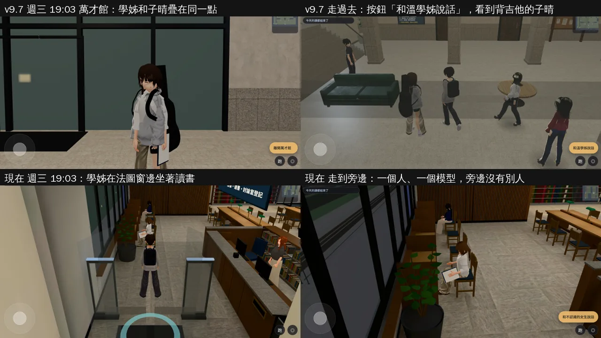
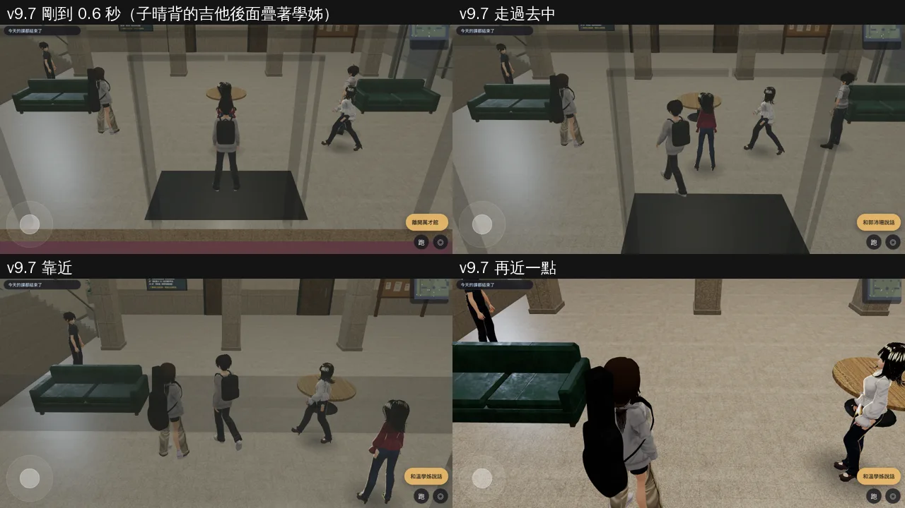

# 學姊「兩個臉」（BUG-04／C24；LAWWW2-B 2026-11-01）

- **起因**：使用者 10-15 第 25 項：「禮拜三晚上去法服：溫學姊在圖書館外只是站著，人物變得很怪（兩個臉的感覺），也沒有任何法服活動。」LAWWW-B 11-01 02:53 派工（P1）。
- **狀態**：
  - 原因找到了，在使用者玩的那一版重現。
  - 現在的開發分支已經不會發生（那一段程式後來拿掉了）。
  - 另交一個 patch，讓同樣的疊法以後不會再出現，附 Node 測試。
- 截圖是 Playwright＋SwiftShader（電腦 1280×720），不是實機；讀檔放日期、時間是 [捷徑]。

## 一、原因（v9.7 `ebebce9f4`，10-14 發布、使用者 10-15 玩的版本）

- **不是同一個人有兩個實體，也不是一個人掛了兩個模型**：
  - 遊戲裡學姊（`sis`／heroine_05）只有一個實體、底下一個模型。
  - 是**兩個不同的人生在同一點**。
- 時間地點：週三 18:48～21:00，萬才館大廳。
- 疊在一起的兩個人：
  - 舊的學姊（legacy `GM.spawnNPC('sis')`）站在 (−3, 3.6)，原本是法服讀書會的位置。
  - 照作息 `act:'club'` 的第一個社員，`story3d.js` 的 `CLUB_SPOTS[0]` 也是 (−3, 3.6)。
  - 兩個人距離 0，朝向只差 0.7 弧度，臉疊在一起。
- 掃描（下面第三節）結果：
  - 伯涵：2025-09-17 起，548 個時段。
  - 子晴：吉他社，2025-10-01 起，312 個時段。
- 遊戲內紀錄（`seq.py`：剛到 0.6 秒、2 秒、走過去、靠近）：
  - 學姊一個實體、一個模型。
  - 0.5 m 內是 heroine_04，距離 0。
  - 走過去按鈕寫「和溫學姊說話」，看到的卻是背吉他的子晴。
- 「圖書館外」：萬才館大廳那一點前面是一整片玻璃牆（第一張圖左上）。這是推測，沒有問過使用者。
- 「也沒有任何法服活動」：舊的學姊只是站在那裡，沒有事件。

## 二、現在的開發分支

- 那一段已經拿掉：
  - `story3d.js` 萬才館那一行註解寫「週三晚上 18:48 學姊在萬才館（法服讀書會）拿掉：讀書會停用（AA_236 A1）」。
  - 學姊週三 19:00～21:00 在法圖坐著讀書（`characters.js` 作息，AA_236 A8）。
- 遊戲內（開發 `81dd3258c`＋這個 patch，法圖週三 19:03）：
  - 剛到 0.6 秒、2 秒、走過去、走到旁邊四張都拍了。
  - 學姊一個實體、一個模型，0.5 m 內沒有別人（上圖下排）。
  - 萬才館、校園那個時段沒有學姊。
- **全遊戲掃描**：
  - 範圍：34 區 × 每一天（1500 天）× 7:00～23:30 每半小時，跑真正的 `STORY.populate`，共 1,734,000 次。
  - 找「站著、看得見的兩個人距離 < 0.35 m」：**0 組**。
  - v9.7 用同一個工具掃，萬才館有三組：學姊＋伯涵、學姊＋子晴、2027 年週四下午兩位教授在 (−5, 1.2)。
  - 校園另外有 3 次偶發的同學＋語彤，是在走路線的人剛好經過。
- 掃描工具一開始的兩個誤報（工具的問題，不是遊戲的問題）：
  - Café 櫃台：hcircle3d 讓位時會把無名店員藏起來，工具原本沒看 `hidden`。
  - 201 講台兩位教授：工具原本沒載課表（`classes3d.js`）。
  - 兩個都修好以後，現在是 0 組。

## 三、patch：站的位置已經有人就換位置

- 背景：拿掉 legacy 以後不會再疊，但 `spawnAt` 的社團（club）和 linger 照舊不看那一點有沒有人。別的程式（legacy、劇情、店員）先在那裡放了人，就會再疊一次。
- **`src/story3d.js`**，只改 `populateSchedule`：
  - 新的 `standBusy`、`standFree`、`lingerSpot`、`clubSpot`。
  - **社團**：那個 CLUB_SPOT 有人站著，就換下一個。
  - **linger**：那一點有人站著，就往她的右、左挪 0.7、1.4 m，再不行往後 0.7 m，要站得住（`canStand`）才用。
  - 沒有人的時候，位置和原本完全一樣（測試 ②④）。
  - 坐著的人不算，座位照原本的 `used`。
  - linger、club 兩行都還是一行：`bball_present_unit.js` 用 regex 讀 linger 那一行的 `noPair`。第一版拆成兩行，被這支測試抓到，已改回一行。
- **把同樣的 patch 套到 v9.7 再掃萬才館**：學姊疊人從 860 個時段 → **0**。剩下 2027 年週四兩位教授那一組，現在的開發分支已經有自己的處理（`prof==='wancai'` 的第二位往東 1.4 m）。
- **沒有改的**（掃描現在 0 組，先不動）：
  - `hcircle3d.js` 帶同伴去指定位置（`S.place` 的 `opt.at`）不看有沒有人。
  - ta、help、barista 只有一個固定點。
  - legacy 的 `GM.spawnNPC` 本身。
- **怎麼套**（給 LAWWW-B）：
  - patch：`docs/art-rebuild/second_ai/patches/npc_overlap_1101.patch`（對開發 `7a2ac2512`，`git apply --check` 過）。
  - 內容：`src/story3d.js`＋新 `tests/npc_overlap_unit.js`。
  - 不改 `character3d.js`、`hcircle3d.js`、資料檔、模型。

## 四、測試

- `tests/npc_overlap_unit.js`（Node，約 45 秒，不需要瀏覽器）：
  - 用法：照 `schedule_roommove_unit.js` 的替身，跑真正的 `STORY.populate`。
  - **v9.7 的資料（`ebebce9f4` 的 src）FAIL 3**（① ③ ⑤）：⑤ 抽樣掃描直接抓到使用者遇到的那兩組（萬才館 學姊＋伯涵、學姊＋子晴 (−3, 3.6) 19:05）。
  - **開發分支原樣 FAIL 2（① ③）**：學姊那一段已拿掉，⑤ 過；但 club、linger 還不看有沒有人。
  - **開發分支＋這個 patch：ALL PASS**。
  - ① 萬才館週三 19:05，CLUB_SPOTS[0] 先有人站著（＝v9.7 的學姊）：子晴不能生在他身上。改後她站 CLUB_SPOTS[1]。
  - ② 沒有人先站在那裡：子晴照舊站 (−3, 3.6)。
  - ③ linger：從資料找第一個真的站在作息位置的人。現在找到的是芷若，在普通 101 門口 (−4.8, 0.9)。那一點先有人站著時，她往旁邊挪 0.7 m。
  - ④ 沒有人先站在那裡：芷若照舊站在作息寫的位置。
  - ⑤ 抽樣掃描：16 區、每 9 天、每半小時，共 90,848 次 populate，疊在一起的 0 組。
- LAWWW-B 指定的幾支（開發 `81dd3258c`＋這個 patch）：`schedule_roommove_unit`、`v2_c13_unit`、`presence_unit`、`holiday_presence_unit`、`sis_expo_presence_unit`、`sis_pre94_presence_unit`、`zz_bkk_presence_unit` 都 ALL PASS。
- **全部 Node（開發 `81dd3258c`＋這個 patch，含新測試）：807 支、0 失敗**。
  - 第一版有 1 支 FAIL：`bball_present_unit.js` 的 regex，上面第三節說的那一支；改回一行以後重跑全部，0 失敗。
- 沒跑：
  - 手機實機。
  - 瀏覽器的真實流程測試（`flow_*`）：這個 patch 只在「那一點已經有人」時才改位置。

## 五、工具（只在 scratchpad，沒有放進 repo）

- `overlap_scan.js`：全遊戲掃描，參數是區域清單和隔幾天。
- `seq.py`：剛到、走過去、靠近三種實拍，同時記錄實體數、模型數、旁邊的人。
- `probe.py`：近照。
