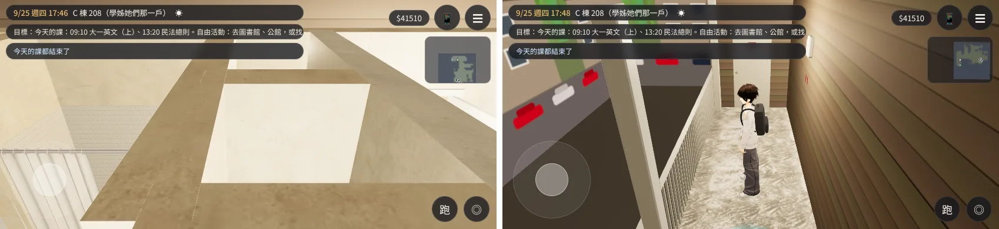
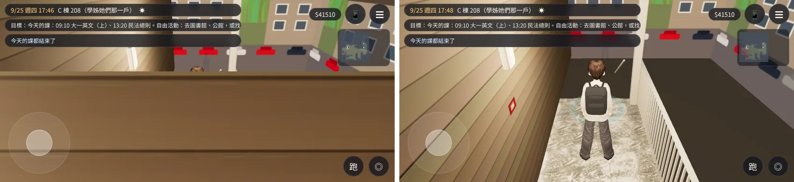
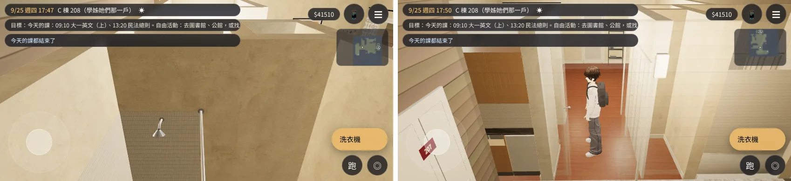
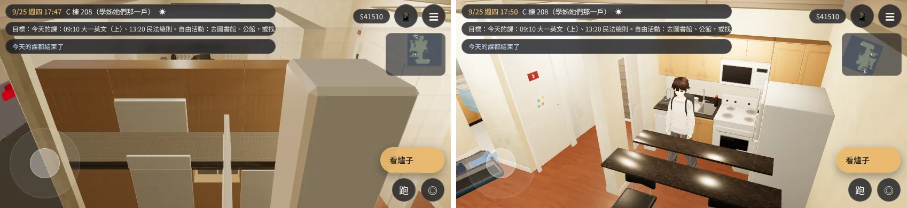
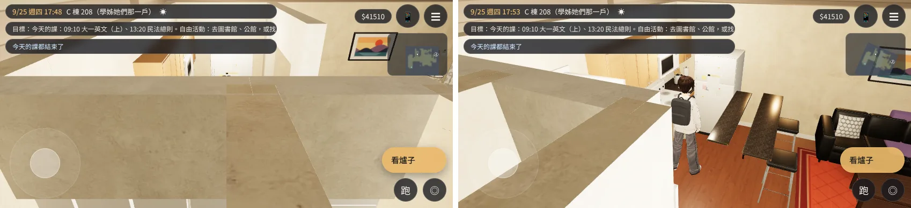

# C 棟 208 的鏡頭卡在牆後面（BUG-CAM-C208-1021）——已交件

帳號 A 的 LAWWW2，2026-10-21 19:4x UTC。狀態：**已交件**，交 LAWWW 整合；請 BB 用 artrev2 的角度重拍。

## 問題（BB_218 artrev2 57、58、62、77、78）

美國交換的 C 棟 208 公寓（`us_shared`），有五個位置＋鏡頭方向，整個畫面是牆或牆頂，看不到人：

| 編號 | 位置 | 鏡頭方向 |
|---|---|---|
| 57 | 門外走廊（平台） | 北 |
| 58 | 門外走廊 | 西 |
| 62 | 屋裡、大門旁 | 東 |
| 77 | 廚房 | 南 |
| 78 | 廚房 | 東 |

原因：
- 公寓沒有鏡頭碰撞（`zone.camCols`）。跟隨鏡頭照固定距離退，會退到隔間牆、外牆後面。
- 外牆外面的壁板比牆高：壁板到 3.0 m（`us_apartment.py` 的 OUTER＝H＋0.4），牆是 2.6 m。第一版只算到 2.6 m，57 號修好後鏡頭還是停在壁板頂上（第二版才改）。
- 引擎的 `followCam`：鏡頭抬高撞到門楣、又拉近時，回傳的距離沒更新。`autoSwing` 以為鏡頭沒有貼牆，不會轉開。

## 改法：`docs/art-rebuild/second_ai/patches/c208_cam_walls.diff`（第二版 `eec79b9e`）

對開發分支 `15f3c677` git apply 乾淨。

1. `src/us3d.js` 加 `aptCamCols`：
   - 照配置的牆建看不見的碰撞盒；
   - 關著的門、窗會擋；大門、廚房門、陽台門、吧台窗口不擋；
   - 外牆（N、S、E、W）高到 H＋0.4（壁板的高度）。
2. `src/engine3d.js` 的 `followCam` 改一行：抬高後又拉近時，回傳的距離也更新，`autoSwing` 才會轉開。
   - **這一行是 LAWWW 的檔案**，請整合時確認。
   - 教學館的鏡頭測試（`teach_cam_walls_unit.js`）照舊 ALL PASS。
3. 新測試 `tests/us_cam_walls_unit.js`。

## 測試

### Node 單元測試 `tests/us_cam_walls_unit.js`

- 測試的牆照模型的壁板高度算。
- 第一版：FAIL（57、77；整體 5.1%／6% 的方向被擋）。
- 第二版：ALL PASS。
- 其他：`teach_cam_walls`、`nav_us`、`us_life` ALL PASS。
- `us_season`：「`us_community.glb` 存在」那一項 FAIL，原因是稀疏工作樹沒有那個模型檔。沒改的版本也一樣 FAIL，和這個 patch 無關。

### 遊戲內前後對照（`c208cam_check.py`）

- 環境：Playwright 手機橫向 844×390。**不是 iPhone。**
  - 修改前：開發分支 `b804db03`，沒有 `?turbo`。
  - 修改後：開發分支 `15f3c677`＋第二版 patch，有 `?turbo`。
  - 兩個版本之間只差測試檔。`?turbo` 只影響走位和時間步長；鏡頭停在哪裡由碰撞決定，所以比 6 秒後的畫面。
- [前置／捷徑]：
  - 讀使用者 9/25 存檔；
  - 設旗標 `US_DEPARTED`、`US_ARRIVED`；
  - `GAME.enter('us_shared')` 17:45；
  - 搬玩家、設鏡頭方向，之後不碰鏡頭，讓遊戲自己拉近、轉開。
- 每個位置拍設好方向後 1 秒、6 秒兩張。這裡放 6 秒那張。
- 兩次都 JS 例外 0。
- 左邊是修改前、右邊是修改後：

| 編號 | 修改前（6 秒後） | 修改後（6 秒後） |
|---|---|---|
| 57 走廊・北 | 整個畫面是牆頂 | 看得到人、走廊欄杆、對面的公寓 |
| 58 走廊・西 | 壁板擋住下面三分之二，只露出頭頂 | 從背後看得到人和走廊 |
| 62 大門旁・東 | 鏡頭在浴室裡，看到淋浴間 | 看得到人在走道上、浴室門 |
| 77 廚房・南 | 櫥櫃頂、牆擋住 | 看得到人、廚房、吧台 |
| 78 廚房・東 | 整個畫面是牆頂 | 看得到人、吧台、客廳；**左邊約四成還是牆頂** |

## 還不到的地方（誠實寫）

- **78 號只修好一部分**：
  - 鏡頭停在廚房和走道之間的隔間牆上方（鏡頭高 2.99 m、牆 2.6 m），畫面左邊約四成是牆頂。
  - 人、吧台、客廳都看得到。原本整個畫面是牆頂。
  - 鏡頭在牆上方往下看、看得到牆頂，是整個遊戲室內鏡頭的做法（宿舍、教學館一樣），不是這個 patch 造成的。
  - 要再改，可以讓鏡頭貼牆時往旁邊轉更多，這是引擎 `autoSwing` 的範圍（LAWWW）。
- 只拍了 17:45。
- 真機沒看過。

## 接法（LAWWW）

1. `git apply docs/art-rebuild/second_ai/patches/c208_cam_walls.diff`：改 `src/us3d.js`、`src/engine3d.js`（一行），加 `tests/us_cam_walls_unit.js`。
2. 跑 `node tests/us_cam_walls_unit.js`、`node tests/teach_cam_walls_unit.js`、`node tests/nav_us_unit.js`。
3. 和 `dorm_cam_203.diff` 互不相依。
