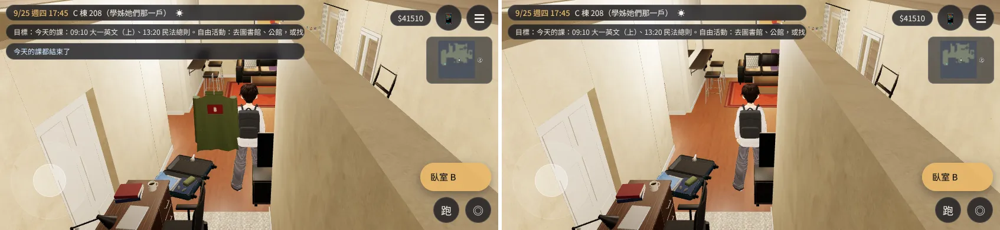

# C208 門上的外套、掛勾、白板、門牌跟著牆淡出（BB_218 補拍不通過那一件）——已交件

帳號 A 的 LAWWW2，2026-10-21 16:2x UTC。狀態：已交付 LAWWW，等 BB 用同一支腳本重拍。

## 問題（BB_218 最後一節，`claude/story-planning` 72e571fa）

鏡頭在臥室 B 那一側時（玩家在 A、B 門前面向西、鏡頭在東）：
- B 門板跟著隔間牆 `bed_w` 淡出了；
- 但外套、掛勾、「B」門牌沒有淡出，飄在門口半空。

## 原因與修法

1. **外套、掛勾、A 門的小白板、C 門的貼紙**：原本放在家具組或 root，不在牆的淡出組裡。
   - 修法（`tools/blender/env_second/us_apartment.py`）：放進門所在那面牆的組，在 GLB 裡叫 `WALL_<牆>_deco_*`，遊戲照牆的規則一起淡出。
   - 外套保留平滑著色；白板、貼紙保留自己的 UV。
2. **臥室 C 的門板原本被歸到南牆 S**：門對牆的對照表沒有 `bedC`，預設成 S，所以 C 門門板會跟著南牆淡出。
   - 修法：C 門在 `lau_w` 上（衣帽間那面），這面牆不淡出；C 門的貼紙也在同一組。
3. **門牌（`PLATE_FACE_door_*`）**：門牌要讓遊戲畫字，名字必須是 `PLATE_FACE` 開頭，不能改成 `WALL_`。
   - 修法：在遊戲端加幾行，`../../patches/c208_plate_fade.diff`（`src/us3d.js`）。
   - 會淡出的內牆（不是外牆 N／S／W／E）上的門牌，放進 `winParts`，和窗的零件同一套規則：鏡頭和玩家在牆的兩邊就藏起來。
   - 門牌的頂點是世界座標、物件原點在 (0,0,0)，所以用網格的中心判斷它在哪面牆。第一版用物件原點，量到門牌沒藏起來，已修正。

## 接法（LAWWW）

1. 換 `assets/models/env/second_ai/us_shared.glb`＋`.json`。
   - 物件 134、材質 58 不變；三角形 43,806→43,804。
2. 套 `docs/art-rebuild/second_ai/patches/c208_plate_fade.diff`：對開發分支 `5e297de9` `git apply` 乾淨。
3. 單元測試：在 `5e297de9`＋patch＋新 GLB 上跑了 `node tests/nav_us_unit.js`、`node tests/us_life_unit.js`，**都 ALL PASS**。

## 遊戲內前後對照

- 測試條件：Playwright 手機橫向 844×390、`?turbo`，不是 iPhone。
- 前置：讀使用者 9/25 存檔，用捷徑設旗標 US_DEPARTED、US_ARRIVED，進 `us_shared`，17:45。
- 腳本：`c208_check.py`。紀錄：`before.log`、`after.log`。
- 每張圖左邊是修改前（開發分支）、右邊是修改後。

| 位置 | 修改前 | 修改後 |
|---|---|---|
| A、B 門前，鏡頭在東（臥室那一側） | 外套、B 門牌飄在半空 | 外套、掛勾、A 白板、A／B 門牌跟著牆藏起來 |
| A 門前，鏡頭在東 | A 白板、門牌飄著 | 跟著牆藏起來 |
| 客廳，鏡頭在西（同一側） | 全部看得到 | 全部看得到（不變） |
| C 門前 | C 門貼紙、門牌看得到 | 看得到（不變；C 門現在不會跟著南牆淡出） |

圖：`cmp_bedside_camEast.webp`、`cmp_bedside_camEast_A.webp`、`cmp_living_camWest.webp`、`cmp_cdoor.webp`。

物件可見度（`after.log`，鏡頭在東）：
- `WALL_bed_w_deco_coat_bedB`、`WALL_bed_w_deco_hook_bedB`、`WALL_bed_w_deco_card_bedA`：不可見，透明度 0.12。
- `PLATE_FACE_door_bedA`／`bedB`：不可見。
- `PLATE_FACE_door_bedC`、`lau_w_deco_card_bedC`：可見。

## 沒做的、另外交

- **BUG-CAM-C208-1021**（C 棟 2F 208 門口走廊 17:46 鏡頭卡進牆、屋簷）：這是室內區域的鏡頭碰撞，另外修、另外交，不拖住這件。
- 正式 GLB 和測過的 scratch GLB：JSON 完全相同，只有兩包泡麵（EVENT_US2，平常藏著）和合併後的鉻件有亂數造成的微小差異。這是腳本原本就有的、每次建都不一樣，和這次改的無關。
