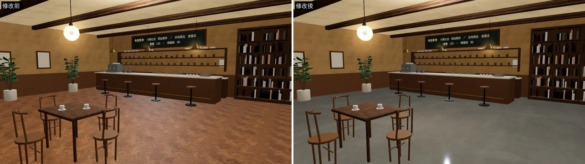
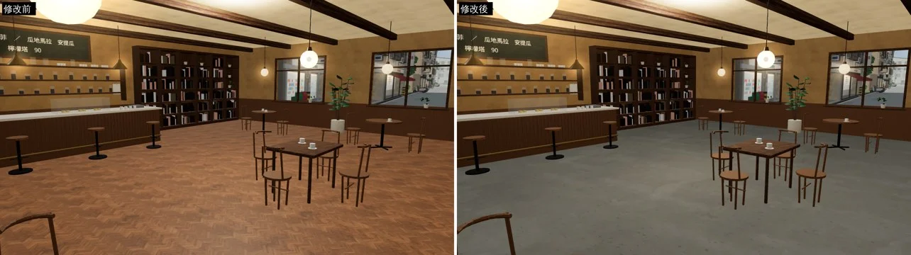

# ART-CAFE-FLOOR：兩點半 Café 地板改成自流坪水泥

- **起因**：使用者 2026-10-16 23:4x：「2am咖啡廳地板真的太醜 跟桌子顏色太近 我要自流坪那種水泥顏色」（LAWWW-B 轉，P0）。
- **做的人**：LAWWW2-B。
- **狀態**：`READY_FOR_ART_REVIEW`（場景美術由使用者確認）。
- **檔案**：
  - `assets/models/env/second_ai/cafe_interior.glb`：室內。
  - `assets/models/env/second_ai/cafe_exterior.glb`：從窗外看進去的店內也換了。
- **只換地板材質**：格局、座位、節點名稱都不動。材質名稱照舊是 `cafe_int_floor`，遊戲端的燈光感設定照舊套得上。

## 做法（`tools/blender/env_second/cafe_layout.py` 的 `self_leveling()`）
- 雲紋：Poly Haven CC0 的 `plaster_grey_04`，去色、明暗只留 38%。
- 細小氣孔：Poly Haven CC0 的 `granular_concrete`，只取最暗的 3%。
- 平均顏色校正到淺灰 `#b3b2ad`。
- 沒有磁磚縫、沒有木紋。
- 粗糙度約 0.6，雲紋亮的地方稍微光滑一點。不帶金屬感。
- 第一版（`#a8a7a2`、明暗留 50%）雲紋太深，有點像髒污，改淡了。

## 遊戲內修改前後（同角度、11:00；左修改前、右修改後）
吧檯一帶：

座位區往窗戶看：

- Playwright 手機模擬，**不是真機**。
- 測試工作樹：開發分支 `dd24edbb`＋這次的 GLB。

## 還沒做
- 程序化備用地板（`zones3d.js`）：LAWWW-B 說他會同步改成水泥灰。
