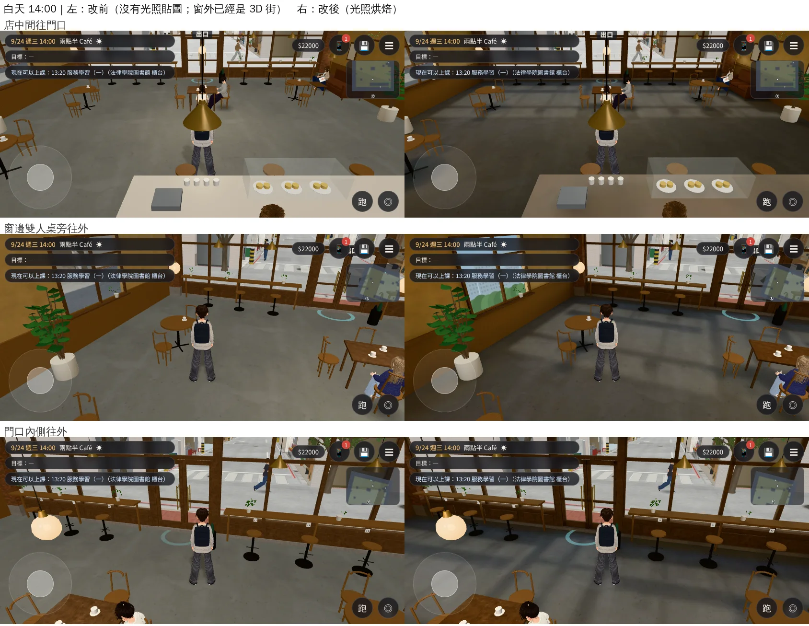
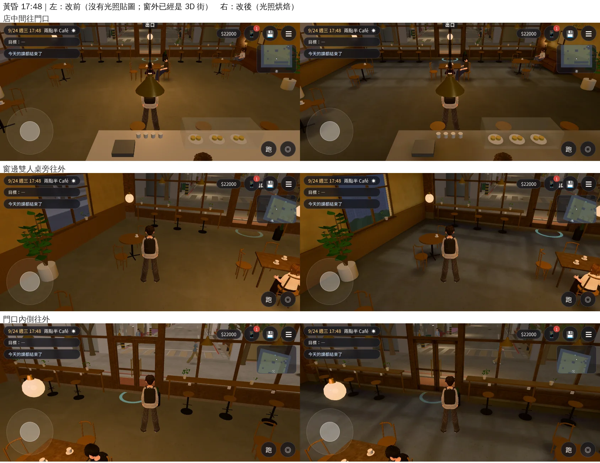
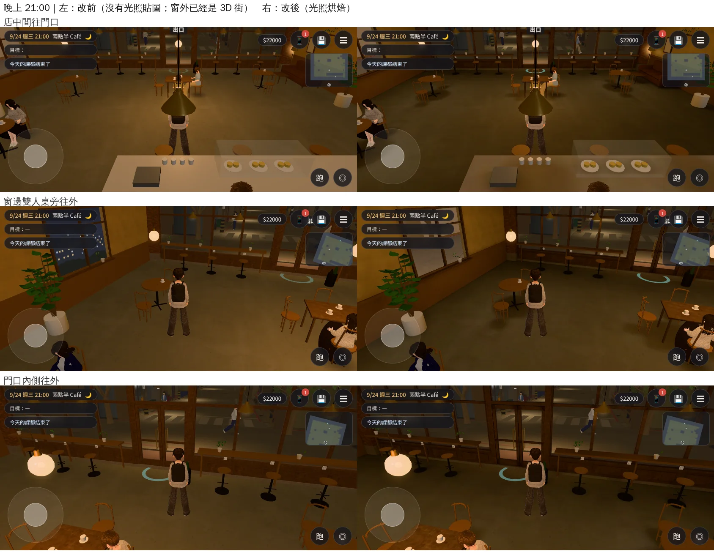

# 兩點半 Café 室內光照烘焙（INTERIOR-AAA 第二間，CAFE-LM-1030；LAWWW2-B 2026-10-30）

- **起因**：使用者 10-28 P0「校內建築室內……廉價手遊感」（UA-LAWWW2-1028-01、X125）。LAWWW-B 10-30 定的順序（D111）：宿舍 203 → **兩點半 Café** → 法律學院圖書館。
- **狀態**：`READY_FOR_ART_REVIEW`。建築、場景的 `ART_APPROVED` 只有使用者能標。
- **截圖條件**：遊戲內、玩家鏡頭，手機橫向 844×390，Playwright＋SwiftShader 模擬，**不是 iPhone 實機**。讀檔放位置是 [捷徑]；截圖時暫時藏手機通知。
  - 窗外是 X132 的 3D 溫州街（`cafe_window_live_1030`，LAWWW-B 已合進 postrel `dcf33a4e0`），改前改後兩邊都有。

## 一、交付

| 檔案 | 內容 |
|---|---|
| `assets/models/env/second_ai/cafe_interior.glb` | 多一套 UV（TEXCOORD_1）、`extras.lightmap`。1.44 → 1.92 MB；30,544 三角形（和原本畫出來的數量一樣） |
| `assets/models/env/second_ai/cafe_interior_lm_day.webp`、`_night.webp` | 光照貼圖 1024，96 KB＋75 KB |
| `tools/blender/env_second/lightbake/bake_cafe.sh` | 建模＋烘焙＋WebP（512 取樣約 10 分鐘） |
| `tools/blender/env_second/lightbake/cafe_interior_lm.json` | 這次烘焙的參數紀錄 |

- **不用改程式**：zones3d.js 的 cafe 區域本來就走 `attachRoomGLB`，看到 GLB 的 `extras.lightmap` 就接。測試樹沒改程式，截圖就是這樣接上的。
- 換上後跑：全部 Node（結果在 outbox）。

## 二、怎麼烘的

- **白天**：
  - 天光從店面（+z，真的西邊）和右牆兩扇窗進來；其他幾面包黑殼。
  - 下午的太陽從店面斜照進來（仰角 28°），地上有店面窗框的影子。
  - 吊燈照樣開（咖啡廳白天也開燈）。
- **晚上**：十二盞吊燈＋角落立燈，暖色。
  - 四張桌子上方的玻璃球吊燈、吧檯上方三盞、店面窗邊吧台上方四盞。
  - 桌子底下、牆角、沙發後面暗下來。
- **照舊即時光**：
  - 燈泡、玻璃燈罩（自己發光）、植物、黃銅、鐵件、杯盤、蛋糕、書背、罐子。
  - 椅子、凳子、桌子：烘焙工具把實例展開後是很多曲面小島，第一次試烘把整張貼圖擠滿，地板只分到 0.08%。
- **亮度校正**（兩輪，遊戲內和沒有光照貼圖的版本比）：
  - 第一輪：吊燈 28／30／14／18 W、天光 0.5。白天、晚上都比原本暗。
  - 現在：吊燈 45／45／22／28 W、天光 0.8、太陽 1.6。白天和原本差不多亮；晚上比原本暗一點，但有明暗。

## 三、改前改後（同角度；左＝沒有光照貼圖、右＝烘焙）

三個鏡頭：①店中間往門口 ②窗邊雙人桌旁往外 ③門口內側往外。

- **白天**：店面窗框的陽光斜斜落在地上；家具底下、吧檯後面有陰影。原本整間一樣亮。
- **晚上**：吊燈下一圈一圈的暖光，角落暗。原本是平平的一片橘。

## 四、效能

- 光照貼圖兩張共 171 KB。執行時幾乎不增加計算。
- draw call：店中間往門口 278 → 280（白天）、272 → 272（晚上）。
- 椅子、凳子、桌子原本用 GPU instancing，烘焙工具展開成合併網格，三角形一樣。
- 手機實機沒量。

## 五、還沒做到的

- 人物沒有吃到烘焙的光：人物照舊是室內的半球光＋方向光，晚上看起來比旁邊的地板亮一點。
- 烘焙的太陽不會動：白天都是下午西曬的位置，早上也一樣。
- 晚上整體比原本暗一些。要再亮可以把吊燈加到 55 W 左右重烘（10 分鐘）。
- 椅子、凳子、桌子照即時光，晚上在暗處會比旁邊亮。
- 右牆兩扇窗外照舊是照片的窗景（X132 只換了店面那一面）。
