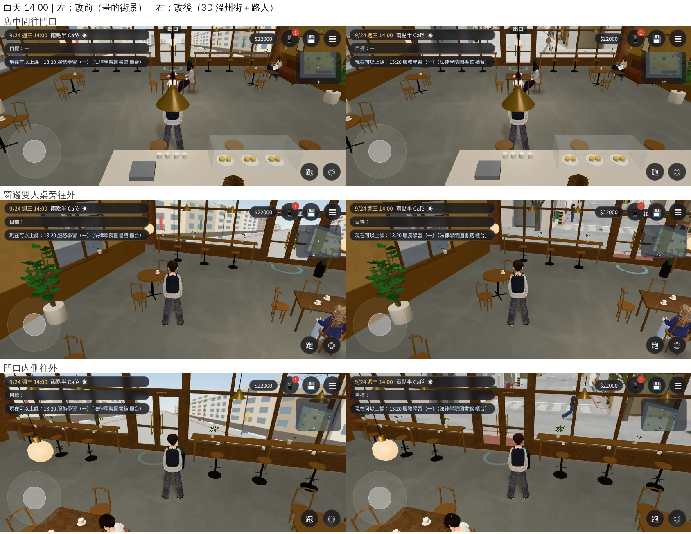
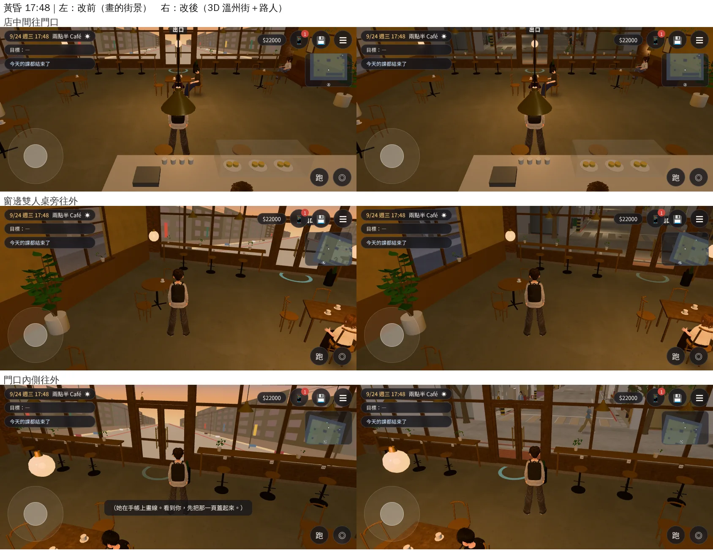
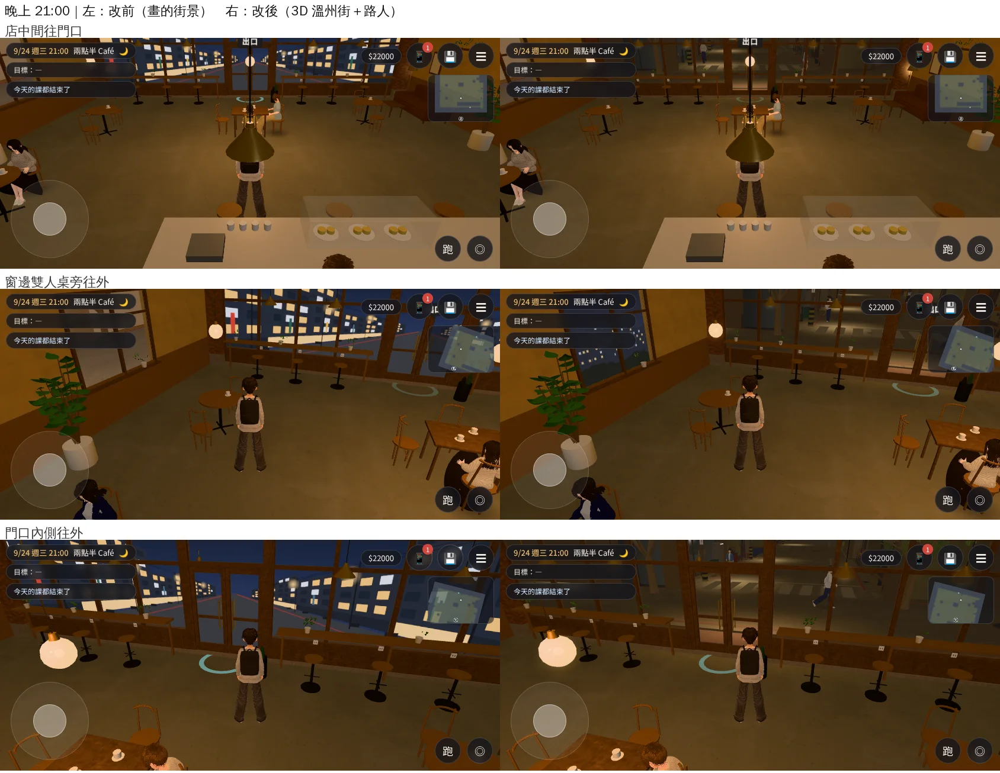

# X132 兩點半 Café 往門口看的窗外改成真的 3D 溫州街（CAFE-WINDOW-LIVE-1030；LAWWW2-B 2026-10-30）

- **使用者原話**（10-30 04:4x 對 LAWWW-B，UA-LAWWW-1030-10）：「兩點半 Café 往進門那個方向的窗景還是靜態、很像貼一張圖」。
- **原本**：店面玻璃外 0.55 m 一張 15×3.5 m 的平面（canvas 畫的街景，白天／黃昏／晚上三張），鏡頭怎麼移動都沒有景深，沒有人走過。
- **現在**：溫州街本身的正式模型照實際位置擺在玻璃外。往外看就是 Café 門口的紅磚、路口、斑馬線、行道樹、路燈、主巷兩側的公寓，一路到巷底；鏡頭移動有真的視差。4 個路人在店門口、斑馬線、主巷兩側走動。
- **狀態**：`READY_FOR_ART_REVIEW`。建築、場景的 `ART_APPROVED` 只有使用者能標。
- **截圖條件**：遊戲內、玩家鏡頭，手機橫向 844×390，Playwright＋SwiftShader 模擬，**不是 iPhone 實機**。讀檔放位置是 [捷徑]；截圖時暫時藏手機通知。

## 一、怎麼做的（patch：`docs/art-rebuild/second_ai/patches/cafe_window_live_1030.patch`，只改 `src/zones3d.js`＋新測試）

- **位置**：Café 的店面在溫州街 x≈55、門在 z=0、面向西。溫州街 (x,z) → Café (z, 61−x)，整組 `rotation.y=π/2`、`position (0,0,61)`。
  - 檢查：溫州街「進入兩點半 Café」的互動點 (54.2, 0) 換過來是 Café 的 z=6.8，玻璃在 z=6。
- **用的模型**：溫州街本來就有的 `bldg.wenzhou_street`（主巷兩側公寓）、`bldg.wz_props`（路面、電線桿、反光鏡、路名牌、門前紅磚）。接法照 `attachWenzhouModel`：招牌、門牌、晚上亮窗、光暈都和溫州街一樣。
  - 另外照溫州街的參數加了：路口兩棵行道樹、斑馬線、路口北側的路燈、三支電線桿路燈和 Café 門口的地上光圈。
  - 天空：Café 是室內區域，沒有引擎的天空 → 加一個半球，白天／黃昏／晚上換顏色。
- **只畫玻璃外面**：溫州街模型有幾個整條街合併的大網格，範圍一直到 Café 自己和隔壁兩棟，會穿進店裡。
  - 材質複製一份、加裁切平面（`clippingPlanes`，只留 Café 的 z≥6.35）。打開 `renderer.localClippingEnabled`；沒有裁切平面的材質不受影響。
  - 複製的材質不會動到溫州街本身共用的材質。
  - 光暈合成的網格沒辦法裁切：玻璃以內的光暈（Café 自己門口那盞）先從模型拿掉。
- **時段**：
  - 晚上：照溫州街的時段公式叫 `TK.setNight`（亮窗、招牌、燈）；地上的光圈照溫州街 `zoneTime` 的算法。
  - 室內的環境光比戶外強：晚上街景的顏色乘 0.2（不然晚上的街是白天的灰），黃昏偏暖，白天加一點自發光補亮。
- **原本畫的街景**：留著當備用。3D 街接上以後，從 `winParts` 拿掉、藏起來。
  - `winParts` 每一幀照鏡頭位置重設顯示：第一次只設 `visible=false`，結果它照樣蓋在 3D 街前面，改前改後看起來一樣。
  - 模型載入失敗：照舊用畫的街景。
- **路人**：`E.addExtra`（和騎腳踏車的人同一套）。換區域時引擎會自動拿掉、放掉人物模型；遠處換低面數由引擎處理。
  - 直線來回走，不用導航格（街在 Café 的導航格外面）。
  - 人數照時段：平常 4 個；22:00～7:00 或低畫質 2 個；1:00～6:00 沒有人。
  - 鏡頭到前牆外時和街景一起藏。
- **測試**：`tests/cafe_street_live_unit.js`（新）。檢查換算位置、裁切平面在玻璃和入口之間、`winParts` 拿掉畫的街景、路人路線都在玻璃外、材質複製、`TK.setNight`、載入失敗的備用。改前 10 項 FAIL，改後 ALL PASS。
- 全部 Node：測試樹（開發 4df154b26＋DORM203＋系外套＋床欄透空＋這一包）**738 支 0 失敗**。
- patch 在遠端 `postrel-1030`（3808792fe）上做；開發 `modest-rubin`（647dc5c6d）上 `git apply --check` 通過；和 `jacket_econ_1030`、`cine_seethru_1030` 依序套也通過。

## 二、改前改後（同角度；左＝改前、右＝改後）

三個鏡頭：①店中間往門口 ②窗邊雙人桌旁往外 ③門口內側往外。

- **白天**：門口的紅磚、淺灰柏油、紅線、斑馬線、行道樹、對面的公寓都是 3D；有人從門口走過、過斑馬線。
- **黃昏**：街景偏暖，門口開始有燈光灑在地上。
- **晚上**：街是暗的，門口的燈光、路燈的光圈照在地上，路人走過。

## 三、效能（門口內側往外，14:00；SwiftShader 量的數字，手機實機沒有量）

| | draw call | 三角形 |
|---|---|---|
| 改前 | 158 | 25.4 萬 |
| 改後（全部） | 265 | 46.8 萬 |
| 　其中溫州街公寓模型 | 70 | 14.6 萬 |
| 　其中 4 個路人 | 41 | 11.2 萬 |
| 　其中路面、電線桿 | 13 | 0.7 萬 |

- 九個鏡頭裡最多的是黃昏的門口內側：310 次 draw call、53 萬三角形。
- 溫州街本身之前驗收的數字約 290 次、42 萬（`1e445818`）：Café 現在和它同一級，三角形多一些。
- 要再省：路人減到 2 個（三角形少 5～6 萬），或低畫質不載 3D 街（照舊畫的街景）。手機實機要量過再決定。

## 四、還沒做到的

- 鏡頭在店裡是往下看的，窗外主要看到路面、門口和對街的一樓；遠處的公寓、天空要走到玻璃邊才看得到。
- 右牆兩扇窗（往北）照舊是照片的窗景，不是 3D。
- 路人是直線來回走，不會停下來、不會進店；晚上路人比街亮一點（人物照室內的光）。
- 溫州街的機車、A 字立牌、門口的腳踏車沒有放（要接溫州街的機車合併程式，下一步可以加）。
- 雨天：街上沒有濕地面反光；雨絲照引擎原本的。
- 第一次直接讀檔進 Café（沒先經過溫州街）要多下載溫州街模型（約 8.8 MB）；下載完以前是畫的街景。
