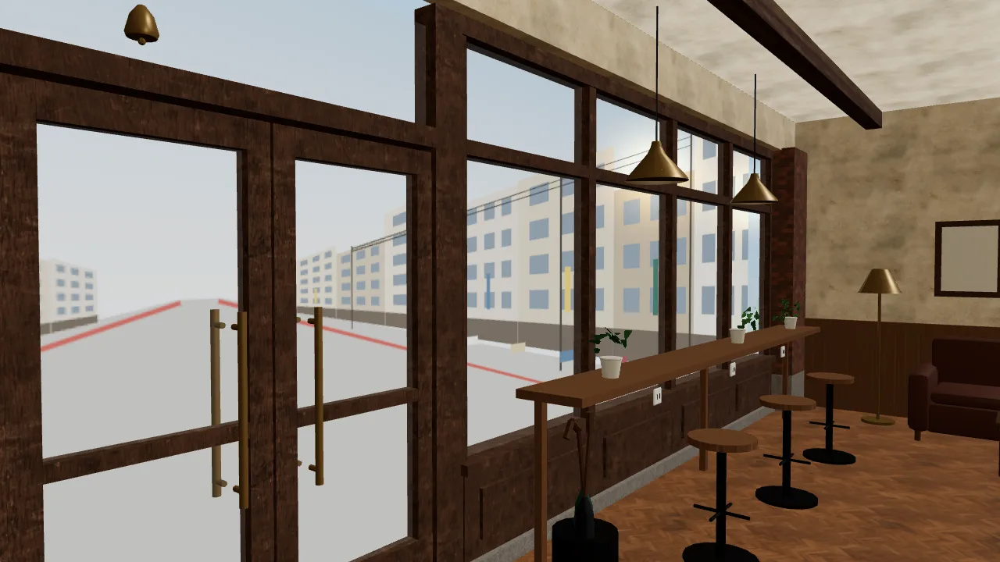
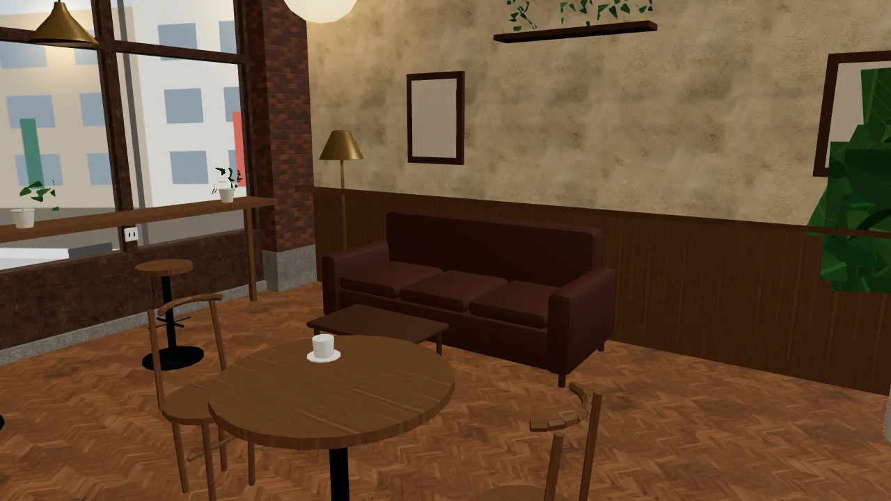
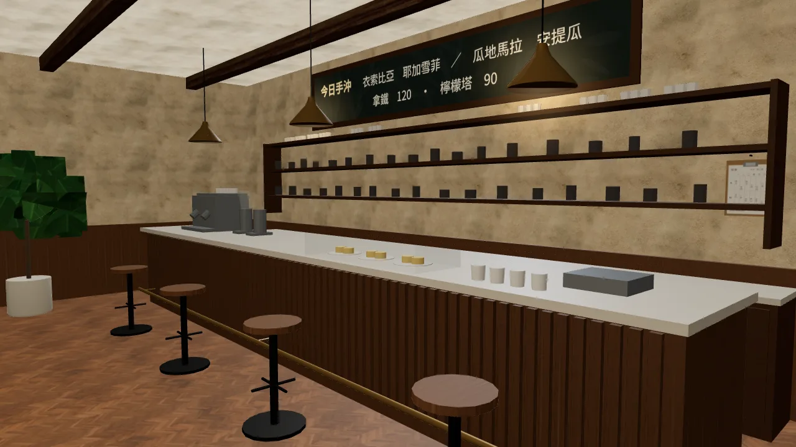
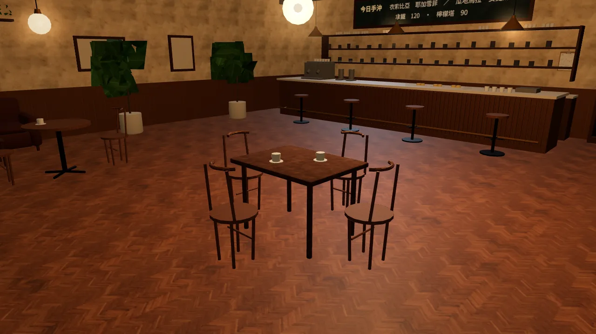

# 兩點半 Café ART-WZ4：遊戲內截圖（LAWWW2-B 2026-10-16）

整合說明：`docs/art-rebuild/second_ai/patches/cafe_wz4.md`。

模型：`assets/models/env/second_ai/cafe_interior.glb`。
- 20,072 三角形（原本 17,268）、1.36 MB。
- 腳本：`tools/blender/env_second/cafe_layout.py` 的 `interior()`＋`wz4_details()`。

截圖：
- 遊戲：舊開發版（5ec6a388）換上新 GLB，`zones3d.js` 還是舊的。所以是「畫面」驗收；導航和座位要等 LAWWW-B 照 patch 改完再拍。
- 時間：20:00，`?turbo`，桌機 Playwright 1280×720。

| 門口：門鈴、傘桶、窗邊吧台的插座 | 角落：沙發、矮桌、立燈 |
|---|---|
|  |  |
| **吧檯：四張吧檯椅、班表（右端）** | **四人桌（長方桌、兩端加椅）** |
|  |  |

## 已知問題（下一版 WZ4b 修）

- **盆栽**：大葉子是一片片折紙一樣的多邊形，很像積木，和使用者要的「日系加一點寫實」不合。
  - 這是原本的盆栽，不是這次加的。
  - 要換成總圖用過的葉片卡做法（`tools/blender/plants.py`）。
- **牆面**：灰泥貼圖的深色斑太明顯，看起來髒。要降低對比。
- **傘桶**：只看得到一把黑傘；綠傘的握把被傘桶擋住，要轉一下角度。
