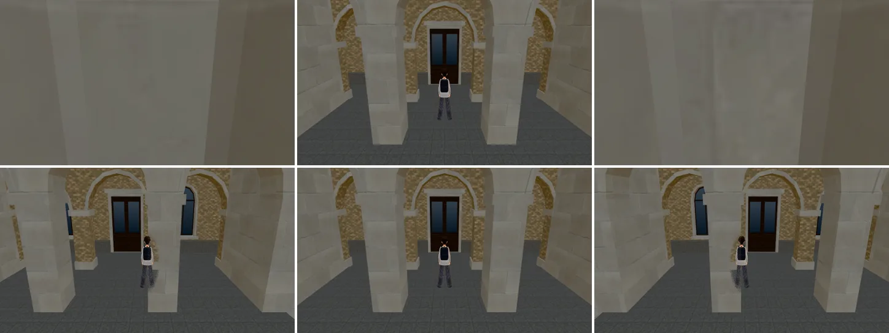

# 傅鐘鐘亭擋跟隨鏡頭（CAM-BELL-1031；LAWWW2-B 2026-10-31）

- **起因**：CAM-PILLAR-HALLS-1031 交件時我回報的（`test_shots/cam_pillar_halls_1031/README.md` 第三節）；LAWWW-B 排 P3，做法照門廊石柱。
  - 行政大樓門廊往東、西走 1.3 m，面向行政大樓。
  - 跟隨鏡頭在人後面 5.9 m，正好落在傅鐘 (−38, 16.5) 的鐘亭裡：整個畫面是柱子、梁的石材，玩家 0%。
- **狀態**：功能修正（鏡頭），模型外觀不變。
  - 截圖是 Playwright＋SwiftShader（電腦 1280×720 橫向），不是實機。
  - 讀檔放位置、藏路人是 [捷徑]。

## 一、改法（`tools/blender/env_second/campus_bell.py`，只改模型的材質分組）

- 柱子（柱腳、柱身、柱頸、柱頭）、梁、梁上的線腳、石碑改用另一個材質 `seethru_bell_stone`。
  - 貼圖、顏色和原本的 `ck_bell_stone` 一樣。
  - 台基、屋頂上的寶頂照舊 `ck_bell_stone`：鏡頭在台基上面，不會擋。
- **遊戲不用改程式**：
  - 傅鐘本來就由 `zones3d.js` 的 `attachWenzhouModel` 接；
  - 它會把 `seethru_` 開頭的材質標樹幹透視：擋住玩家、或離鏡頭太近時網點透空。
  - 和行政大樓門廊石柱 `seethru_ck_col` 同一套。
- 模型其他地方沒變：用改之前的腳本重匯，和部署中的 GLB 節點、頂點數完全一樣，只差 8 bytes 編碼。
  - 這一版多一個材質、一個網格：draw call 多 1，三角形不變。

## 二、改前改後（行政大樓門廊，14:00；上＝改前，下＝改後）

- 由左到右：往西 1.3 m、門廊正中、往東 1.3 m。

| 位置 (x, 23.5) | 改前 | 改後 |
|---|---|---|
| 往西 2.6 m（−40.6） | 34% | 34% |
| 往西 1.3 m（−39.3） | **0%** | 33% |
| 門廊正中（−38） | 26% | 26% |
| 往東 1.3 m（−36.7） | **0%** | 32% |
| 往東 2.6 m（−35.4） | 34% | 34% |

- 「看得到」＝玩家外框裡的像素（`cam_pillar_visible.py`）。人本身大約只佔外框的一半，30% 以上就是整個人看得到。
- 門廊正中 26%：擋的是行政大樓門廊的石柱（已經是網點透空），和這一包無關。
- 鏡頭在傅鐘柱子裡面時，柱子整根透空，畫面看到的是行政大樓的門廊。

## 三、測試、怎麼套

- 新測試 `tests/campus_bell_seethru_unit.js`（Node，讀 GLB）：
  - GLB 有 `seethru_bell_stone`，範圍是地面（石碑）到梁頂，不到屋頂；台基照舊；
  - 傅鐘照舊用 `attachWenzhouModel` 接、它照舊認 `seethru_`。
  - **開發分支原樣 FAIL 1，改後 ALL PASS**。
- `tests/campus_hall_pillar_seethru_unit.js` ALL PASS。
- `tests/campus_glb_integration.py`（瀏覽器）看傅鐘的地燈 `ck_bell_lens`、柱面暖光 `ck_bell_wash`，名字沒變，沒重跑。
- **換二進位**：`assets/models/env/second_ai/campus_bell.glb`（`campus_bell.json` 統計不用換）。
- **patch**：`docs/art-rebuild/second_ai/patches/cam_bell_1031.patch`（只有新測試）。
- 沒跑：手機實機。
