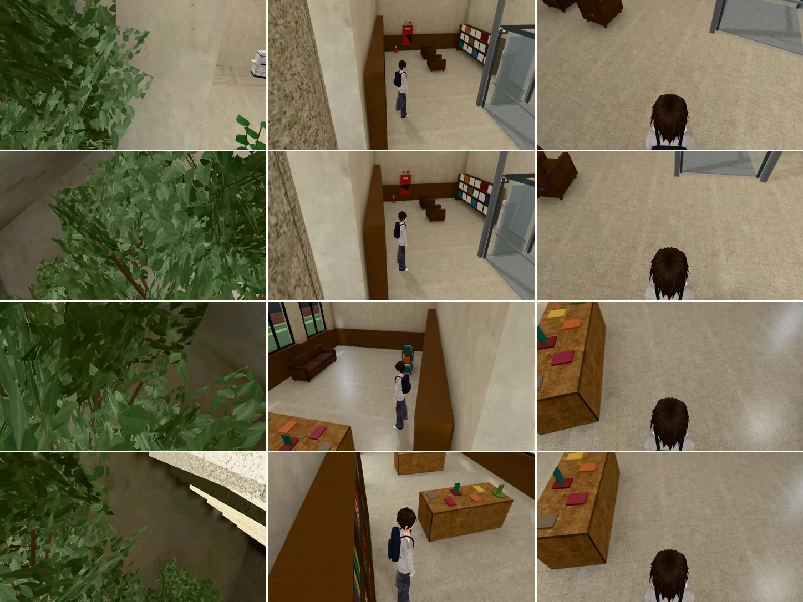

# 總圖大廳一樓：鏡頭穿進中央樓梯核心（BUG-CAM-LIBHALL-CORE-1031；LAWWW2-B 2026-10-31）

- **起因**：LAWWW-B 10:45（P1；BB-B n31_lhcore，`2a3e53b59`，照玩家操作重現）。
  - 玩家走到樓梯核心東邊 (6.2,−2.6) 往東看，或西邊 (−6.2,−3.2) 往西看。
  - 跟隨鏡頭在玩家背後、核心那一側，4 個方向玩家 0%。
  - 擋住的是室內樹的葉子、灰泥牆、胡桃木；這一區沒有鏡頭碰撞（`E.colliders`＝0）。
- **狀態**：功能修正，不是美術。
  - 截圖是 Playwright＋SwiftShader（電腦 1280×720 橫向），不是實機。
  - 讀檔放位置、藏路人是 [捷徑]。

## 一、原因

- 大樓梯兩側各有一塊實心的核心（欄杆外側 x ±3.6 → 核心外牆 ±5.2，高到二樓樓面 4.7 m），外面再靠一排書架（到 ±5.65）。
- 大廳原本沒有鏡頭碰撞，只有電梯井道有。玩家背對核心站時，鏡頭往後退 4.8 m，會穿過書架和灰泥牆，停在樓梯底下：
  - 往東那兩個方向停在 (2.12,3.43,−0.81)、(1.76,3.43,−2.20)；
  - 往西那兩個方向停在 (−1.85,3.43,−2.24)、(−1.77,3.43,−2.75)。
  - 和 BB 量到的一樣。
- 量出來同一件事不只 BB 的 4 個方向：
  - 一樓大廳每 0.5 m、8 個方向，14% 的鏡頭線穿進核心或樓梯底下；
  - 站在樓梯、平台上的有 20%；
  - 另外中庭四角的柱子也會擋。

## 二、改法（`src/library3d.js`，只改這一支）

1. **跟隨鏡頭的隔間牆**：`coreCamCols`，交給 `engine3d.js` 的 `followCam` 當隔間牆（`zone.camCols`）。和教學館、美國公寓、體育館同一套：
   - 擋到就拉近到牆前、拉近時抬高；
   - 沒在拖鏡頭時，`autoSwing` 轉向空的那一邊。
   - 引擎不用改。
   - 碰撞盒都看不見、不參加合併：
     - **核心兩塊**：x 從欄杆內側到書架外緣（導航阻擋的外緣）、z 涵蓋整個核心、地面到二樓樓面。兩端各多 6 cm，視線擦過角落時照樣擋得到。
     - **兩側那一跑的下面**：地面到踏面的梯形斜塊。人走不到這裡。原本站在核心南邊往南看時，鏡頭會從樓梯底下穿上來，停在踏面上，中間隔著樓梯底板。
       - 站在樓梯上的人不受影響：鏡頭在頭的後上方（俯角 0.38），視線一直在踏面上面。
     - **中庭四角的柱子**：半徑 0.34 m，地面到屋頂。
       - 第一版沒加柱子：BB 往東的第二個方向，鏡頭轉開後停在東南角柱子裡面（離柱心 0.25 m），畫面中間被柱子擋住。加了以後停在柱子旁邊。
   - **第 0、1 層用同一組**：兩側那一跑兩層共用，從二樓走下來的人還在第 1 層。
     - 二樓樓面上的人，鏡頭在頭的後上方，核心和樓梯下面的碰撞盒都在二樓樓面以下，擋不到；只有柱子會擋（柱子一直到屋頂）。
2. **室內樹、盆栽的葉子網點透空**：
   - 正式模型載入後，區域打開 `seeThru`，名字有 `leaf` 的材質標 `seeThrough`＋`patchSeeThrough`。
   - 影響的材質：`lb_leaf_small`、`lb_leaf_fern`、`lb_leaf_dark`、`lb_leaf_mid`。
   - 網點透空只作用在標了 `seeThrough` 的材質，大廳其他東西不受影響。
- **導航沒有動**：NAV-LIBHALL-ISLAND 的滅火器牆角照舊。`library_copier_unit`、`library_hall_lightmap_unit`、`nav_buildings_unit` 都 ALL PASS。

## 三、BB 的 4 個方向（改前改後；2029-04-26 14:00）

- 左＝改前。
- 中＝改後，鏡頭照平常一樣：沒在拖鏡頭，貼牆時自己轉開，等 6 秒。
- 右＝改後，當作剛拖過鏡頭（`manualT` 999，不轉）。
- 由上到下：往東 (2.10,3.43,−0.80)、往東 (1.76,3.43,−2.20)、往西 (−1.86,3.43,−2.25)、往西 (−1.78,3.43,−2.75)。



- 「看得到」＝玩家在外框裡的像素（`cam_pillar_visible.py`：藏起玩家再拍一張，相減）。人本身大約只佔外框的一半，所以 40% 已經是整個人看得到。

| 方向 | 改前 | 改後（自己轉開） | 改後（剛拖過鏡頭） |
|---|---|---|---|
| 往東 ① | 0%（鏡頭 (2.12,3.43,−0.81)） | 40%（鏡頭轉到南邊的走道 (5.69,3.37,1.55)） | 90% |
| 往東 ② | 2%（(1.76,3.43,−2.20)） | 31%（(5.65,3.22,0.87)） | 92% |
| 往西 ① | 5%（(−1.85,3.43,−2.24)） | 27%（(−5.81,2.71,−2.06)） | 89% |
| 往西 ② | 0%（(−1.77,3.43,−2.75)） | 43%（(−5.83,2.66,−4.11)） | 91% |

- 剛拖過鏡頭那一欄是從頭頂往下看的近景：鏡頭被核心拉近到玩家背後、抬高 0.9 m。放開鏡頭 1.5 秒後 `autoSwing` 會轉開，和教學館、美國公寓一樣。
- 往東那兩張，左邊緣是中庭的柱子：鏡頭在柱子旁邊，不在柱子裡。

## 四、測試

- **新測試** `tests/library_hall_cam_core_unit.js`（Node，不需要瀏覽器）：
  - 在 Node 建出遊戲真正的總圖大廳（程序化備用模型＝和正式模型同一份配置）；
  - 照引擎的跟隨鏡頭（camDist 4.8、俯角 0.38）算鏡頭位置，看「頭 → 鏡頭」有沒有穿過實心的地方；
  - 「修改前」＝同一個引擎、把核心的碰撞盒拿掉（電梯井道照舊）。

| 範圍 | 取樣 | 修改前穿過去 | 修改後 |
|---|---|---|---|
| 一樓大廳（每 0.5 m、8 個方向） | 5,648 | 785（13.9%） | 0 |
| 樓梯、平台（第 0 層，每 0.25 m） | 5,152 | 1,006 | 0 |
| 樓梯（第 1 層） | 960 | 66 | 0 |
| 二樓樓面（柱子） | 5,536 | 107 | 0（除了柱子附近，鏡頭和修改前一樣：97%） |

  - BB 的 4 個方向：修改前的鏡頭就在 BB 量到的位置（差不到 2 cm）、穿進核心；修改後 3 秒內轉開，水平離頭 2.3～4.1 m、沒有穿過實心的地方、沒有左右來回。
  - 葉子：程式有接上、正式模型有 4 個葉子材質。Node 載不到 GLB，實際的網點透空沒有在這支測試裡跑；上面的遊戲截圖是正式模型。
  - **開發分支原樣 FAIL 10，改後 ALL PASS**。
- 會建出總圖大廳的 Node 測試 95 支（`nav_buildings_unit`、`stairs_cam_slab_unit`、`teach_cam_walls_unit`、`library_*`、劇情裡會進總圖的……）全部 ALL PASS。
- 全部 Node（測試樹＝開發 `f79dc8b9e`＋書店＋門廊側牆＋這一包）：**跑中**，交件時跑了 149／787 支、0 失敗。這一包 P1 先交，跑完補在 outbox。
- 沒跑：`tools/dev_scratch/nav_islands.py`（導航沒改）、手機實機。

## 五、怎麼套（給 LAWWW-B）

- patch：`docs/art-rebuild/second_ai/patches/cam_libhall_core_1031.patch`（`src/library3d.js`＋新測試 `tests/library_hall_cam_core_unit.js`）。對最新開發 `3438bf10a`（和 `f79dc8b9e`）`git apply --check` 通過。
- 不用換模型、不用改引擎。
- 量畫面用的工具：`tools/blender/env_second/shots/cam_pillar_probe.py` 加了環境變數 `ZONE`（區域）、`LV`（樓層）、`SWING=1`（鏡頭自己轉開）。BB 要重拍 LHCORE 可以直接用：
  ```
  ZONE=library_hall SWING=1 python3 tools/blender/env_second/shots/cam_pillar_probe.py <工作樹> <URL> <輸出> 'e1:6.2,-2.6,-1.157;e2:6.2,-2.6,-1.481;w1:-6.2,-3.2,1.355;w2:-6.2,-3.2,1.469' 2029-04-26 14.0
  python3 tools/blender/env_second/shots/cam_pillar_visible.py <輸出>
  ```
