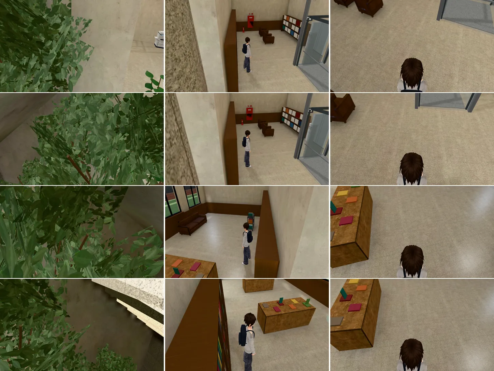
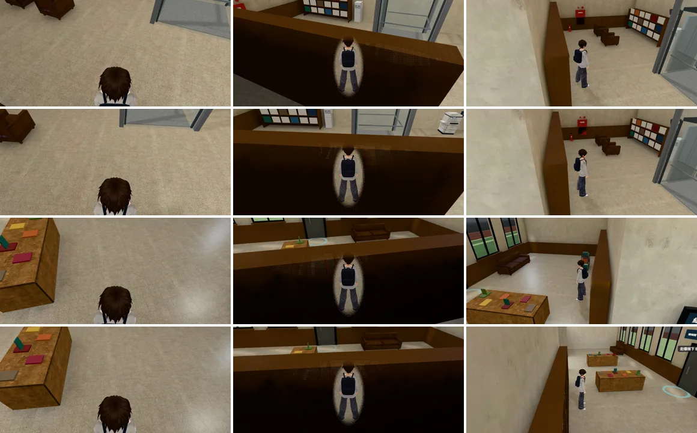

# 總圖大廳一樓：鏡頭穿進中央樓梯核心（BUG-CAM-LIBHALL-CORE-1031；LAWWW2-B 2026-10-31）

- **起因**：LAWWW-B 10:45（P1；BB-B n31_lhcore，`2a3e53b59`，照玩家操作重現）。
  - 玩家走到樓梯核心東邊 (6.2,−2.6) 往東看，或西邊 (−6.2,−3.2) 往西看。
  - 跟隨鏡頭在玩家背後、核心那一側，4 個方向玩家 0%。
  - 擋住的是室內樹的葉子、灰泥牆、胡桃木；這一區沒有鏡頭碰撞（`E.colliders`＝0）。
- **狀態**：功能修正，不是美術。
  - 截圖是 Playwright＋SwiftShader（電腦 1280×720 橫向），不是實機。
  - 讀檔放位置、藏路人是 [捷徑]。

## 一、原因

- 大樓梯兩側各有一塊實心的核心（欄杆外側 x ±3.6 → 核心外牆 ±5.2，高到二樓樓面 4.7 m），外面再靠一排書架（到 ±5.65）。
- 大廳原本沒有鏡頭碰撞，只有電梯井道有。玩家背對核心站時，鏡頭往後退 4.8 m，會穿過書架和灰泥牆，停在樓梯底下：
  - 往東那兩個方向停在 (2.12,3.43,−0.81)、(1.76,3.43,−2.20)；
  - 往西那兩個方向停在 (−1.85,3.43,−2.24)、(−1.77,3.43,−2.75)。
  - 和 BB 量到的一樣。
- 量出來同一件事不只 BB 的 4 個方向：
  - 一樓大廳每 0.5 m、8 個方向，14% 的鏡頭線穿進核心或樓梯底下；
  - 站在樓梯、平台上的有 20%；
  - 另外中庭四角的柱子也會擋。

## 二、改法（`src/library3d.js`，只改這一支）

1. **跟隨鏡頭的隔間牆**：`coreCamCols`，交給 `engine3d.js` 的 `followCam` 當隔間牆（`zone.camCols`）。和教學館、美國公寓、體育館同一套：
   - 擋到就拉近到牆前、拉近時抬高；
   - 沒在拖鏡頭時，`autoSwing` 轉向空的那一邊。
   - 引擎不用改。
   - 碰撞盒都看不見、不參加合併：
     - **核心兩塊**：x 從欄杆內側到書架外緣（導航阻擋的外緣）、z 涵蓋整個核心、地面到二樓樓面。兩端各多 6 cm，視線擦過角落時照樣擋得到。
     - **兩側那一跑的下面**：地面到踏面的梯形斜塊。人走不到這裡。原本站在核心南邊往南看時，鏡頭會從樓梯底下穿上來，停在踏面上，中間隔著樓梯底板。
       - 站在樓梯上的人不受影響：鏡頭在頭的後上方（俯角 0.38），視線一直在踏面上面。
     - **中庭四角的柱子**：半徑 0.34 m，地面到屋頂。
       - 第一版沒加柱子：BB 往東的第二個方向，鏡頭轉開後停在東南角柱子裡面（離柱心 0.25 m），畫面中間被柱子擋住。加了以後停在柱子旁邊。
   - **第 0、1 層用同一組**：兩側那一跑兩層共用，從二樓走下來的人還在第 1 層。
     - 二樓樓面上的人，鏡頭在頭的後上方，核心和樓梯下面的碰撞盒都在二樓樓面以下，擋不到；只有柱子會擋（柱子一直到屋頂）。
2. **室內樹、盆栽的葉子網點透空**：
   - 正式模型載入後，區域打開 `seeThru`，名字有 `leaf` 的材質標 `seeThrough`＋`patchSeeThrough`。
   - 影響的材質：`lb_leaf_small`、`lb_leaf_fern`、`lb_leaf_dark`、`lb_leaf_mid`。
   - 網點透空只作用在標了 `seeThrough` 的材質，大廳其他東西不受影響。
- **導航沒有動**：NAV-LIBHALL-ISLAND 的滅火器牆角照舊。`library_copier_unit`、`library_hall_lightmap_unit`、`nav_buildings_unit` 都 ALL PASS。

## 三、BB 的 4 個方向（改前改後；2029-04-26 14:00）

- 左＝改前。
- 中＝改後，鏡頭照平常一樣：沒在拖鏡頭，貼牆時自己轉開，等 6 秒。
- 右＝改後，當作剛拖過鏡頭（`manualT` 999，不轉）。
- 由上到下：往東 (2.10,3.43,−0.80)、往東 (1.76,3.43,−2.20)、往西 (−1.86,3.43,−2.25)、往西 (−1.78,3.43,−2.75)。



- 「看得到」＝玩家在外框裡的像素（`cam_pillar_visible.py`：藏起玩家再拍一張，相減）。人本身大約只佔外框的一半，所以 40% 已經是整個人看得到。

| 方向 | 改前 | 改後（自己轉開） | 改後（剛拖過鏡頭） |
|---|---|---|---|
| 往東 ① | 0%（鏡頭 (2.12,3.43,−0.81)） | 40%（鏡頭轉到南邊的走道 (5.69,3.37,1.55)） | 90% |
| 往東 ② | 2%（(1.76,3.43,−2.20)） | 31%（(5.65,3.22,0.87)） | 92% |
| 往西 ① | 5%（(−1.85,3.43,−2.24)） | 27%（(−5.81,2.71,−2.06)） | 89% |
| 往西 ② | 0%（(−1.77,3.43,−2.75)） | 43%（(−5.83,2.66,−4.11)） | 91% |

- 剛拖過鏡頭那一欄是從頭頂往下看的近景：鏡頭被核心拉近到玩家背後、抬高 0.9 m。放開鏡頭 1.5 秒後 `autoSwing` 會轉開，和教學館、美國公寓一樣。
- 往東那兩張，左邊緣是中庭的柱子：鏡頭在柱子旁邊，不在柱子裡。

## 四、測試

- **新測試** `tests/library_hall_cam_core_unit.js`（Node，不需要瀏覽器）：
  - 在 Node 建出遊戲真正的總圖大廳（程序化備用模型＝和正式模型同一份配置）；
  - 照引擎的跟隨鏡頭（camDist 4.8、俯角 0.38）算鏡頭位置，看「頭 → 鏡頭」有沒有穿過實心的地方；
  - 「修改前」＝同一個引擎、把核心的碰撞盒拿掉（電梯井道照舊）。

| 範圍 | 取樣 | 修改前穿過去 | 修改後 |
|---|---|---|---|
| 一樓大廳（每 0.5 m、8 個方向） | 5,648 | 785（13.9%） | 0 |
| 樓梯、平台（第 0 層，每 0.25 m） | 5,152 | 1,006 | 0 |
| 樓梯（第 1 層） | 960 | 66 | 0 |
| 二樓樓面（柱子） | 5,536 | 107 | 0（除了柱子附近，鏡頭和修改前一樣：97%） |

  - BB 的 4 個方向：修改前的鏡頭就在 BB 量到的位置（差不到 2 cm）、穿進核心；修改後 3 秒內轉開，水平離頭 2.3～4.1 m、沒有穿過實心的地方、沒有左右來回。
  - 葉子：程式有接上、正式模型有 4 個葉子材質。Node 載不到 GLB，實際的網點透空沒有在這支測試裡跑；上面的遊戲截圖是正式模型。
  - **開發分支原樣 FAIL 10，改後 ALL PASS**。
- 會建出總圖大廳的 Node 測試 95 支（`nav_buildings_unit`、`stairs_cam_slab_unit`、`teach_cam_walls_unit`、`library_*`、劇情裡會進總圖的……）全部 ALL PASS。
- **全部 Node**（測試樹＝開發 `f79dc8b9e`＋書店＋門廊側牆＋這一包）：**787 過、0 失敗**（交件後跑完，12:1x）。
- 沒跑：`tools/dev_scratch/nav_islands.py`（導航沒改）、手機實機。

## 五、怎麼套（給 LAWWW-B）

- patch：`docs/art-rebuild/second_ai/patches/cam_libhall_core_1031.patch`（`src/library3d.js`＋新測試 `tests/library_hall_cam_core_unit.js`）。對最新開發 `3438bf10a`（和 `f79dc8b9e`）`git apply --check` 通過。
- 不用換模型、不用改引擎。
- 量畫面用的工具：`tools/blender/env_second/shots/cam_pillar_probe.py` 加了環境變數 `ZONE`（區域）、`LV`（樓層）、`SWING=1`（鏡頭自己轉開）。BB 要重拍 LHCORE 可以直接用：
  ```
  ZONE=library_hall SWING=1 python3 tools/blender/env_second/shots/cam_pillar_probe.py <工作樹> <URL> <輸出> 'e1:6.2,-2.6,-1.157;e2:6.2,-2.6,-1.481;w1:-6.2,-3.2,1.355;w2:-6.2,-3.2,1.469' 2029-04-26 14.0
  python3 tools/blender/env_second/shots/cam_pillar_visible.py <輸出>
  ```

---

# 第二輪（BB n33 第 1 項；LAWWW2-B 2026-10-31 17:xx）

- **起因**：LAWWW-B 15:37（BB n33_lhcore）。第一輪整合後，BB 用「剛拖過鏡頭」（`manualT`，`autoSwing` 不轉）重拍 4 個方向：
  - 鏡頭被核心碰撞盒拉到玩家頭頂正上方，水平只離頭 0.36～0.43 m；
  - 人看得到（89～92%），但畫面只有頭髮和地板，看不到前面。
- **狀態**：功能修正，不是美術。截圖是 Playwright＋SwiftShader（電腦 1280×720 橫向），不是實機；讀檔放位置、藏路人是 [捷徑]。

## 一、我自己也要更正的事：第一輪的葉子網點透空沒有作用

- 第一輪在正式模型載入後走訪 `root`，把名字有 `leaf` 的材質標 `seeThrough`。
- 但 `B3.attachFormal` 會先把 `L0_root`／`L1_root` 搬進區域的樓層群組，`root` 已經是空的——**一個材質都沒標到**。
- 第一輪的測試只檢查程式碼裡有那個正規式，所以沒抓到。BB 這次的截圖裡，葉子照樣不透空。
- 這一輪改成走訪區域群組 `g`，測試也改成真的建一個假的正式模型、檢查材質有沒有被標（下面 4a）。

## 二、改法（`src/library3d.js`，只改這一支）

1. **鏡頭碰撞分兩組，照玩家有沒有在控制鏡頭換**（`zone.update`）：
   - **平常**（沒拖鏡頭）＝第一輪的整塊核心（`camColsThick`）：貼著核心時鏡頭被拉近，`autoSwing` 轉到走道上。BB n31 驗過，不動。
   - **拖著鏡頭、或剛放開**（`E.cam.dragging`、`manualT>0`；這時 `autoSwing` 本來就不轉）＝只擋靠樓梯井那一面的薄板（`camColsThin`：欄杆內側 x ±3.6 一片 12 cm 的板子）＋兩側那一跑下面的斜塊＋中庭柱子。
     - 鏡頭可以退進實心核心：核心外牆是單面材質，從裡面看不到；
     - 書架、書、鋼件網點透空（下一點）。
     - 鏡頭不會穿進樓梯井（薄板擋著），也不會停在柱子裡。
2. **網點透空的材質**：葉子（`lb_leaf_*`）＋書架胡桃木 `lb_walnut`、書 `lb_vc`、書架鋼件 `lb_steel`。
   - 網點透空只在擋住玩家、或離鏡頭太近的時候作用（`engine3d.js updateSeeThrough`），平常照舊不透明。
   - 灰泥牆、磨石地板不標。
- **導航、引擎都沒有動**。

## 三、BB 的 4 個方向（剛拖過鏡頭，`manualT` 999）

| 方向 | 第一輪（BB n33 量到的情況） | 第二輪 |
|---|---|---|
| 往東 ① (6.2,−2.6) | 鏡頭 (5.84,2.53,−2.44)，水平離頭 0.39 m | (3.95,2.98,−1.61)，水平 2.46 m，看得到 42% |
| 往東 ② | (5.85,2.51,−2.57)，0.35 m | (3.98,2.93,−2.40)，2.23 m，43% |
| 往西 ① (−6.2,−3.2) | (−5.84,2.51,−3.12)，0.37 m | (−3.97,2.94,−2.71)，2.28 m，42% |
| 往西 ② | (−5.85,2.51,−3.16)，0.35 m | (−3.98,2.93,−2.97)，2.23 m，43% |

- 第一輪那一欄「看得到」是 89～92%，但那是從頭頂往下看：人佔滿外框、看不到前面。
- 第二輪鏡頭在核心裡面（x ±3.95～3.98，核心是 ±3.6～±5.65），隔著透空的書架看玩家，前面的走道看得到。
- 「看得到」＝玩家外框裡的像素（`cam_pillar_visible.py`：藏起玩家再拍一張相減）。人本身大約只佔外框的一半，40% 以上就是整個人看得到。

## 四、三種情況並排（2029-04-26 14:00）

- 左＝第一輪（BB n33 量到的情況：剛拖過鏡頭，鏡頭被拉到頭頂）。
- 中＝第二輪，剛拖過鏡頭（`manualT` 999）：鏡頭退進核心，隔著書架看玩家。
- 右＝第二輪，平常（沒拖鏡頭，貼牆時自己轉開，等 12 秒）：和第一輪一樣用整塊核心擋，轉到走道上。
- 由上到下：往東 ①、往東 ②、往西 ①、往西 ②。



| 方向 | 平常（自己轉開）鏡頭 | 水平離頭 | 看得到 |
|---|---|---|---|
| 往東 ① | (5.49,3.21,0.84) | 3.5 m | 44% |
| 往東 ② | (5.55,3.23,0.93) | 3.6 m | 37% |
| 往西 ① | (−5.48,3.43,1.20) | 4.5 m | 38% |
| 往西 ② | (−5.80,3.43,−7.63) | 4.4 m | 32% |

- 第一輪的報告「改後（自己轉開）27～43%」那一欄只等了 6 秒：SwiftShader 每秒 1～3 幀，`autoSwing` 一幀最多轉 1.3×dt，6 秒拍到的是還沒轉完的。這次 CPU 空下來、等 12 秒，都轉到走道上了。手機上（30 fps 以上）大約 1 秒轉完。

### 還不夠的（照實寫）

- **拖鏡頭那一組，畫面下面三分之二是書架背板**（中間那一欄）：
  - 網點透空只開在玩家周圍那一圈（`updateSeeThrough` 的做法），書架其他地方照樣不透明。
  - 人整個看得到、前面的走道也看得到，比第一輪只看到頭髮好；但不是乾淨的畫面。
  - 再好一點的做法：鏡頭在核心裡面的時候，整片書架和核心外牆淡出（像教室的牆 `fadeWalls`）。要動 `library3d.js` 的淡出群組，這一版沒做。要的話告訴我。
- 放開鏡頭 1.5 秒以後 `manualT` 歸零，換回整塊核心，`autoSwing` 轉到右邊那一欄的位置。

## 五、測試（第二輪）

- `tests/library_hall_cam_core_unit.js`（改寫）：
  - 1d：薄板 8 個成員、在 |x| 3.54～3.66。
  - 4a：**實際**建一個假的正式模型（`L0_root`／`L1_root`、葉子、書架、灰泥、磨石的材質），載入以後檢查哪些材質被標 `seeThrough`：葉子、胡桃木、書、鋼件有，灰泥、磨石沒有。第一輪是檢查程式碼裡有沒有那個正規式，所以沒抓到 `root` 是空的。
  - 5a：拖鏡頭時換薄板、放開後換回整塊。
  - 5b：BB 的 4 個方向，拖鏡頭時鏡頭水平離頭 ≥ 1.2 m（實際 2.23～2.45 m；第一輪 < 0.5 m），不在樓梯井、不在柱子裡。
  - 5c：薄板模式整個一樓大廳掃一遍：鏡頭不穿過欄杆那一面、不在柱子裡、不在樓梯下面的斜塊裡。
  - **開發分支（第一輪已整合）FAIL 8，改後 ALL PASS。**
- 會建出總圖大廳的 Node：見交件訊息（和體育館光照一起跑全部 Node）。

## 六、怎麼套（第二輪）

- patch：`docs/art-rebuild/second_ai/patches/cam_libhall_core_v2_1031.patch`（`src/library3d.js`＋`tests/library_hall_cam_core_unit.js`）。
  - 對開發 `f275a620f`、最新 `d93d6fc4d` 都 `git apply --check` 通過。
- 不用換模型、不用改引擎。
