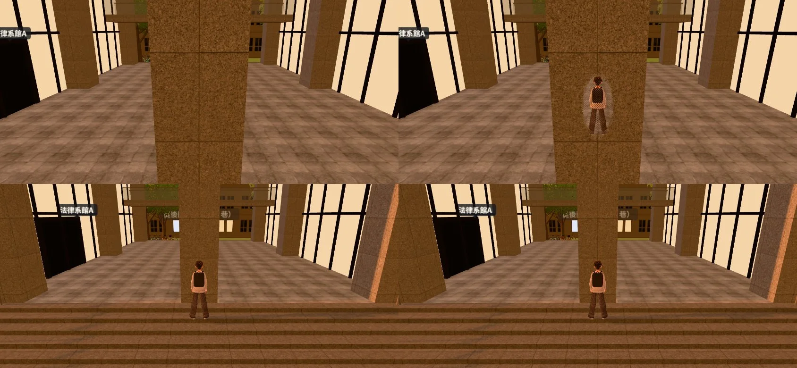
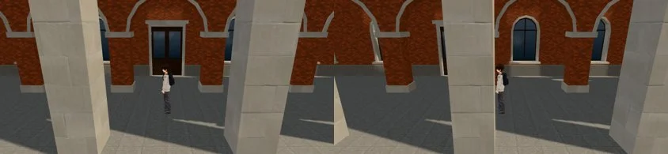

# 法律系館A（霖澤館）穿堂的柱子擋住跟隨鏡頭（BUG-CAM-PILLAR-LAWA-1031；LAWWW2-B 2026-10-31）

- **派工**：LAWWW-B 10-31 05:02（P1；場景鏡頭碰撞，D108）。
- **BB-B 的重現**（`0eb633624`）：2029-04-27 17:25，校園從 (34,−99) 走到穿堂門口 (34,−106.5)。
  - 跟隨鏡頭在後面（南），前排中柱把人整個擋住。
  - 劇情運鏡拉回來的時候，鏡頭還會穿進柱子。
- **狀態**：修好，等 BB 跑 DAD2／DAD2_NO 驗收。
  - 截圖是 Playwright＋SwiftShader（手機橫向 844×390），不是實機。
  - 讀檔放位置、拿掉路人是 [捷徑]。

## 一、原因

- 柱子是 `tools/blender/linze_exterior.py` 的 `pcol`（花崗石 1.2×1.2）：穿堂兩側各三根，加一根前排中柱。
- 匯出時照材質合併：柱子和台階、牆一起在 `ext_granite` 裡。
  - 不能整個 `ext_granite` 標透視：台階、牆也會跟著網點。
- 鏡頭碰撞（`ckPlace`）只有建築本體和拱廊上方的樓層，沒有柱子：鏡頭不會被拉近，人就被擋住。

## 二、做法

- **模型**：柱子另外一個材質 `seethru_ext_granite_col`。
  - 同一張花崗石貼圖、同樣的參數，畫面不變。
  - GLB 多 1.2 KB（貼圖共用），多一個節點（一次 draw call）。
- **遊戲**（`src/zones3d.js` 的 `attachExterior`）：`seethru_` 開頭的材質標成 `userData.seeThrough`、`E3.patchSeeThrough`。
  - 和行道樹樹幹、電線桿、Café 吊燈電線、宿舍床欄同一套（`engine3d.js` 的 `updateSeeThrough`）。
  - 柱子擋在鏡頭和玩家中間時，玩家周圍網點透空；離鏡頭 1.7 m 以內的柱面也透空。
  - 劇情運鏡結束時，鏡頭是用跟隨模式（`follow`）拉回來的，所以拉回途中穿過柱子時也會透空。
- **沒有把柱子加進鏡頭碰撞**：左右走過柱子時，鏡頭會一下拉近、一下拉遠（你提醒的）。透視不動鏡頭。

## 三、改前改後（同角度；左＝改前，右＝改後）

- 上：穿堂門口 (34, −106.2)，鏡頭在南、6.6 m（BB-B 的位置）。下：台階上 (34, −102.2)，柱子在人後面（不變）。

- **玩家看得到多少**（`tools/blender/env_second/shots/cam_pillar_probe.py`＋`cam_pillar_visible.py`）：
  - 量法：有玩家、沒玩家各拍一張，比較玩家外框裡差多少像素。
  - 沒被擋的時候大約 35～45%（人形佔外框的比例）。

| 位置 | 改前 | 改後 |
|---|---|---|
| 穿堂門口 (34, −106.2) | **0%** | 39% |
| 穿堂中間 (34.75, −104.75) | 38% | 42% |
| 台階上 (34, −102.2) | 38% | 38% |
| 萬才館（法律系館B）門口 (93.8, −99.2) | 34% | 34% |

## 四、其他有拱廊、門廊的系館（照你說的一起看）

- **萬才館**：門口沒有柱子擋（上表）。
- **共同教學館**門口：正前方、左右 1.6 m 都看得到（43～45%）。
- **總圖**門口：
  - 正前方看得到（22%：衣服和門的顏色接近，量出來比較低，畫面上整個人都在）。
  - **往旁邊 2.6 m，門廊的柱子會切掉人的一半**（下圖）。

- 總圖、行政大樓、文學院、校史館的外觀是 `campus_hall.py` 匯出的正式模型，門廊柱子和收邊共用 `ck_trim`。
- **這一包沒有改**。要改的話，做法和霖澤館一樣：
  - 門廊柱子另外一個 `seethru_` 材質，重新匯出這幾棟的 GLB；
  - 載入正式模型的 `attachWenzhouModel` 也要認 `seethru_`。
  - 會動到四棟的 GLB，所以先問你要不要做。
- 我先試過改套件（`campuskit3d.js` 的門廊柱子）：畫面沒有差別，因為套件的外觀在正式模型載入以後就藏起來了。已經改回去，沒有放進 patch。

## 五、怎麼套（給 LAWWW-B）

1. 換 `assets/models/env/linze_exterior.glb`。
2. 套 `docs/art-rebuild/second_ai/patches/cam_pillar_linze_1031.patch`：
   - `src/zones3d.js`：`attachExterior` 加一行。
   - `tools/blender/linze_exterior.py`：柱子換材質。
   - 新測試 `tests/linze_pillar_seethru_unit.js`。
3. 新測試在開發分支原樣 **FAIL 4**（GLB 沒有柱子材質、遊戲沒標透視），改後 ALL PASS。檢查三件事：
   - 真的 GLB：七根柱子每根八個角都在 `seethru_ext_granite_col`，這個材質沒有別的東西；
   - 在 Node 建出校園：柱子標了透視、patch 過 shader，台階、牆、玻璃不透；
   - 門口鏡頭線真的穿過前排中柱（重現 BB-B 看到的）。

## 六、測試、還沒驗的

- **全部 Node**（測試樹＝開發 `a54a7d860`＋這一包＋C 那一包）：781 支 780 過。
  - FAIL 的 `r2y4b_events_unit` 是你 `0447c75bb` 已經修的（a54a7d860 的 walkPlace）。
- **對最新開發 `61bf5e485`**：
  - `git apply --check` 通過；
  - 套上後 `linze_pillar_seethru_unit`、`r2y4b_events_unit`、`nav_buildings_unit`、`kit_nav_check.js` 都 ALL PASS。
- **還沒驗的**：
  - BB 的 DAD2／DAD2_NO 劇情演完後 3 秒、6 秒（我這邊沒跑劇情，只跑了平常走到門口的跟隨鏡頭）。
    - 劇情運鏡結束時鏡頭是用跟隨模式拉回來的，透視照理會作用。
    - 如果某一場的固定運鏡（cinematic）本身就放在柱子裡，透視不會作用：那一場可以用 `E.cam.seeThru` 指定透空的地方（宿舍上舖用過）。
  - 手機實機。
