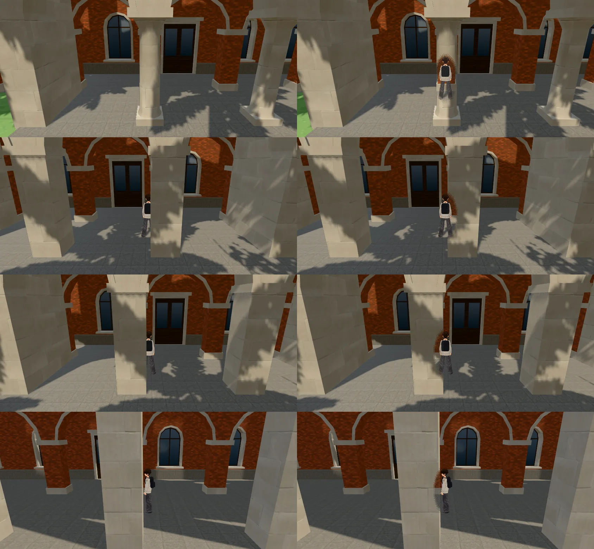
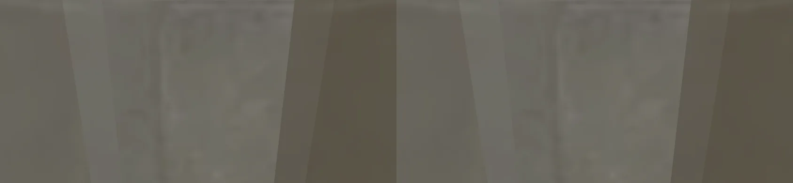

# 總圖、行政大樓、文學院、校史館：門廊、拱廊的柱子擋住跟隨鏡頭（CAM-PILLAR-HALLS-1031；LAWWW2-B 2026-10-31）

- **派工**：LAWWW-B 10-31 05:52（P2）。總圖在經濟系那一年、法律系都常去。
  - 照法律系館A（`test_shots/cam_pillar_1031/README.md`，開發 `3ba38e34a`）的做法。
- **狀態**：已交，等整合。
  - 截圖是 Playwright＋SwiftShader（手機橫向 844×390），不是實機。
  - 讀檔放位置、拿掉路人是 [捷徑]。

## 一、做法

- **模型**（`tools/blender/env_second/campus_hall.py`，四棟共用）：柱子另外兩個材質，名字 `seethru_` 開頭。
  - `seethru_ck_col`：門廊石柱（柱身、柱頭、柱礎；校史館的圓柱也是），拱廊柱墩的柱頭、柱腳。和石材收邊同一張貼圖。
  - `seethru_ck_pier`：拱廊的面磚柱墩。和牆同一張貼圖。
  - 收邊（簷口、拱圈、門廊頂板、山牆）、牆、門廊兩端的側牆**照舊不透**。
  - 四棟重新匯出：三角形、貼圖數不變。每棟多兩個材質、兩個節點，GLB 多約 2.4 KB。
  - 改之前先確認過：沒改的腳本重新匯出，四棟和開發分支逐位元組相同。
- **遊戲**（`src/zones3d.js` 的 `attachWenzhouModel`）：騎樓柱子（`wz_pillar_`）、蒲葵的透視判斷多一個 `seethru_` 開頭。
  - 用的是霖澤館、行道樹、電線桿同一套 `updateSeeThrough`。

## 二、改前改後（同角度；左＝改前，右＝改後）

- 站在門廊裡、離門口往旁邊 1.3～2.6 m，鏡頭在門廊外面看著建築（6.6 m）。
- 由上到下：校史館（往西 1.3 m，圓柱）、文學院（往東 1.3 m）、文學院（往西 1.3 m）、總圖（往北 2.6 m）。

- **玩家看得到多少**（`cam_pillar_probe.py`＋`cam_pillar_visible.py`）：
  - 量法：有玩家、沒玩家兩張比玩家外框；沒被擋的時候大約 35～45%。
  - 每棟量了門口正前方、往兩邊各 1.3、2.6 m，共 20 個位置。有變的：

| 位置 | 改前 | 改後 |
|---|---|---|
| 校史館 往西 1.3 m（圓柱） | **0%** | 35% |
| 文學院 往東 1.3 m | 28% | 43% |
| 文學院 往西 1.3 m | 18% | 24% |
| 其他 17 個位置 | 一樣（沒被擋，或只擋到邊） | 一樣 |

- 總圖往旁邊 2.6 m：柱子只擋到人的一側，改後那一側網點透空（最下面一列）。數字看不太出來（27%→27%）。

## 三、找到的另一個問題（這一包沒改）

- **行政大樓門廊往旁邊 1.3 m，鏡頭跑進傅鐘裡**，整個畫面是傅鐘的石材（下圖，改前改後一樣）。
  - 行政大樓門廊在 z≈22，傅鐘在 (−38, 16.5)；鏡頭在人後面 6.6 m，正好落在鐘亭裡。
  - 鐘亭的柱子不在鏡頭碰撞（`E.colliders`）裡。
  - 修法可以是把傅鐘加進鏡頭碰撞（鏡頭拉近到鐘亭前面），或傅鐘的柱子也改成 `seethru_`。
  - 要做的話跟我說；傅鐘是 `campus_bell.py`。

## 四、效能（藏路人；`interior_perf.py` `HIDE_NPC=1`；14:00；SwiftShader，手機實機沒量）

| 位置 | draw call（前／左／右／後） | 三角形 |
|---|---|---|
| 總圖前 (78, 0) | 130／250／168／334 → 134／254／172／344 | 不變 |
| 文學院前 (−38, −14) | 271／204／285／219 → 276／206／293／227 | 幾乎不變 |

- 每個方向多 2～10 次：多兩個材質，陰影那一輪也各多畫一次。最多 +3%。

## 五、怎麼套（給 LAWWW-B）

1. 換四棟的 GLB（＋`.json` 統計）：`assets/models/env/second_ai/campus_library.glb`、`campus_admin.glb`、`campus_arts.glb`、`campus_hist.glb`。
2. 套 `docs/art-rebuild/second_ai/patches/cam_pillar_halls_1031.patch`：
   - `zones3d.js` 一行；
   - `campus_hall.py`；
   - 新測試 `tests/campus_hall_pillar_seethru_unit.js`。
3. 新測試在開發分支原樣 **FAIL 11**，改後 ALL PASS。檢查兩件事：
   - 真的 GLB：四棟都有兩個柱子材質、只在一樓；收邊、牆照舊在、比柱子高 3 m 以上。
   - 在 Node 建出校園：柱子標了透視、patch 過 shader，收邊、窗、牆、屋頂、玻璃不透。

## 六、測試

（Node 全部跑完補）
