# 四棟拱廊大門＋博雅東側一樓（ART-ECON-3D-GAP-1021）

帳號 A 的 LAWWW2，2026-10-21 21:0x～23:3x UTC。狀態：**READY_FOR_ART_REVIEW**（交件 23:3x）——四棟大門都有正面的遊戲內前後對照（15:00、20:00），博雅東側有斜看的對照；使用者看過才算 ART_APPROVED。

## 問題

經濟系那一年的巡場景（`ART_DIRECTOR_PATROL.md` 第 1 節）抓到兩件事：

| # | 問題 | 優先 |
|---|---|---|
| 1 | 總圖、行政大樓、文學院、校史館的拱廊大門是一個全黑的長方形：整片深色木作，在拱廊的陰影裡什麼都看不出來 | P2 |
| 2 | 博雅教學館東側一樓整面是一片沒開口的灰牆。經濟學原理在博雅上課，經濟系每天從小椰林道走過來，看到的就是這一面 | P2 |

## 改法

只換 GLB，**不改程式**。導航、鏡頭碰撞、門口互動點照舊是套件的（`ckPlace`）。

### 1. 四棟拱廊大門（`89655410`＋`30519553`）

- `tools/blender/env_second/campus_hall.py` 的 `door_leaves`：雙開木門。
  - 每一扇有木框：邊梃、上冒頭、中冒頭、下冒頭；
  - 上半是玻璃，和窗同一套，晚上透出門廳的燈；
  - 下半是凹進去 2.5 cm 的木板；
  - 直的門把，靠中間、外凸 4.5 cm；
  - 中間對開縫。
- 材質沿用窗框的深色木作（`ck_frame`）和窗玻璃（`ck_glass`）：不加材質、不加 draw call。
- `30519553` 補兩個漏光的地方。總圖門的遊戲內對照看到：兩扇門中間的縫、門底下，看得到空的建築裡面和底下的草地（一條綠線）。
  - 縫後面放一條深色木作；
  - 門洞底加一道石材門檻。
- 四個 GLB 的變化：
  - 物件數、材質數都不變；
  - 三角形各 +78（門 +72、補漏光 +6）；
  - 用修改前的腳本重建，和遊戲裡原本的 GLB 逐位元組相同（確定只有這次的修改）。

### 2. 博雅東側一樓（`0343b994`）

- `campus_teach.py` 東側一樓加大廳玻璃帶：13 m 寬，直櫺每 1.625 m，2.6 m 一道橫櫺，晚上亮。
- 參考資料：博雅的入口在西南和東側。這一版不做可以按的門。
- `campus_boya.glb`：三角形 3,354 → 3,424，物件數、材質數不變。

## Blender 渲染（D38 第 12.8 節 ⑤，不是遊戲畫面）

**門的正面、斜看**：

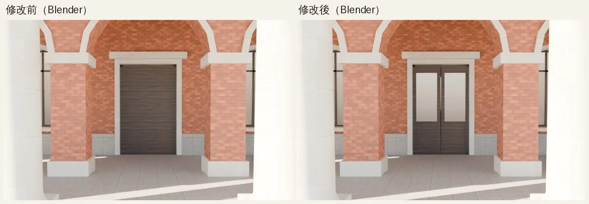

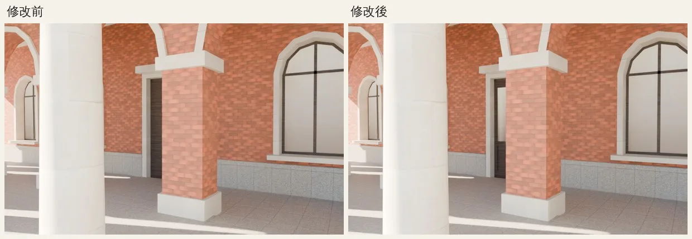

**補漏光**：

- 左邊是補之前：中間的縫透出一條藍線（Blender 裡是天空）。
- 右邊是補之後：縫後面是暗的。

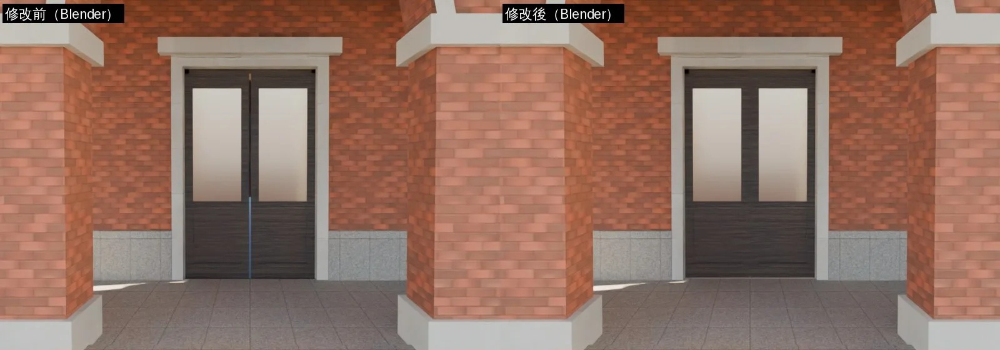

**博雅東側一樓**：

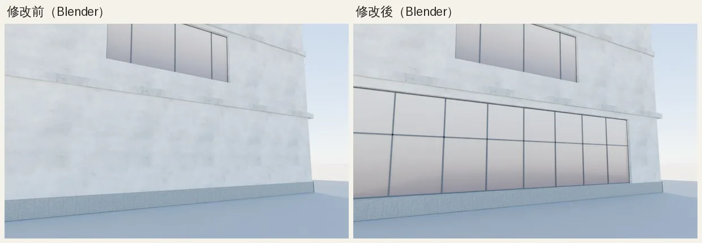

## 遊戲內前後對照

- 環境：`tools/shots/scene_shot.py`，1280×720，Playwright＋SwiftShader，**不是 iPhone**。
- 修改前：開發分支 `a9da472a`；修改後：同一個工作樹換上新的 GLB（大門 `30519553`、博雅 `0343b994`）。
- 拍攝設定：`shots_econfix2_*.json`（第一批）、`shots_doors2_*.json`（正面重拍）。
- 每張圖左邊是修改前、右邊是修改後。

**文學院、行政大樓、校史館**：第一批鏡頭從斜角拍，被拱廊的柱子擋住，看不到門。改成站在門廊中間那一跨正面拍，15:00、20:00 各一張（重拍 j9，22:45～23:4x；`$SP/doors2`）。

**文學院 15:00**：原本門洞是一塊全黑的長方形；現在看得出是兩扇門、上半兩片玻璃（反射一點天光）、中間對開。文學院的門在拱廊最深的陰影裡，下半的木板和門框還是接近全黑，凹板、門把看不出來。

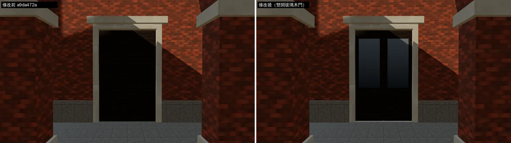

**文學院 20:00**：兩片玻璃透出門廳的暖光；原本整個門洞是黑的。

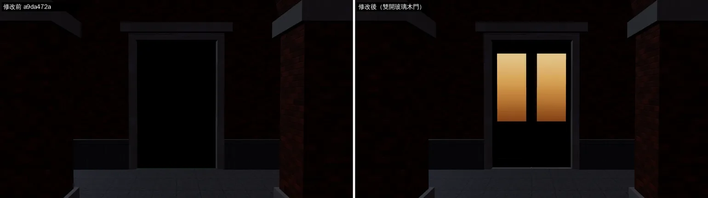

**行政大樓 15:00**：雙開玻璃木門；這裡的陰影比文學院淺，下半的兩塊凹板、中冒頭看得出來。

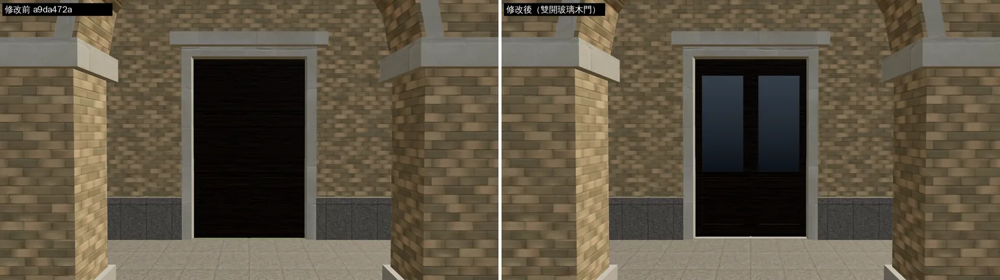

**行政大樓 20:00**：玻璃透出暖光。

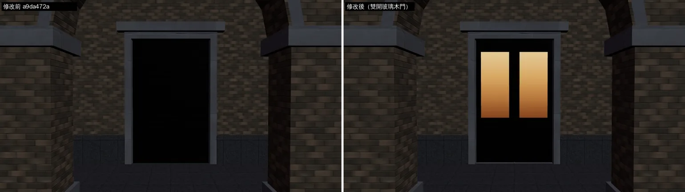

**校史館 15:00**：一道斜的陽光照進門洞左邊，修改前只有那一條看得到木紋，其他是黑的；修改後是雙開玻璃木門，曬到太陽的左扇看得到木紋和框，兩片玻璃反射天光。

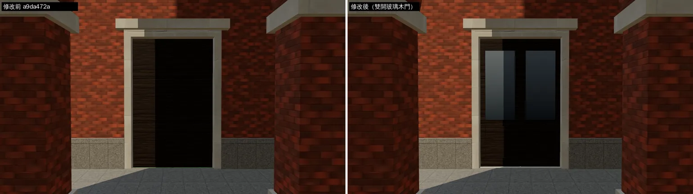

**校史館 20:00**：玻璃透出暖光。

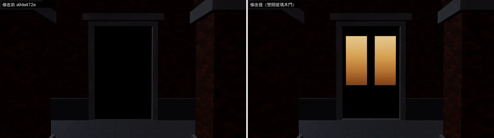

**總圖 15:00**：修改前是一整塊深色木板，門底下露出一條綠線（門洞後面是空的，看得到底下的草地）；修改後是雙開玻璃木門、門底有石材門檻，綠線沒了，中間的對開縫後面是暗的。

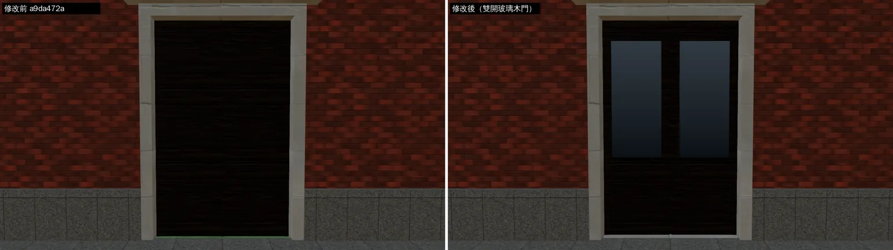

**總圖 20:00**：玻璃透出暖光。左邊那片玻璃上的白點是附近燈的反光。

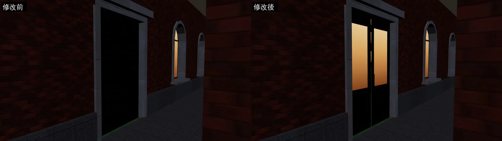

（第一批從斜角拍的總圖門照片（`shots_econfix2_*.json`、補漏光之前的版本）已經換成這兩張正面的。）

**博雅東側**（重拍 j8，22:16～22:40；`$SP/boya2`）：從小椰林道那一側斜看東立面一樓，15:00、20:00。

- 15:00：一樓原本整面是沒開口的灰牆，現在是一道 13 m 的玻璃帶（直櫺、橫櫺），和樓上的窗同一套玻璃。
- 20:00：玻璃帶透出室內的暖光，和樓上亮著的窗一致；原本一樓整片是暗的。

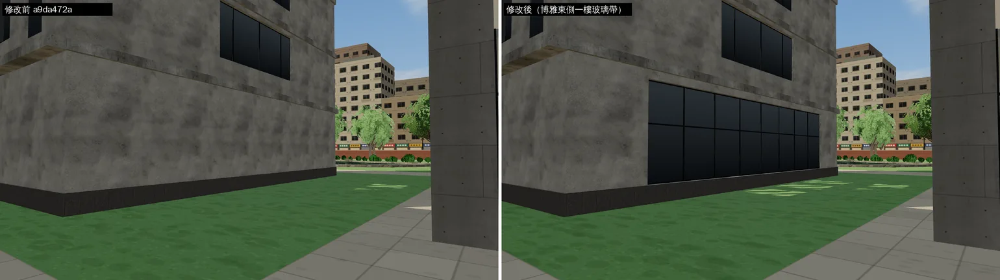

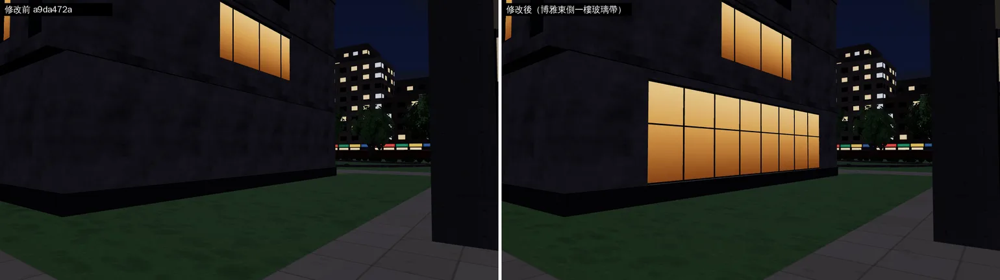

- 同一批還有「正面」兩張（鏡頭 (−9, 1.8, −83)）：鏡頭落在博雅東邊那棟系館的柱子裡，整張灰色，修改前後都一樣，**作廢**。正面看玻璃帶要退到 x −12 左右（兩棟中間只有約 10 m），斜看那兩張已經看得出差別，不再重拍。

## 還不到的地方（誠實寫）

- 門打不開，也走不進去。這幾棟目前都是外觀，門只是畫面上的改善。
- 門的木作很深：在拱廊最深的陰影裡（文學院），下半的凹板、門把幾乎看不出來；陰影淺一點的地方（行政大樓）才看得到。真的老建築的門也是深色木頭，這一版不調亮（木作和窗框共用一個材質，調亮會連整棟的窗框一起變）。
- 博雅一樓的玻璃白天看起來偏黑：遊戲沒有環境貼圖，玻璃只剩一點天空的反光；樓上原本的窗也是這樣。要更像真的大廳，得在玻璃後面放室內的景（像 Café 的窗內店面），這一版沒做。
- 真機沒看過。

## 接法（LAWWW）

- 換 `assets/models/env/second_ai/` 的 `campus_library`、`campus_admin`、`campus_arts`、`campus_hist`、`campus_boya` 五個 `.glb`＋`.json`（我的分支 `claude/second-ai-env-art`）。
- 不用改程式。
