# ART-EXT-GATE：臺大校門（整座，照真的配置）

LAWWW2-C，2026-10-18。

- 誰派的：使用者 10-18 03:3x 說四座全部改；LAWWW-C 04:2x 選做法 A，照真的配置做。
- 狀態：`MODEL_READY`，場景美術 **READY_FOR_ART_REVIEW**（使用者看過才算）。
- **動到導航和出口**：patch 附給 LAWWW-C，等 v9.10 發布以後再套。

## 查到的真實資料（只有文字，沒有照片）
- 來源：臺大訪客中心、台北旅遊網的搜尋摘要；沙盒打不開網站。
- 1931 年 3 月 31 日落成，市定古蹟。
- 磚造加石材；磚的顏色和臺北帝國大學的建築一致。
- **門房在正中間**，人、車都從兩側進出。
- 基礎和四座燈柱是北投唭哩岸一帶採的石材。
- 查不到的：屋頂（平頂還是斜頂）、尺寸、窗的樣子、燈籠的樣子。這些照 1930 年代台大建築的語彙推測。**有照片的話照照片改。**

## 和原本的差別（玩家會看到什麼）
- **原本**（v9.3 第十四批的套件）：
  - 中間一個 8.4 m 的開口、兩根門柱；
  - 門房在校內旁邊；
  - 註解寫「不是照真實台大校門建模」。
- **現在**：
  - 門房在正中間。花崗石勒腳、面磚牆、轉角石（大小交錯）、石材腰帶、兩層簷口、平屋頂女兒牆；
  - 門房的窗朝兩側的通道，門在校內那面，校外那面是石材匾額「國立臺灣大學」。
  - 兩側各一條約 4.5 m 的通道，人從通道走進走出。
  - 四座唭哩岸石燈柱：花崗石柱礎、一段一段的石材柱身、三層出挑的柱帽、鑄鐵燈籠（四面乳白玻璃、四坡頂）；晚上燈籠亮、有光暈。
  - 鐵門：每條通道兩扇，白天往校內打開、靠在燈柱旁（鑄鐵直條、尖頭）。
  - 兩端短的矮牆（面磚、石材壓頂）接上原本的圍牆。
- 校園（椰林大道那一頭）和公館（校門口）兩邊放的是同一個模型，和原本一樣。

## 要改的程式（patch：`docs/art-rebuild/second_ai/patches/campus_gate.diff`）
- `src/campuskit3d.js` 的 `CK.gate()`：
  - 改成同一個配置（尺寸常數 `GATE`，和 Blender 腳本一樣）；
  - 這是導航阻擋，也是正式模型載入失敗時的備用；
  - `userData.gate` 多了 `.house`（門房，給鏡頭碰撞）和 `.lanes`（兩條通道的中心）。
- `src/zones3d.js`：
  - `placeGate`：門房的鏡頭碰撞改用 `.house`，原本寫死在 (7.6, −3.4)；有正式模型時套件標 `dyn`、`ckTag='gate'`。
  - 新的 `gateExits`：出口互動點放在兩條通道上。
  - 新的 `gateGLB`：載入 `bldg.campus_gate`，放到和套件一樣的位置、方向，照校園地標的接法（`attachWenzhouModel`）藏起套件。
  - 校園「走出校門」：原本 (−126, 0) r3 → **兩側通道各一個 (−125.5, ±5.27) r2.5**。
  - 公館「回到校園」：原本 (0, −48) r3，現在是門房 → **兩側通道各一個 (±5.27, −47.5) r2.5**。
  - **兩個區域原本都有一段「把舊開口強制設成可以走」的程式**（校園 x −127～−118、z −4～4；公館 x −4～4、z −50～−44），會蓋掉門房的阻擋。
    - 改成只開兩條通道，開完再用 `placeBlocks` 把門房、燈柱、鐵門擋回去。
- `src/assets3d.js`：加 `bldg.campus_gate`。
- 測試（座標照新配置改）：
  - `tests/campus_layout_nav.py`：
    - 走得到：兩側通道、出口互動點；
    - 不能走：門房、燈柱；
    - 舊存檔站在舊開口正中間（現在是門房）→ 讀檔後移到走得到的地方。
  - `tests/gongguan_layout_nav.py`：
    - 走得到：兩側通道內外、出口互動點；
    - 不能走：門房、四座燈柱。
- 出生點不動：公館 → 校園 (−119, 0)、校園 → 公館 (−2.5, −29)、機場回台北 (−2.5, −29)。
- 有查、不用改的：
  - 劇情、自動走路：`story3d.js`、`events.js`、`outings3d.js` 沒有寫死經過校門正中間的路線。
  - 「回臺北的家」(−120.5, 2.4) r1：在門房後面 0.8 m，站得住；和新的出口不重疊。
  - `CLS.ANCHOR`、`guide3d` 沒有校門的座標，照出口的 label 找。
  - `flow_bike.py`：照遊戲裡的出口位置找，不是寫死的。
  - `find_person_unit.js`：自己的假資料。
  - `home_unit.js`：還是拿舊的 (−126, 0) 算「不和走出校門重疊」，一樣會過，但量的不是現在的出口。要的話改成量 `走出校門` 兩個點。

## 遊戲內前後截圖
Playwright、iPhone 直向 390×844 模擬（另一張橫向）；LAWWW-C 分支 `1fe92919`。
- 上一排：改之前＝LAWWW-C 分支原樣，`e2c78c34` 的校門和現在一樣。
- 下一排：改之後＝本 patch＋GLB。

| 校園：從椰林大道看校門 | 校園：通道裡 | 校園：晚上 20:30 | 公館：從校門口看 | 公館：斜看 |
|---|---|---|---|---|
| 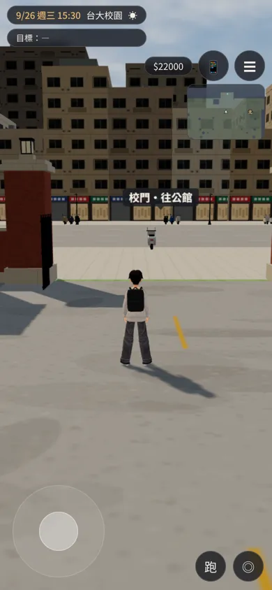 | 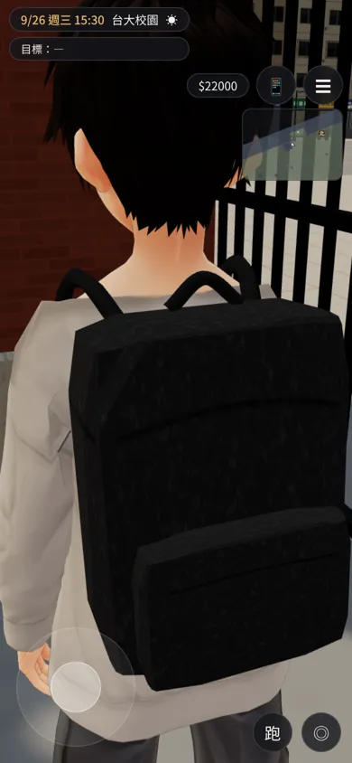 | 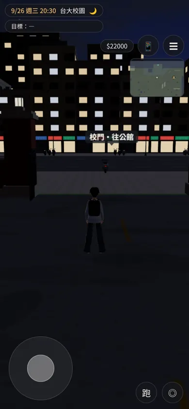 | 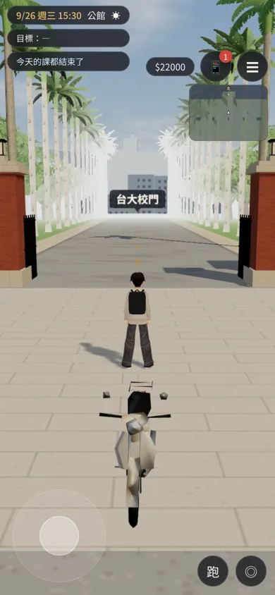 | 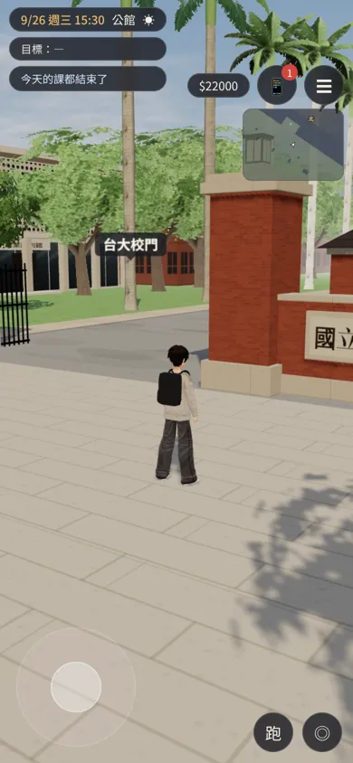 |
| 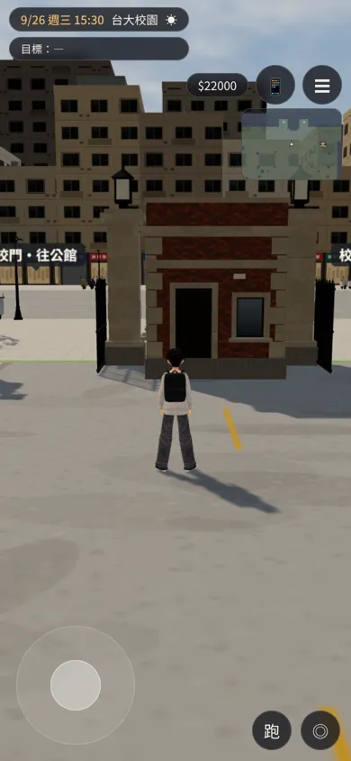 | 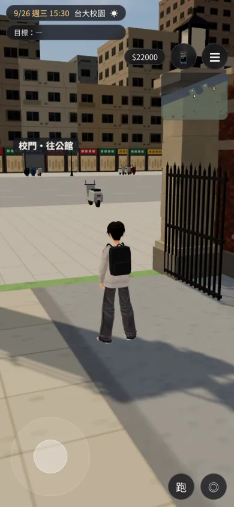 | 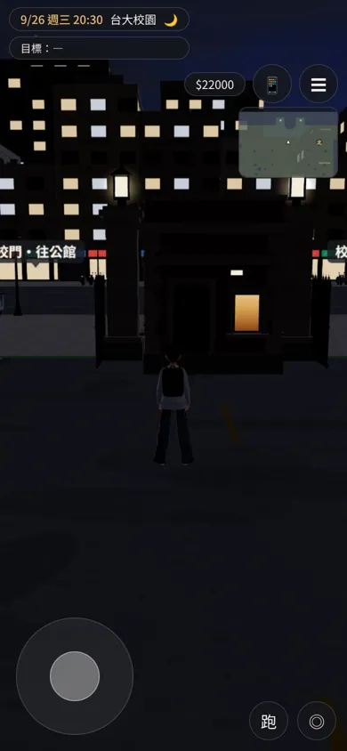 | 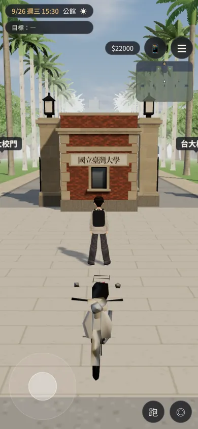 | 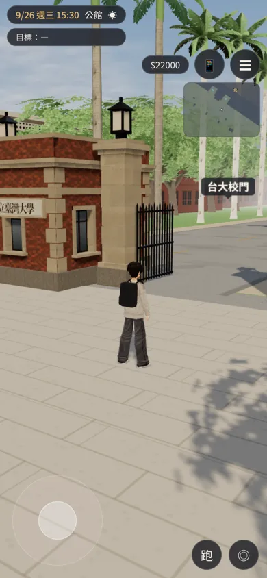 |

橫向（公館）：

| 改之前 | 改之後 |
|---|---|
| 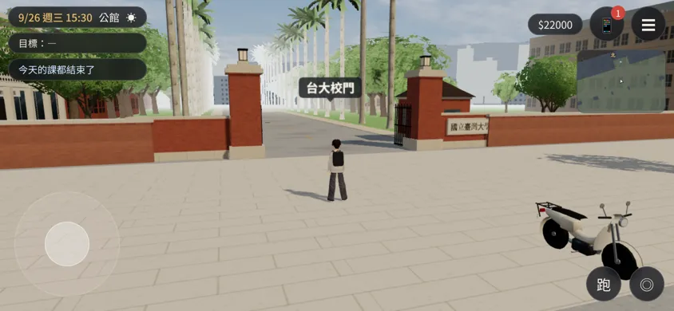 | 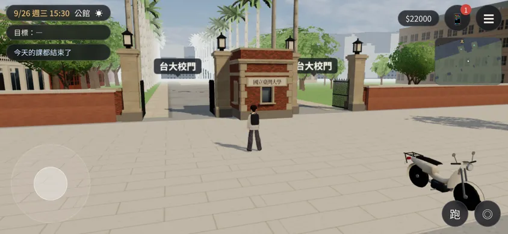 |

- 「校門・往公館」「台大校門」是遊戲的出口提示（UI）。現在兩條通道各一個出口，所以提示出現兩個。
- 改之前「校園：通道裡」那張，站的位置是舊門柱旁邊，鏡頭被擠到人物背後。

Blender 算圖（Cycles）：

| 校外 | 校內 | 燈柱、門房轉角 |
|---|---|---|
| 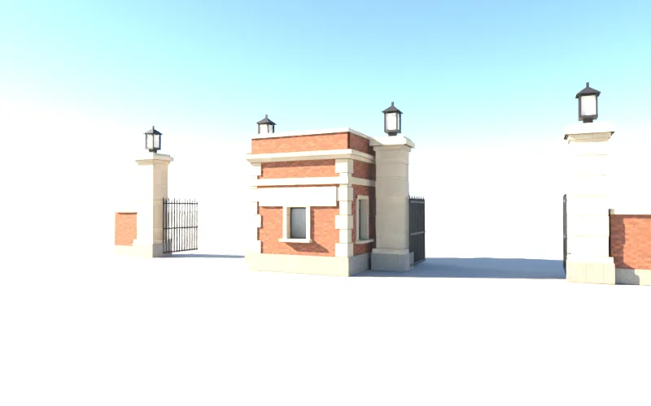 | 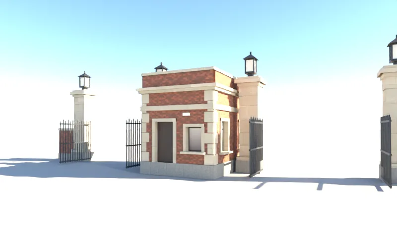 | 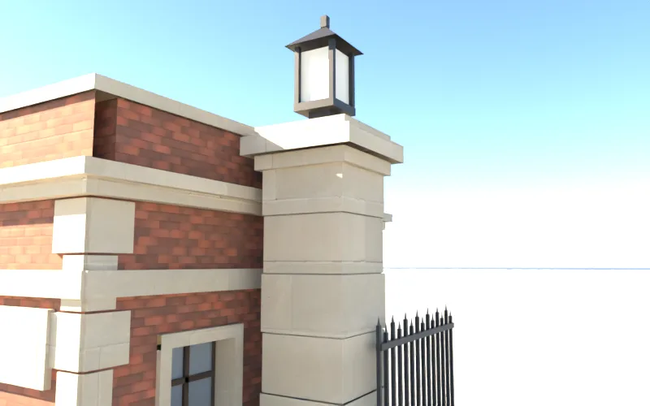 |

## 測試（套 patch 的樹，`1fe92919`＋本 patch）
- `node tests/nav_buildings_unit.js` ALL PASS。
- `node tools/dev_scratch/kit_nav_check.js` ALL PASS。
- `python3 tests/campus_layout_nav.py` ALL PASS（81 項）。
  - 第一次跑抓到兩個區域原本都有一段「舊開口強制設成可以走」的程式，蓋掉了門房的阻擋（見上面）。
  - 測試清單裡舊的三項（舊門柱 (−124, ±4.9)、舊門房 (−120.6, 7.6) 不能走）拿掉：那裡現在是通道或空地。
- `python3 tests/gongguan_layout_nav.py` ALL PASS。
- `python3 tests/zone_transitions.py` ALL PASS（校門 → 公館 → 回校園）。
- `python3 tests/p0_movement.py` RESULT: ALL PASS。
- `python3 tests/reachability_all.py --zones campus,gongguan` ALL PASS（51 個互動點、15 個出入口到達點）。
- 遊戲內截圖沒有 JS 錯誤。
- patch 在 LAWWW-C 最新的 `6ca69c33`（v9.10 發布用）上 `git apply --check` 乾淨。
- 沒測：
  - iPhone 實機；
  - 真實玩家流程走過校門（`flow_bike.py` 騎車出校門會用新的出口，沒有跑）；
  - `home_unit.js` 沒有跑。

## 還沒做到的（誠實列出）
- 沒有照片：
  - 門房的屋頂（平頂）、窗、門的位置是推測；
  - 燈籠的樣子是推測；
  - 柱身的段數、柱帽的線腳是推測。
- 匾額的字照套件原本的「國立臺灣大學」。真的校門匾額在哪一面、寫什麼字，沒有查到。
- 門房裡面沒有做（看不進去）。
