# ART-EXT-M1：男一舍外觀（Blender）

LAWWW2-C，2026-10-18。

- 誰派的：使用者 10-18 03:3x 說四座全部改（男一舍、校門、普通／博雅、捷運出口），LAWWW-C 03:08 轉達、照順序派。
- 狀態：`MODEL_READY`，場景美術 **READY_FOR_ART_REVIEW**（使用者看過才算）。
- 只換外觀：位置、佔地、門口、導航、互動點（回宿舍 (20, 59.6)）都照遊戲現在的；室內沿用 `dorm_hall.glb`、`dorm_room4.glb`。

## 查到的真實資料（只有文字，沒有照片）
- 住宿組男一舍頁的搜尋摘要：
  - 長興街 50 號，1980 年落成，2006 年翻修；
  - 地上 4 層、地下 1 層，沒有電梯；
  - 約 970 床，四人房為主，輔導員辦公室在 2、3 樓。
- 沙盒連不上住宿組網站和 Dcard，看不到照片。
- 所以外觀是「依文字資料的遊戲化設計」：台灣 1980 年前後公立大學宿舍常見的樣子，**不是照片還原**。
- 使用者有男一舍的照片的話，照照片改。

## 玩家會看到什麼（和原本的套件、大一女舍的差別）
- **地上 4 層**，照住宿組資料。原本的套件是 5 層；patch 把套件也改成 4 層，鏡頭碰撞跟著變矮。
- **外牆**：米灰色的小口馬賽克磚（真實比例約 4 cm 一塊）。
- **露明的混凝土框架**：每 4 m 一根灰白色柱子、每層樓板一條水平帶，立面一格一格的，1980 年代的公家建築常見這樣。
- **正面中間的樓梯間**：一整面鏤空花磚（台灣 70～80 年代樓梯間、陽台常見）。
  - 洞看進去是樓梯間的陰影和樓梯平台；
  - 一路往上凸出屋頂，成為樓梯間出口，上面一個混凝土水塔。
- **正面寢室**：
  - 鋁框推拉窗（上面一格固定窗）＋混凝土窗框；
  - 有些窗下有窗型冷氣；
  - 一樓的窗有鐵窗。
- **背面寢室**：
  - 每間一個小陽台：混凝土欄杆、兩根曬衣桿、衣服、冷氣室外機；
  - 陽台之間是垂直的遮陽板。
- **兩端**：走廊盡頭的窗、浴室的小窗。
- **屋頂**：女兒牆、太陽能熱水器、冷氣室外機、天線。
- **門口**：
  - 平頂雨遮，位置和寬度照套件的門廊；
  - 鋁框玻璃門、名牌「男一舍」、刷卡機、住宿公告欄、門口左邊一排信箱；
  - 晚上雨遮下的吸頂燈亮、地上一圈光（和大一女舍同一套）。
- **晚上**：約七成的窗亮燈。
- 和大一女舍刻意不同（D38 第 1 條：不是同一個模型換顏色）：
  - 女舍：二丁掛面磚、正面白色樓梯間直條、窗上遮陽板、窗外曬衣架；
  - 男一舍：馬賽克磚、混凝土框架、花磚樓梯間、背面陽台。

## 遊戲內前後截圖
Playwright、iPhone 直向 390×844 模擬（另一張橫向）；LAWWW-C 分支 `e2c78c34`。
- 上一排：改之前＝LAWWW-C 分支原樣，套件 5 層。
- 下一排：改之後＝本 patch＋另一個 patch（`night_rereg.diff`，晚上窗亮燈的修正，見下面）。

| 正面（15:30） | 斜看 | 門口 | 晚上 20:30 |
|---|---|---|---|
| 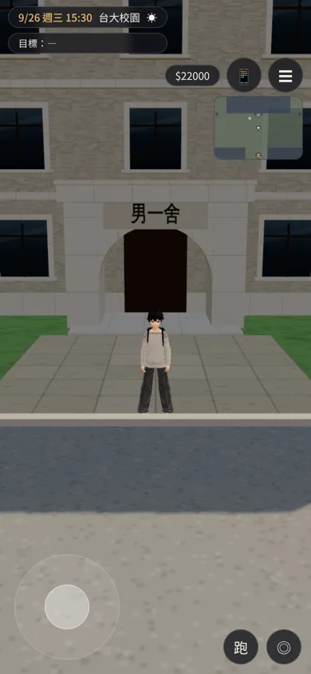 | 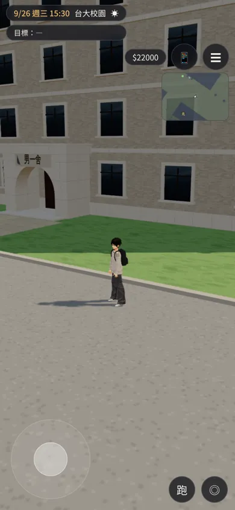 | 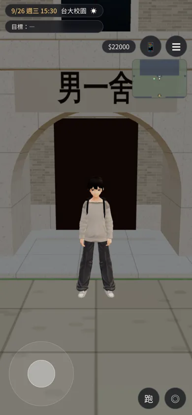 | 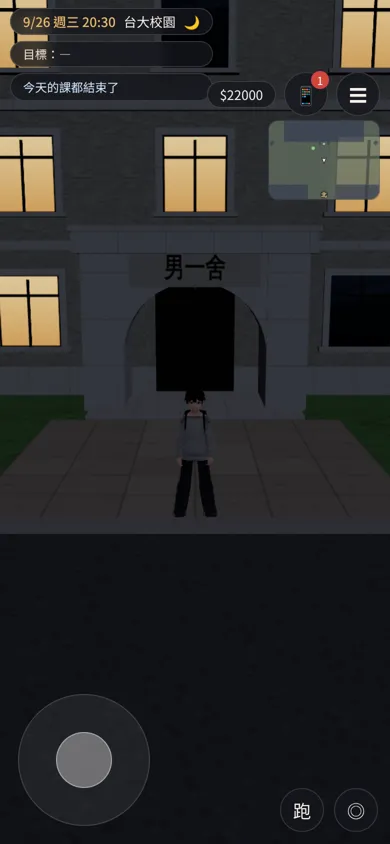 |
| 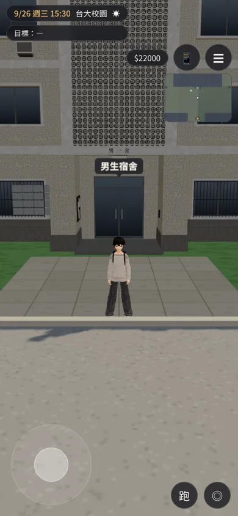 | 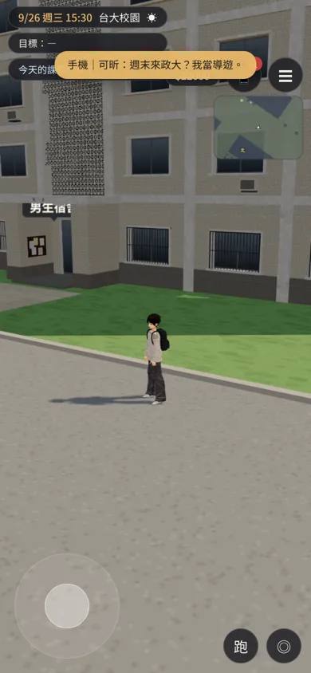 | 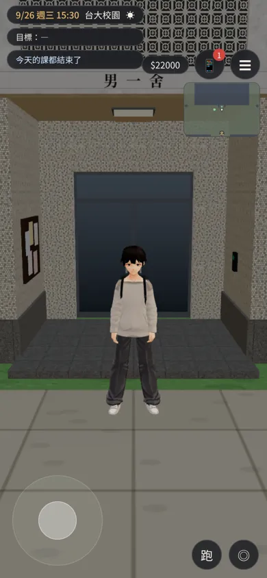 | 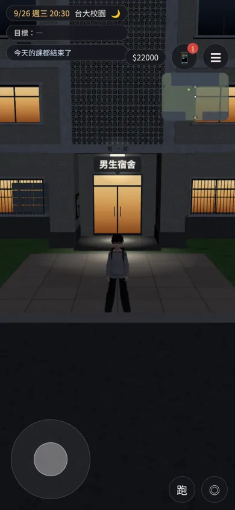 |

橫向：

| 改之前 | 改之後 |
|---|---|
| 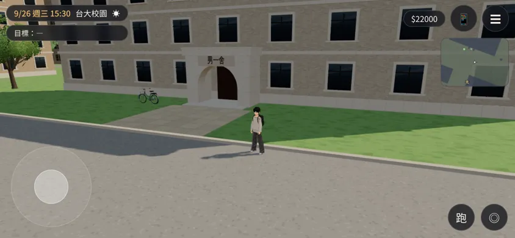 | 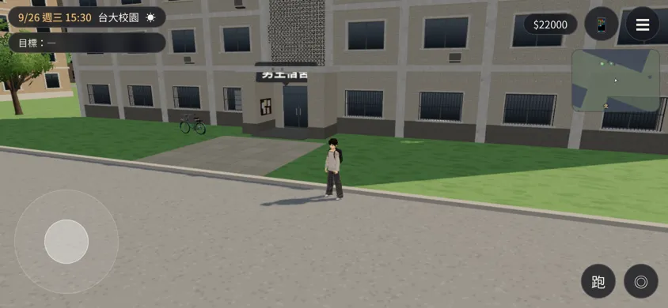 |

- 門口上方的「男生宿舍」是遊戲的出口提示（UI），不是模型上的字。改之前被套件的拱門擋住看不到。
- 鏡頭在正面時，樓梯間的花磚佔畫面上半；鏡頭拉遠才看得到整棟。

Blender 算圖（Cycles）：

| 正面 | 門口 | 背面（陽台） |
|---|---|---|
| 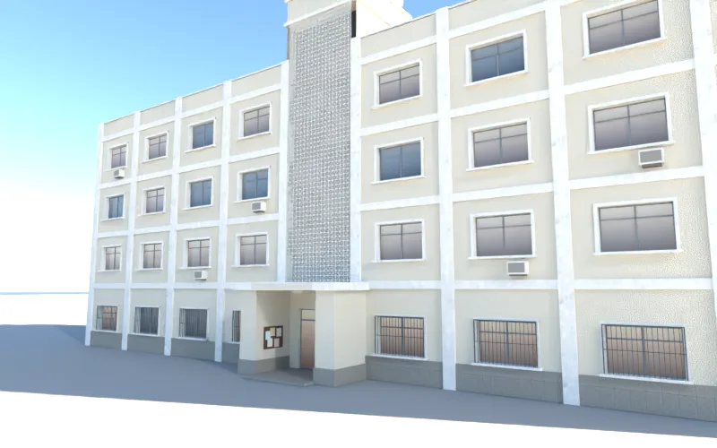 | 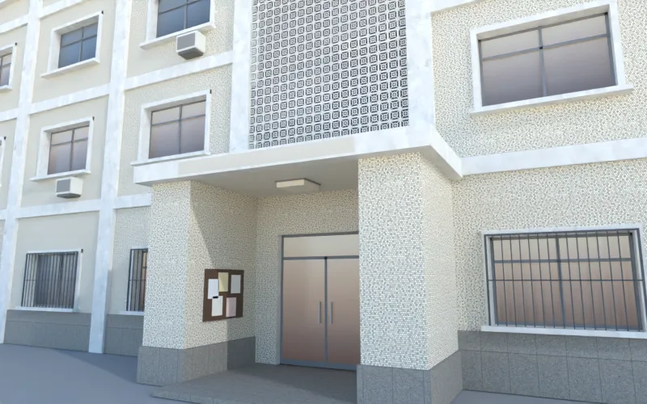 | 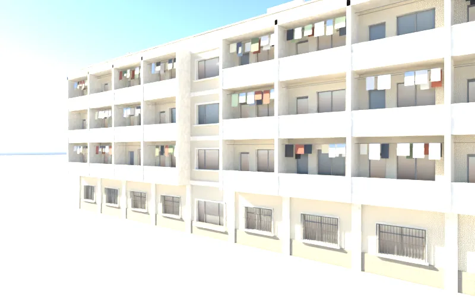 |

## 交付
- `assets/models/env/second_ai/campus_male1.glb`：1.1 萬三角形、1.0 MB、13 個材質。
  - 不用 instancing；同材質合成一個網格；純色零件併成頂點色材質 `wz_vc_m1`。
- 腳本：`tools/blender/env_second/campus_male1.py`，用 `archkit.py`，和大一女舍同一套工具。
  - 鏤空花磚貼圖 `textures/gen/m1_breeze.png` 由腳本自己產生。
- **patch 一**：`docs/art-rebuild/second_ai/patches/campus_male1.diff`，對 LAWWW-C 分支 `e2c78c34`，`git apply` 乾淨。
  - `src/assets3d.js`：加 `bldg.campus_male1`。
  - `src/zones3d.js`：
    - 男一舍的 `CK.hall` 由 `floors:5` 改 `floors:4`；
    - `dormB.userData.ckTag='male1'`，有正式模型時標 `dyn`；
    - 載入後 `attachWenzhouModel(…,'male1')`，和大一女舍同一套接法；
    - 門廊吸頂燈的光暈加 (20, 60)。
  - 導航阻擋、門口互動點、出口都沒改。
  - 載入失敗時照舊是套件，套件也是 4 層。
- **patch 二**（另外發現的錯誤，修在遊戲程式，請 LAWWW-C 決定要不要收）：`docs/art-rebuild/second_ai/patches/night_rereg.diff`。

## 另外發現：正式模型的窗、燈第二次進區域以後不跟著天黑亮（patch 二）
- **現象**：白天進校園，到了晚上，大一女舍、男一舍（以及其他 Blender 正式模型）的窗都不亮。反過來，晚上第一次進來的話，到了白天窗還亮著。
- **原因**：
  1. 正式模型的材質和 ASSETS 的快取共用（`c.scene.clone(true)` 不複製材質）。
  2. 離開區域時 `disposeGroup` → `TK.forget` 會把這些材質從夜間清單拿掉。
  3. 再進來時，`attachWenzhouModel` 的 `wzReg`、`attachExterior` 的 `nightReg`、Café 的 `cafeReg` 已經是 true，直接 return，不會重新 `TK.addNight`。
  4. 結果亮度停在第一次接上時的值。
- **修法**：
  - 有這些旗標的時候，還是照表重新 `TK.addNight`（它自己會去重複）；
  - 傅鐘的 `ck_bell_wash` 一起處理；
  - 其他一次性的設定照舊只做一次。
- **測試**：`docs/art-rebuild/second_ai/patches/night_rereg_check.py <url>`。
  - 流程：白天進校園 → 天黑 → 進宿舍 → 回校園 → 天黑，量大一女舍窗玻璃的 `emissiveIntensity`。
  - 標 [前置／捷徑]：用 applySave、GAME.enter、applyTime。
  - 改之前（`e2c78c34`）：**FAIL**，第一次天黑就是 0；回校園那一步量不到值（null），原因沒有追。
  - 改之後：**PASS**，天黑 1、白天 0、回來再天黑 1。
- 兩個 patch 互相獨立，一起套也乾淨（已檢查）。

## 測試
- 通過：
  - `node tests/nav_buildings_unit.js` ALL PASS（套兩個 patch 的樹）；
  - `python3 tests/campus_layout_nav.py` ALL PASS（78 項，同一棵樹）；
  - 遊戲內截圖沒有 JS 錯誤；
  - 夜間檢查（上面）。
- 沒測：
  - iPhone 實機；
  - 真實玩家流程（`flow_dorm_hall.py`：導航、門口沒改，照理不受影響）；
  - 鏡頭在男一舍背面（陽台那一側）的遊戲內截圖。

## 還沒做到的（誠實列出）
- 沒有照片：真的男一舍外觀一定和這個不一樣（顏色、窗型、樓梯間的位置、陽台）。
- 背面的陽台在套件的鏡頭碰撞外面：鏡頭在背面時可能穿過陽台的樓板。背面很少走到，沒有加碰撞。
- 門口沒有腳踏車、機車：要加的話得先加導航阻擋，不然玩家會穿過去。
- 地下 1 層沒有表現（從外面看不到）。
