# ART-EXT-TEACH：普通教學館、博雅教學館（外觀＋室內）

LAWWW2-C，2026-10-18。

- 誰派的：使用者 10-18 03:3x 說四座全部改；LAWWW-C 03:08 派，範圍是外觀＋室內。
- 狀態：`MODEL_READY`，場景美術 **READY_FOR_ART_REVIEW**（使用者看過才算）。
- 分兩批交：
  - **第一批：外觀**（已整合）。
  - **第二批：室內**（牆、地板、天花、樓梯、教室），見最下面。

## 第一批：外觀

### 查到的真實資料（只有文字，沒有照片）
來源：`docs/art-rebuild/second_ai/research/四棟教學館與宿舍_參考資料.md` 第 2、3 節。使用者 10-13 給的照片連結，沙盒還是打不開。
- **普通**：
  - 1991 年重建、五層樓、磚紅色、和周圍建築協調；
  - 二樓有空橋往北接博雅。
- **博雅**：
  - 2011 年啟用、地上五層＋地下一層，境向聯合建築師事務所；
  - 入口在西南（綠園）與東側；北邊是醉月湖；
  - 一樓有階梯教室和三處大型公共空間。

### 玩家會看到什麼
- **普通**（照文字資料）：
  - 五層；紅褐色面磚；
  - 每層一條洗石子的樓層帶，窗是洗石子窗框＋鋁窗，一開間一道磚柱；
  - 正面中間的平頂門廊（洗石子框、玻璃門、名牌「普通教學館」）；
  - 北面二樓是空橋的門；屋頂有樓梯間出口、水塔、冷氣室外機。
- **博雅**（**現代建築的外觀是推測**，沒有照片）：
  - 五層；
  - 一樓整面玻璃（大廳、公共空間），往內退 0.6 m、上面的樓板挑出去；
  - 上層是橫向長窗＋垂直鋁鰭；淺灰外牆；
  - 東端一道直的樓梯間長窗；四面挑出 0.9 m 的薄屋頂板；
  - 南面入口：薄雨遮＋兩支細鋼柱、名牌「博雅教學館」。
- 兩棟都是五層（真的樓層數）。原本的套件是四層，patch 一起改。
- 樓層高度和空橋對得上：
  - 普通一樓 4.0 m＝校園空橋外觀的 `Y0`；
  - 博雅一樓 4.6 m＝空橋往北升 0.6 m 的那一端。

### 遊戲內前後截圖
Playwright、iPhone 直向 390×844 模擬（另一張橫向）；LAWWW-C 分支 `5ffde5b3`。
- 上一排：改之前，套件。
- 下一排：改之後，本 patch＋GLB。

| 普通（從東南看） | 普通晚上 20:30 | 兩棟之間（空橋下） | 博雅（醉月湖那一側） |
|---|---|---|---|
| 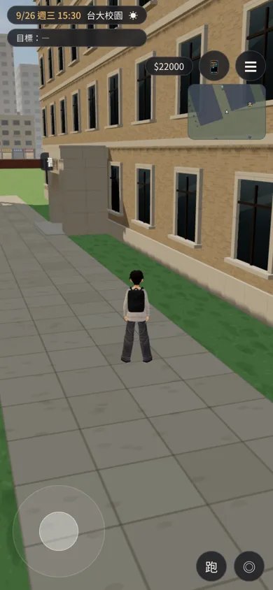 | 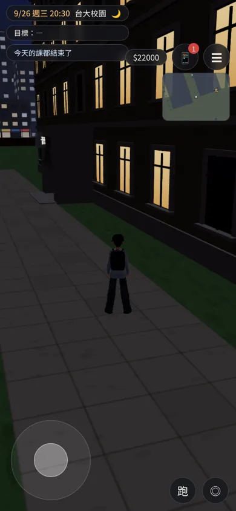 | 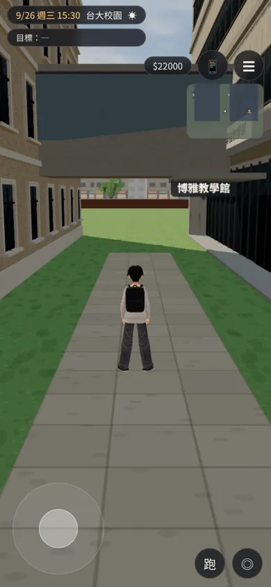 | 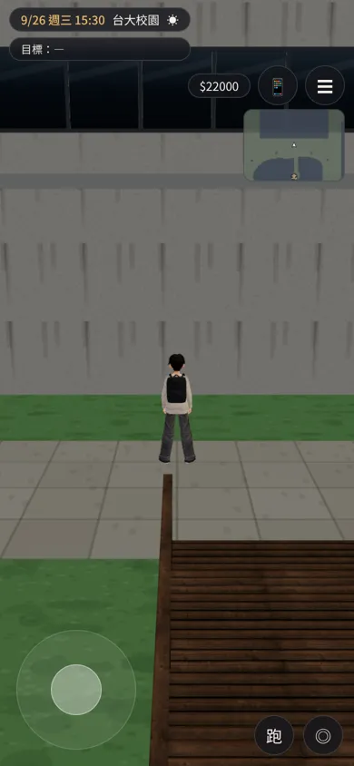 |
| 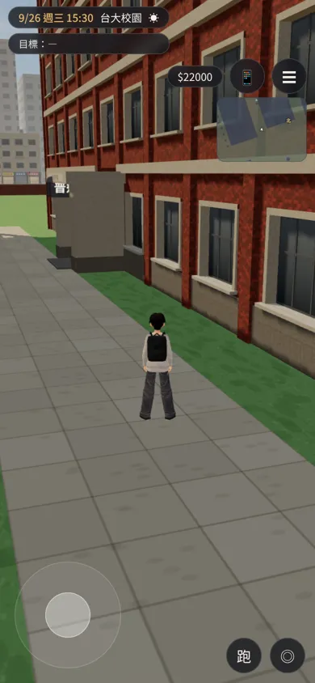 | 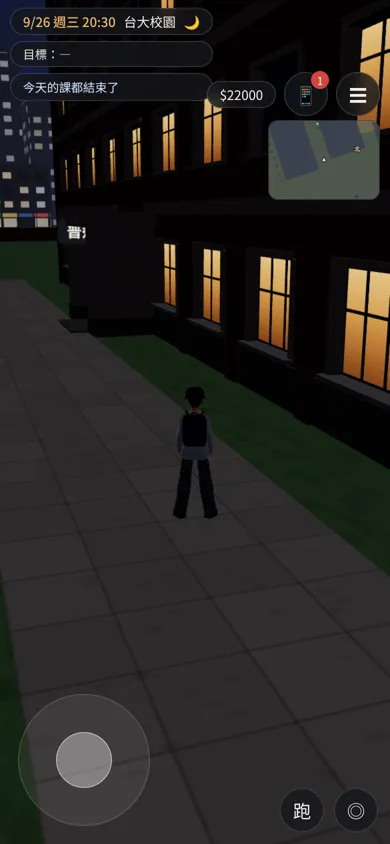 | 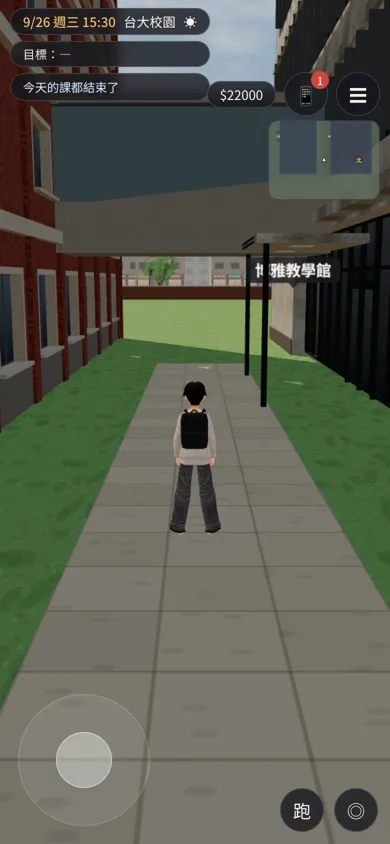 | 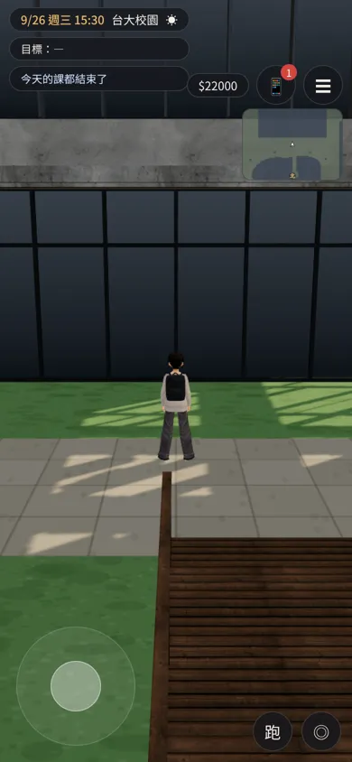 |

橫向：

| 改之前 | 改之後 |
|---|---|
| 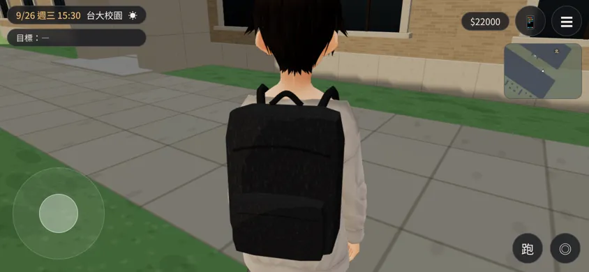 | 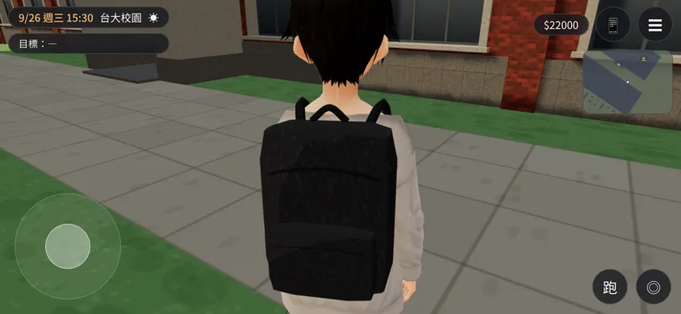 |

- 普通正面南邊離文學院的背面只有約 5.5 m，鏡頭退不開，所以正面那張從東南斜看。

Blender 算圖（Cycles）：

| 普通 | 博雅（北面） | 鳥瞰 |
|---|---|---|
| 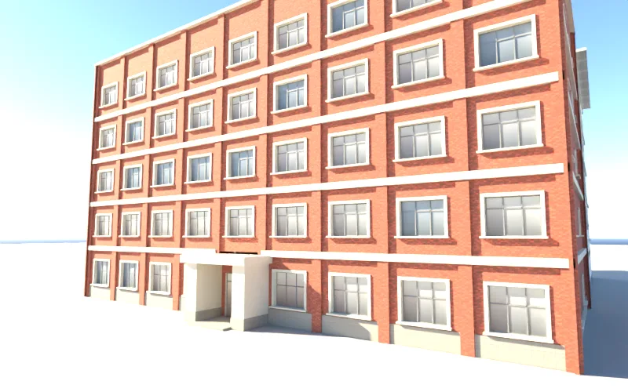 | 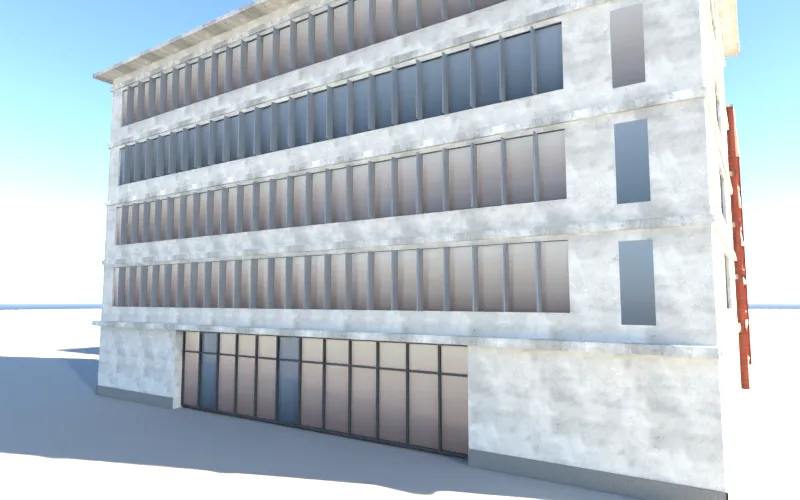 | 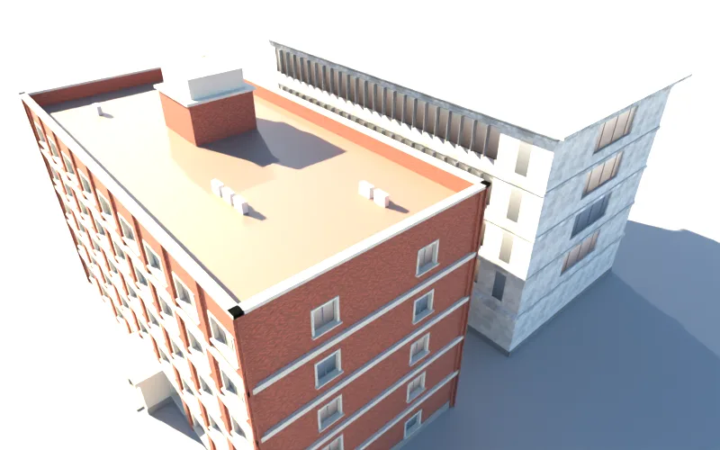 |

### 交付
- GLB：
  - `assets/models/env/second_ai/campus_putong.glb`：7.2 千三角形、0.7 MB；
  - `assets/models/env/second_ai/campus_boya.glb`：3.4 千三角形、0.5 MB。
- 腳本：`tools/blender/env_second/campus_teach.py -- --set putong|boya`。
- patch：`docs/art-rebuild/second_ai/patches/campus_teach_ext.diff`，對 LAWWW-C 分支 `5ffde5b3`。
  - `src/assets3d.js`：加 `bldg.campus_putong`、`bldg.campus_boya`。
  - `src/zones3d.js`：
    - 普通 `CK.hall` 改 `floors:5, fh:3.6`；
    - 博雅 `CK.modern` 改 `floors:5, gfh:4.6`；
    - 兩棟加 `ckTag`、有正式模型時 `dyn`；
    - 載入後 `attachWenzhouModel`，和其他校園地標同一套接法。
  - 導航、門口互動點（`classes3d.js` 的 `DOORS.putong`、`DOORS.boya`）都沒改。
- 測試：
  - `node tests/nav_buildings_unit.js` ALL PASS；
  - 遊戲內截圖沒有 JS 錯誤。
  - 沒測：iPhone 實機；`campus_layout_nav`（導航沒動，沒有跑）。

### 還沒做到的
- 兩棟都沒有照片。博雅的外觀幾乎都是推測：顏色、材料、窗的分割、雨遮。
- 博雅西南、東側的另外兩個入口沒有做。遊戲只有南面一個門口互動點。
- 博雅地下一層看不到，沒有做。

## 第二批：室內
### 玩家會看到什麼
- 地板、樓板：灰白磨石子地板，樓梯平台、走廊同一套。
- 牆：
  - 外牆內側的窗框、窗台；
  - 入口是鋁框玻璃雙開門，上面一排固定窗；
  - 普通二樓北面是往空橋的玻璃門。
- 天花：輕鋼架天花板＋燈具。
- 樓梯：踏面、止滑條、扶手。
- 教室：
  - 黑板、講桌、講台；
  - 博雅 101 階梯教室：平台、走道台階、走道地毯；
  - 關著的房間是有木紋的門。
- 大廳、交誼區：沙發。
- 桌椅照舊是遊戲原本的桌椅（座位資料不變），搬到不會被藏起來的群組。

### 要改的程式（patch：`docs/art-rebuild/second_ai/patches/campus_teach_int.diff`，對 LAWWW-C 分支 `ba6e9aa4`，`git apply --check` 乾淨）
- `src/assets3d.js`：加 `bldg.putong_interior`、`bldg.boya_interior`。
- `src/teach3d.js`：
  - 桌椅、長椅、公告欄、講堂椅從備用模型群組 `fallback0／fallback1` 搬到 `furniture0／furniture1`（正式模型載入後會藏起備用模型，桌椅要留著）；
  - 載入 `bldg.<id>_interior`，用 `B3.attachFormal`（和法圖、萬才館同一套）；
  - 隔間牆（`tb_partition`）擋住鏡頭時網點透空；
  - `fadeWalls` 用牆的包圍盒中心（正式模型的牆頂點是世界座標）。
- `tests/desk_furniture_unit.js`：找合成桌椅網格時，父群組的名字從 `fallback0` 改成 `furniture0`；量法（桌面在平台上 0.75 m）不變。
- 導航、座位、互動點都沒改。

### 遊戲內前後截圖
Playwright、iPhone 直向 390×844 模擬，9/26 週三 11:00。
- 上排：改之前（LAWWW-C 分支 `5ffde5b3`）。
- 下排：改之後。

博雅（左到右：大廳、101 階梯教室、自習區、樓梯、二樓走廊）：
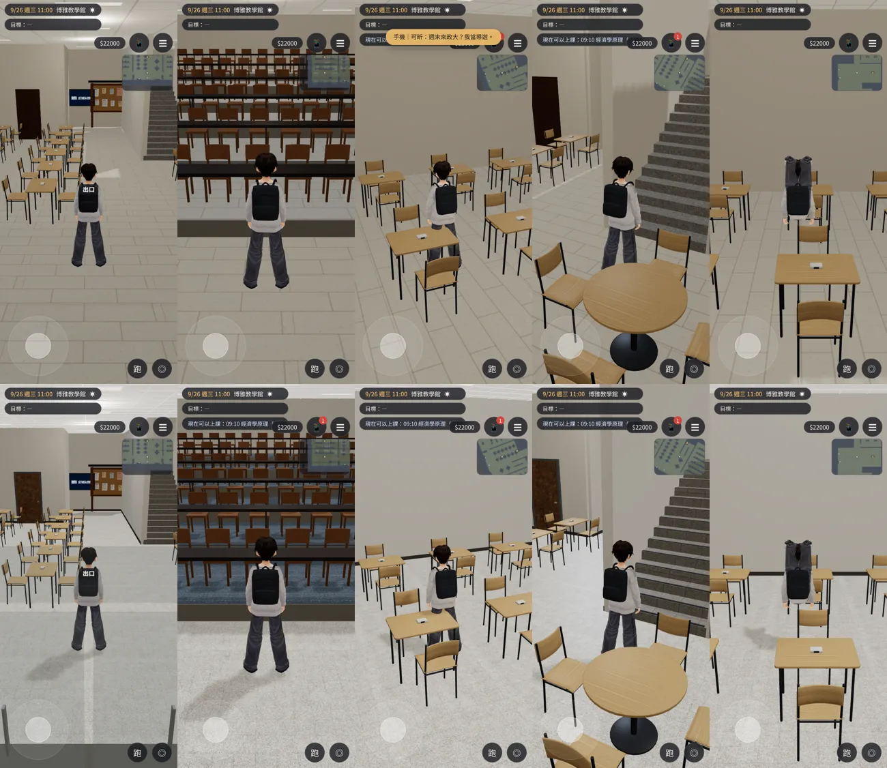

普通（左到右：大廳、101 教室、樓梯、二樓走廊）：
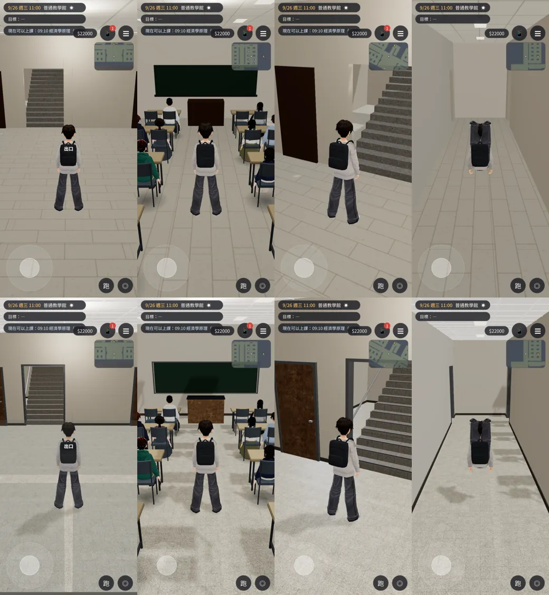

- 大廳那張的鏡頭在入口外面。畫面最下面的灰條是入口的地墊和門框。
  - 第一版地墊深 1.4 m、深灰，往下看是一整條黑帶；改成淺灰、0.95 m。

### 交付
- GLB：
  - `assets/models/env/second_ai/boya_interior.glb`：11.4 千三角形、1.3 MB；
  - `assets/models/env/second_ai/putong_interior.glb`：9.2 千三角形、1.0 MB。
- 腳本：`tools/blender/env_second/teach_interior.py -- --set boya|putong`，讀 `src/data/<id>_layout.js` 的配置。

### 測試（套 patch 的樹）
- `node tests/teach_class_unit.js` ALL PASS。
- `node tests/boya_lecture_unit.js` ALL PASS。
- `node tests/desk_furniture_unit.js` ALL PASS。
  - 改測試之前，第 C 項失敗：找不到 `fallback0` 底下的桌椅。
- `node tests/seated_figures_unit.js` ALL PASS。
- `node tests/nav_buildings_unit.js` ALL PASS。
- 遊戲內 9 個鏡頭沒有 JS 錯誤。
- 沒測：
  - iPhone 實機；
  - `reachability_all`（導航沒動）；
  - 真實玩家流程。

### 還沒做到的
- 沒有室內照片。顏色、材料、天花板的樣子都是推測。
- 教室的窗外沒有景（和原本一樣）。
- 博雅的地下一層沒有做。
