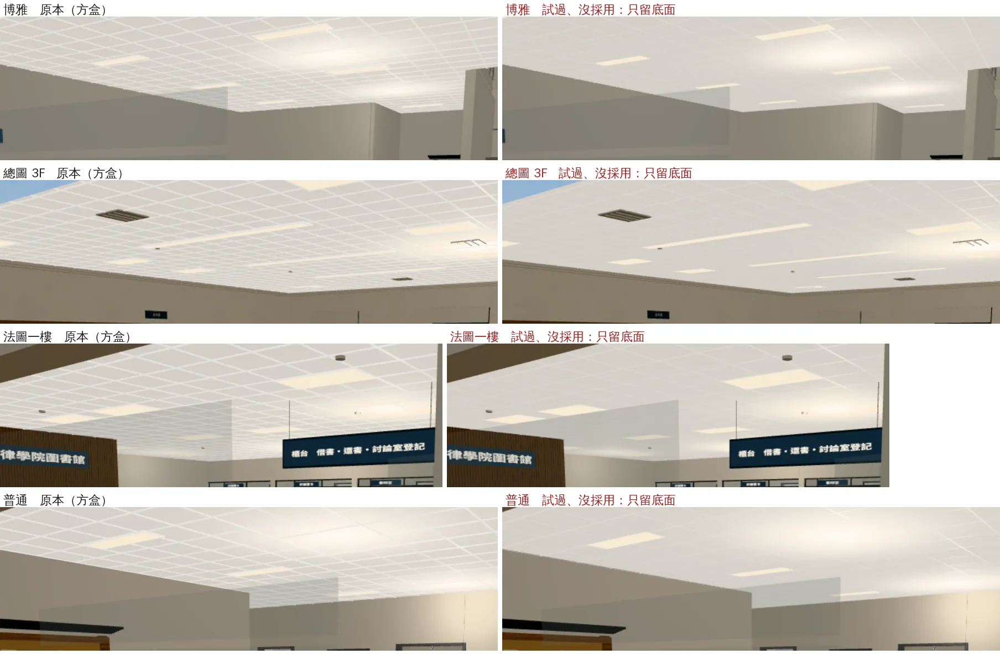
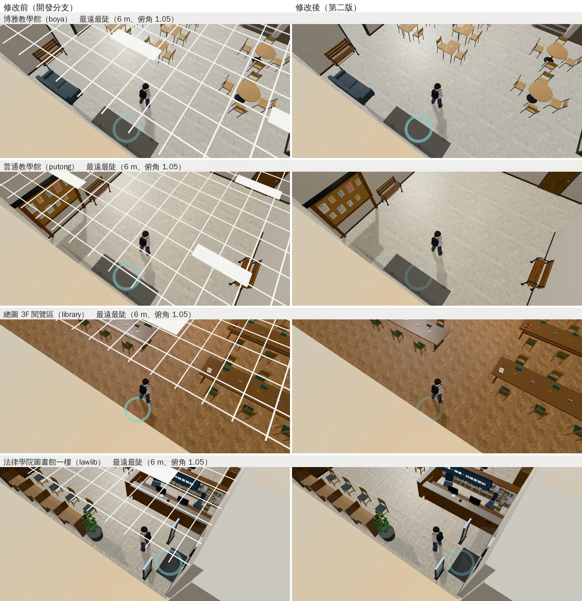
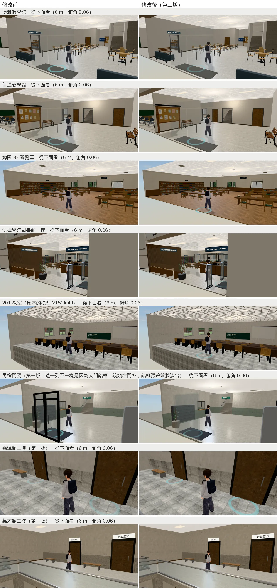
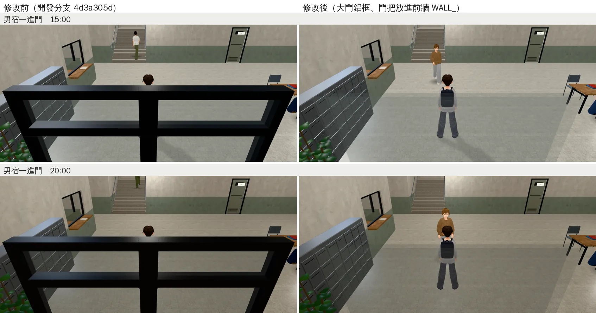

# 室內天花板：鏡頭拉到最遠時不再是一整片白、不再浮著白格子和燈（ART-CEIL-LAWWW-ROOMS-1022，第二版）

帳號 A 的 LAWWW2，2026-10-22 09:0x～11:xx UTC。

- **狀態**：
  - 第一版（`63d4a3e3`）：201 教室、男宿門廳、霖澤館、萬才館的天花板。LAWWW 已接進開發分支 `4d3a305d`。
  - **第二版交件**：`READY_FOR_ART_REVIEW`（場景美術由使用者驗收）。
    - `patches/ceiling_lights.diff` 只改 `tests/room_ceiling_unit.js`，對開發分支 `4d3a305d`、`0bb6e8c0`、`cc4528be` 都乾淨。
    - 八份 GLB 同檔名替換，遊戲的程式不用改。
- **派工**：LAWWW 08:34（P2）——四個房間的天花板，照 118 巷那次的做法改，交件附鏡頭拉到最遠、最陡的前後。
  - 第二版是同一件事做完整：天花板上掛的骨架、燈也處理。
  - 我自己的博雅、普通、總圖 3F、法律學院圖書館一起做（10-22 盤點記的 P3）。
- **起因**：10-22 的天花板盤點（j36c，`l118_arcade_1022/README.md`「其他室內的天花板盤點」）。
  - 雙指拉到最遠（6 m）、往上拖到最陡（俯角 1.05）時，鏡頭在天花板上面。
  - LAWWW 的四間：整個畫面是天花板的背面（第一版修了）。
  - 天花板改單面以後：
    - 骨架（T 型骨架、輕鋼架）、燈框、燈箱這些方盒，從上面看是浮在房間上面的白格子、白條；
    - 燈板是雙面的，從上面也看得到。
  - 我的四間：天花板本來就是單面，一樣是白格子、白條。

## 做法

| 東西 | 做法 | 從下面看 | 鏡頭在上面 |
|---|---|---|---|
| 天花板（第一版） | 材質單面（四邊形本來就朝下） | 不變 | 看不到 |
| 平的燈板（嵌在天花板） | 材質單面（四邊形本來就朝下） | 不變 | 看不到 |
| 骨架、輕鋼架、燈框、201 的燈箱、男宿門廳的吸頂日光燈（方盒） | **形狀不變**；整組放進名字含 `WALL_`、自訂屬性 `dir`＝[0,−1,0]（往室內＝往下）的節點 | 不變（同一組三角形） | **藏起來**：和牆一樣淡出 |

- 方盒那一組用的是遊戲現成的邏輯，程式不用改：
  - 各區域的 `fadeWalls` 算「鏡頭到這一組中心的向量 · `dir`」，小於 0（鏡頭在它上面）就把透明度設成 0.12；
  - 引擎的 `hideFaded` 再把這種整個藏起來。
  - `attachRoomGLB`（201、總圖 3F）、`B3.attachFormal`（霖澤館、萬才館、博雅、普通、法圖、男宿門廳）都會收名字含 `WALL_` 的網格。
  - 遊戲程式裡沒有地方用這些節點、材質的名字（`git grep` 過）。
- **試過、沒採用：骨架只留底面、單面朝下**（09:3x 那一版，沒有交出去）。
  - 從上面看確實不見了。
  - 可是 j46 從下面平視看（俯角 0.06），遠處 2.4 cm 寬的平面投影不到一個像素，博雅、普通、法圖、總圖 3F 的天花板格子大部分不見了。
  - 原本方盒 1.2 cm 高的側面，正是低角度時看得到的那一面。
  - 所以改成方盒照舊、放進 `WALL_`。

- 上圖：同一個鏡頭（俯角 0.06、6 m）。左邊是原本，右邊是只留底面，格子不見了。

### Blender 腳本

| 腳本 | 第一版 | 第二版 |
|---|---|---|
| `tools/blender/classroom_201.py` | 天花板 `cls_ceiling` 單面 | 合併後的骨架 `CLS_cls_grid`、燈箱 `CLS_cls_light` 改名 `WALL_ceil_grid`、`WALL_ceil_light`，加 `dir` |
| `tools/blender/dorm_hall.py` | 天花板 `dm_ceiling` 單面 | 吸頂日光燈（燈座、燈管）名字加 `WALL_`、`dir` 朝下（合併時照 `dir` 分組：`L{lv}_WALL_wall+0-1+0_dm_fixture`／`_dm_tube`）；大門鋁框、門把名字加 `WALL_`、`dir`＝前牆的 [0,0,−1] |
| `tools/blender/linze_interior.py` | 天花板 `ceiling` 單面 | 燈板、崁燈 `light_panel` 單面 |
| `tools/blender/wancai_interior.py` | 天花板 `wc_ceiling` 單面 | 燈板、崁燈 `wc_light_panel` 單面 |
| `tools/blender/env_second/teach_interior.py`（博雅、普通） | — | 輕鋼架、燈框改用 `wm(lv, 'ceil', 'tbar')`（`L{lv}_WALL_ceil_tbar`，`DIRS['ceil']`＝[0,−1,0]）；燈板 `tb_light_panel` 單面 |
| `tools/blender/env_second/library_3f.py`（總圖 3F） | — | 同上（`WALL_ceil_tbar`；`l3_light_panel` 單面） |
| `tools/blender/lawlib_interior.py`（法律學院圖書館） | — | 同上（`L{lv}_WALL_ceil_tbar`；`ll_light_panel` 單面） |

### GLB（和原本比）

- 比對方法：用遊戲的格式讀 GLB，把每個材質的三角形都換成世界座標（0.1 mm），比兩份是不是同一組；貼圖也比。
- 原本＝第一版以前：201、男宿門廳、霖澤館、萬才館是開發分支 `2181fe4d` 的；博雅、普通、總圖 3F、法圖是開發分支 `0bb6e8c0` 的（沒有改過）。
  - 201 和開發分支 `4d3a305d`（第一版）比會不一樣：第一版的骨架只留底面（114 個三角形），第二版還原成原本的方盒（684 個）。
- **八份每個材質的三角形都和原本相同**（沒多、沒少、沒動），只有：
  - 節點分組、改名、加 `dir`；
  - 天花板、燈板的材質不再雙面。

| GLB | 大小（bytes，原本 → 第二版） | 改了什麼 |
|---|---|---|
| `assets/models/env/classroom_201.glb` | 1,566,312 → 1,566,360 | `cls_ceiling` 單面（第一版）；`WALL_ceil_grid`、`WALL_ceil_light` |
| `assets/models/env/dorm_hall.glb` | 3,297,360 → 3,298,416 | `dm_ceiling` 單面（第一版）；吸頂日光燈兩組 `WALL_`（一二樓）；**大門鋁框、門把放進前牆那一組 `WALL_`**（下面「男宿門廳一進門」） |
| `assets/models/env/linze_interior.glb` | 2,001,860 → 2,001,820 | `ceiling`（第一版）、`light_panel` 單面 |
| `assets/models/env/wancai_interior.glb` | 2,514,392 → 2,514,352 | `wc_ceiling`（第一版）、`wc_light_panel` 單面 |
| `assets/models/env/lawlib_interior.glb`（＋`.json`） | 2,772,292 → 2,772,368 | `L0／L1_WALL_ceil_tbar`；`ll_light_panel` 單面 |
| `assets/models/env/second_ai/boya_interior.glb`（＋`.json`） | 1,319,728 → 1,319,800 | 同上（`tb_`） |
| `assets/models/env/second_ai/putong_interior.glb`（＋`.json`） | 1,043,836 → 1,043,908 | 同上（`tb_`） |
| `assets/models/env/second_ai/library_3f.glb`（＋`.json`） | 1,461,620 → 1,461,640 | `WALL_ceil_tbar`；`l3_light_panel` 單面 |

- **注意（博雅、普通）**：
  - 這兩份要在開發分支的工作樹匯出。我的分支的 `src/data/boya_layout.js`、`putong_layout.js` 是 10-13 的舊版，少了 10-16「空橋走得過去」那一筆。
  - 用舊的配置匯出，會把空橋那扇門做回去。第一次試匯出時比對出來：牆、門、踢腳板都跟著變了。
  - 八份都是在開發分支 `4d3a305d` 的工作樹匯出的。

### 測試（`patches/ceiling_lights.diff`：`tests/room_ceiling_unit.js`）

- 在 `4d3a305d` 的版本（＝第一版）之上：
  - 多驗博雅、普通、總圖 3F、法圖四份。
  - 天花板本身（`ceiling`、`ceiling_boards`、`_deck`）照舊要單面、朝下。
  - **掛在天花板上的**（`ceiling_grid`、`cls_grid`、`cls_light`、`light_panel`、`dm_fixture`、`dm_tube`）要符合其中一個：
    - 單面、朝下；
    - 在名字含 `WALL_`、`dir` 朝下的節點裡。

| 測試＋模型 | 結果 |
|---|---|
| **新測試＋開發分支 `4d3a305d` 的模型** | **FAIL 8**：八間的骨架、燈雙面又不在 `WALL_` 裡 |
| **新測試＋第二版的模型** | **ALL PASS**（37 份 GLB、74 項） |
| 開發分支的舊測試＋第二版的模型 | FAIL 1：201 的骨架改回方盒，舊測試只認「單面朝下」。**patch 和模型要一起接** |

- `node tests/nav_buildings_unit.js`：ALL PASS（j45；j49 換最後的 `dorm_hall.glb` 再跑一次也是；導航不讀 GLB，只是確認）。
- 10-22 10:5x 在開發分支 `cc4528be` 重跑上面三列和 `nav_buildings`：結果一樣（FAIL 8／ALL PASS／FAIL 1；ALL PASS）。

## 遊戲內前後

- Playwright＋SwiftShader，844×390（手機橫向）、像素比 2，**不是 iPhone**。15:00，路人藏起來。人站在各區的出生點，霖澤館、萬才館在二樓。
- 鏡頭：
  - 「最遠最陡」：距離 6 m、俯角 1.05（雙指能拉到的最遠、往上拖到最陡）。
  - 「從下面看」：距離 6 m、俯角 0.06（最低，幾乎平視，看得到遠處的天花板）。
- 修改後：j48、j48b，開發分支 `4d3a305d`＋第二版的八份模型。
  - j48 在背景跑到時間上限、停在一半（拍了 8 張），剩下的在 j48b 補拍；男宿門廳兩張在 j48b 用最後的版本（含大門鋁框）重拍。
- 修改前：
  - 最遠最陡：j42（`5aa16a70`，LAWWW 的四間）、j45（`2181fe4d`，我的四間）。這些模型在這幾個版本之間沒有變。
  - 從下面看：j46（`4d3a305d`）。201、男宿門廳用原本的模型補拍（j48）。霖澤館、萬才館是第一版，從下面看和原本一樣（第一版只改天花板的雙面）。

### 最遠最陡：我的四間

### 最遠最陡：LAWWW 的四間

### 201 教室

- 左：原本。
- 中：只改天花板的時候，骨架是方盒、從上面看整間教室蓋著一層白格子。
- 右：第二版，骨架、燈箱在鏡頭上面時藏起來。

### 從下面看（確認和原本一樣）

- 七間左右一樣：骨架、燈框、燈箱從下面看和原本同一組三角形。
- 男宿門廳那一列不一樣，是大門鋁框的修正（下一節）：這個鏡頭在大門外面，鋁框跟著前牆淡出；玻璃照舊。

### 男宿門廳一進門（順便修，同一份 `dorm_hall.glb`）

- 巡場景第 3 區（j47）看到的，P1（遮擋）：從校園走進男宿的第一個畫面，鏡頭在大門外（人後面 3.6 m）。
  - 前牆淡出了，大門的黑色鋁框（含上方橫框）還在，粗黑框橫在鏡頭和人中間，人只看得到頭。
- 改法：鋁框、門把放進前牆那一組 `WALL_`（同一個 `dir`），鏡頭在門外時一起淡出；鏡頭在門裡面時照舊看得到大門。
  - 玻璃不動：`B3.attachFormal` 會把 `WALL_` 的透明度設回 1，玻璃會變成不透明的板子；前面那排窗的玻璃也是照舊留著。

- j49：修改前＝開發分支 `4d3a305d`，修改後＝換這一份 `dorm_hall.glb`。15:00、20:00，鏡頭在人後面（預設）。
- 修改後的路人（駝色針織衫）是遊戲生成的，兩次不一樣。
- 同一次跑的 `node tests/nav_buildings_unit.js`：ALL PASS。

### 機場出境／入境、美國大超市（第三版，LAWWW 已接進 `2181fe4d`）

- j41，開發分支 `5aa16a70`（修改前）／換三份 GLB（修改後），最遠最陡。
- 第三版交件時還沒有遊戲內的圖，補在這裡。

## 接法（LAWWW，第二版）

1. `git apply docs/art-rebuild/second_ai/patches/ceiling_lights.diff`（只有 `tests/room_ceiling_unit.js`），對開發分支 `4d3a305d`、`0bb6e8c0`、`cc4528be` 乾淨。第一版的 `ceiling_more.diff` 已經接了，不要再套。
2. 換八份 GLB（同檔名），**和 patch 一起接**：
   - `assets/models/env/{classroom_201,dorm_hall,linze_interior,wancai_interior,lawlib_interior}.glb`
   - `assets/models/env/second_ai/{boya_interior,putong_interior,library_3f}.glb`
   - 匯出統計 `.json` 四份：`lawlib_interior`、`boya_interior`、`putong_interior`、`library_3f`。
3. 腳本：
   - `tools/blender/{classroom_201,dorm_hall,linze_interior,wancai_interior,lawlib_interior}.py`
   - `tools/blender/env_second/{teach_interior,library_3f}.py`
4. 跑 `node tests/room_ceiling_unit.js`、`node tests/nav_buildings_unit.js`。

## 還不到的地方（誠實寫）

- 鏡頭在天花板上面時，偵煙器、冷氣出風口（小的圓片、方塊）、霖澤館二樓的電梯車廂頂還看得到。
- 「藏起來」是一整組一起：鏡頭只要比那一組骨架的中心高就整組不畫。
  - 鏡頭剛好在天花板高度附近時，骨架會突然整組消失或出現（和牆淡出一樣）。
  - 從下面看的鏡頭不會碰到這個高度。
- 真機沒看過。
