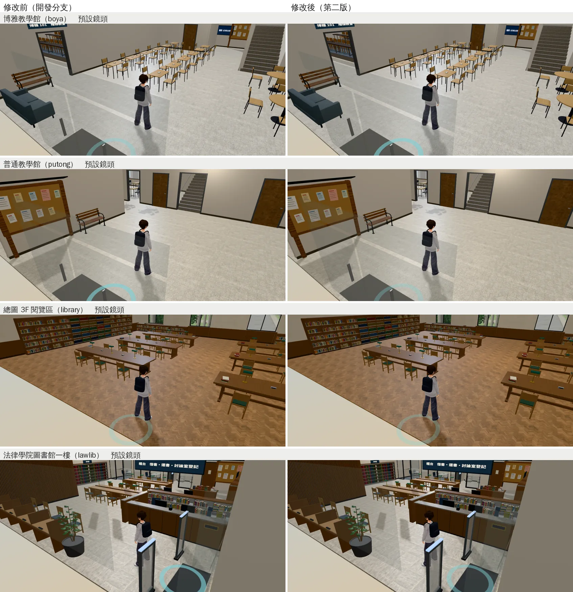

# 室內天花板：鏡頭拉到最遠時不再是一整片白、不再浮著白格子（ART-CEIL-LAWWW-ROOMS-1022，第二版）

帳號 A 的 LAWWW2，2026-10-22 09:0x～10:0x UTC。

- **狀態**：
  - 第一版（`63d4a3e3`：201 教室、男宿門廳、霖澤館、萬才館的天花板）LAWWW 已接進開發分支 `4d3a305d`。
  - **第二版交件**：`READY_FOR_ART_REVIEW`（場景美術由使用者驗收）。
    - `patches/ceiling_lights.diff` 只改 `tests/room_ceiling_unit.js`，對開發分支 `4d3a305d` 乾淨。
    - 七份 GLB 同檔名替換，遊戲的程式不用改。
- **派工**：LAWWW 08:34（P2）——四個房間的天花板，照 118 巷那次的做法改，交件附鏡頭拉到最遠、最陡的前後。第二版是我順手做的同一件事：
  - 天花板上的燈也改；
  - 我自己的博雅、普通、總圖 3F、法律學院圖書館的天花板格子也改（10-22 盤點記的 P3）。
- **起因**：10-22 的天花板盤點（j36c，`l118_arcade_1022/README.md`「其他室內的天花板盤點」）。
  - 雙指拉到最遠（6 m）、往上拖到最陡（俯角 1.05）時，鏡頭在天花板上面。
  - LAWWW 的四間：整個畫面是天花板的背面。
  - 我的四間：天花板本來就是單面，但輕鋼架、燈框是方盒，從上面看是浮在房間上面的白格子。

## 改了什麼

### Blender 腳本

| 腳本 | 第一版 | 第二版 |
|---|---|---|
| `tools/blender/classroom_201.py` | 天花板 `cls_ceiling` 單面；T 型骨架 `cls_grid` 只留底面、單面朝下 | 燈箱 `cls_light`（2 cm 方盒）只留底面、單面朝下 |
| `tools/blender/dorm_hall.py` | 天花板 `dm_ceiling` 單面 | 不變（下面說明） |
| `tools/blender/linze_interior.py` | 天花板 `ceiling` 單面 | 燈板、崁燈 `light_panel` 單面 |
| `tools/blender/wancai_interior.py` | 天花板 `wc_ceiling` 單面 | 燈板、崁燈 `wc_light_panel` 單面 |
| `tools/blender/env_second/teach_interior.py`（博雅、普通） | — | 輕鋼架、燈框 `tb_ceiling_grid` 只留底面、單面朝下；燈板 `tb_light_panel` 單面 |
| `tools/blender/env_second/library_3f.py`（總圖 3F） | — | 同上（`l3_ceiling_grid`、`l3_light_panel`） |
| `tools/blender/lawlib_interior.py`（法律學院圖書館） | — | 同上（`ll_ceiling_grid`、`ll_light_panel`） |

- 天花板、燈板的四邊形本來就朝下，只差材質是雙面（glTF 匯出時 `doubleSided`＝不剔除背面）。
- 輕鋼架、燈框、燈箱原本是 1.2～2.4 cm 高的方盒，鏡頭在上面時看到方盒的頂面。
  - 改成只留原本方盒的底面、單面朝下。從下面看位置、顏色、寬度一樣，從上面看不到。
  - 交叉的地方，一個方向低 0.5～1 mm，不疊面。
- 男宿門廳的日光燈是吸頂式燈具，有 6 cm 高的燈座，從下面看得到側面，所以沒有改。

### GLB（和開發分支 `4d3a305d` 比）

- 比對方法：用遊戲的格式讀 GLB，逐個網格比頂點、索引、節點位置，貼圖也比。

| GLB | 大小（bytes） | 改了什麼 | 其他 |
|---|---|---|---|
| `assets/models/env/classroom_201.glb` | 1,526,360 → 1,509,536 | `cls_light` 不再雙面，三角形 288 → 48 | 其他網格、貼圖逐位元組相同 |
| `assets/models/env/linze_interior.glb` | 2,001,840 → 2,001,820 | `light_panel` 不再雙面 | 幾何資料逐位元組相同 |
| `assets/models/env/wancai_interior.glb` | 2,514,372 → 2,514,352 | `wc_light_panel` 不再雙面 | 幾何資料逐位元組相同 |
| `assets/models/env/lawlib_interior.glb`（＋`.json`） | 2,772,292 → 2,670,380 | `ll_ceiling_grid` 三角形 1,820 → 310、不再雙面；`ll_light_panel` 不再雙面 | 其他網格、貼圖逐位元組相同 |
| `assets/models/env/second_ai/boya_interior.glb`（＋`.json`） | 1,319,728 → 1,106,496 | `tb_ceiling_grid` 3,860 → 662、不再雙面；`tb_light_panel` 不再雙面 | 同上 |
| `assets/models/env/second_ai/putong_interior.glb`（＋`.json`） | 1,043,836 → 846,480 | `tb_ceiling_grid` 3,578 → 614、不再雙面；`tb_light_panel` 不再雙面 | 同上 |
| `assets/models/env/second_ai/library_3f.glb`（＋`.json`） | 1,461,620 → 1,404,888 | `l3_ceiling_grid` 972 → 162、不再雙面；`l3_light_panel` 不再雙面 | 同上 |

- 男宿門廳 `dorm_hall.glb` 第二版沒有改（開發分支的就是第一版）。
- **注意（博雅、普通）**：
  - 這兩份要在開發分支的工作樹匯出。我的分支的 `src/data/boya_layout.js`、`putong_layout.js` 是 10-13 的舊版，少了 10-16「空橋走得過去」那一筆。
  - 用舊的配置匯出，會把空橋那扇門做回去（第一次試匯出時比對出來：牆、門、踢腳板都跟著變了）。
  - 七份都是在開發分支 `2181fe4d` 的工作樹匯出的。這幾份配置檔在 `2181fe4d` 和 `4d3a305d` 之間沒有變。

### 測試（`patches/ceiling_lights.diff`：`tests/room_ceiling_unit.js`）

- 在 `4d3a305d` 的版本（＝第一版）之上：
  - 多驗博雅、普通、總圖 3F、法圖四份。
  - 「天花板」多算三種材質：
    - `ceiling_grid`：輕鋼架、燈框；
    - `light_panel`：嵌在天花板的燈板；
    - `cls_light`：201 的燈箱。
  - 都要單面、朝下。

| 測試＋模型 | 結果 |
|---|---|
| 開發分支 `4d3a305d` 的測試＋開發分支的模型 | ALL PASS |
| **新測試＋開發分支 `4d3a305d` 的模型** | **FAIL 7**：201、霖澤館、萬才館（燈板、燈箱雙面）；博雅、普通、總圖 3F、法圖（輕鋼架、燈框、燈板雙面） |
| 新測試＋第一版以前的模型（`2181fe4d`） | FAIL 12 |
| **新測試＋第二版的模型** | **ALL PASS**（37 份 GLB、74 項） |
| 開發分支的測試＋第二版的模型 | ALL PASS |

- `node tests/nav_buildings_unit.js`：ALL PASS（j45，開發分支 `2181fe4d`＋第二版的模型）。

## 遊戲內前後

- Playwright＋SwiftShader，844×390（手機橫向）、像素比 2，**不是 iPhone**。15:00，路人藏起來；人站在各區的出生點。
- 鏡頭：
  - 「最遠最陡」：距離 6 m、俯角 1.05（雙指能拉到的最遠、往上拖到最陡）。
  - 「預設」：進門時的鏡頭。
- 博雅、普通、總圖 3F、法圖：j45，修改前＝開發分支 `2181fe4d`（這四份模型和 `4d3a305d` 相同），修改後＝換第二版的模型。
- LAWWW 的四間：
  - 修改前：j42，開發分支 `5aa16a70`（第一版以前）。
  - 修改後：j45，第二版。男宿門廳第二版沒有改，用 j42 第一版的圖。

### 我的四間：最遠最陡

### 我的四間：預設鏡頭（確認沒有變）

### LAWWW 的四間：最遠最陡

### 201 教室：骨架、燈箱

- 左：修改前。
- 中：第一版以前，只改天花板，教室蓋著一層白格子。
- 右：第二版，骨架、燈箱也只留底面。

### LAWWW 的四間：預設鏡頭（確認沒有變）

### 機場出境／入境、美國大超市（第三版，LAWWW 已接進 `2181fe4d`）

- j41，開發分支 `5aa16a70`（修改前）／換三份 GLB（修改後），最遠最陡。
- 第三版交件時還沒有遊戲內的圖，補在這裡。

## 接法（LAWWW，第二版）

1. `git apply docs/art-rebuild/second_ai/patches/ceiling_lights.diff`（只有 `tests/room_ceiling_unit.js`），對開發分支 `4d3a305d` 乾淨。第一版的 `ceiling_more.diff` 已經接了，不要再套。
2. 換七份 GLB（同檔名）：
   - `assets/models/env/{classroom_201,linze_interior,wancai_interior,lawlib_interior}.glb`
   - `assets/models/env/second_ai/{boya_interior,putong_interior,library_3f}.glb`
   - 匯出統計 `.json` 四份：`lawlib_interior`、`boya_interior`、`putong_interior`、`library_3f`。
3. 腳本：
   - `tools/blender/{classroom_201,linze_interior,wancai_interior,lawlib_interior}.py`
   - `tools/blender/env_second/{teach_interior,library_3f}.py`
4. 跑 `node tests/room_ceiling_unit.js`、`node tests/nav_buildings_unit.js`。

## 還不到的地方（誠實寫）

- 鏡頭在天花板上面時，從上面還看得到這些：
  - 男宿門廳的吸頂日光燈（6 cm 燈座）；
  - 偵煙器、冷氣出風口（小的方塊、圓片）；
  - 霖澤館二樓的電梯車廂頂。
- 真機沒看過。
