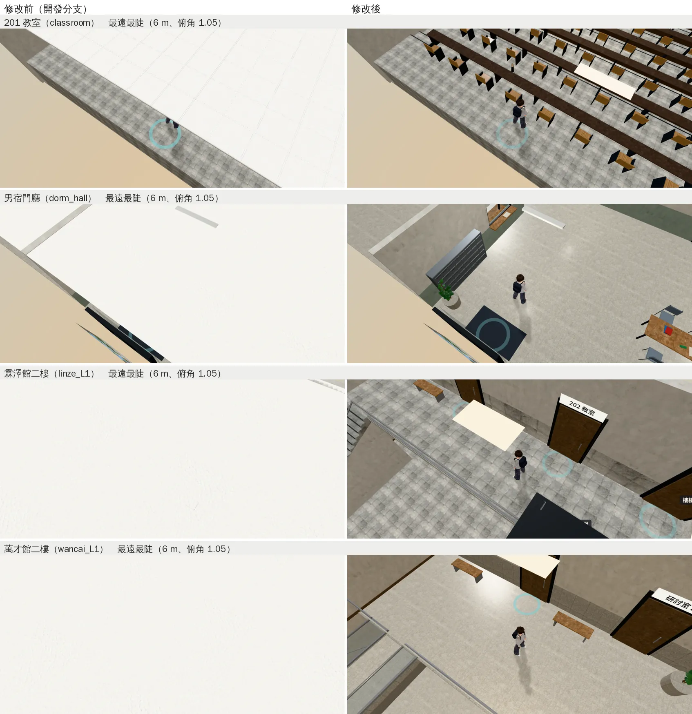
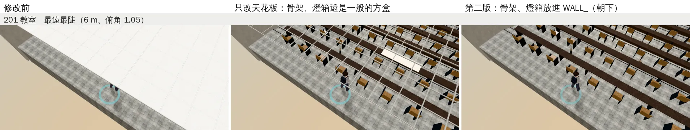
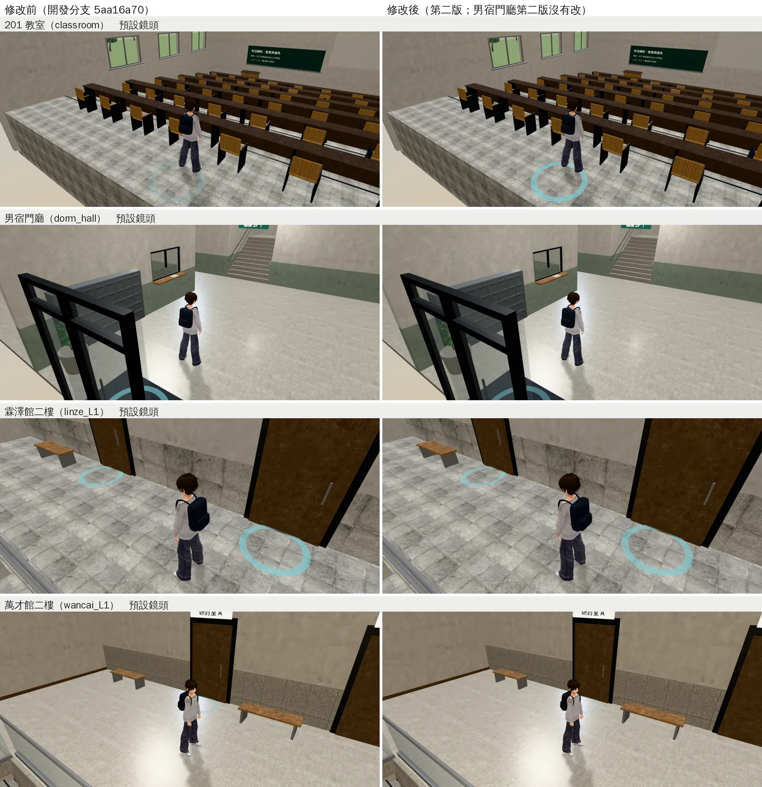
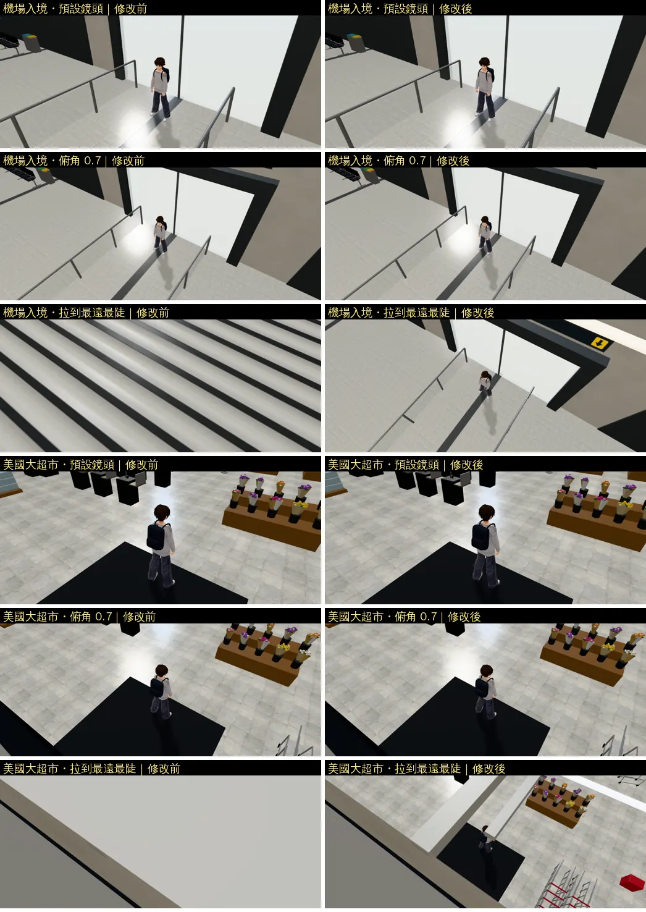

# LAWWW 的四個室內：鏡頭拉到最遠時不再是一整片白（ART-CEIL-LAWWW-ROOMS-1022）

帳號 A 的 LAWWW2，2026-10-22 09:0x～09:3x UTC。

- **狀態**：交件；`READY_FOR_ART_REVIEW`（場景美術由使用者驗收）。
  - `patches/ceiling_more.diff` 只改 `tests/room_ceiling_unit.js`，對開發分支 `2181fe4d` 乾淨。
  - 四份 GLB 同檔名替換，遊戲的程式不用改。
- **派工**：LAWWW 08:34（P2）——201 教室、男宿門廳、霖澤館二樓、萬才館二樓的天花板，照 118 巷那次的做法改（cull＋朝下、重新匯出），交件附鏡頭拉到最遠、最陡的前後。
- **起因**：
  - 10-22 的天花板盤點（j36c，`l118_arcade_1022/README.md`「其他室內的天花板盤點」）。
  - 這四間雙指拉到最遠（6 m）、往上拖到最陡（俯角 1.05）時，鏡頭在天花板上面，整個畫面是天花板的背面。

## 改了什麼

### Blender 腳本（`tools/blender/`，LAWWW 的腳本，D100、D108 派給 LAWWW2 改）

| 腳本 | 改法 |
|---|---|
| `classroom_201.py` | ①天花板材質 `cls_ceiling` 單面（`cull=True`）；②**天花板的 T 型骨架**（`cls_grid`）只留底面、單面朝下（下面說明） |
| `dorm_hall.py` | 天花板材質 `dm_ceiling` 單面 |
| `linze_interior.py` | 天花板材質 `ceiling` 單面 |
| `wancai_interior.py` | 天花板材質 `wc_ceiling` 單面 |

- 四個腳本的天花板四邊形本來就朝下，只差材質是雙面（glTF 匯出時 `doubleSided`＝不剔除背面）。
- **201 的 T 型骨架**：
  - 原本是 2.4 cm × 1.9 cm 的方盒，每 0.6 m 一條，共 57 條。
  - 只改天花板（第一次匯出）以後，鏡頭在上面時看到方盒的頂面：整間教室蓋著一層白格子（下面第二張圖的中間那張）。
  - 改成只留原本方盒的底面、單面朝下：從下面看位置、顏色、寬度一樣，從上面看不到。
  - 交叉的地方 z 向那一條低 1 mm，不疊面。

### GLB（`assets/models/env/`，同檔名）

- 比對方法：用遊戲的格式讀修改前（開發分支 `2181fe4d`）和修改後的 GLB，逐份比對。

| GLB | 大小（bytes） | 改了什麼 | 其他 |
|---|---|---|---|
| `classroom_201.glb` | 1,566,312 → 1,526,360 | `cls_ceiling` 不再雙面；`cls_grid` 不再雙面，三角形 684 → 114 | 其他 28 個網格（含節點位置、椅子的 GPU instancing）、17 張貼圖逐位元組相同 |
| `dorm_hall.glb` | 3,297,360 → 3,297,340 | `dm_ceiling` 不再雙面 | **幾何資料逐位元組相同**（三角形 18,490） |
| `linze_interior.glb` | 2,001,860 → 2,001,840 | `ceiling` 不再雙面 | 幾何資料逐位元組相同（5,528） |
| `wancai_interior.glb` | 2,514,392 → 2,514,372 | `wc_ceiling` 不再雙面 | 幾何資料逐位元組相同（7,130） |

### 測試（`patches/ceiling_more.diff`：`tests/room_ceiling_unit.js`）

- LAWWW 已經接了第三版（機場出境／入境、美國大超市）。這一份是**在那之上**的增量：
  - 多驗 LAWWW 的四份（`assets/models/env/`，清單寫 `../classroom_201` 等）。
  - 2 m 以上、水平的天花板三角形每一層都驗：男宿門廳一樓的天花板比二樓低，原本只驗最上面 0.3 m，會漏掉一樓。
  - 「朝下」的門檻從法線離正下方 8° 放寬到 25°：多驗每一層以後，機場出境的弧形天花板有 8°～14° 斜的板子也算進來了。
  - 第②項（天花板那一層沒有雙面的一大片）的高度照舊用最上面那一層。
  - `cls_grid`（201 的 T 型骨架）也算天花板。

| 測試＋模型 | 結果 |
|---|---|
| 開發分支的測試＋開發分支的模型 | ALL PASS（不含這四份） |
| **新測試＋開發分支的四份**（修改前） | **FAIL 8**：四份各兩項都不過（201：686／686 個三角形雙面） |
| 新測試＋只改天花板的 201（j42 拍的那一版） | FAIL 1：`cls_grid` 684 個三角形雙面 |
| **新測試＋新的四份** | **ALL PASS**（33 份 GLB、66 項） |
| 開發分支的測試＋新的四份 | ALL PASS（新模型不會讓舊測試失敗） |

- `node tests/nav_buildings_unit.js`：ALL PASS（j42：開發分支 `5aa16a70`＋新的四份；導航不讀 GLB，只是確認）。

## 遊戲內前後

- Playwright＋SwiftShader，844×390（手機橫向）、像素比 2，**不是 iPhone**。15:00，路人藏起來。
- 修改前：開發分支 `5aa16a70`（j42）。這四間的 GLB 和 `src/` 在 `5aa16a70` 和 `2181fe4d` 之間只差 `character3d.js`（沛珊的裙子），和這四間無關。
- 修改後：
  - 男宿門廳、霖澤館二樓、萬才館二樓：換新的 GLB（j42）。
  - 201 教室：開發分支 `2181fe4d`＋最後一版 GLB（j43，T 型骨架也改了）。
- 鏡頭：
  - 「最遠最陡」：距離 6 m、俯角 1.05（雙指能拉到的最遠、往上拖到最陡）。
  - 「預設」：進門時的鏡頭。
- 人物都站在該區的出生點。

### 最遠最陡

- 修改前：四間都是一整片白（天花板的背面）。
- 修改後：看得到房間裡面和人。
- 天花板上的燈具還是浮著，和其他室內一樣（下面「還不到的地方」）：
  - 男宿門廳：日光燈；
  - 霖澤館二樓：燈箱；
  - 萬才館二樓：門口上方的燈。

### 201 教室的 T 型骨架

- 左：修改前。
- 中：只改天花板，教室蓋著一層白格子。
- 右：骨架也改，看得到整間教室。

### 預設鏡頭（確認沒有變）

- 四間從下面看天花板、骨架、燈的樣子都和原本一樣。

### 機場出境／入境、美國大超市（第三版，LAWWW 已接進 `2181fe4d`）

- j41，開發分支 `5aa16a70`（修改前）／換三份 GLB（修改後），最遠最陡。
- 第三版交件時還沒有遊戲內的圖，補在這裡。

## 接法（LAWWW）

1. `git apply docs/art-rebuild/second_ai/patches/ceiling_more.diff`（只有 `tests/room_ceiling_unit.js`），對開發分支 `2181fe4d` 乾淨。
2. 換四份 GLB（同檔名）：`assets/models/env/{classroom_201,dorm_hall,linze_interior,wancai_interior}.glb`。
3. 腳本：`tools/blender/{classroom_201,dorm_hall,linze_interior,wancai_interior}.py`。
4. 跑 `node tests/room_ceiling_unit.js`、`node tests/nav_buildings_unit.js`。

## 還不到的地方（誠實寫）

- 鏡頭在天花板上面時，燈具從上面看是浮著的。和 118 巷、溫州街店家、便利商店一樣，看得進房間，但不是完全乾淨。
  - 霖澤館二樓還看得到電梯車廂的頂（深色的一塊）。
- 博雅、普通、總圖 3F、法律學院圖書館一樓的天花板格子、燈具從上面看是浮著的白線（我的 GLB，盤點時記的 P3），這次沒有改。
- 真機沒看過。
