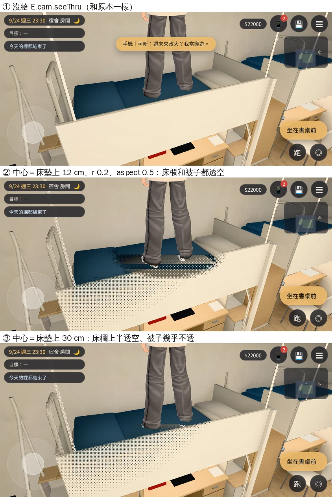

# #120 床欄透空：固定運鏡指定透空中心（DORM-SLEEP-VISUAL-1030 後續；LAWWW2-B 2026-10-30）

- **起因**：睡覺的鏡頭（`sleep_scene.cam`）從走道斜上方看上舖，床欄擋住躺著的人。LAWWW-B 10-30 05:49 選第一個做法：引擎讓固定運鏡也能指定透空中心，**patch 先給他看**；什麼時候設、清由他接（`story3d.js` 的 `S.lieDown`）。
- **狀態**：給 LAWWW-B 審的 patch，還沒整合。

## patch：`docs/art-rebuild/second_ai/patches/cine_seethru_1030.patch`（只改 `src/engine3d.js`）

- 新的 `E.cam.seeThru={x,y,z,r,aspect}`：
  - `x,y,z`：世界座標的中心。
  - `r`：橢圓的半高，佔畫面高度的比例，預設 0.22。
  - `aspect`：橢圓橫向的壓縮，預設 2（直立，和跟隨鏡頭一樣）；躺著的人給 0.5（橫的）。
- 運鏡（`E.cam.mode==='cinematic'`）時：有給就照它透空，沒給就和原本一樣（`uSeeR=0`，不透空）。
- 只作用在 `userData.seeThrough` 的材質；宿舍的床架、床欄是 `seethru_dorm_frame_white`，已經是了。室內照舊要區域有 `seeThru`（宿舍有）。
- 跟隨鏡頭完全照舊：每一幀把 `aspect` 設回 2。
- shader 多一個 uniform `uSeeA`（原本寫死的 `2.0`）；`customProgramCacheKey` 改成 `|seeThrough2`，第一次用會重新編譯一次。
- 遠端 `postrel-1030`（3808792fe）和開發 `modest-rubin`（647dc5c6d）上 `git apply --check` 都過。

## 對照

`tools/blender/env_second/shots/cine_seethru_shots.py`，ALL PASS（①沒給→不透空 ②給了→透空、橫的 ③清掉→恢復 ④回到跟隨鏡頭→直立；沒有 JS 例外）。

- [捷徑]：人沒有躺下（躺的動畫是 LAWWW-B 那一半），人是站在上舖的床上；這裡只看床欄、床架在鏡頭和床中間那段。

- 中心放床墊上 12 cm：床欄透空很明顯，但被子也透掉（被子也是 `seethru_` 材質，比中心點靠鏡頭）。
- 中心放床墊上 30 cm：床欄上半透空，被子幾乎不透。
- **建議**：中心＝躺著的身體中段、床墊上 0.25～0.3 m；`r` 0.2；`aspect` 0.5。人躺好以後再看一次，必要時調 `r`。
- 這是 Playwright＋SwiftShader 模擬，不是 iPhone 實機。
