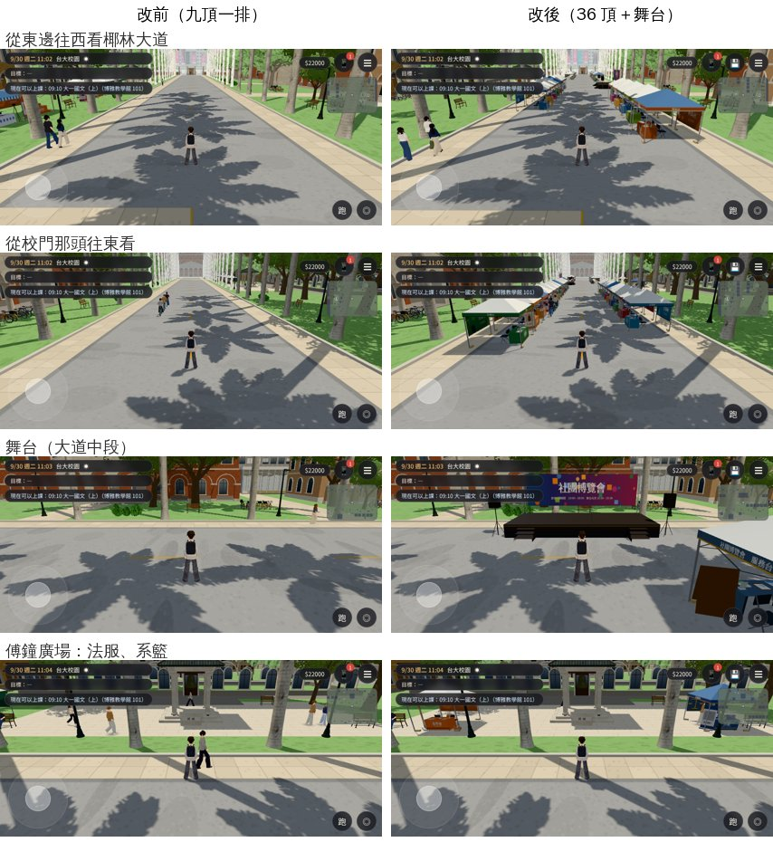

# CLUBFAIR-REAL-1027（X109）：社團博覽會——椰林大道兩邊 36 頂帳篷＋舞台（LAWWW2-C 2026-10-27）

- **使用者**（10-27 試玩）：「社團博覽會攤會也太少 都沒人顧」「要參考實際的吧」。**規格**：AA_485 第 3 節（企劃線 5aaa71d6a）——照臺大的社團聯展：椰林大道兩邊一路排帳篷、大道中段一個舞台；建議 36 頂；15 攤有互動（能加入 5、只能看看 10）；招牌只寫社團類型的名稱（D77）。
- **分工**（LAWWW-C 20:44Z）：我做帳篷、招牌、舞台、導航阻擋、位置表；顧攤的人、人流、互動點、選單由 LAWWW-C 那邊做。
- **對**：開發 `ef936bc59` 做、最新開發 `48d2ba832` `git apply --check` 過。
- **工具**：Blender bpy（`tools/blender/env_second/club_fair_expo.py`，帳篷沿用 `club_fair.py` 的做法：折疊帳篷、四邊垂簾印社名、背板、桌巾、折疊椅、傳單、報名表、易拉展、各社的小東西）→ `club_fair_expo.glb`。字是 WenQuanYi Zen Hei（只畫進貼圖）、貼圖全部程式畫（PIL）。

## 畫面

- **36 頂**：北側 18 頂（z −4.9，面向南）、南側 16 頂（z +4.9，面向北），傅鐘廣場兩側各一頂（法律服務社在傅鐘西邊、系籃在東邊，面向大道）。x −88～+10。
  - 帳篷沿柏油路兩邊（前緣 z ±3.4、後緣 ±6.4）：大道中間留 6.8 m 走，人行道（z ±7）照舊走得到。
  - 留空：往北的兩條路（x −41～−35、−15.5～−8.5）、往南的傅鐘廣場入口（x −53～−23）、宿舍那條路（x 16～24）。椰子樹、花叢、路燈、長椅、腳踏車都沒壓到（測試 ④）。
  - 帆布白色、藍色交錯；每一攤主色不同；垂簾、桌巾、背板都印社名。原本六攤（法服、吉他社、辯論社、登山社、系籃、服務台）的背板圖照舊（天平、吉他、正反方、山、籃球、地圖），其他攤是圖形＋社名。
- **舞台**：北側、大道中段（x −29.75～−20.75、z −7.75～−3.25，高 0.8 m），面向南：黑色台面裙布（印「社團博覽會」）、前面兩邊的台階、後面的鋁桁架＋大背板（「社團博覽會　新生社團聯展　10:00－16:00　舞台表演 10:30－15:30」）、兩邊的喇叭架、麥克風架。觀眾站在大道中間（測試 ③：舞台前 9×5 m 有 45 格站得住）。
- **效能**：36 頂＋舞台烘成**一個網格、一個材質＝一個 draw call**（26,894 三角形；GLB 1.96 MB、貼圖 2048×2048 一張＋ORM 256）。同角度 draw call 和改前差不多（從東往西看 404 vs 398，差異是路人）。
- 校慶、經濟系那一年的博覽會照舊用九頂那一排（`club_fair.glb`），沒動。
- **招牌**（只寫社團類型）：能加入——吉他社、辯論社、登山社、法律服務社、法律系系學會　系籃；只能看看——攝影社、桌遊社、魔術社、電影研究社、熱舞社、合唱團、羽球社、服務隊、咖啡研究社、嘉義校友會（AA：「校友會（某個縣市）」，選了一個不是臺北的縣市）；服務台；背景——管樂社、國樂社、動漫社、天文社、書法社、劍道社、國標舞社、桌球社、鋼琴社、茶藝社、野鳥社、直笛團、網球社、游泳社、攀岩社、單車社、日文研究社、陶藝社、手語社、西洋劍社。

## 位置表（LAWWW-C 要的：攤位 id → x, z）

座標＝校園區域。front＝玩家站在攤位前的位置（帳篷中心往正面 2 m，帳篷前緣再外 0.5 m）。顧攤的人：帳篷裡兩張折疊椅（桌子後面），面向帳篷正面。程式：`Z3.fairExpoFront(id)`、配置 `CLUB_FAIR_EXPO.tents`。

| 攤位 id | 招牌 | 種類 | 帳篷中心 (x, z) | 面向 | 站在攤位前（front） | 顧攤的人（兩張椅子） |
|---|---|---|---|---|---|---|
| `guitar` | 吉他社（`club_guitar`） | 能加入 | (-84.4, -4.9) | 南 | (-84.4, -2.9) | (-84.85, -4.7)、(-83.95, -4.7) |
| `debate` | 辯論社（`club_debate`） | 能加入 | (-77.2, -4.9) | 南 | (-77.2, -2.9) | (-77.65, -4.7)、(-76.75, -4.7) |
| `hiking` | 登山社（`club_hiking`） | 能加入 | (-62.8, -4.9) | 南 | (-62.8, -2.9) | (-63.25, -4.7)、(-62.35, -4.7) |
| `lawclub` | 法律服務社（`lawclub`） | 能加入 | (-47.5, 13.5) | 北 | (-47.5, 11.5) | (-47.05, 13.3)、(-47.95, 13.3) |
| `basketball` | 法律系系學會　系籃（`dept_basketball`） | 能加入 | (-28.5, 13.5) | 北 | (-28.5, 11.5) | (-28.05, 13.3)、(-28.95, 13.3) |
| `photo` | 攝影社 | 只能看看 | (-70, -4.9) | 南 | (-70, -2.9) | (-70.45, -4.7)、(-69.55, -4.7) |
| `boardgame` | 桌遊社 | 只能看看 | (-55.6, -4.9) | 南 | (-55.6, -2.9) | (-56.05, -4.7)、(-55.15, -4.7) |
| `magic` | 魔術社 | 只能看看 | (-48.4, -4.9) | 南 | (-48.4, -2.9) | (-48.85, -4.7)、(-47.95, -4.7) |
| `film` | 電影研究社 | 只能看看 | (-4.6, -4.9) | 南 | (-4.6, -2.9) | (-5.05, -4.7)、(-4.15, -4.7) |
| `dance` | 熱舞社 | 只能看看 | (-80.8, 4.9) | 北 | (-80.8, 2.9) | (-80.35, 4.7)、(-81.25, 4.7) |
| `chorus` | 合唱團 | 只能看看 | (-73.6, 4.9) | 北 | (-73.6, 2.9) | (-73.15, 4.7)、(-74.05, 4.7) |
| `badminton` | 羽球社 | 只能看看 | (-66.4, 4.9) | 北 | (-66.4, 2.9) | (-65.95, 4.7)、(-66.85, 4.7) |
| `service` | 服務隊 | 只能看看 | (-59.2, 4.9) | 北 | (-59.2, 2.9) | (-58.75, 4.7)、(-59.65, 4.7) |
| `coffee` | 咖啡研究社 | 只能看看 | (-17.2, 4.9) | 北 | (-17.2, 2.9) | (-16.75, 4.7)、(-17.65, 4.7) |
| `alumni` | 嘉義校友會 | 只能看看 | (-10, 4.9) | 北 | (-10, 2.9) | (-9.55, 4.7)、(-10.45, 4.7) |
| `info` | 社團博覽會　服務台 | 服務台 | (-20.8, 4.9) | 北 | (-20.8, 2.9) | (-20.35, 4.7)、(-21.25, 4.7) |
| `bg_band` | 管樂社 | 背景 | (-88, -4.9) | 南 | (-88, -2.9) | (-88.45, -4.7)、(-87.55, -4.7) |
| `bg_chinese` | 國樂社 | 背景 | (-80.8, -4.9) | 南 | (-80.8, -2.9) | (-81.25, -4.7)、(-80.35, -4.7) |
| `bg_anime` | 動漫社 | 背景 | (-73.6, -4.9) | 南 | (-73.6, -2.9) | (-74.05, -4.7)、(-73.15, -4.7) |
| `bg_astro` | 天文社 | 背景 | (-66.4, -4.9) | 南 | (-66.4, -2.9) | (-66.85, -4.7)、(-65.95, -4.7) |
| `bg_callig` | 書法社 | 背景 | (-59.2, -4.9) | 南 | (-59.2, -2.9) | (-59.65, -4.7)、(-58.75, -4.7) |
| `bg_kendo` | 劍道社 | 背景 | (-52, -4.9) | 南 | (-52, -2.9) | (-52.45, -4.7)、(-51.55, -4.7) |
| `bg_ballroom` | 國標舞社 | 背景 | (-44.8, -4.9) | 南 | (-44.8, -2.9) | (-45.25, -4.7)、(-44.35, -4.7) |
| `bg_tabletennis` | 桌球社 | 背景 | (-1, -4.9) | 南 | (-1, -2.9) | (-1.45, -4.7)、(-0.55, -4.7) |
| `bg_piano` | 鋼琴社 | 背景 | (2.6, -4.9) | 南 | (2.6, -2.9) | (2.15, -4.7)、(3.05, -4.7) |
| `bg_tea` | 茶藝社 | 背景 | (6.2, -4.9) | 南 | (6.2, -2.9) | (5.75, -4.7)、(6.65, -4.7) |
| `bg_birds` | 野鳥社 | 背景 | (9.8, -4.9) | 南 | (9.8, -2.9) | (9.35, -4.7)、(10.25, -4.7) |
| `bg_recorder` | 直笛團 | 背景 | (-84.4, 4.9) | 北 | (-84.4, 2.9) | (-83.95, 4.7)、(-84.85, 4.7) |
| `bg_tennis` | 網球社 | 背景 | (-77.2, 4.9) | 北 | (-77.2, 2.9) | (-76.75, 4.7)、(-77.65, 4.7) |
| `bg_swim` | 游泳社 | 背景 | (-70, 4.9) | 北 | (-70, 2.9) | (-69.55, 4.7)、(-70.45, 4.7) |
| `bg_climb` | 攀岩社 | 背景 | (-62.8, 4.9) | 北 | (-62.8, 2.9) | (-62.35, 4.7)、(-63.25, 4.7) |
| `bg_cycling` | 單車社 | 背景 | (-55.6, 4.9) | 北 | (-55.6, 2.9) | (-55.15, 4.7)、(-56.05, 4.7) |
| `bg_japanese` | 日文研究社 | 背景 | (-13.6, 4.9) | 北 | (-13.6, 2.9) | (-13.15, 4.7)、(-14.05, 4.7) |
| `bg_pottery` | 陶藝社 | 背景 | (-6.4, 4.9) | 北 | (-6.4, 2.9) | (-5.95, 4.7)、(-6.85, 4.7) |
| `bg_sign` | 手語社 | 背景 | (-2.8, 4.9) | 北 | (-2.8, 2.9) | (-2.35, 4.7)、(-3.25, 4.7) |
| `bg_fencing` | 西洋劍社 | 背景 | (0.8, 4.9) | 北 | (0.8, 2.9) | (1.25, 4.7)、(0.35, 4.7) |
| `stage` | 舞台 | — | (-25.25, -5.5)，9×4.5 m、高 0.8 | 南 | (-25.25, -0.6) | — |

## 遊戲端（patch：`docs/art-rebuild/second_ai/patches/club_fair_expo_1027.patch`）

- `src/zones3d.js`：`clubFairExpo`（導航阻擋：每頂 3×3 m、舞台台面、兩邊台階、喇叭；正式模型載入前／失敗用簡單的帳篷、台子）、`isExpoDay`、`fairExpoFront`、`EXPO_DAYS=['2026-09-12']`（大二的社博；`fairDayKey` 也認這一天）。博覽會那天（`activities.js` 的 `club_expo_y1s1.dates`、`EXPO_DAYS`）用 36 頂；其他擺帳篷的日子照舊九頂。
- `src/assets3d.js`：`bldg.club_fair_expo`；`index.html`：載入 `src/data/club_fair_expo_layout.js`。
- 新 `src/data/club_fair_expo_layout.js`（配置，遊戲和 Blender 共用）、新 `tests/club_fair_expo_unit.js`。
- 正式模型、原始檔在我的分支：`assets/models/env/second_ai/club_fair_expo.glb`＋`.json`、`tools/blender/env_second/club_fair_expo.py`、`textures/gen/club_fair_expo_atlas.png`、`club_fair_expo_orm.png`。

## 要 LAWWW-C 那邊做／注意的

- **日子**：`activities.js` 的 `club_expo_y1s1.dates` 改成 `['2025-09-06']`（AA_485 3-2）就會用 36 頂；大二 2026-09-12 我放在 `EXPO_DAYS`。`FAIR_DAYS` 裡舊的大二 `2026-09-16`、`2026-09-17`（AA_170）我沒拿掉——要不要拿掉看你們搬日子的方式。
- **舊的集合點**：`club_expo_y1s1.spot (-13.5,13.6)`、法服招生攤位 `(-18,13.5)` 現在在南側帳篷後面的草地上（走得到，但不在帳篷前）；改成服務台的 front `(-20.8, 2.9)`、法服的 front `(-47.5, 11.5)`。
- **人流**：北側人行道 z −7 的路人路線會穿過舞台那一段（x −29.75～−20.75）要繞；傅鐘那一圈（`(-38,9)→(-50,14)→…→(-26,14)`）會經過兩頂帳篷旁邊；騎腳踏車 z ±3 照舊（前緣 ±3.4）。
- 舞台的表演者、觀眾、顧攤的人、新生拿傳單都是你那邊（我沒放人）。

## 測試

- 新 `tests/club_fair_expo_unit.js`（Node，建出遊戲真正的校園，用引擎的找路＋移動碰撞）：**ALL PASS（22 項）**——36 頂（5／10／1／20）、AA 的 15 攤都在、能加入的對到 clubs 的 id、不重疊；平常日帳篷範圍裡原本沒有東西；社博那天每頂中心擋住、舞台擋住、每一攤和舞台前面站得住而且從大道中間走得到；大道中間 x −90→+12、南側人行道、北側人行道（舞台以外兩段）走得過去；舞台前的觀眾區；校慶、經濟系那一年照舊九頂；大二 2026-09-12 也是 36 頂；GLB 一個網格一個材質、範圍對；manifest、index.html。改前（沒有這些）當然 FAIL。
- `nav_buildings_unit`（含 `fairDayKey` 舊的檢查）、`campus_public_unit` ALL PASS。
- 截圖（`tools/shots/club_fair_expo_shots.py`，SwiftShader 手機模擬橫向，9/30 11:00；[捷徑] 讀檔、直接放玩家、路人藏起來）：`before_*`（九頂）、`after_*`（36 頂＋舞台）各 7 張；正式模型載入、備用帳篷藏起來、沒有 JS 例外。貼圖集縮圖 `atlas.jpg`。
- 沒跑：BB 的瀏覽器流程（走一遍社博、點攤位）、整套回歸、手機實機的效能（多 2.7 萬三角形、一個 draw call，沒在真機量過）。

## 還沒達到的地方

- 人：顧攤的人、人流、舞台上的表演者都還沒有（LAWWW-C 那邊）。沒有人的時候帳篷看起來像收攤。
- 背景攤的背板是圖形＋社名（沒有各社自己的圖案）；桌上的東西只有六攤有專屬道具（吉他、天平、講台、登山包、籃球、地圖），攝影、桌遊、天文、電影、陶藝、書法借用相機腳架、桌遊盒、手作的道具。
- 美術狀態：`READY_FOR_ART_REVIEW`（場景要使用者看過才能標 ART_APPROVED）。
