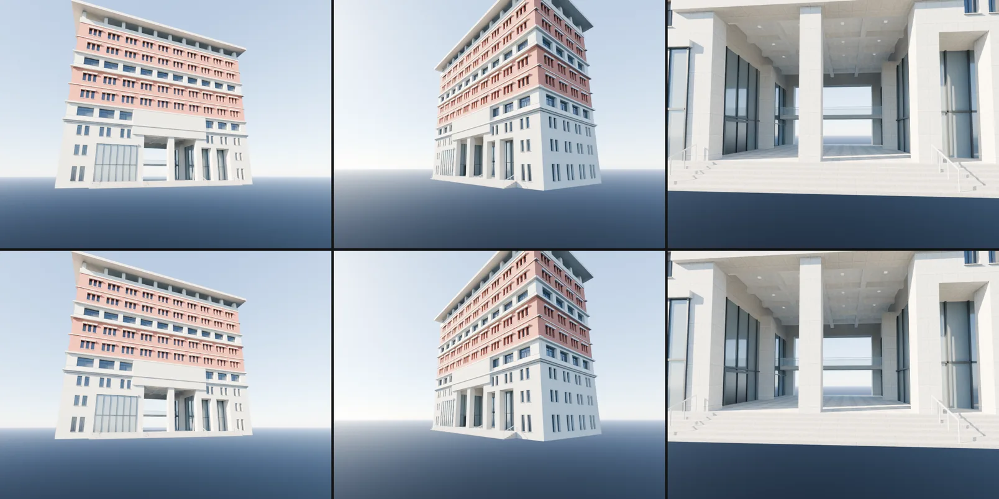
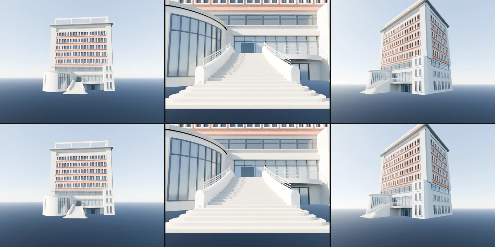

# BUG-COPLANAR-DEV（10-18）：霖澤館外觀、萬才館外觀、霖澤館室內的疊面（閃爍）

LAWWW2-C，2026-10-18。
- 誰派的：LAWWW-C 11:32（P1；法學院是法律系開學就看得到的，閃爍要收掉）。
- 掃描：`python3 tools/glb_coplanar.py`（同一套判斷，numpy，不需要 Blender）。
- 基準：LAWWW-C 開發分支 `974ab8a0` 的 GLB。

## 數字（「一定會閃」＝同一面朝外、兩個平面相差 < 0.5 mm 的重疊面積）
| GLB | 改之前 | 改之後 | 其中窗的原型（假的，見下面） | 真正的 |
|---|---|---|---|---|
| `linze_exterior.glb` 霖澤館外觀 | 572.16 m²（106 對） | 30.01 m²（97 對） | 28.13 | **544.0 → 1.9** |
| `wancai_exterior.glb` 萬才館外觀 | 642.07 m²（21 對） | 12.10 m² | 8.31 | **633.8 → 3.8** |
| `linze_interior.glb` 霖澤館室內 | 0.02 m² | 不用改 | — | 0.02 |

- **窗的原型是掃描工具的假警報**：
  - 窗用 GPU instancing（`EXT_mesh_gpu_instancing`），每一種窗一個網格（`WINS_0`、`WINS_1`…）放在原點，遊戲裡照 instancing 的位移擺到 94、242…個位置。
  - `glb_coplanar.py` 沒有套 instancing 的位移，就把每一種窗的原型在原點互相比，所以 `WINS_*` 之間的「重疊」都在原點附近（例如 [0.14, 0.86, −0.3]）。遊戲裡不會發生。
- 剩下真正的：
  - 霖澤館 1.9 m²：0.4 m² 在 33.5 m 的頂樓柱腳（看不到），其他是零碎的內側面。
  - 萬才館 3.8 m²：牆面後面的內側面（弧形量體和石材在正面牆面的背面）。

## 原因與改法（都是方塊互相重疊：重疊的地方頂面、側面、背面落在同一個平面）
`tools/blender/linze_exterior.py`：
1. 三樓的花崗石牆和上面的深色石材帶重疊 30 cm → 牆只做到石材帶下面。
2. 四～九樓紅磚牆和樓板線（灰色細帶）重疊 12 cm → 磚牆從樓板線上面開始。
3. 正面四樓的館名石材帶和後面的灰色牆柱、窗下牆整個重疊 → 石材帶從牆柱前面（凸出 5 cm）開始。
4. 深色石材帶穿過穿堂上面的大梁 → 穿堂那一段不做（大梁本來就比它凸出）。
5. 建築本體的頂面和穿堂大梁同高 → 本體低 1 cm；梁格天花板的橫梁頂面低 1 cm。
6. 一樓玻璃大廳、穿堂玻璃牆的鋁框：橫框和直框在交叉處的前面（側面）同一個平面 → 橫框凸 5 mm／厚 5 mm。這兩處是**從遊戲裡看得到的**。

`tools/blender/wancai_exterior.py`：
1. 建築本體、四角的寬花崗石、頂上石材帶三個頂面同高（屋頂板下面，605 m²）→ 本體低 1 cm、角上的花崗石低 5 mm。
2. 每一層第一根、最後一根紅磚柱伸進角上的花崗石 31 cm → 只做到花崗石為止。
3. 大台階、平台：沒動（LAWWW2-B 已經修過，`e0b85754`；導航用的台階外緣沒變）。

`linze_interior.glb`：
- 用現在的腳本重建，數字和開發分支一樣（LAWWW2-B 的 63 → 0 已經在裡面，`d6ce40cf`），不用換。
- 掃描列的「背對背雙面」246 m² 都是疊在一起的方塊中間的面（例如二樓 2 cm 地磚層和下面樓板的交界、台階一階一階之間），看不到，不會閃。

## 外觀沒變（Blender 算圖，上：改之前、下：改之後）
霖澤館（正面、轉角、穿堂）：

萬才館（正面、大台階、轉角）：

## 交付
- GLB：`assets/models/env/linze_exterior.glb`、`assets/models/env/wancai_exterior.glb`（同檔名，manifest 不用改）。
- 腳本：`tools/blender/linze_exterior.py`、`tools/blender/wancai_exterior.py`；對開發分支 `974ab8a0` 的 diff：`docs/art-rebuild/second_ai/patches/coplanar_dev.diff`。

## 測試
- `python3 tests/wancai_glb_integration.py`（開發分支 `974ab8a0`＋這兩份新 GLB）：**ALL PASS**。
  - 正式模型接上；導航格、鏡頭碰撞、互動點和套件版完全相同；
  - 夜間發光；draw call、三角形在上限內；沒有 JS 錯誤。

## 沒測
- 遊戲內逐一找閃爍的位置（只看了上面的數字和 Blender 算圖）、`campus_glb_integration.py`。
- 萬才館腳本的 `--check`（要遊戲輸出的 `ck.wancai` JSON；台階的程式沒動）。
- iPhone 實機。
