# BUG-COPLANAR-DEV：開發組室內 GLB 的疊面（會閃）

- **做的人**：LAWWW2-B。
- **工具**：`tools/blender/env_second/check_coplanar.py`。
  - 「一定會閃」＝兩個面朝同一邊、相差不到 0.5 mm；
  - 「遠處才閃」＝相差 0.5～2 mm。
- **只改 Blender 腳本、重新匯出 GLB**。導航、互動點、節點名稱（`L0_root`／`L1_root`／`WALL_*`）不變，遊戲程式不用改。
- 外觀（萬才館 eb3a3bad、霖澤館 2b78d35d）已經交過。宿舍大廳 LAWWW-B 自己修過（e4b6b55e）。這裡是室內。

## 1. 霖澤館室內（`tools/blender/linze_interior.py` → `assets/models/env/linze_interior.glb`）
**一定會閃：63 → 0**（遠處才閃 0）。

| 地方 | 原本 | 改成 |
|---|---|---|
| 南面兩層樓的玻璃帷幕、東面一樓玻璃門面 | 玻璃和直櫺、橫櫺的外面同一個平面：從大廳看出去，框和玻璃一直閃 | 玻璃放到直櫺深度的中間；框比牆面凸出 1 cm；橫櫺比直櫺薄一點（交叉的地方不同平面） |
| 二樓迴廊的地板靠牆一條 | 一樓的牆頂（4.2 m）和二樓地板同一個平面 | 一樓的牆停在樓板裡（4.17 m），二樓的牆往下接；樓板、地板停在牆的內面 |
| 牆角 | 北牆、東西牆在牆角重疊 | 北牆夾在東西牆中間，東西牆往南多 5 cm 包住牆角；南面帷幕上方的石材也夾在中間 |
| 大廳的沙發 | 扶手、椅背和座墊的面重疊 | 扶手比座墊寬 5 mm、比椅背短 6 mm，椅背和扶手的底伸進座墊裡 |
| 西牆的木踢腳板 | 伸進北牆裡 | 停在北牆內面 |

遊戲內修改前後（同一個鏡頭、11:00；左修改前、右修改後）：
- 測試工作樹是開發分支 `3d477ddb`。
- 閃爍是動態的，靜態截圖只拍得到一格，兩張看起來一樣是正常的。這裡主要確認改完沒有破洞、沒有東西不見。
- NPC 的位置不同，是作息的關係。
- 手機模擬，不是真機。

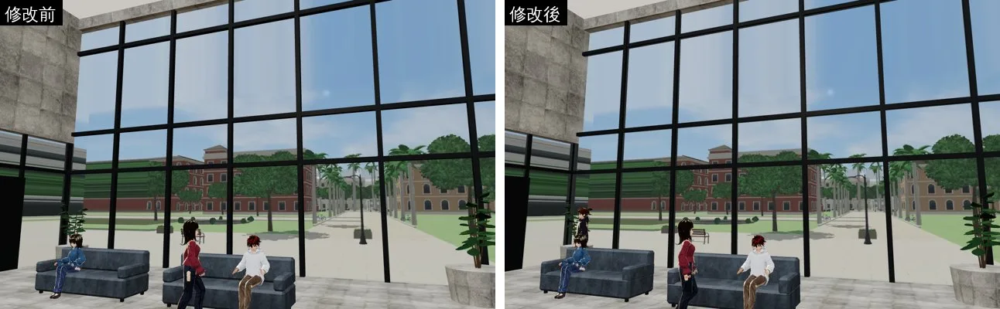
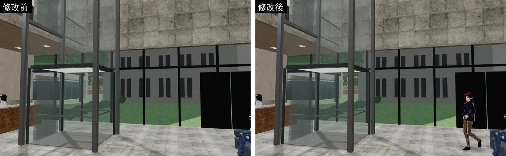
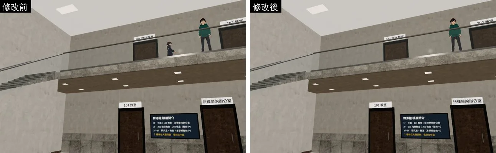

## 2. 201 階梯教室（`tools/blender/classroom_201.py` → `assets/models/env/classroom_201.glb`）
**一定會閃：11 → 0。**

| 地方 | 原本 | 改成 |
|---|---|---|
| 六排平台前緣的金屬收邊、兩側走道台階的止滑條 | 正面和平台、台階的正面同一個平面，頂面只高 2 mm | 往前凸出 4 mm、頂面高 4 mm |
| 牆角 | 前後牆和東西牆重疊 | 前後牆夾在東西牆中間，東西牆包住牆角 |

- 剩下 15 對「遠處才閃」：天花板格柵的頂面和牆頂（5.6 m），都在天花板上面，看不到。
- 節點名稱、座位不變。

## 3. 萬才館室內（`tools/blender/wancai_interior.py` → `assets/models/env/wancai_interior.glb`）
**一定會閃：54 → 4。**

做法和霖澤館一樣：
- 南面帷幕：玻璃放到直櫺中間，框凸出，橫櫺比直櫺薄；
- 一二樓的牆在樓板裡接（4.17 m），樓板停在牆的內面；
- 牆角不重疊；
- 二樓通到平台的玻璃門：門框凸出牆外 5 mm，直框停在上框下面；
- 二樓迴廊東側的石材收邊停在帷幕直櫺前面；
- 西牆踢腳板停在南北牆內面，二樓踢腳板從二樓地板算。

剩下 4 對都在西牆內面（x −8.9）、朝牆裡的面：
- 樓梯側面、踢腳板背面、法律學院圖書館名牌的背面；
- 從房間裡看不到，只有鏡頭在西牆外面、牆淡出時才可能看到。

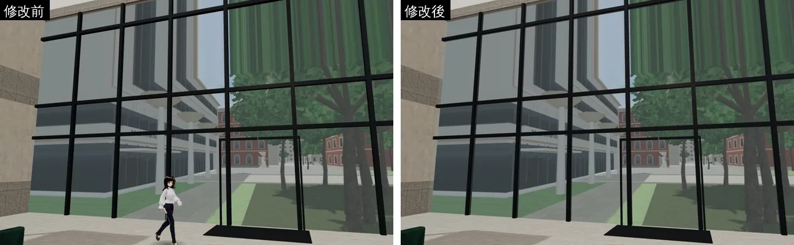
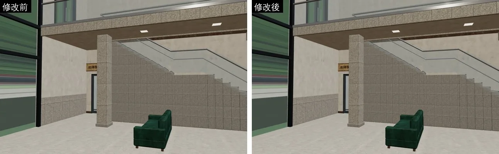
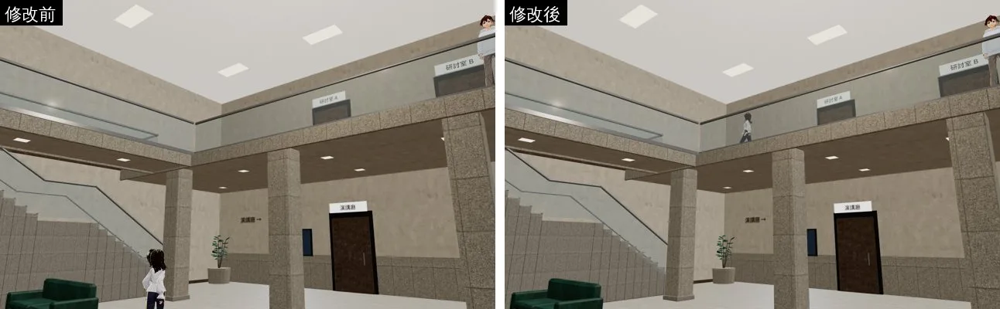

## 4. 總圖大廳（`tools/blender/library_interior.py` → `assets/models/env/library_interior.glb`）
**一定會閃：129 → 27。** 腳本以開發分支最新版（LAWWW-B 8811662e 的 wall_cut 修正）為底。

| 地方 | 原本 | 改成 |
|---|---|---|
| 門廳挑高帷幕 | 一樓、二樓在 4.2 m 各放一道橫櫺（疊在一起）；玻璃和框同一個平面 | 4.2 m 那道只留一樓；玻璃放到直櫺中間；框凸出、橫櫺比直櫺薄 |
| 書架（大廳、二樓自習區、核心書架） | 層板、底座、頂板、直隔板、背板的正面和側面同一個平面；最後一本書的側面和外側板同一個平面 | 底座內縮、頂板外凸 5 mm、層板退 6 mm、直隔板夾在底座和頂板之間、書排在兩側板中間 |
| 期刊報紙架 | 同上 | 背板、層板夾在側板中間，層板退 6 mm |
| 二樓踢腳板 | 整條穿過多媒體中心、研究小間、樓梯間的門和北面大窗（門口下面有一條木條） | 在門口、窗口斷開 |
| 側邊樓梯 | 樓梯板側面和踏階側面同一個平面 | 樓梯板內縮 3 mm |
| 樓梯旁的欄杆底座 | 貼在核心牆面上 | 窄 5 mm |

- 剩下 27 對，從玩家的鏡頭看不到：
  - 朝下的面：書本底面、欄杆底座、門板底面，貼在層板或地板上；
  - 天花板上面的牆角；
  - 樓梯頂端夾在二樓樓板裡的面。
- 第二張截圖被樓層簡介擋住，書架拍得不清楚；這張只用來確認沒有東西不見。

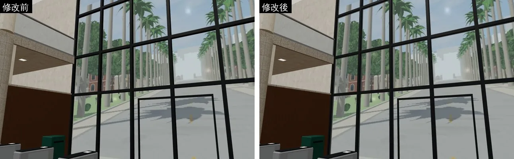
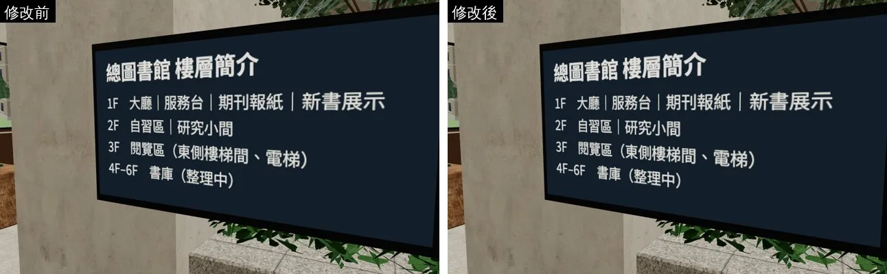
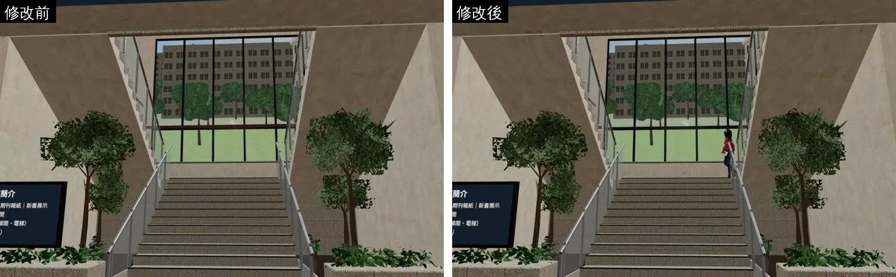

## 5. 法圖（`tools/blender/lawlib_interior.py` → `assets/models/env/lawlib_interior.glb`）
**一定會閃：120 → 93。**

| 地方 | 原本 | 改成 |
|---|---|---|
| 雙面書架、靠牆書架 | 層板和直隔板的正面同一個平面，交叉的地方會閃 | 層板退 4 mm |
| 靠牆書架的背板 | 和踢腳板一樣厚、正面同一個平面 | 背板放在踢腳板前面 |
| 現期期刊架 | 相鄰兩格各放一片側板，完全重疊 | 相鄰兩格共用一片 |

- 剩下的 93 對查過：
  - 大多是貼在牆面、地板上的接觸面：踢腳板背面、書架底座底面、木格柵背面、牆角；
  - 牆角兩組靠牆書架的層板底面（在 0.59 m，從站著的高度看不到）。
- 掃描工具不知道遮擋，所以列進去。從玩家的鏡頭看不到。

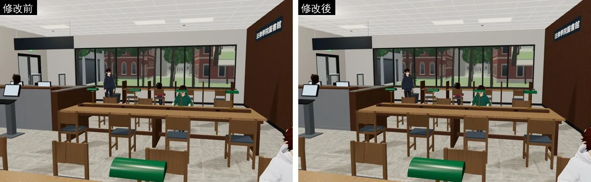
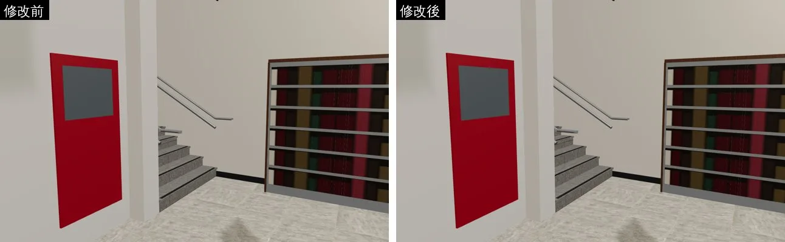
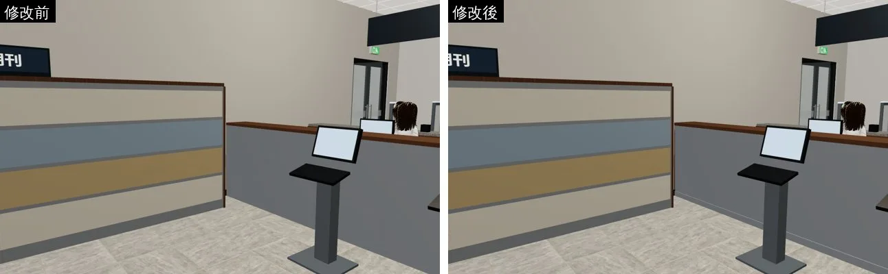

## 6. 宿舍大廳（`tools/blender/dorm_hall.py` → `assets/models/env/dorm_hall.glb`，LAWWW2-C，2026-10-17）
- 腳本以開發分支 `adoring-meitner-mqzst8` 的最新版為底（含 LAWWW-B e4b6b55e 的修正）。
- **一定會閃：10.20 → 7.45 m²**；不同材質、玩家看得到的部分清為 0。

| 地方 | 原本 | 改成 |
|---|---|---|
| 一樓公告欄 | 六張告示紙同一個深度，上下兩排疊到的角會閃 | 上排比下排前面 3 mm |
| 樓梯間東西兩道牆（二樓那段） | 一路伸到 z −1.4，牆頭和二樓走廊北牆疊在一起：上樓梯時有一條白牆、灰綠腰牆交替閃 | 二樓那段停在二樓走廊北牆的背面（z −1.6） |

- 剩下 7.45 m²，玩家看不到：
  - 同材質的面互相重疊（白牆×白牆、腰牆×腰牆、門框×門框）：貼圖用世界座標，兩面畫出來完全一樣；
  - 樓梯側面夾在中間矮牆裡；
  - 告示紙背面貼在軟木板上；
  - 家具底面貼在地板上。
- 導航、`dorm_layout.js`、互動點都沒動；只有 `WALL_` 的節點會淡出，新的牆段不是外牆。
- 遊戲內前後截圖（開發分支 `adoring-meitner-mqzst8` 工作樹，11:00，左修改前、右修改後）：
  - 公告欄：修改前，下排和上排交疊的角有鋸齒；修改後上排完整壓在前面。
  - 樓梯口：確認改完沒有破洞（閃爍是動態的，靜態圖拍不出來）。
  - 手機模擬，不是真機。

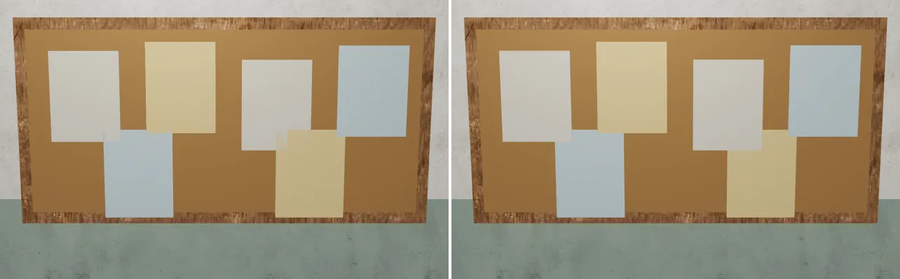
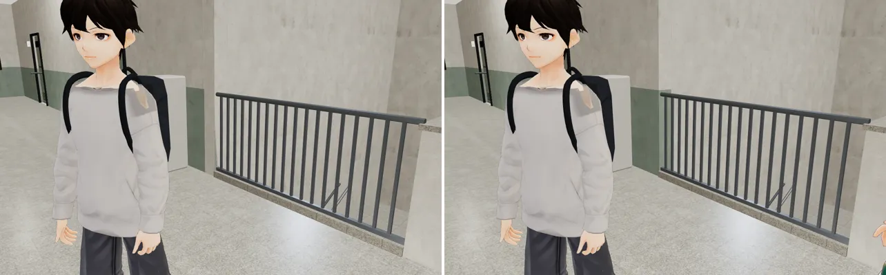

## 7. 結論（LAWWW2-C 2026-10-17 覆查）
- 霖澤館、萬才館外觀：掃描列的「一定會閃」都在屋頂上面（y ≥ 11.4、屋頂 32.4），或是在建築量體裡面背對背的面（霖澤館 z 8.35／x 19.35、萬才館 x 15／z 10），從地面看不到。
- 萬才館室內剩 2.70 m²、總圖 7.51 m²、法圖約 99 m²：逐項查過法線方向，都是背面、底面或夾在別的東西裡面。
  - 例：總圖北牆 z −8.9 是牆裙背面×壁柱背面，兩個都朝牆裡；萬才館、總圖 y 0 是柱座、台階的底面。
  - 不改。
- **BUG-COPLANAR-DEV 可以結案**（等 LAWWW-C 整合宿舍大廳後在遊戲裡再看一次）。
