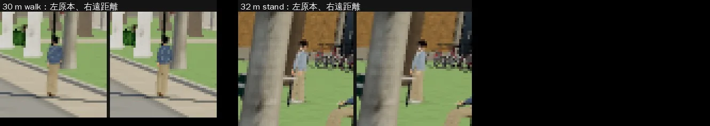
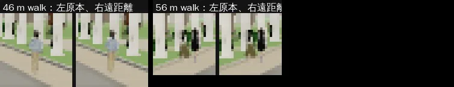
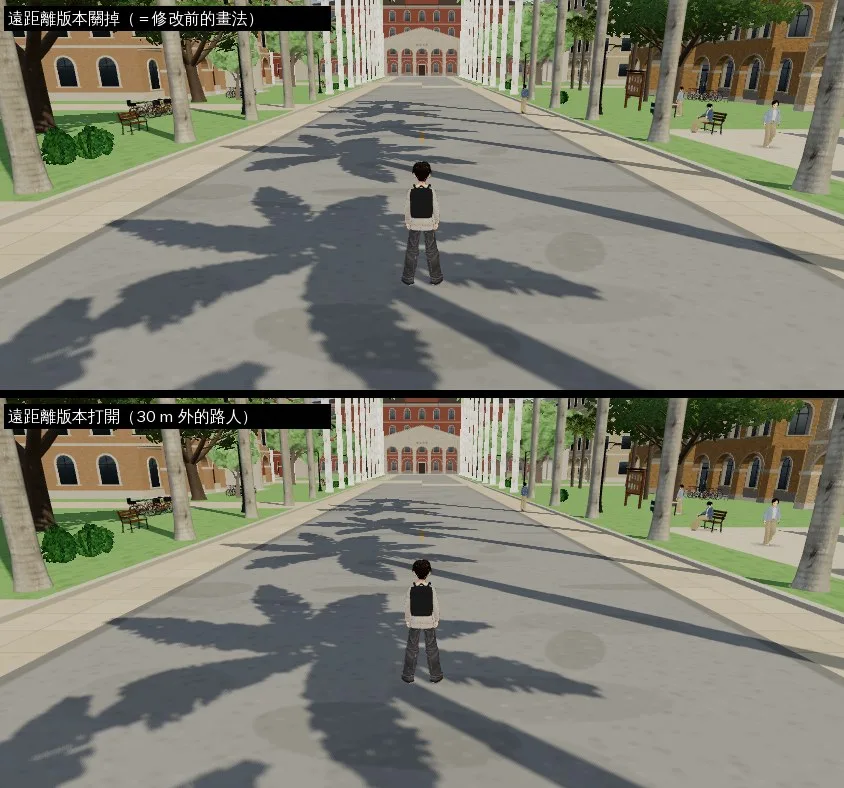
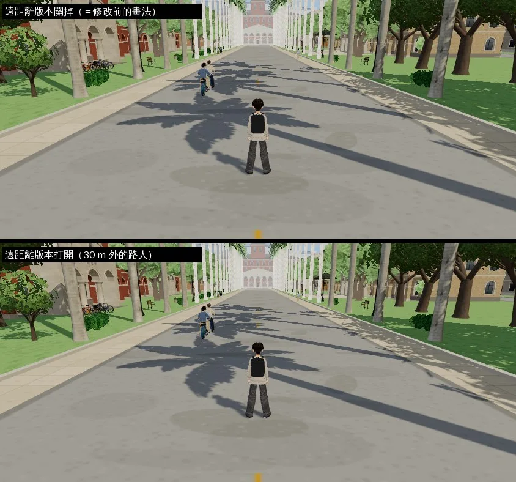

# 遠處的路人換成低面數版本（PERF-CROWD-LOD-1021）

帳號 A 的 LAWWW2，2026-10-21 21:2x UTC（21:4x 材質改成照 MToon 公式）。狀態：**交件**（10-22 03:3x；`crowd_far_lod.diff` 對開發分支 `be8c1b0e` 乾淨）。遊戲內量測（j10）、換區域前後的記憶體（j22b）都在下面。

## LAWWW 的要求（20:11 派工，P2）

> 先量距離分布；遠的換低面數或藏起來，椰林大道 15:00 的 draw call／三角形明顯下降；30 m 內的路人樣子不變；nav、crowd、follow_buddy 單元測試全過；遊戲內前後對照。改 engine3d／character3d 先跟我說一聲。

- 20:4x 已經傳開工通知給 LAWWW（DELIVERED）。

## 做法：遠的人換成低面數版本，不把人藏起來

使用者 10-17 才要路人加倍（`STORY.CROWD_X`），把遠處的人藏起來會讓椰林大道變空，所以選擇「換低面數」。

### 一個路人原本有多重

40 個無名路人底模（`bl_npc_*.vrm`，LAWWW2 的 Blender 改作 VRoid CC0 樣本），每個大約：

- 13～14 個網格：臉 8 個（皮膚、眼白、虹膜、眼線、睫毛、眉毛、嘴巴、眼睛高光）、身體、衣服 3 個、頭髮；
- 其中 5～6 個材質有描邊，描邊會再畫一次；
- 約 31,000 個三角形。

30 m 外的人在手機畫面上只有二三十個像素高，眼睛、眉毛不到一個像素。

### 遠距離版本（`tools/lod/npc_lod.py`，離線產生）

- **骨架同一副**：節點、關節順序、反向綁定矩陣原樣複製。
- 臉的皮膚、身體、衣服合成**一個網格**：
  - 貼圖顏色烘成頂點色（sRGB 轉線性）；
  - 再用 meshoptimizer 減面（MIT，只在離線產生時用，遊戲不載入）；
  - 身體貼圖透明的部分（被衣服蓋住、挖空的地方）整片拿掉；
  - 衣服的頂點另外標記，遊戲裡和 MToon 的衣服一樣乘 `CLOTH_K`。
- 頭髮另外一個網格，貼圖縮到 256 px。
- 眼睛、眉毛、睫毛、眼線、嘴巴裡面不要。
- 結果：平均 **6,400 個三角形、2 個網格、275 KB**（40 個共 10.8 MB）。

### 遊戲裡（`patches/crowd_far_lod.diff`，對開發分支 `d22748f5` 乾淨）

| 檔案 | 改了什麼 |
|---|---|
| `src/assets3d.js` | anon 底模載入時，一起載同一個資料夾的 `lod/<檔名>.lod.glb`（沒有或失敗＝照舊畫原本的人）；`unloadVRM` 一起放掉 |
| `src/character3d.js` | `attachFar`：建無名路人時，照骨頭名字把遠距離版本綁到這個人自己的骨頭上（反向綁定矩陣用他自己 skeleton 的），預設藏著；材質照 MToon 的公式算明暗（見下面）。`CHAR.setFar(h, far)` 切換顯示哪一個。`release` 時拿掉、骨架貼圖放掉。網址加 `?nofar` 整個關掉 |
| `src/engine3d.js` | NPC 迴圈：路人（`isExtra`）離鏡頭超過 30 m 用遠距離版本，回到 28 m 內才換回來，免得在邊界閃。騎腳踏車的路人（`E.extras`）用同一套 |

- 30 m 內完全是原本的模型，程式上沒有任何不同。
- 動作、位置、朝向跟著原本的骨頭走：減面只拿掉頂點、不搬動，所以兩個版本的動作完全一樣。

### 明暗和原本的人一樣（換版本時不跳）

- MToon（原本的人）的直射光是 `mix(陰影色, 受光色, linearstep(-1+toony, 1-toony, dotNL+shift))`，環境光是 `irradiance × 受光色`。
- 遠距離版本用 `MeshToonMaterial`：環境光的算法一樣；直射光是 `漸層(dotNL) × 受光色`。陰影色＝受光色 × r 時，漸層取 `r + (1−r) × linearstep(…)` 就和 MToon 完全一樣。
- r、toony、shift 從這個人自己的 MToon 材質讀（已經套過 `C.LOOK`）：
  - 身體用衣服材質的平均：陰影面約 **0.53**（VRoid 的陰影色約受光色的 0.72，`C.LOOK` 再乘 0.74）；
  - 頭髮：陰影面約 **0.47**（0.745 × `C.LOOK` 的 0.62）；
  - 這批底模的明暗其實是柔和漸層（toony 0.2～0.35），不是兩階。
- 第一版用兩階（陰影面 0.82）是估的，比原本的人亮一成多，在 30 m 換版本時會亮一下；改成上面的算法。
- 頂點顏色是貼圖原本的顏色：衣服乘 `CLOTH_K`（和 MToon 的衣服一樣），皮膚乘皮膚材質的顏色（`C.LOOK` 的膚色 #ffeee2）。

## 測試

### 單元測試（Node）

- 新測試 `tests/npc_far_unit.js`：修改前 FAIL，修改後 ALL PASS。
  - 40 個 anon 底模都有遠距離版本：2 個網格、三角形 ≤ 原本的 30%；
  - 載入時一起載到；
  - 第一個實例（原本的 VRM）和骨架複製品都綁上、預設藏著；
  - **明暗：遠距離版本漸層的每一格＝用這個人自己的 MToon 材質直接算的值（最大差 0.002）**，皮膚乘的顏色＝皮膚材質的顏色；
  - **走路動畫走一段以後，遠距離版本的每個頂點都貼在原本模型的頂點上：最遠 0.04 cm**（綁錯骨頭或反向綁定矩陣會差幾公分到幾十公分）；
  - `setFar` 切換、`?nofar`；
  - `release` 以後遠距離網格拿掉、原本的網格恢復顯示；同一個 VRM 再借出去，不會留下上一個人的遠距離網格；
  - engine3d 的兩個接點（路人、騎車的人）。
- 18 支相關單元測試，修改前、修改後（兩版材質）都 ALL PASS：
  - `anon_dedup`、`anon_pool`、`ride_pose`、`seated_look`、`stairs_feet`、`v0_econ_chars`、`walkdir`、`crowd`、`follow_buddy`、`npc_ambient`、`indoor_crowd`、`ios_memory`、`bike`、`quick_travel`、`zone_dispose`、`nav_buildings`、`sit_feet`、`sit_floor`。

### Blender 檢查

- 原本的模型和遠距離版本並排渲染（近看、縮到 30 m 的大小）：縮到 30 m 的大小看不出差別。

### 遊戲內量測（排隊中）

- 工具：`tools/shots/crowd_lod_audit.py`。
- 條件：椰林大道 15:00、兩個位置（大道中段、大門口往東看整條大道）。
- 量測內容：等路人底模下載完，每 2.5 秒取一次樣，共 6 次。每一次在同一格畫面量三種情況：
  - 遠距離版本打開；
  - 全部關掉（＝修改前的畫法）；
  - 路人全部藏起來（看路人自己佔多少）。
- 修改前的版本另外跑一次，核對「全部關掉」和修改前一樣。
- 同一格畫面也會拿去做前後對照，和遠處每個路人的放大對照。

#### 結果（佇列 j10，10-22 00:5x；開發分支 `77554430`＋`crowd_far_lod.diff`；Playwright＋SwiftShader 手機模擬 844×390，**不是 iPhone**）

同一格畫面（同一批路人、同一個位置）量三種畫法；表裡是第 6 次取樣（底模全部下載完、路人站定）：

| 位置（15:00） | 遠距離版本關掉（＝修改前的畫法） | 打開 | 差 | 路人全部藏起來 |
|---|---|---|---|---|
| 大道中段 | 362 draw call／70.6 萬三角形 | 328／61.0 萬 | **−34／−9.6 萬**（−9%／−14%） | 282／48.7 萬 |
| 大門口往東看整條大道 | 585／97.4 萬 | 553／88.5 萬 | **−32／−8.9 萬**（−5%／−9%） | 426／68.5 萬 |

- 6 次取樣裡，大道中段每次省 17～34 個 draw call、4.7～9.6 萬三角形（路人走來走去，30 m 外的人數在變）；大門口每次都是 −32／−8.9 萬。
- **路人自己佔多少**（關掉 − 藏起來）：大道中段 80 個 draw call／21.9 萬三角形，大門口 159／28.9 萬。遠距離版本省掉的是其中的兩成到四成。
- **為什麼不是更多**：引擎原本就把 61 m 外的路人藏起來（量到的：畫出來的最遠 60.6 m、藏起來的最近 61.0 m），所以遠距離版本只作用在 30～60 m 這一段；這一段畫面上同時只有 1～2 個人。**近處的一個路人（含描邊）約 32 個 draw call、5.8 萬三角形**——比遠處的人貴得多。
- 再省的選項（要 LAWWW 決定，這一版不改）：遠距離版本從 20 m 開始（20 m 時臉只有 4～5 個像素），省下的大概多一倍；LAWWW 派工寫「30 m 內的路人樣子不變」，所以照 30 m 做。
- 修改前的版本（j10 另外跑一次 `77554430`、沒有套 patch）：大道中段 378～402 個 draw call，和上表「關掉」差不多；大門口 641～659，比上表高，因為那一次畫面裡的路人比較多（7～8 個，上表那一次 5 個）。路人位置每次不同，要比就看同一格畫面的「關掉／打開」。

**放大對照**（同一格畫面，左＝原本的模型、右＝遠距離版本；4 倍最近鄰放大）：30～56 m 的路人看不出差別。亮度：遠距離版本／原本＝0.98～1.01。

整個畫面（上＝關掉、下＝打開）：

#### 記憶體（換區域前後；LAWWW 20:55 要的：遠距離版本的網格、貼圖要跟著放掉）

- 工具：`tools/shots/crowd_mem_probe.py`（patch 裡）。校園 15:00（路人最多）↔ 公館來回三趟，每一站停一下記 `renderer.info.memory`。路人底模池照遊戲原本的方式輪換（換區域放掉舊的、載新的），「放掉」那條路會被走到。
- 修改前＝開發分支 `77554430`（j22）；修改後＝同一版套 `crowd_far_lod.diff`＋40 個遠距離版本（j22b，10-22 03:23～03:29；伺服器記錄載了 64 次 `.lod.glb`）。

| 站 | 修改前 geometries／textures／shader | 修改後 geometries／textures／shader | 修改後：場景裡的遠距離網格 | 快取裡帶遠距離版本的底模 |
|---|---|---|---|---|
| 校園 | 497／337／61 | 500／346／63 | 64 | 8 |
| 公館 | 169／100／61 | 183／136／64 | 28 | 8 |
| 校園 | 484／344／62 | 487／343／64 | 64 | 8 |
| 公館 | 207／169／64 | 176／99／61 | 28 | 8 |
| 校園 | 537／468／63 | 541／477／65 | 76 | 8 |
| 公館 | 195／99／61 | 190／99／61 | 28 | 8 |
| 校園 | 530／358／69 | 530／359／71 | 76 | 8 |

- **沒有越換越多**：修改後三趟的數字和修改前在同一個範圍（校園 487～541、公館 176～190；修改前 484～537、169～207）。換到公館，校園那批路人的遠距離網格就不在場景裡了（76 → 28）。
- 快取裡帶遠距離版本的底模一直是 8 個＝路人底模池的大小：池子換人時，舊底模的遠距離版本跟著放掉。
- shader 多 2 個（遠距離版本的 `MeshToonMaterial`）。
- `crowd_mem_probe.py` 自己的檢查：ALL PASS（沒有 JS 例外）。

## 還不到的地方（誠實寫）

- 皮膚的陰影色在 MToon 裡比較紅（`C.LOOK` 指定 #cf967f），遠距離版本身體只有一條漸層（照衣服），皮膚的陰影面會比原本的人淡一點；30 m 外臉和手只有幾個像素。遊戲內放大對照看過再決定要不要處理。
- 有名字的人物、用舊路人底模＋換色的人（`AMB`），這一版沒有遠距離版本。他們不是 `isExtra`，本來就不會被當成路人藏起來。
- 真機沒看過；SwiftShader 的 draw call、三角形數字和手機一樣，但幀率不能代表手機。

## 接法（LAWWW）

1. `git apply docs/art-rebuild/second_ai/patches/crowd_far_lod.diff`（`src/assets3d.js`、`src/character3d.js`、`src/engine3d.js`、`tests/npc_far_unit.js`、`tools/shots/crowd_lod_audit.py`；對 `be8c1b0e` 乾淨）。`character3d.js`、`engine3d.js` 是 LAWWW 的檔，開工前（10-21 20:4x）通知過。
2. 從我的分支拿 `assets/models/char/second_ai/lod/`（40 個 `.lod.glb`，共 10.8 MB）；產生的工具 `tools/lod/npc_lod.py`（離線，遊戲不載入）。
3. 記憶體量測工具 `tools/shots/crowd_mem_probe.py`（我的分支；不在 patch 裡，要用再拿）。
4. 跑 `node tests/npc_far_unit.js` 和上面 18 支相關單元測試。
5. 網址加 `?nofar` 可以整個關掉（比較用）。
