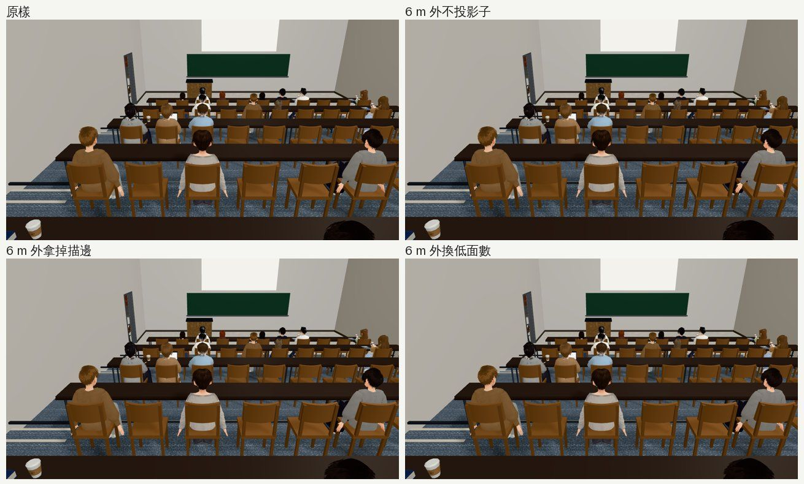
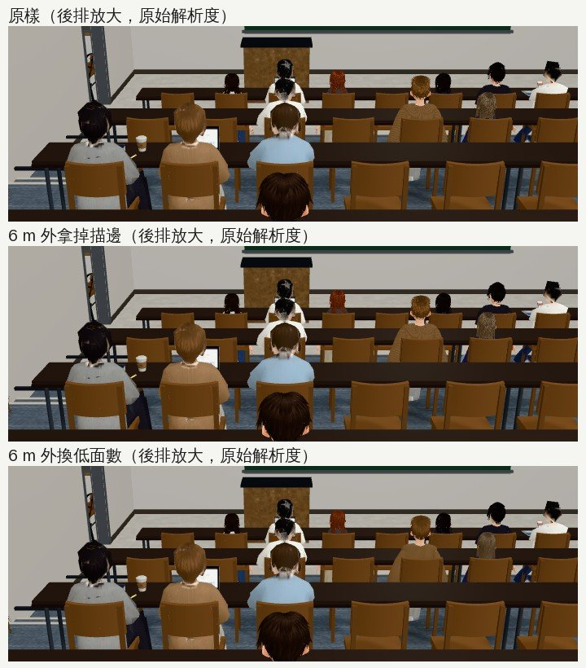

# 博雅一樓階梯教室那班路人：少畫一點（量測＋三種做法試過）

- **來源**：
  - 巡場景第 7 區（`test_shots/patrol_classrooms_1024/`）：博雅一樓階梯教室下午上課那段 365 calls、77 萬三角形，其他教室是 107～143 calls。
  - LAWWW-B 10:49：「可以順手看看能不能少畫一點（同一批人用低面數或少放幾個），改 story3d.js 的人數前告訴我」。
- **做的人**：LAWWW2-B。
- **狀態**：量測、試做完成。改法要動 `engine3d.js`，等 LAWWW-B 決定。

## 量測（同一個鏡頭：坐在後排往前看，15:00）

- 畫面上的同學 11 位，全是無名路人（`isExtra`），離鏡頭 1.1～9.3 m。
- 每人 9 個沒描邊的網格（約 1.2 萬三角形）＋5 個有描邊的網格（約 1.9 萬，描邊再畫一次）。
- 整個畫面（含陰影那一輪）361 calls、76.4 萬三角形。

## 三種做法（都只對離鏡頭 6 m 以外的同學，在遊戲裡直接切換）

| 做法 | calls | 三角形 | 畫面 |
|---|---|---|---|
| 原樣 | 361 | 76.4 萬 | — |
| 不投影子 | 361 | 76.4 萬 | 沒差：路人本來就不進陰影那一輪 |
| 拿掉描邊 | 321 | 61.0 萬 | 頭髮變顆粒、有鋸齒——**不建議** |
| 換遠距離低面數（PERF-CROWD-LOD 那一套，8 位換了） | **271** | **50.2 萬** | 後排放大到原始解析度比，幾乎看不出差別 |

## 提案（要動 `engine3d.js`，等 LAWWW-B）

- 室內區域，無名路人換低面數的距離從 30 m 改成大約 7 m（回來 6.5 m）。
- 室外照舊 30／28 m。
- 有名字的角色不受影響（照舊只換 `isExtra`）。
- 改的地方：`engine3d.js` NPC 迴圈裡 `CHAR.setFar` 那一行（目前用 `CHAR.FAR_OUT`／`FAR_IN`），室內改讀一組室內用的距離。
- 不用動 `story3d.js` 的人數。

## 沒做／沒測

- 手機實機的幀率沒量（只有 SwiftShader 的 calls、三角形）。
- 室內 7 m 的換模型，在走動中會不會被看出「跳一下」：要改了以後走一段路截圖確認。
