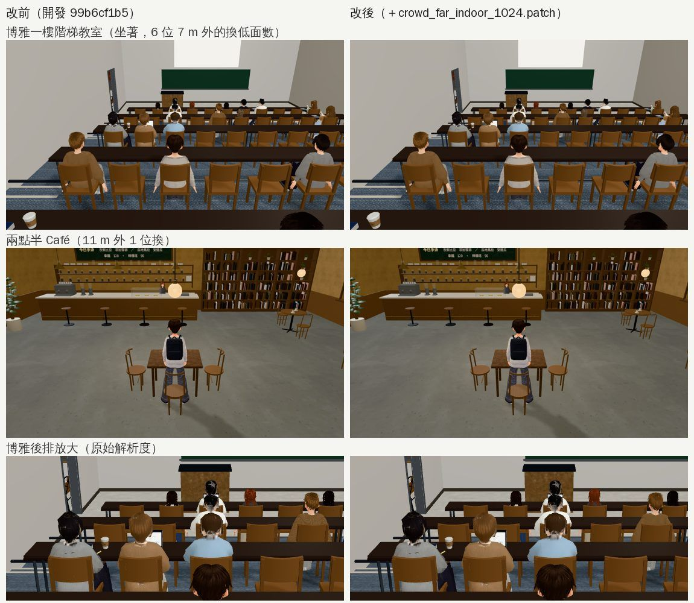
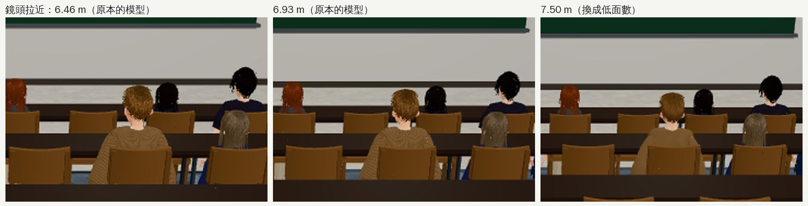

# 博雅一樓階梯教室那班路人：少畫一點（量測＋三種做法試過）

- **來源**：
  - 巡場景第 7 區（`test_shots/patrol_classrooms_1024/`）：博雅一樓階梯教室下午上課那段 365 calls、77 萬三角形，其他教室是 107～143 calls。
  - LAWWW-B 10:49：「可以順手看看能不能少畫一點（同一批人用低面數或少放幾個），改 story3d.js 的人數前告訴我」。
- **做的人**：LAWWW2-B。
- **狀態**：已交付 patch（LAWWW-B 11:26 同意：室內 7 m／回來 6.5 m，室外照舊 30／28，有名字的角色不換，不動 story3d.js 的人數）。

## 量測（同一個鏡頭：坐在後排往前看，15:00）

- 畫面上的同學 11 位，全是無名路人（`isExtra`），離鏡頭 1.1～9.3 m。
- 每人 9 個沒描邊的網格（約 1.2 萬三角形）＋5 個有描邊的網格（約 1.9 萬，描邊再畫一次）。
- 整個畫面（含陰影那一輪）361 calls、76.4 萬三角形。

## 三種做法（都只對離鏡頭 6 m 以外的同學，在遊戲裡直接切換）

| 做法 | calls | 三角形 | 畫面 |
|---|---|---|---|
| 原樣 | 361 | 76.4 萬 | — |
| 不投影子 | 361 | 76.4 萬 | 沒差：路人本來就不進陰影那一輪 |
| 拿掉描邊 | 321 | 61.0 萬 | 頭髮變顆粒、有鋸齒——**不建議** |
| 換遠距離低面數（PERF-CROWD-LOD 那一套，8 位換了） | **271** | **50.2 萬** | 後排放大到原始解析度比，幾乎看不出差別 |

## 改了什麼（`docs/art-rebuild/second_ai/patches/crowd_far_indoor_1024.patch`，對開發 `99b6cf1b5`）

- `src/character3d.js`：`C.FAR_OUT_IN=7; C.FAR_IN_IN=6.5;`（室外 `FAR_OUT=30`、`FAR_IN=28` 照舊）。
- `src/engine3d.js`：
  - 新的 `farWant(isFar, cd, indoor)`：室內 7 m 外換、6.5 m 內換回來；室外 30／28。
  - NPC 迴圈那一行改用 `farWant`，照舊只換無名路人（`isExtra`）。
  - 騎腳踏車的路人（`E.extras`，室外）沒動。
- `tests/crowd_far_indoor_unit.js`（新，修改前 FAIL 4）：
  - 室內、室外的距離；
  - 換了以後要更近才換回來；
  - 來回走三趟：6.5 m 以內一定是原本的模型、每趟只換兩次；
  - 只換 `isExtra`。
- `tests/npc_far_unit.js`：比對 NPC 迴圈那一行的寫法改成新的（30／28 照舊檢查）。

## 遊戲內改前改後（Playwright＋SwiftShader；不是 iPhone 實機）

| 畫面 | 改前 calls／三角形 | 改後 | 換了幾位 |
|---|---|---|---|
| 博雅一樓階梯教室（坐後排往前看 15:00） | 361／76.4 萬 | **271／50.2 萬** | 6 位（最近的 7.0 m） |
| 兩點半 Café 15:00 | 160／21.2 萬 | 145／16.8 萬 | 1 位（11 m，不在畫面裡） |
| 總圖 3F（兩個方向） | 143、199 | 一樣 | 0（學姊 5.2 m、陳助教 6.6 m 都是有名字的角色，不換） |
| 普通 101、共同 101（15:00、10:30） | — | 一樣 | 0（那兩個時段教室沒有人） |

**坐著換模型接不接得上**（LAWWW-B 要確認的）：
- 博雅後排換了以後，位置、坐姿、朝向都一樣（上圖最下面一列）。
- 低面數版本綁在同一副骨頭上。

**走動中換模型**：同一位同學，鏡頭往後拉（6.46 → 6.93 → 7.50 m），放大 2 倍：

- 換的那一下位置、姿勢不跳。
- 細節看得出來：毛衣的針織紋路沒了、頭髮比較平。原本大小（手機上那個人大約 60 px 高）幾乎分不出來，放大才看得出。
- 要更保險可以把室內距離改成 8 m：博雅那一段大約換 4～5 位，省得少一點。
- 邊界來回：6.46 m 原本的模型、6.65 m 已經換了的照舊是低面數（要到 6.5 m 內才換回來），不會一直閃。

## 測試

- `crowd_far_indoor_unit`（新）、`npc_far_unit`、`teach_perf_unit`、`indoor_crowd_unit`、`boya_lecture_unit`、`crowd_unit`、`classes_unit`、`shadow_levels_unit`、`nav_levels_unit`：ALL PASS。
- **沒有跑**：瀏覽器整套回歸。

## 沒做／沒測

- 手機實機的幀率沒量（只有 SwiftShader 的 calls、三角形）。
- 小教室（普通 101，約 9 m 深）上課中的畫面這次沒拍到（那兩個時段沒有人）。照距離算：坐在後排時，鏡頭在人後面 3 m，7 m 內是前面 4 m 以內的人。老師是有名字的角色，不會換。
