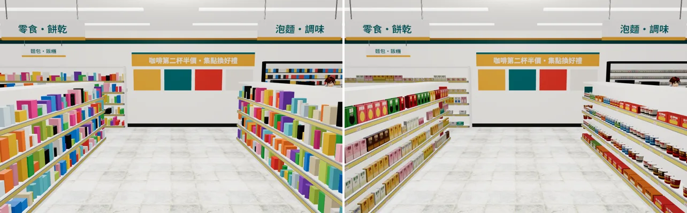
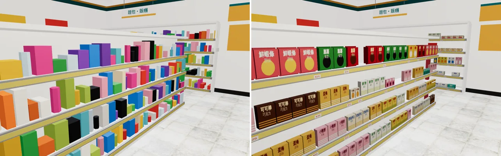

# 便利商店商品第二版（交班時的狀態：WORK_IN_PROGRESS，不是交付）

LAWWW2，2026-10-14 17:4xZ 交班時整理。**正式 GLB `assets/models/env/second_ai/cvs_interior.glb` 沒有換**，LAWWW 不要整合這一版。

## 需求

- 使用者 2026-10-14 回饋⑦：「便利商店店面裡面的東西看起來就是一堆模板複製貼上超假的」。
- LAWWW 09:53Z 佇列②、17:22Z 佇列①：
  - 飲料冰箱：瓶罐分層、不同包裝。
  - 零食、泡麵、餅乾、文具日用品、收銀台旁小物。
  - 同一層不要整排同一個商品：高矮、寬窄、顏色要有變化，有缺貨空位、斜放。
  - 貨架尺寸照 `zones3d.js` 的 goodsWall／shelfWall，導航不變。
  - 交付 GLB＋接法說明＋遊戲內截圖（手機直向、橫向），狀態 READY_FOR_ART_REVIEW。

## 已做（腳本在分支上：`208f242`）

- `tools/blender/env_second/cvs_goods.py`（新）：
  - 59 種虛構商品（不仿真實品牌，字型文泉驛正黑），分成杯麵、袋麵、洋芋片、餅乾、糖果、麵包、寶特瓶、鋁罐、紙盒、日用品、洗沐、文具、香菸（只有色帶、不畫品牌）。
  - 2048×2048 包裝貼圖集，每格 128×128；全部商品共用一個材質 `cvs_goods_atlas`，一次 draw call。貼圖集裡也有價格標籤、端架促銷牌（第二件 6 折、新品上市、買一送一）。
  - 形狀各有一種：杯麵（上寬下窄＋蓋子）、袋子、盒子、寶特瓶（瓶身液體顏色、標籤、瓶肩、瓶頸、瓶蓋）、鋁罐（上下緣）。
  - 陳列：同一種並排 2～4 個（冷藏櫃 3～5 個），6% 機率缺一個，每一組下面一張價格標籤。
- `tools/blender/env_second/cvs_interior.py`：改用上面的模組（舊的隨機色塊 `fill()` 拿掉）。分區如下：
  - 後牆：日用品、洗沐、文具、麵包、餅乾。
  - 西側雙面貨架：零食、餅乾、糖果。
  - 東側雙面貨架：泡麵＋麵包。
  - 四個端架：每個只放一種商品，堆四層，上面一張促銷牌。
  - 香菸櫃：菸盒。
  - 冷藏櫃：每扇門一區（茶、水、罐裝、紙盒）。
- 測試建置（scratchpad，沒有 commit）：

  | | 三角形 | 材質數 | 檔案大小 |
  |---|---|---|---|
  | 這一版 | 36,322 | 24 | 2.73 MB |
  | 原本 | 17,220 | 23 | 1.41 MB |

  重建指令：`/opt/blenv/bin/python tools/blender/env_second/cvs_interior.py -- --out <輸出路徑>`。亂數固定，同一個 commit 重建結果相同。**不要直接輸出到 `assets/…/cvs_interior.glb`**，除非已經完成下面的「還沒做」並驗收過。

## 遊戲內截圖（實際遊戲畫面）

- 桌機 1280×800，Playwright＋SwiftShader。不是手機實機，也還沒拍手機直向、橫向。
- 中午 14:00、鏡頭位置固定，設定在 `shots_cvs.json`。
- 做法：在開發分支 `e6ca3e2` 的本機 worktree 只換 GLB，沒改程式。
- 不需要改 `zones3d.js`：新材質是一般貼圖材質，亮度看起來夠，不用加 `TK.bounce`。舊的 `cvs_goods`／`cvs_poster` 頂點色材質仍給關東煮、茶葉蛋、海報用，`attachCvsInterior` 照舊。

| 角度 | 原本 | 這一版（WIP） |
|---|---|---|
| 入口往裡看 | `before_cvs_1_entrance.webp` | `after_wip_cvs_1_entrance.webp` |
| 零食貨架（西側） | `before_cvs_2_island.webp` | `after_wip_cvs_2_island.webp` |
| 後牆 | `before_cvs_3_backwall.webp` | 還沒拍 |
| 冷藏櫃 | `before_cvs_4_cooler.webp` | 還沒拍 |

並排比較：`compare_cvs_1_entrance.webp`、`compare_cvs_2_island.webp`（左原本、右 WIP）。

玩家會看到的差別：
- **原本**：每一層都是隨機顏色、隨機大小的方塊，看不出賣什麼。
- **WIP**：看得出每一區賣什麼（零食、泡麵、杯麵、麵包），包裝有品名，同一種並排，下面有價格標籤，偶爾缺一個。

## 還沒做（下一班照這個順序接）

1. **牆上的「海報」還是純色方塊**。後牆促銷看板下面四塊、左牆三塊，是 `cvs_poster` 頂點色。
   - 改成貼圖集裡的海報（貼圖集第 6～11 列是空的）。
     - 後牆 4 張，每張 4×3 格（512×384）：現煮咖啡、集點換好禮、早餐組合、霜淇淋。
     - 左牆 3 張，每張 3×3 格（384×384）：關東煮、代收繳費・包裹取件、冰涼特調。
   - 海報網格要命名成 `WALL_back_posters`／`WALL_left_posters`，並加自訂屬性 `dir`，才會跟著牆淡出（`attachRoomGLB`）。
2. **洋芋片、麵包是硬盒子**，要改成鼓起來的袋子：
   - 正面 3×5 格網，上下封口壓扁，兩側圓，背面平。
   - 共用頂點＋平滑著色，每個約 60 個三角形。
3. **包裝圖案太單調**（純色圓、圓角方塊），在畫面上像洞。
   - 依分類畫插圖：泡麵碗、洋芋片堆、蝦條、糖果、餅乾、麵包、茶葉、水滴、檸檬、咖啡豆、氣泡、口罩、文具吊卡。
   - **照每個面的實際長寬比畫**，再縮進格子。現在每格 128×112 直接貼到面上，所以：
     - 袋麵（2.2:1）的字被拉寬約 2 倍。
     - 洗髮精（0.4:1）、紙盒、文具的字被壓扁。
4. **圓柱（杯麵、鋁罐、寶特瓶）有兩個問題**：
   - 現在是平面著色，而且有一段剛好跨過包裝接縫（被擠壓）。
   - 改法：一圈共用頂點、平滑著色，起始角度設在接縫上（10 段、8 段剛好半圈對齊）。
5. **寶特瓶標籤太窄**（瓶高的 30%），改成 0.05～0.15（約 43%）。
6. 後牆貨架看起來有點空，要檢查密度。
7. **拍完交付截圖**：
   - 四個角度的 after。
   - 手機直向、橫向（LAWWW 要求）。
   - 量 draw call、三角形，GLB 目標 ≤ 約 3 MB；太大就縮貼圖集或減少瓶子段數。
8. 交付：GLB 寫到正式路徑＋`.json`、README（接法：只換 GLB）、VISUAL_REVIEW。狀態 READY_FOR_ART_REVIEW，通知 LAWWW。

## 自評（WIP 現況，誠實寫）

- **比原本好很多的地方**：看得出是便利商店的商品，分區、並排、價格標籤都像真的。
- **還不到參考品質**：
  - 包裝是平面色塊＋字，沒有照片感。
  - 袋子是硬的。
  - 海報是色塊。
  - 冷藏櫃、後牆還沒檢查。
- 不要標 READY_FOR_ART_REVIEW。
