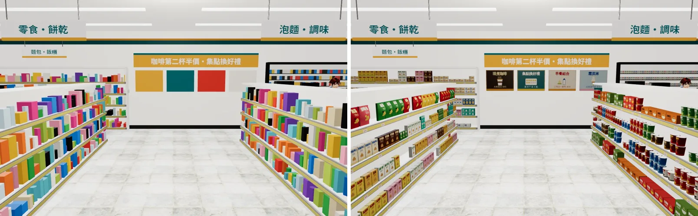
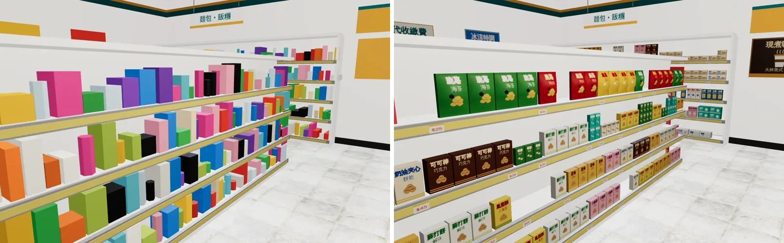
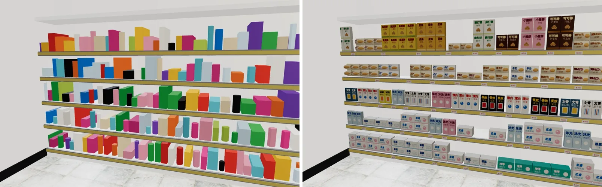
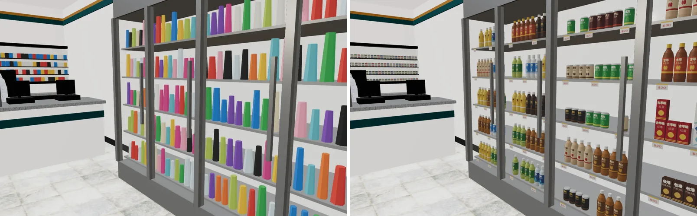
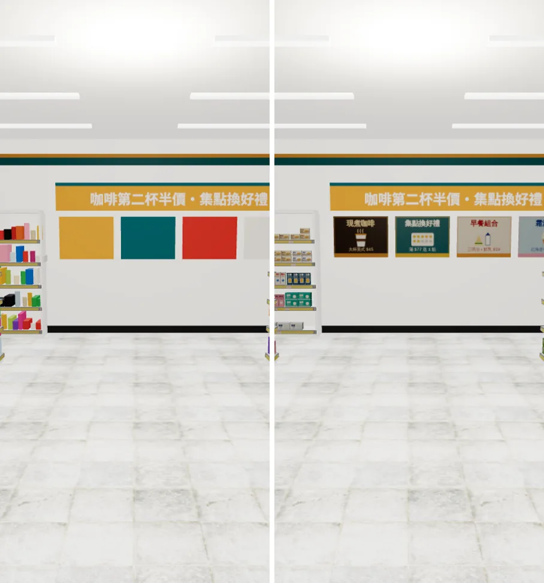
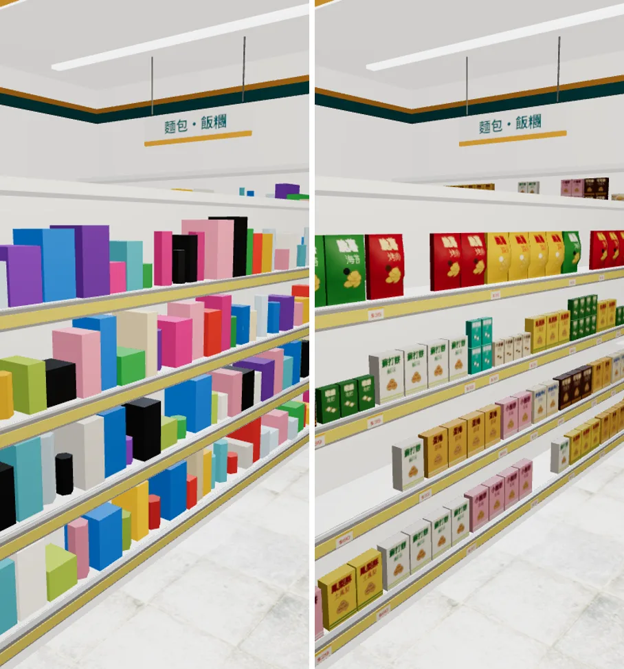
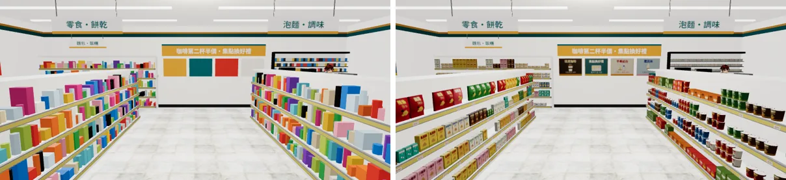
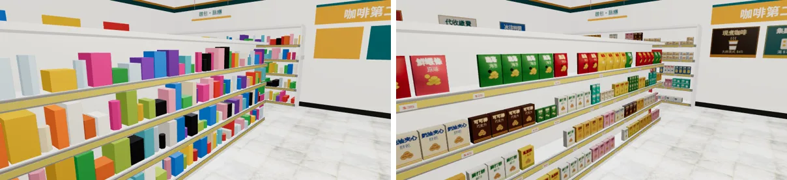

# 便利商店商品第二版（READY_FOR_ART_REVIEW；LAWWW2-B 2026-10-15）

> 資料夾名稱保留 `cvs_goods_wip`（上一班建的）。內容已經從 WIP 做完，可以交給 LAWWW-B 整合；**整合、發布的時間由 LAWWW-B 依使用者排的順序決定**。

## 需求

- 使用者 2026-10-14 回饋⑦：「便利商店店面裡面的東西看起來就是一堆模板複製貼上超假的」。
- LAWWW 09:53Z 佇列②、17:22Z 佇列①：
  - 飲料冰箱的瓶罐分層、包裝不同。
  - 零食、泡麵、餅乾、文具日用品、收銀台旁小物。
  - 同一層不要整排同一個商品：高矮、寬窄、顏色要有變化，有缺貨的空位。
  - 貨架尺寸照 `zones3d.js` 的 goodsWall／shelfWall，導航不變。

## 做了什麼（腳本：`tools/blender/env_second/cvs_goods.py`、`cvs_interior.py`）

1. **商品包裝**：
   - 59 種虛構商品，不仿真實品牌；香菸只畫色帶。
   - 全部畫在一張 2048 的貼圖集，一個材質。
   - **照每一面的實際長寬比畫**。上一班的版本中，袋麵的字被拉寬、洗髮精的字被壓扁，現在不會了。
   - 每一類有自己的插圖：麵碗、洋芋片、餅乾、糖果、麵包、茶葉、水滴、檸檬、氣泡、咖啡豆、口罩、吊卡的筆。
   - 橫的包裝（袋麵、面紙）字在左、圖在右。
2. **形狀**：
   - 洋芋片、麵包改成**鼓起來的袋子**：正面曲面、上下封口壓扁、平滑著色。
   - 杯麵、鋁罐、寶特瓶改成一圈共用頂點的平滑圓柱，包裝接縫對齊側面。
   - 寶特瓶標籤加高：從瓶高 30% 改到 43%（0.05～0.15）。
3. **陳列**：
   - 同一種商品並排 2～4 個，冷藏櫃 3～5 個。
   - 6% 機率缺一個，每一組下面一張價格標籤。
   - **矮的商品往上疊兩層**（盒子、袋子、杯麵；瓶罐不疊）。上一版的後牆層板上方空了一大截。
4. **牆上的海報**：原本是 7 塊純色方塊，換成貼圖集裡的海報。
   - 後牆：現煮咖啡、集點換好禮、早餐組合、霜淇淋。
   - 左牆：關東煮、代收繳費・包裹取件、冰涼特調。
   - 網格叫 `WALL_back_posters`／`WALL_left_posters`，帶自訂屬性 `dir`，會跟著牆淡出（`attachRoomGLB`）。

## 規格

| | 三角形 | 材質數 | 檔案大小 |
|---|---|---|---|
| 原本（上線中 v9.7） | 17,220 | 23 | 1.41 MB |
| 上一班的 WIP | 36,322 | 24 | 2.73 MB |
| **這一版** | **50,268** | **24** | **2.59 MB**（目標 ≤ 約 3 MB） |

- 商品都在同一個材質 `cvs_goods_atlas`，一次 draw call；海報是另外兩個小網格（跟著牆淡出）。
- 重建：`/opt/blenv/bin/python tools/blender/env_second/cvs_interior.py`，輸出到 `assets/models/env/second_ai/cvs_interior.glb` 和 `.json`。
  - 亂數固定，重建的大小、三角形數相同。
  - 兩次建置的檔案有少數位元組不同，推測是貼圖封裝的差異，畫面相同。

## 接法

**只換 GLB，不用改程式**：
- `zones3d.js` 的 cvs 區塊、`attachCvsInterior` 照舊。
- 導航、互動點、出生點不變，沒有加新的障礙物。
- 新材質是一般貼圖材質，亮度夠，不用 `TK.bounce`。

## 遊戲內截圖（實際遊戲畫面）

- 基準：LAWWW-B 開發分支 `6212adb`，只在本機 worktree 換 GLB，沒改程式。
- 環境：Playwright＋SwiftShader。**不是手機實機。**
  - 桌機 1280×800。
  - 手機模擬：直向 390×844、橫向 844×390，is_mobile、觸控。
- 時間 14:00，鏡頭固定，設定在 `shots_cvs.json`；手機用前兩個鏡頭。JS 例外 0。

| 角度 | 並排（左原本、右這一版） |
|---|---|
| 入口往裡看 |  |
| 零食貨架（西側） |  |
| 後牆 |  |
| 冷藏櫃 |  |
| 手機直向・入口 |  |
| 手機直向・零食貨架 |  |
| 手機橫向・入口 |  |
| 手機橫向・零食貨架 |  |

單張：`before_*.webp`（原本）、`after_v2_*.webp`（這一版）。

### 玩家會看到的差別

- **原本**：每一層都是隨機顏色、隨機大小的方塊，看不出賣什麼；海報是色塊。
- **這一版**：
  - 看得出每一區賣什麼：零食、餅乾、泡麵、杯麵、麵包、日用品、文具、飲料。
  - 包裝有品名和插圖，同一種並排，下面有價格標籤，偶爾缺一個。
  - 冷藏櫃是一排排寶特瓶、鋁罐、紙盒。
  - 牆上的海報看得出在賣什麼。

## 自評（還不到參考品質的地方，誠實寫）

- 包裝是平面插畫加字，沒有照片感；近看字很小。貼圖集每格 128 px，鏡頭貼近時有點糊。
- 寶特瓶、杯麵的段數少，近看輪廓有角。
- 袋子只有正面鼓起來，背面平（貼著貨架看不到）。
- 只檢查了白天 14:00，晚上沒拍。
- 冷藏櫃、後牆只拍了桌機角度，手機只拍入口和零食貨架。
- 美術由使用者確認，**不標 ART_APPROVED**。
