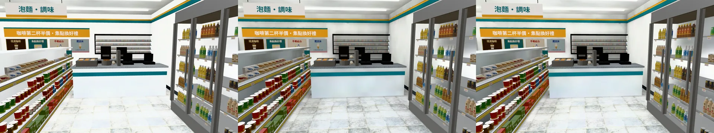
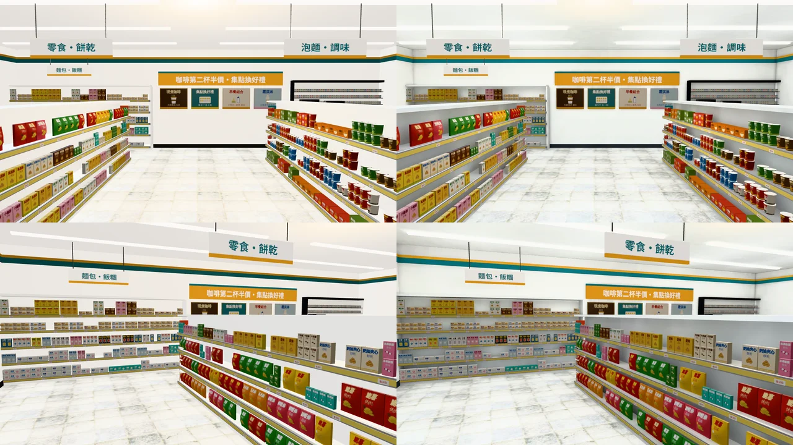
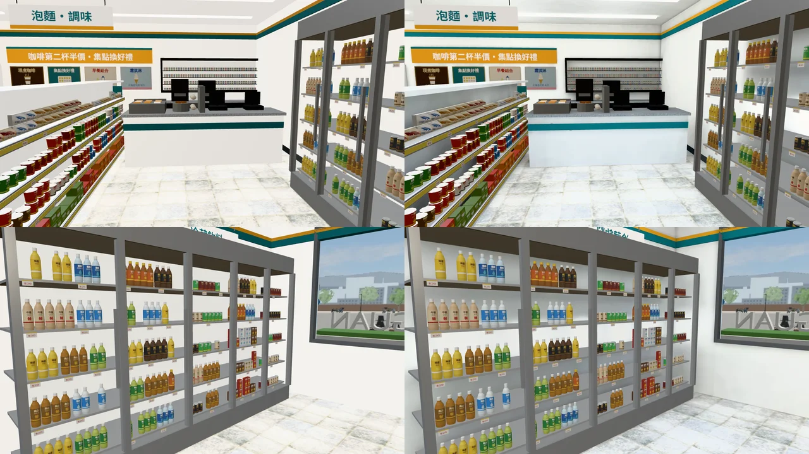
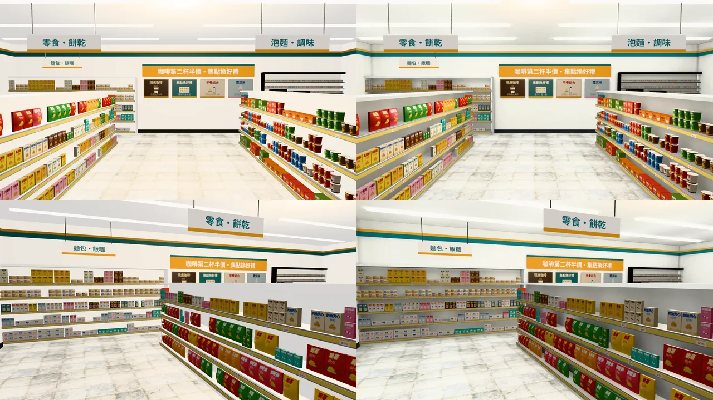
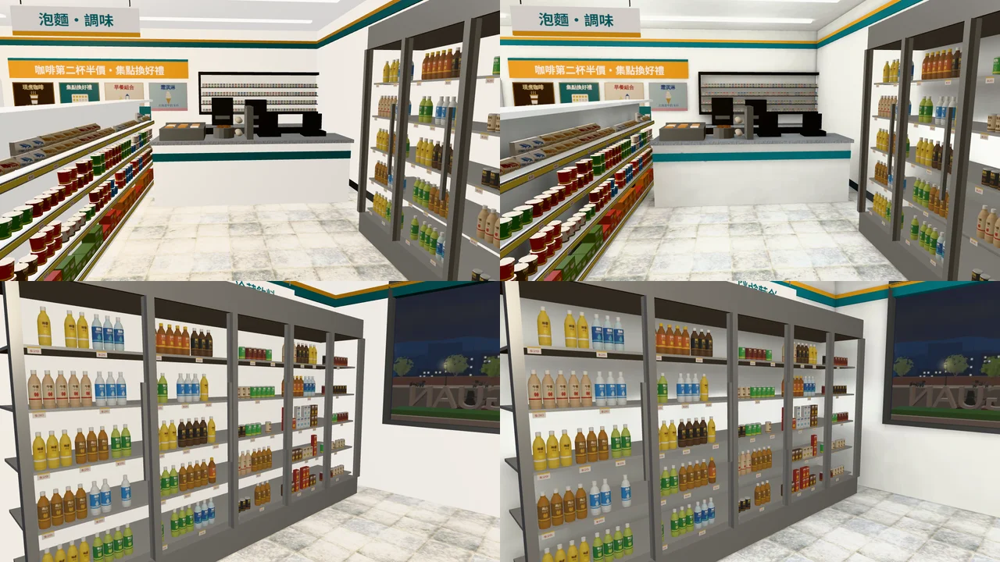

# 日日便利（便利商店）室內光照烘焙（INTERIOR-AAA-REVIEW-1028；LAWWW2-B 2026-10-31）

- **起因**：INTERIOR-AAA-REVIEW-1028 第 5 節 P1（光照）。
  - 查了全部有正式模型、還沒有光照貼圖的室內：便利商店、書店、溫州街三家、體育館、美國那幾間。
  - 照「玩家多常去」排，便利商店第一（日常會進去買東西）。
  - LAWWW-B 05:52：「做完（四棟柱子）回 INTERIOR-AAA-REVIEW-1028」。
- **狀態**：`READY_FOR_ART_REVIEW`。建築、場景只有使用者能標 `ART_APPROVED`。
  - 截圖是 Playwright＋SwiftShader（電腦 1280×720），不是實機。
  - 讀檔放位置、藏玩家和 NPC 是 [捷徑]。
- **這一包只做光照（P1）**。擺設（P4：誰在用、剛發生什麼）沒做。

## 一、怎麼套（給 LAWWW-B）

1. **換二進位**：
   - `assets/models/env/second_ai/cvs_interior.glb`（＋`.json`）；
   - 新的 `cvs_interior_lm_day.webp`、`cvs_interior_lm_night.webp`。
   - 模型和開發分支一樣，只多一套光照 UV 和 extras.lightmap。節點不變；三角形少 144 個（看不到的面被收掉）。
2. **patch**：`docs/art-rebuild/second_ai/patches/cvs_lm_1031.patch`（對開發 `74fbc5a32`）。
   - `src/zones3d.js` 的 `attachCvsInterior` 改一行：有光照貼圖的材質不加補光（`CVS_BOUNCE`），理由見第二節。
   - 新測試 `tests/cvs_interior_lm_unit.js`：
     - 光照貼圖兩張都在；
     - 地板、天花板、四面牆、貨架、櫃檯有第二套 UV；
     - 燈條、飲料櫃背光、商品、價格條、分類牌照舊即時光；
     - 有光照貼圖時不加補光。
     - 開發分支原樣 FAIL，改後 ALL PASS。
   - 新工具 `tools/blender/env_second/lightbake/bake_cvs.sh`（照麵店：同一排公館南側店面、店面朝東、太陽 0）。
   - 烘焙紀錄 `cvs_interior_lm.json`。
   - `tools/blender/env_second/cvs_interior.py`：分類牌、促銷看板的材質（`cvs_sign_face`）明確單面。
     - 現在的腳本匯出來是雙面：single_side 第四份改了規則，只有 SIGN_FACE 在用的材質照舊雙面。
     - 部署的 GLB（10-25 第一份）是單面，`singleside_interiors_unit.js` 也要單面。重匯時才發現兩邊不一樣。
     - 吊牌兩面各自一片，看板只從店裡看，單面就對。改後重匯的模型材質和部署的一樣。
   - `tests/singleside_interiors_unit.js`：便利商店的牆面原本檢查「開口的零件有反面」。
     - 光照烘焙會拿掉有光照貼圖的物件的反面（反面的光照貼圖是黑的；社科圖的天井 10-30 也一樣）。
     - 改成 2c：牆裡面那一面（x=±5.88、z=±4.38）都朝店裡。實測朝店裡 115.7 m²、朝外 0。

## 二、參數（遊戲內試了三版）

- **第一版**（燈條 14 W、燈下點光源 6 W）：和改前幾乎一樣。
  - 原因：遊戲的 `attachCvsInterior` 對牆、地板、貨架、櫃檯加了一層均勻的自發光（`CVS_BOUNCE`），把烘焙出來的影子洗掉。
  - 改成有光照貼圖的材質不加（和宿舍四人房的 `DORM_BOUNCE` 同一個做法）。
- **第二版**：貨架底下、櫃檯正面、牆角有影子了，但白色貨架偏灰。
- **定案（第三版）**：
  - 燈條 18 W、晝光色 0.96,0.98,1.0（便利商店的燈很白）；
  - 每條燈條下 0.8 m 兩顆點光源 8 W（天花板才亮得起來）；
  - 飲料櫃裡一排冷白點光源；天光 0.6；白天燈照開。
- 參數都寫在 `bake_cvs.sh` 開頭。

## 三、改前改後（同角度；左＝開發分支原樣，右＝光照烘焙）

- 鏡頭：`tools/blender/env_second/shots/cvs_lm_shots.py`。①門口往裡看 ②走道往後牆 ③櫃檯 ④飲料櫃。

### 看得到的差別

- 貨架的層板底下、櫃檯正面、牆角、天花板邊緣有陰影。改前整間一樣白、一樣亮，貨架和櫃檯像貼在地上的紙模型。
- 地板靠貨架的地方暗一點，走道中間亮。
- 晚上：冷白的燈，店裡比外面亮很多（便利商店晚上本來就這樣）。
- 門口牆面取樣：白天 (111,118,104) → (98,106,92)，地板 (244,239,228) → (235,237,230)。整體稍暗，但影子出來了。

### 還不夠的（照實寫）

- **擺設（P4）沒做**：店員、正在補貨的紙箱、門口的傘桶、結帳台上的東西。這一包只做光。
- 商品（四萬多個三角形的小盒子、瓶罐）照舊即時光：晚上離燈遠的層板，商品比旁邊的貨架亮一點。
- 烘焙的太陽不會動（這間太陽本來就照不進來，影響小）。

## 四、檢查、效能

- `lm_squash_scan.py`：朝室內被壓扁 **0 m²**。
- 效能（藏路人；`interior_perf.py` `HIDE_NPC=1`；14:00；SwiftShader，手機實機沒量）：

| 位置 | draw call（前／左／右／後） | 三角形 |
|---|---|---|
| 門口 | 85／79／87／75 → 86／79／87／75 | 少約 140 |
| 走道 | 79／66／88／71 → 80／66／89／71 | 少約 140 |

- 光照貼圖兩張共約 130 KB（1024²）。

## 五、測試

（Node 全部跑完補）
