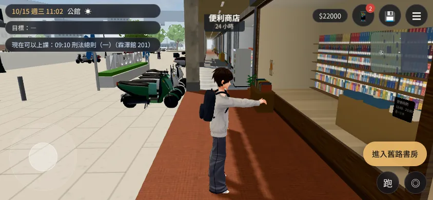
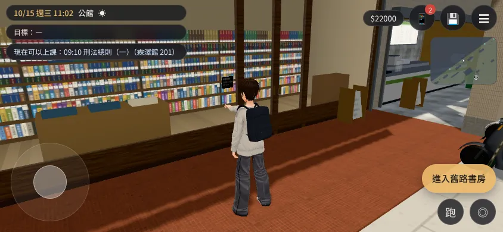
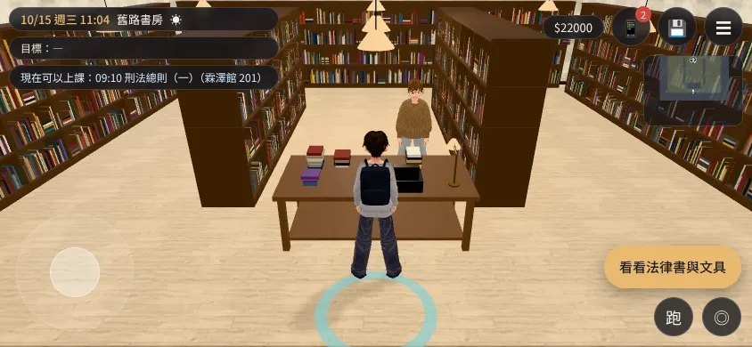
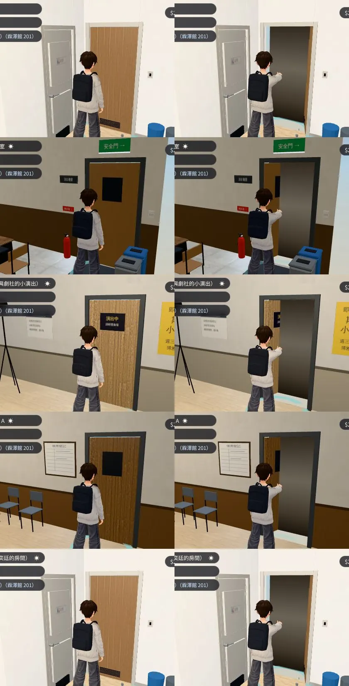

# ANIM-DOOR-OPEN-1027（USER_WANTS A21「人物動作要有開門」）第一階段（LAWWW2-C 2026-10-27）

- **使用者**（spec 21 第 5 點）：人物動作要有上下樓、轉身、坐下、站起來、**開門**。其他都有，開門沒有。評估：`docs/art-rebuild/second_ai/EVAL_J13_A21_D40_1027.md`。
- **對**：開發分支 `479e35f11`、最新 `de75d3106`（`git apply --check` 都過）。**依賴**：`character3d.js` 的疊加姿勢掛勾 `u.overlay`（羽球短片那支 patch，已經在開發分支）。

## 玩家會看到什麼

- 按「進入舊路書房」「離開咖啡廳」「走出房間」「出門」這種**有門的出入口**：祐廷先轉向門、右手往前伸到胸口高推門（約 0.45 秒），接著照舊變黑換區域；到新的地方手已經放下。
- **自動門**（便利商店、美國的兩家超市、機場）：只轉向門口，不伸手。
- **不是門**：樓梯、電梯、「往溫州街」這種路、搭車、過馬路、回到校園；**開放式的店面**（阿鳳麵店，整個店面是開的）。
- 騎腳踏車、劇情自己換區域（不是玩家按的）：不演。
- **門板本身不會動**（第二階段：最常走的幾扇門把門板從模型分出來轉開）。

| 推門（側面） | 推門（斜後方） | 推完、進到書店（手放下） |
|---|---|---|
|  |  |  |

公館舊路書房門口，手機橫向模擬（SwiftShader）；[捷徑] 讀檔、直接放到門口，推門姿勢是把疊加姿勢固定在 k＝1 拍的（真的按下去只有 0.45 秒，SwiftShader 一張截圖來不及）。
第一版手太低、像「伸手」：`v0_push_noodle_low_arm.webp`（也是在這一版發現麵店沒有門）→ 手臂抬到胸口高。

## 怎麼判斷是不是門（`src/door3d.js` 的 `DOOR.kind`）

- 出入口的字有「進入／離開／走出／出門／回公寓／回宿舍／回家／回房／回萬才館大廳」→ 門；有「樓梯間／上樓／下樓／電梯／搭車／過馬路／往…／回到校園／回公館」→ 不是門。
- 去的地方或現在的地方是自動門的區域（`AUTO_ZONES`）→ 自動門；開放式店面（`OPEN_ZONES`，目前只有麵店）→ 不是門。
- **出入口自己寫 `exit.door:'push'|'auto'|'none'` 會蓋過上面的判斷**——判斷錯的出入口這樣修就好。
- 程式碼裡寫死字的 30 個出入口：推門 21、自動門 1（＋從便利商店出來）、不是門 8（清單見 `tests/door_open_unit.js` ②）。用 getter 或拼字的出入口（118 巷的店、美國的幾個）照同一套規則，**沒有逐一看過**——BB 測的時候看到開放式的店卻推門，告訴我加進 `OPEN_ZONES`。

## 做法

- 新 `src/door3d.js`（`DOOR`）：`open(GM,it)` 轉向門（0.18 秒）＋疊加姿勢 0→1（0.25 秒）＋推著 0.2 秒，演完才回傳；`close` 只清開門自己的疊加姿勢（羽球短片的不動）。
- **手什麼時候放下**：換到新區域（`E.zone` 換了）的第一格——那時候畫面還是全黑（瀏覽器實測那一格黑幕不透明度 1）。一開始用計時器（變黑 0.52 秒後放下），**實測換區域會卡住主執行緒，計時器晚了 1～2 秒，新區域亮起來時手還伸著**，所以改成看區域。沒換成（鎖著、失敗）4 秒後放下。
- `src/game3d.js` 一行：按出入口時 `if(typeof DOOR!=='undefined'){ const dp=DOOR.open(GM,it); if(dp) await dp; }` 再 `enter`。
- `index.html` 一行：`game3d.js` 前面載入 `src/door3d.js`。

## 測試

- 新 `tests/door_open_unit.js`（Node）：**改前 FAILED 1（DOOR 不存在）、改後 ALL PASS（16 項）**——30 個出入口的分類、`exit.door` 蓋過、getter 的字；推門約 0.45 秒才換區域、手伸出去、轉向門；**換區域前手還伸著、換了以後下一格放下**；沒換成 4 秒後放下；自動門不伸手；不是門、騎車不演；只清自己的疊加姿勢；接線。
- 瀏覽器（`tools/shots/door_open_shots.py`）：書店、麵店兩次真的按出入口，換區域成功、換完手放下、沒有 JS 例外。
- `tests/zone_transitions.py`（套上以後；各區域的出入口真的按、進去再出來）：**ALL PASS**（37 項、沒有 JS 例外）——多 0.45 秒推門沒有讓換區域出錯。
- **沒測**：手機實機；BB 的玩家流程（每天出門、進教室）。

## 還不夠好（誠實）

- 門板不會動；推的是空氣裡門的位置（玻璃門、木門前面看得懂，沒有門板動作還是少一點）。
- 只有右手；拉門（往外開的門）也是推的動作。
- 換區域多 0.45 秒。
- 美術狀態：`READY_FOR_ART_REVIEW`。

## 檔案（我的分支 `claude/focused-cray-c9uwvw`）

- patch：`docs/art-rebuild/second_ai/patches/door_open_1027.patch`（新 `src/door3d.js`、`src/game3d.js` 一行、`index.html` 一行、新 `tests/door_open_unit.js`）
- 工具：`tools/shots/door_open_shots.py`

---

# 第二階段：門板真的轉開＋BB-C 的三點（LAWWW2-C 2026-10-27 23:xx）

- **對**：開發分支 `fe2fc0241`（`git apply --check` 過）。patch：`docs/art-rebuild/second_ai/patches/door_open_phase2_1027.patch`（只改 `src/door3d.js`、`tests/door_open_unit.js`；`game3d.js`、`index.html` 不用再改）。

## 玩家會看到什麼

- **推門的時候門板真的往裡面轉開**（70°，跟著手 0.45 秒），門洞後面是暗的走廊，接著照舊變黑換區域。
  - 目前轉得開的門：宿舍房門（203、205）、霖澤館 202、博雅 203、萬才館研討室 A／B、多功能教室、法律學院辦公室、總圖多媒體中心、研究小間、日本宿舍房門。條件是模型裡有單獨一片門板網格。
- **門上的東西跟著門板轉**：202、研討室的小窗，博雅 203 的「演出中」牌子，宿舍門下的通風格柵。
  - 第一版只轉門板，這些東西浮在半空，見 `phase2_v1_parts_floating.webp`。原因是它們在 Blender 匯出時照材質併進大網格了。
  - 改法：推門時把三個頂點都在門板範圍裡的三角形切出來，跟著門轉。門框、牆、踢腳板比門板長，不會被切到。原本的幾何不動，另外做一份只換三角形清單、頂點共用的幾何；模型快取是共用的，下次進來照舊。
- **不轉**：
  - 201 階梯教室的門：門板後面 8 cm 就是牆（門是貼在牆上的，沒有門洞），轉開會看到牆。
  - 店面、建築大門：門是整棟模型的一部分，分不出門板。
  - 以上這些只有手的動作（第一階段）。

（[捷徑] 讀檔、直接放到門口，推門那一刻凍結截圖；SwiftShader 手機橫向模擬。）

## BB-C 的三點（LAWWW-C 10-27 23:11Z 轉來）

1. **118 巷「進〇〇」**：規則原本只認「進入…」開頭，進去不演、出來推門。改成 `^進`（「進入」「進六張犁麵舖」「進去半熟」「進圖書館」都算）。
   - **九間店都推門**：九間的室內是同一個店面外殼（`lane118_shops.py` 的 `shell()`：鋁框玻璃門加推把），沒有開放式的。
   - 溫州街林家乾麵的模型是整面拉開的開放式（`wz_shopkit.py` A4 `door='open'`），放進 `OPEN_ZONES`。
   - 如果要哪一間改成開放式店面，那是改模型，不是改這裡。
2. **推門那 0.45 秒鎖住玩家**：`E.player.busy=true`，走到一半的路線清掉，演完還原成原本的值（本來就在劇情裡就照舊 busy）。正在推的時候再按，回傳同一個 Promise，只推一次。
3. **分類**：
   - 洗衣間：模型裡有一片關著的淺灰鐵門 → 推門。
   - 「走出去（大樓梯平台）」：萬才館二樓入口的玻璃門，從二樓的門出去到平台 → 推門。
   - 總圖正面：模型是兩扇自動門（`library_interior.py` 的 `L0_autodoor`）→ 校園↔總圖改自動門。總圖裡面的多媒體中心、研究小間照舊推門。

## 用全部 67 區的出入口總表找到的（`DOOR.kind` 前後）

- 校園的「進入霖澤館」「進入萬才館」「進入總圖書館」「回宿舍」「進入社科院圖書館」本來就帶 `door:true`（布林值，比這支 patch 早就有）。第一階段把它當成門的種類，結果只轉身不伸手。現在只認字串，這五個改成照字判斷（總圖是自動門，其他推門）。
- 「走出校門」原本推門 → 不是門（大門口沒有門板）。
- 字沒有動詞的建築入口照門處理，和出來那一邊一致：「共同教學館」「普通教學館」「博雅教學館」「體育館」「法律學院圖書館」「研究小間」「回 2F 自習區」。
- 普通↔博雅走空橋、美國社區「出門（去超市）」走到街上：不是門。
- 美國兩家超市「進草原超市」「進竹葉亞洲超市」：自動門。
- **刻意保留的不一致**（兩種）：
  - 「敲門（205）」「敲門（臥室 C）」：別人來開門，自己不推；出來時推門。
  - 美國 C 棟「上樓（C 棟 208）」：先上樓梯；從屋裡「出門」推門。

## 測試

- `tests/door_open_unit.js`（Node、three.js 真的跑）：**改前 FAILED 8、改後 ALL PASS（41 項）**。
  - 新加的檢查：
    - 找門板：大小、名字、距離。
    - 往遠離玩家的方向轉 70°，從另一邊推也一樣。
    - 門上的小窗、牌子跟著轉；門旁邊的門牌、門框、牆不動。
    - 併在別的網格裡的小窗切出來跟著轉，門框直條、遠處的椅子留著；原本的幾何沒被改。
    - 後面緊貼著牆不轉；門後面空的才放底卡，後面 2 m 有東西就不放。
    - 推門期間 busy、連按兩下同一個 Promise、演完還原 busy（本來就 busy 照舊）。
    - 同一扇門再推一次用同一個鉸鏈；沒換成區域 4 秒後轉回來、底卡拿掉。
    - BB-C 的 27 個出入口；`door:true` 不當成門的種類。
- 瀏覽器（`swing_shots.py`，五扇門真的按）：門板轉 ±1.22、底卡有、沒有 JS 例外。
- 瀏覽器（`dbl_probe.py`，公館舊路書房，真的用觸控按）：
  - 互動鍵 150 ms 內按兩下：DOOR.open 只被叫一次、只換一次區域。
  - 推門那 24 格 busy，推搖桿移動 0 cm。
  - 書店進門的選單照舊出來，沒有 JS 例外。
  - **誠實**：同一支探針在舊版（第一階段 `fe2fc0241`）也只叫一次 DOOR.open。SwiftShader 1～2 fps，0.45 秒不到一格，舊版的「推兩次」在模擬器重現不出來。所以瀏覽器只證明新版鎖住了（舊版推門期間 busy 的格數是 0）；改前改後的差別看 Node 測試（舊版 FAILED）。
- `tests/zone_transitions.py`（套上這支和貓那支 patch；各區域的出入口真的按、進去再出來）：**ALL PASS（37 項）**，沒有 JS 例外。
- 全部 67 區出入口的前後對照：`phase2_exits_kind_before_after.txt`（★改＝這次改了的、←不對稱＝刻意保留的那兩種）；原始資料 `phase2_exits_67zones.json`。
- **沒測**：手機實機；BB 的玩家流程（5o 驗）。

## 工具（`tools/shots/door2/`）

- `survey_all.py`：[捷徑] GAME.enter 進全部區域，列出口、DOOR.kind、找不找得到門板。
- `reclass.js`：用新的規則重算總表、標出改了的和不對稱的。
- `swing_shots.py`：推門那一刻的截圖。
- `dbl_probe.py`：連按兩下＋推搖桿。
- `near_probe.py`：門板附近的網格（看門上的零件併在哪個網格）。
- 美術狀態：`READY_FOR_ART_REVIEW`。
