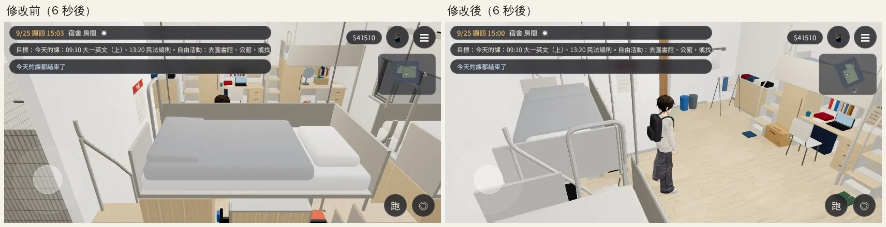
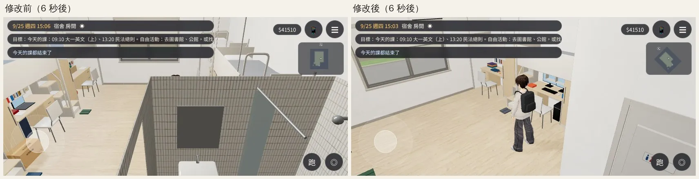
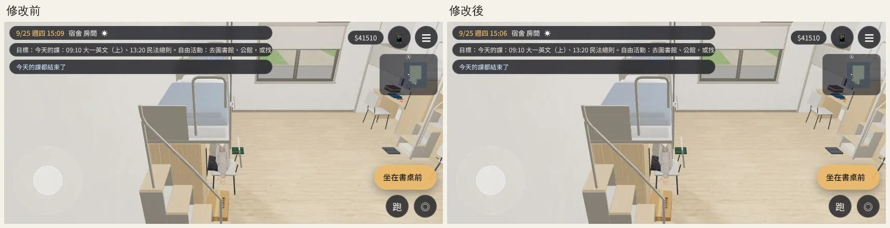
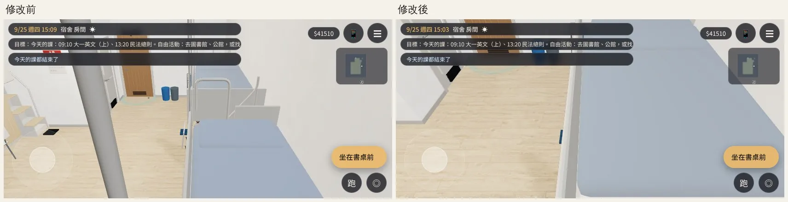

# 大一 203：R2 書桌旁的鏡頭被上鋪、洗手間牆擋住（BUG-CAM-203-R2-1021）——已交件

帳號 A 的 LAWWW2，2026-10-21 18:2x UTC。狀態：**已交件**，交 LAWWW 整合；請 BB 用 artrev3 的角度重拍。

## 問題（BB_218 artrev3 01、04、05、08）

站在 R2 書桌旁 (1.0, 0.25)：
- 鏡頭在東：R2 的上鋪床架擋住整個畫面。
- 鏡頭在南：洗手間的磁磚牆擋住整個畫面。

原因：宿舍房間沒有鏡頭碰撞（`zone.camCols`）。跟隨鏡頭照固定的距離退，會退到上鋪或洗手間隔間後面。

## 改法：`docs/art-rebuild/second_ai/patches/dorm_cam_203.diff`

- 對開發分支 `15f3c677` git apply 乾淨。
- **不需要**改 `engine3d.js`，和 C208 那份 patch 互不相依。

改的內容：
- `src/zones3d.js` 加 `dormCamCols`：
  - 洗手間隔間（地板到天花板）；
  - 四組上鋪（床板底 1.56 m 到床欄頂 2.02 m）。
  - 都交給引擎現有的跟隨鏡頭：擋到就拉近，自動轉向空的那一邊。
- 站在某一組上鋪底下（含坐在自己的書桌前）時，那一組不算。不然鏡頭一出發就撞到頭上的床板，被拉到頭頂。
- 新測試 `tests/dorm_cam_unit.js`。

## 測試

### Node 單元測試 `tests/dorm_cam_unit.js`（ALL PASS）

- 房間裡每 0.3 m 一點、8 個方向，算頭到鏡頭的線有沒有穿過上鋪或洗手間。
  - 修改前的公式：23.2% 的方向被擋住（證明測試抓得到這個 bug）。
  - 修改後：0%。
- BB 的兩個方向 3 秒內轉開，不穿過、水平離頭 ≥ 1.0 m、沒有左右來回。
- 坐在自己書桌前，鏡頭在背後、北、南：不被拉到頭上（水平 ≥ 0.5 m）。
  - 拿掉「自己那一組不算」的話，北邊會量到 0.01 m（FAIL），所以這一條是必要的。

### 遊戲內前後對照（`dorm_check.py`）

- 環境：Playwright 手機橫向 844×390、`?turbo`。**不是 iPhone。**
- [前置／捷徑]：讀使用者 9/25 存檔；進宿舍 15:00；搬玩家、設鏡頭方向，之後不碰，讓遊戲自己拉近、轉開；6 秒後拍。
- 基準：開發分支 `b804db03`。和 `15f3c677` 之間只差測試檔。
- JS 例外 0。

| 位置 | 修改前（6 秒後） | 修改後（6 秒後） |
|---|---|---|
| R2 書桌旁・鏡頭在東（artrev3 01） | 整個畫面是 R2 的上鋪 | 轉了 67°，看得到人和房間 |
| R2 書桌旁・鏡頭在南（artrev3 04） | 洗手間磁磚牆擋住 | 轉了 −45°，看得到人、書桌、窗 |
| 坐在自己書桌前・鏡頭在南 | 看得到人 | 一樣 |
| 坐在自己書桌前・鏡頭在北 | 看不到人（見下面） | 看不到人（見下面） |

## 還不到的地方（誠實寫）

**坐在自己書桌前、鏡頭轉到北：修改前後都看不到人**（`cmp_seated_camN.webp`）。

- 人坐在自己的上鋪底下，鏡頭在床的上面往下看，被自己的床板擋住。
- 修改前就這樣，不是這次造成的。修改後鏡頭停在隔壁 L1 的床前面（0.7 m），不再穿過 L1 的床。
- 坐下時鏡頭預設在背後（南），看得到人，所以先記成 **P3**。
- 要修的話，做法是把上鋪的床板材質標成網點透空（引擎的 `patchSeeThrough`，和樹幹同一套），同時讓宿舍區域開 `seeThru`。這會動到宿舍的模型接線，下一輪再做。

## 接法（LAWWW）

- `git apply docs/art-rebuild/second_ai/patches/dorm_cam_203.diff`：`zones3d.js`＋新測試。
- 跑 `node tests/dorm_cam_unit.js`。
