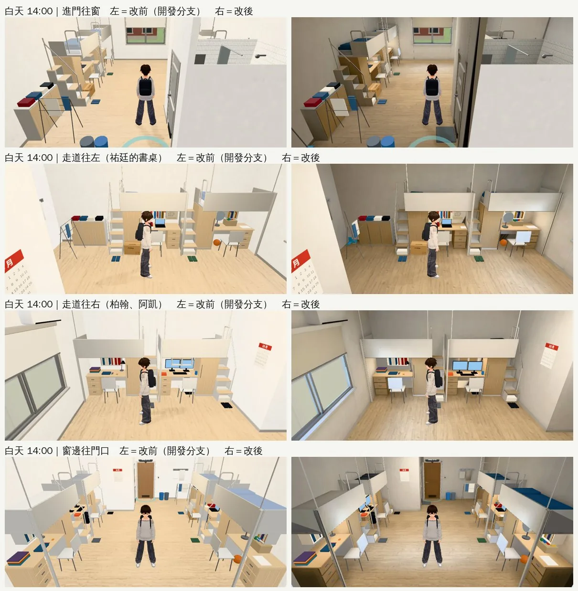
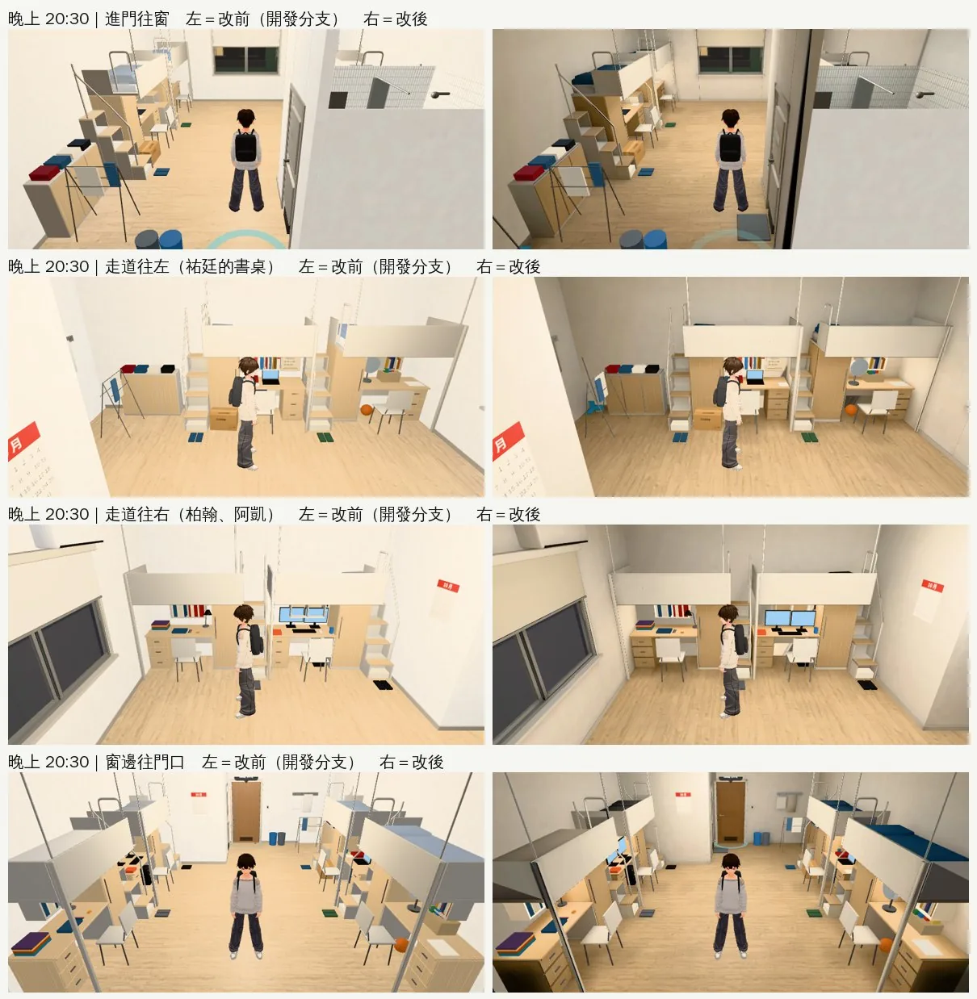
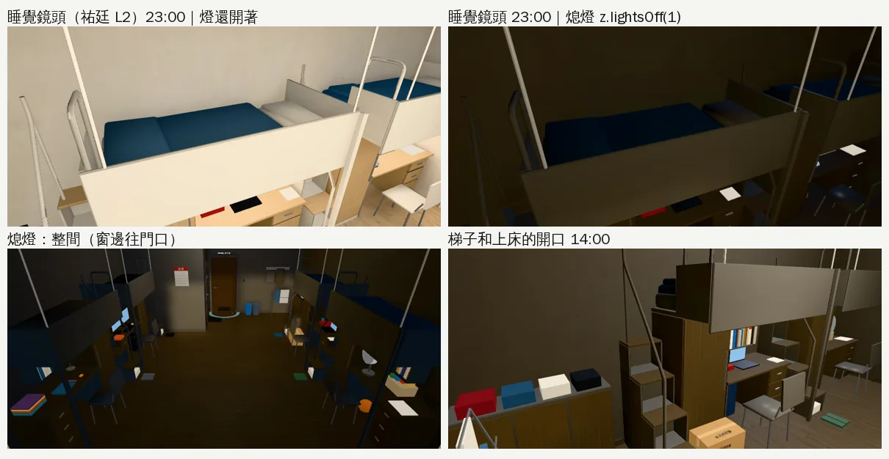
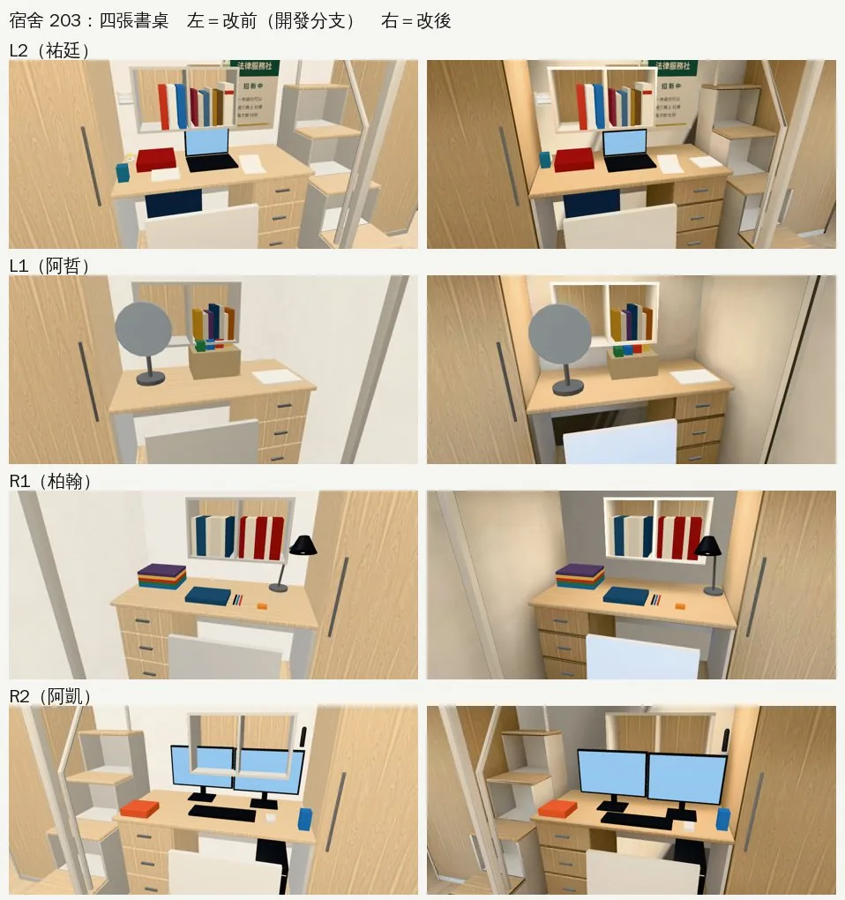
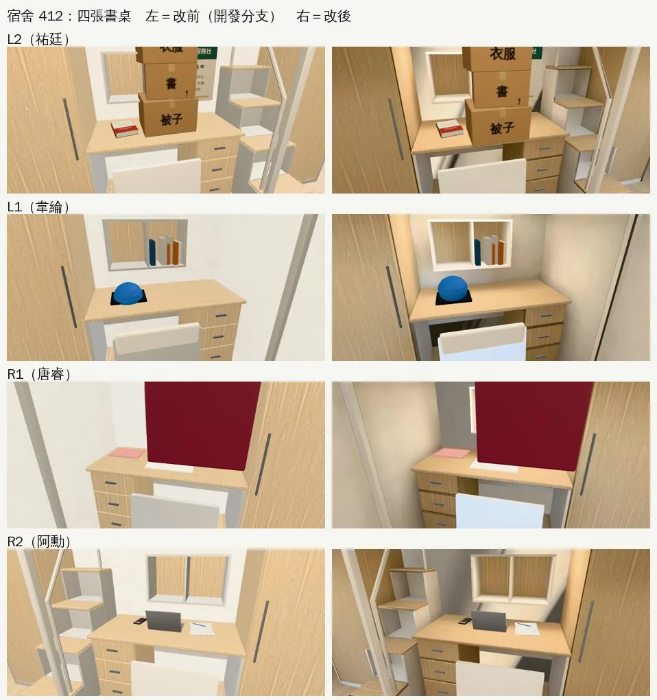
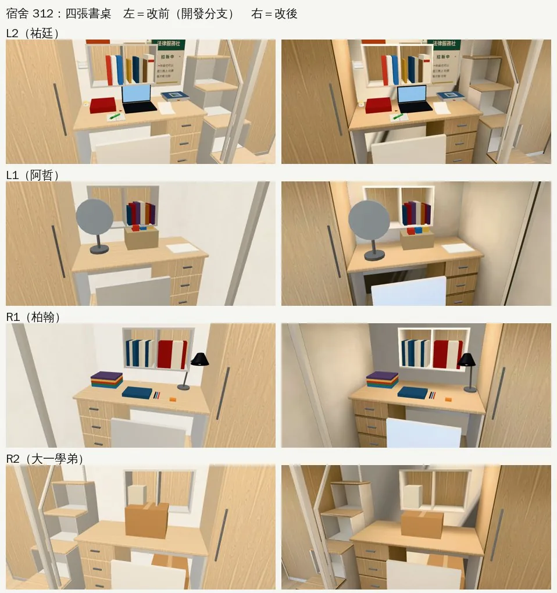
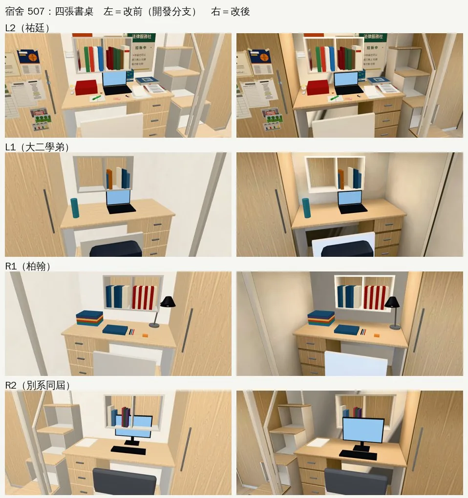
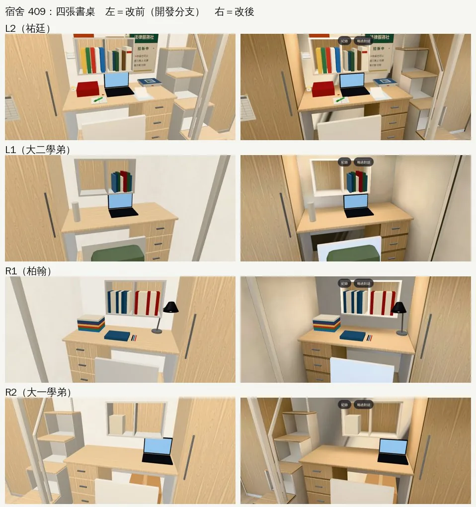

# 宿舍 203（玩家的四人房）：光照烘焙、床的比例、睡覺的畫面、書桌不重疊（DORM203-LM-1030＋DORM-SLEEP-VISUAL-1030 場景那一半；LAWWW2-B 2026-10-30）

- **起因**：
  - 使用者 10-28 P0（UA-LAWWW2-1028-01、X125）：「校內建築 空間內配置……廉價手遊感」。
  - LAWWW-B 10-30 決定 INTERIOR-AAA 繼續做，順序：宿舍 203 → 兩點半 Café → 法律學院圖書館。
  - 使用者 10-30 04:2x（X128，直接對 LAWWW2-B）：「宿舍玩加上去睡覺要真的有畫面 不然從頭到尾都是站在門口說睡完覺 很沒有真實感 床的比例也要注意 每個室友書桌上東西不要重疊」。
- **房間設計沒有動**（使用者 10-17「宿舍ok」）：床桌組、衣櫃、洗手間的位置照舊，座位、走近點、導航阻擋都沒變。
- **狀態**：`READY_FOR_ART_REVIEW`。建築、場景只有使用者能標 `ART_APPROVED`。
- **同一個模型給五個年份用**：大一 203、經濟系 412、大二 312、大三 507、大四 409。

## 怎麼套（給 LAWWW-B）

1. 程式：`git apply docs/art-rebuild/second_ai/patches/dorm203_lm_1030.patch`
   - 在開發分支最新的 `ba7c0726d` 上 apply 通過。
   - 和還沒整合的 `rt_night_1028.patch`、`library_hall_lm_1028.patch` 三包依序套也都通過（順序不限）。
2. 模型、貼圖（二進位，從交件 commit 拿）：
   - `assets/models/env/second_ai/dorm_room4.glb`
   - `dorm_room4_lm_day.webp`、`dorm_room4_lm_night.webp`、`dorm_room4_lm_dark.webp`
   - `dorm_room4.layout.json`：只改 stair_u、sleep 2.5 cm、新的 sleep_scene、v0_props.BOXES_DESK
   - `prop_pothos.glb`、`dorm_y2_items.glb`、`dorm_y3_items.glb`、`aa_support/v0_dorm_props.glb`
   - patch 裡的 `src/data/dorm_room_layout.js` 是用 `python3 tools/gen_dorm_room_layout.py` 從新的 layout 重產的。layout 換了就要再跑一次。

## 一、光照烘焙（同角度改前改後）

- 環境：遊戲內、玩家鏡頭，手機橫向 844×390，Playwright＋SwiftShader 模擬，**不是 iPhone 實機**。讀檔進大一 203、人放到指定位置是 [捷徑]，路人拿掉。
- 左＝改前（開發分支 `4df154b26`），右＝改後（同一個 commit＋這一包）。

白天 14:00：

晚上 20:30：

- **改前**：白天、晚上幾乎一樣亮（晚上只有窗外變黑），床底下的書桌和走道一樣白，看不到影子。
- **改後**：
  - 白天：北窗的天光從窗邊往門口慢慢暗。燈開七成，整體比晚上暗一點、色調偏中性。
  - 晚上：暖色的吸頂燈＋床板底下的 LED 燈條照書桌，牆角、床底下比較暗。
- **烘焙**：`bash tools/blender/env_second/lightbake/bake_dorm_room4.sh`（512 取樣、1024；CPU 約 15 分鐘）。
  - 燈：兩盞圓形吸頂燈（35 W）、洗手間一盞、四條床下 LED（9 W、暖白）。
  - 窗外：只在烘焙時存在的對面大樓＋街道（`dorm_room4.py --bakeblock`，輸出前刪掉）。
  - 每一年不一樣的東西（Y203_／Y412_／Y312_／Y507_／Y409_、ROOMMATE_KAI、NAMETAG_）烘焙時當作不存在：同一張光照貼圖給五個年級用，不能留下某一年的東西的影子。這些東西照舊即時光。
- **調了五輪**（第一輪的截圖：`90_round1_day.webp`）：
  1. 天空的太陽放在北邊，太陽附近的亮天正對北窗，門口地上一大塊亮斑、整間偏橘。改成南邊。
  2. 窗外只有天空，接近地平線的天光直直落到 5 m 外的門口。加對面大樓、街道。
  3. 床下最靠鏡頭的書桌全黑。燈條 6→9 W。
  4. 洗手間外牆斷面每公尺只分到 1 個像素、整面灰。改不烘，照舊即時光＋補光。
  5. 白天、晚上太像。天光 ×3、燈七成。
- **排版**（`lightbake/uv_fill.py`）：
  - 填滿率 30.0%。
  - 地板 29、書桌和衣櫃 28、床架 28、牆 15～22、天花板 11 px/m。
  - 主要的面有到檢討報告第 7 節的 12 px/m；填滿率沒到 50%（小零件多）。
- **深色木地板**：地板照舊是淺色（`#cdb594`，D112）。

## 二、床的比例

- **原本**：床墊 1.85 m（L2、R2）／1.875 m（L1、R1）。祐廷 1.75 m，躺下只剩 10 cm。
- **現在**：1.92 m／1.945 m，標準單人床約 1.9 m。做法：
  - 階梯收納櫃 0.45→0.40 m，床長 +5 cm。
  - 床墊兩端內縮 3.5→2.5 cm。
- **沒變的**：書桌、衣櫃左邊、座位、走近點、導航阻擋都沒動。衣櫃往階梯那邊寬 5 cm 補縫。
- **其他尺寸**（照舊，和真的宿舍上舖床差不多）：
  - 床墊頂 1.76 m、床欄頂 2.02 m、天花板 3.0 m（坐起來頭上還有 1.2 m）。
  - 床板底 1.56 m（坐在書桌前頭上有 25～30 cm）。

## 三、睡覺的畫面（場景那一半；DORM-SLEEP-VISUAL-1030，X128）

- **床尾擋板**：原本在靠牆那一半，剛好擋住最上面一階（靠牆）上床的路。現在移到走道那一半，靠牆那一半是上床的開口。
- **`dorm_room4.layout.json` 每一組床桌的 `sleep_scene`**（10-30 先交給 LAWWW-B，`98f8a41f7`）：
  - approach（梯子前地上）
  - steps（四階踏點，從走道往牆邊爬）
  - bed_entry（上床點）
  - lie.head／feet（頭朝 −z）、床墊範圍
  - cam（走道上方 2.75 m，越過床欄往下看）
- **熄燈**：
  - 第三張光照貼圖 `dorm_room4_lm_dark.webp`（`bake_room.py --dark`）：室內燈全關，只剩夜空和窗外對面的路燈（暖黃）。
  - 遊戲 `z.lightsOff(k)`（0～1，漸變）：換到熄燈那張、燈管和床下燈條不亮、房間自己的點光源剩一成。
- **還不夠的地方**：熄燈時沒有光照貼圖的小東西（桌上的紙、塑膠椅、螢幕）還是比較亮（截圖第二張）。
  - RT-NIGHT 那包（rtK）晚上會讓它們跟著暗到晚上的比例。
  - 熄燈那一刻，建議睡覺流程把室內的半球光、方向光也降到一兩成（engine3d 的光，LAWWW-B 的範圍）。
- **人物爬梯、躺下的動作、睡覺流程**是 LAWWW-B 做（04:2x 分工）。

## 四、書桌上的東西不重疊（五個年份、四張書桌）

- **怎麼查**：
  - 同一年會同時出現的東西：dorm_room4 的每一年的群組、大二～大四拆箱物件、溫州街打工的東西、黃金葛最大的 S4。
  - 用外框和「家具的每一面有沒有穿過物件」檢查，再用遊戲內每張書桌的特寫確認。
  - 外框檢查的誤判（披在床欄上的隊服、斜的檯燈手臂、衣架勾）逐一確認過，沒有真的穿插。
- **修了的**：
  - 阿凱、別系同屆的螢幕：原本貼牆放，上緣 1.18 m 穿過 1.00 m 的層架底板。往前到層架前面，鍵盤、滑鼠跟著往前。
  - 阿哲的零食箱：上面的包裝頂到 1.03 m，矮一點，頂在 0.98 m。電風扇的扇罩原本貼著層架前緣，往前移。
  - 柏翰的檯燈：原本在層架下面，手臂穿過層架的側板。移到層架右邊、書桌最右端，手臂往桌子彎、燈罩在層架前面。
  - 大一學弟（大二那年）桌上的紙箱：0.3 m 穿過層架。改 0.22 m。
  - 經濟系第一晚三箱紙箱：疊起來 0.84 m、放在書桌正中間，穿過層架和床板。每箱矮 2 cm（頂在 1.54 m，床板底 1.56 m），整疊移到層架前面。
  - 韋綸的安全帽：球心太低，下面 10 cm 從書桌底下露出來。
  - 筆電螢幕：0.24→0.215 m，原本剛好頂到層架底板。
  - 唐睿的戲服衣架勾：越過床欄板頂。
  - 祐廷：
    - 黃金葛的藤原本穿過桌板（S2～S4 有 4～15 個頂點在桌板裡），照四人房書桌的實際範圍壓到桌面上，衣櫃那一側拉回桌子盡頭。現在 0 個。
    - 筆記本、馬克杯讓開黃金葛。
    - 大二的螢光筆筆記本讓開黃金葛和筆電。
    - 大三、大四那一疊 A4 原本有一張角落插進筆電底座 3 cm，往後挪、轉小一點。
- **沒改的**：祐廷書桌牆上的「法律服務社」傳單在層架旁邊。從走道看，層架的側板會擋到一點，是透視不是穿插。
- **每一年的四張書桌**（左＝改前、右＝改後；409 那張右上的「紀錄／略過對話」是拍的時候劇情的按鈕）：

## 五、遊戲端的程式（`patches/dorm203_lm_1030.patch`）

- `src/zones3d.js`：
  - `attachDormInterior`：
    - 有光照貼圖的材質不加補光（TK.bounce），不然整片發白、影子不見。
    - 烘焙工具複製給不烘物件的 `_rt` 材質（洗手間外牆斷面）照舊補光。
    - `dorm_items` 的自發光接在原本的 onBeforeCompile 後面，不蓋掉。RT-NIGHT 的 rtK 也包在那裡。
  - 新的 `roomDarkMap`／`z.lightsOff(k)`：
    - GLB 的 `extras.lightmap.dark` 有的話才接。
    - 接在 roomLightmap 後面，**不改 roomLightmap 本身**，所以和 RT-NIGHT 那包不衝突。
    - 再進一次不重複包一層。
  - `Z3` 多匯出 `roomDarkMap`。
- `src/data/dorm_room_layout.js`：照新的 layout 重產。
- `tests/dorm_lightmap_unit.js`（新）：**開發分支 FAILED 9、套 patch 以後 ALL PASS**。第 5 項讀正式模型：每一年的東西沒有第二套 UV；地板、牆、床桌組、被子、腳踏墊有。

## 六、測試、效能

- **全部 Node 測試**：開發分支 `4df154b26`＋這個 patch＋所有二進位檔，`tests/` 736 支、**0 失敗**。
  - 包含 dorm_lightmap_unit、v0_dorm_props_unit、dorm_y2_items_unit、dorm_y3_items_unit、dorm_wz_items_unit、dorm_cam_unit、dorm_seethru_unit、nav_buildings_unit、room_ceiling_unit、aa502_dorm203_unit、aa517_dorm_y24_unit。
  - patch 在最新的 `ba7c0726d` 上也 apply 通過。
- **`tests/dorm_lightmap_unit.js`**：開發分支 FAILED 9 → ALL PASS。第 5 項讀正式模型：58 個每一年的物件都沒有第二套 UV。
- **進兩次**（`shots/lm_reentry.py`）：
  - 晚上 20:30 進宿舍 → 出去到宿舍大廳 → 再進來。
  - 兩次都是接上光照貼圖的材質 38 個、看得到的網格 144 個；shader 錯誤 0、JS 錯誤 0。
  - 兩張截圖平均差 0.43（室友在動）。
- **重疊檢查**：每一年同時出現的東西，穿過層架、書桌、床板，或互相穿插的，除了第四節列的誤判以外 0 件。黃金葛照頂點檢查，S1～S4 在桌板裡 0、在衣櫃裡 0。
- **沒跑**：瀏覽器流程測試（`tests/*.py`）、整套回歸、iPhone 實機。
- **效能**：
  - `dorm_room4.glb`：1.19 MB → 1.56 MB；三角形 18,320 → 18,432（+112：腳踏墊、掃把、畚箕）；網格 125 → 126；材質 39 → 41（腳踏墊、洗手間外牆斷面 `dorm_wall_rt`）。
  - 光照貼圖三張 WebP 共 243 KB：白天 104、晚上 107、熄燈 26。顯示卡記憶體約 12 MB（含 mipmap 約 16 MB）。
  - draw call 多 1 個（腳踏墊一個網格），光照貼圖本身不加 draw call。
  - **fps 沒量**：SwiftShader 1～4 fps，量不出意義；手機實機沒量。

## 七、缺點、還沒做

- **iPhone 實機沒測**：截圖都是 Playwright＋SwiftShader。
- **人物沒有吃到烘焙的光**：和其他房間一樣。
- **白天只有一張**：固定的下午天光，早上、傍晚也一樣；17:00～18:36 慢慢換成晚上那張。
- **熄燈時沒烘焙的小東西偏亮**：見第三節。
- **填滿率 30%**：小零件多，沒到 50%。主要的面有到 12 px/m。
- **黃金葛最大的時候**：藤平躺在桌上，不從書桌盡頭垂下去，因為那一端是衣櫃。往走道那一側照舊垂。
- **經濟系 412、大二～大四的房間只拍了書桌特寫**，整間的同角度改前改後只拍了大一 203。光照是同一張，差別只在每一年的東西。

