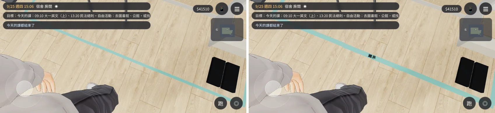
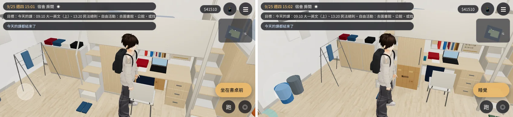
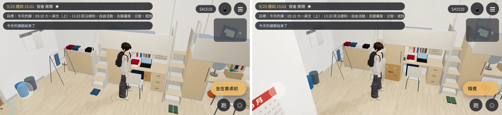
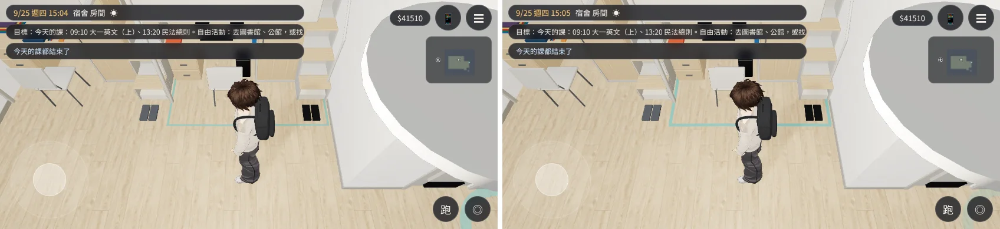

# 大一 203：阿凱的膠帶寫大字、壓平的紙箱搬到看得到的地方（BB_218 兩項不通過）——已交件

帳號 A 的 LAWWW2，2026-10-21 17:1x UTC。狀態：**已交件**，交給 LAWWW 整合；請 BB 用同一支腳本重拍。READY_FOR_ART_REVIEW（不標 ART_APPROVED）。

## 問題（BB_218，`claude/story-planning`）

1. **膠帶中間的字看不到**：原本寫「法律系可以無條件入境」。
   - 貼圖上的字只有 16 px 高，膠帶寬 3 cm，地上大約 2 cm 一個字。
   - 玩家站在旁邊，預設鏡頭、拉到最近、最大俯角都只看到一條薄荷綠的線；劇情鏡頭貼近地面也只是一排小黑點。
   - BB 的建議：只寫兩三個大字佔滿膠帶寬度，只加寬膠帶不夠。
2. **壓平的紙箱玩家看不到**：紙箱放在祐廷書桌底下，被深藍色的東西（`Y203_YUTING_items`）擋住；射線先打到書桌和那個東西才到紙箱。

## 改法（`tools/blender/env_second/dorm_y1_items.py`）

1. **膠帶**：
   - 加寬到 4.8 cm。
   - 中間那一段的字照 AA 16:10 定的：`ev_kai_tape2` 以前寫「國界」（`Y1_KAI_TAPE_MID`），以後寫「法律系免簽」（`Y1_KAI_TAPE_TEXT`）。兩段同時只顯示一個，旗標規則照舊。
   - 字 31 px，佔滿膠帶寬度；麥克筆手寫（每個字大小、角度、高低差一點點）。
   - 字距平均：第一版「律」「系」中間像空了一格（字距 −4、+2、−3、+1 px），換一組亂數後是 −1、0、0、0。
   - 字往上 4 px，不再貼到膠帶下緣。
   - 貼圖：`tools/blender/env_second/textures/gen/dorm_y1_print.png`（`atlas_tape.webp` 是那三條膠帶的放大）。
2. **壓平的紙箱**（`Y1_BOX_FOLDED`）：
   - 從書桌底下搬到衣櫃門前、床板底下，就是原本封好的紙箱放的位置。
   - 立著靠在衣櫃上，不在走道上。
   - 導航不變：那一格本來就在 L2 床桌組裡面，本來就擋著。

## 規格

`assets/models/env/second_ai/dorm_y1_items.glb`＋`.json`：

| 項目 | 數值 |
|---|---|
| 物件 | 5 |
| 三角形 | 40 |
| 材質 | 1（`y1_print`） |
| 檔案大小 | 33,520 bytes |

物件名稱、旗標規則都和原本一樣。

## 接法（LAWWW）

- **只換 GLB＋json，不用改程式。**
- 換的檔案：`assets/models/env/second_ai/dorm_y1_items.glb`、`.json`。
- commit：`33b3a556`、`a47e1860`；這次交件是本 commit。

## 遊戲內前後對照

- 環境：Playwright 手機橫向 844×390、`?turbo`。**不是 iPhone。**
- 基準：開發分支 `5845667e`，只在本機 worktree 換 GLB。
- [前置／捷徑]：讀使用者 9/25 存檔；設旗標（`KAI_TAPE`；`BOX_WINTER_OPEN`＋`ev_kai_tape2` 已演）；進宿舍 15:00；搬玩家；劇情鏡頭貼近膠帶。
- 腳本：`y1_check.py`。JS 例外 0。
- 每張圖左邊是修改前、右邊是修改後。

| 角度 | 修改前 | 修改後 |
|---|---|---|
| `ev_kai_tape2` 以前，貼近膠帶 | 中間那一段沒有字 | 「國界」兩個大字 |
| `ev_kai_tape2` 以後，貼近膠帶 | 一排小字，看不出來 | 「法律系免簽」，看得出來 |
| 壓平的紙箱，玩家鏡頭拉到最近 | 只看到書桌底下的深藍色東西 | 衣櫃門前一張咖啡色紙板 |
| 壓平的紙箱，預設鏡頭 | 同上 | 同上，看得到 |

## 還不到的地方（誠實寫）

- **玩家一般的鏡頭看不清楚字**：膠帶在玩家腳邊的地上。
  - 站在旁邊、預設鏡頭（`cmp_tape_player_cam.webp`）看得到薄荷綠的膠帶，字在人物腳下、被身體擋住或太小。
  - 看清楚要靠劇情鏡頭貼近（演 `ev_kai_tape2` 時）。
  - 加不加演出鏡頭是 LAWWW／AA 的事；這邊只保證貼近時字清楚。
- 只拍了 15:00 白天，晚上沒拍。

