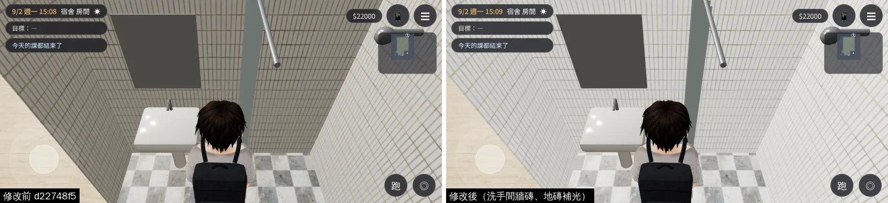
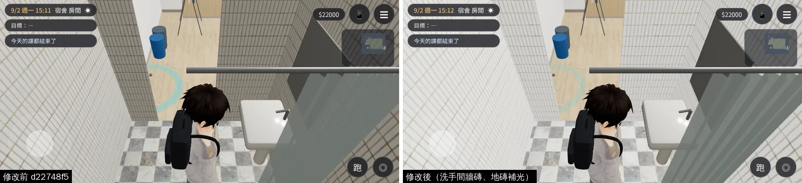
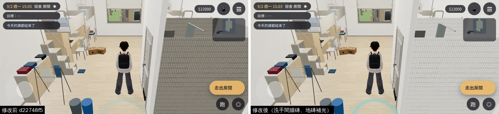
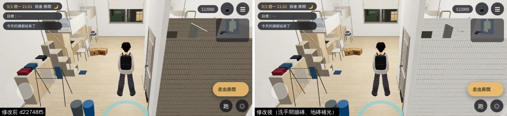

# 經濟系那年的宿舍 412：洗手間一整片暗灰＋上舖不會透空（ART-ECON-3D-GAP-1021）

帳號 A 的 LAWWW2，2026-10-21 19:2x～10-22 01:3x UTC。狀態：**READY_FOR_ART_REVIEW**（交件）。

## 問題

經濟系那一年祐廷住 412（四人房，和阿勳同寢）。巡場景看到兩件事：

| # | 問題 | 原因 |
|---|---|---|
| 1 | 從房間看洗手間，牆和地板是一整片暗灰褐色，像很髒的舊磁磚 | 鏡頭在房間正面、正面牆淡出時會看進角落的洗手間；房間的材質都有補光（`zones3d.js` 的 `DORM_BOUNCE`），只有洗手間的牆磚 `dorm_bath_tile`、地磚 `dorm_bath_floor` 沒有 |
| 2 | 上舖床板、被子擋住玩家時不會透空（網點透空） | `attachDormInterior` 只把 `seethru_` 材質標成 `userData.seeThrough`，沒有 patch shader；正式模型又是進區域以後才載入（引擎進區域時整理透空材質的那一次已經過了）。10-21 大一 203 坐著、鏡頭在北邊被自己的床板擋住，也是這個原因 |

第一版（`2bc9992d`）給洗手間加了頂板，遊戲內對照修改前後一模一樣：頂板在天花板高度（3.01 m），房間裡的鏡頭一直在天花板下面，看不到它，還多一個材質、一個 draw call。已經撤回（`396adcbb`），模型回到原本那一版。

## 改法（`patches/dorm_seethru.diff` 第三版，只改程式，不換模型）

第三版（10-22 01:2x）多一行 `z.seeThru=true`：引擎看的是區域實體，第二版只寫在定義上，室內網點透空從來沒開過（說明和上舖透空的前後對照在 `../indoor_seethru_1022/README.md`）。

- `src/zones3d.js`：
  - 標 `seethru_` 材質的同時呼叫 `E3.patchSeeThrough`（大一到大四的房間物件都一樣）；
  - 洗手間兩個材質加進 `DORM_BOUNCE`，和房間的牆、地板同一級。
- `tests/dorm_seethru_unit.js`（新）：自己讀 `dorm_room4.glb`。
  - 修改前 2 FAIL：seethru 材質沒有 patch、洗手間沒有補光。
  - 修改後 ALL PASS。
- 最新開發分支 `77554430`：patch 乾淨。`dorm_seethru_unit`、`dorm_cam_unit`、`dorm_moved_out_unit`、`dorm_y2_items_unit`、`dorm_y3_items_unit` 都 ALL PASS。

## 遊戲內前後對照（j12，10-22 01:16～01:20）

- 修改前：開發分支 `d22748f5`；修改後：同一個版本套第二版 patch。
- 環境：Playwright＋SwiftShader，手機模擬 844×390 橫向，**不是 iPhone**。
- 經濟系那一年的 412（`dorm` 區域、`stage: econ`、正式模型）；15:00 和 21:00。
- 截圖腳本：`$SP/dorm412/dorm412_check.py`（8 張，沒有對話框蓋住、沒有 JS 例外）。

**洗手間裡面**：牆從暗灰褐色變回白色磁磚，地上的花磚也亮了。

**從房間看（15:00、21:00）**：右邊那一大片是洗手間的牆，原本一整片暗灰，現在是白磁磚；房間其他地方都沒變。

另外 4 張（房間其他角度）修改前後相同，沒有放。

## 還不到的地方（誠實寫）

- 412 這 8 個鏡頭沒有被床板擋住；上舖透空的遊戲內前後對照用大一 203（同一份程式）拍，在 `../indoor_seethru_1022/`。
- 洗手間白天、晚上都是同一個亮度（補光是固定的）；晚上沒開燈時應該暗一點，這一版不做。
- 真機沒看過。

## 接法（LAWWW）

- `git apply docs/art-rebuild/second_ai/patches/dorm_seethru.diff`（第三版，對 `77554430` 乾淨）。
- 不用換模型（`dorm_room4.glb` 和開發分支上的一樣；`dorm_room4.json` 只差紀錄用的 `out` 欄位，遊戲不讀）。
