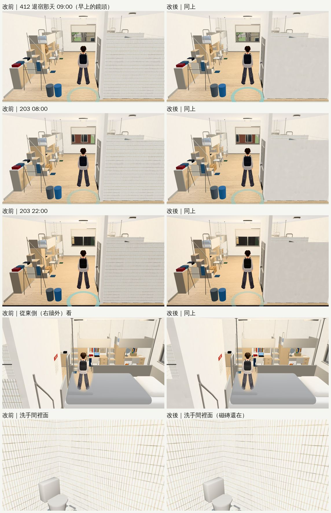

# 宿舍四人房：洗手間外牆不再是浴室磁磚（2026-10-24，LAWWW2-B）

- **來源**：巡查表第 3 節 P3「203、312、409、507：房間右邊洗手間的外牆整片白色磁磚，從房間看像浴室裡面翻到外面」。巡查③的 412 截圖也是這樣。
- **時機**：LAWWW-B 21:27 說照巡查表 P3 繼續、挑玩家每天看得到的。這個是每天早上起床的第一個畫面。
- **對**：開發 `a690484c8`（v9.10.9 之後；我的分支和開發分支的 `dorm_room4.glb`、`dorm_room4.py` 原本完全一樣）。
- **環境**：Playwright＋SwiftShader 手機模擬（1280×720），不是 iPhone 實機。
- **狀態**：`READY_FOR_ART_REVIEW`。場景的 `ART_APPROVED` 只有使用者能標。

## 原因

- `dorm_room4.py` 的洗手間內襯磁磚是 8 mm 厚的方塊，貼著房間的前牆、右牆內側。
- 方塊朝外那一面也是磁磚。
- 早上的鏡頭在門外，前牆淡出以後，這片磁磚方塊還在：房間右邊四成是一整片浴室磁磚。從右牆外面看也一樣。

## 改法

- **`tools/blender/env_second/dorm_room4.py`**：貼著前牆、右牆那兩片磁磚改成兩層。
  - 裡面一層磁磚（洗手間裡面看得到）；
  - 外面一層用房間同一個油漆牆材質 `dorm_wall`；
  - 中間空 0.5 mm，不疊面。
- **`assets/models/env/second_ai/dorm_room4.glb`（＋`.json`）**：重新匯出。
  - 物件 124 → 125（多一個 `dorm_bath_outer`）；三角形 18,296 → 18,320；材質數不變（39）。
  - 遊戲內同一個鏡頭：draw call ＋1、三角形 ＋24。
- **`dorm_room4.layout.json` 不變**：遊戲讀的配置逐位元相同，導航、互動點、床位都不受影響。
- **疊面檢查**（`check_coplanar.py`）：「一定會閃」改前 0、改後 0。

## 改前、改後（同一個鏡頭）

- **412 退宿那天 09:00、203 08:00、203 22:00**：右邊那片從浴室磁磚變成和房間一樣的米白油漆牆，像一般走進房間時右手邊的洗手間牆。
- **從東側（右牆外）看**：
  - 洗手間外側也是油漆牆。
  - 左邊那一小塊磁磚，是鏡頭從高處越過洗手間牆頂（2.2 m）看到的淋浴間裡面，本來就該是磁磚。
- **洗手間裡面**：磁磚照舊。

## 交件

- **檔案**：`assets/models/env/second_ai/dorm_room4.glb`、`dorm_room4.json`、`tools/blender/env_second/dorm_room4.py`。
- **整合**：只要換 GLB，遊戲程式不用改。
- **沒測**：
  - 整套回歸（`tests/flow_dorm_hall.py`、`movement_regression`）；
  - 手機實機。
- **重新匯出**：
  - 用 `/opt/blenv/bin/python tools/blender/env_second/dorm_room4.py -- --out assets/models/env/second_ai/dorm_room4.glb`。
  - 不加 `--out` 的預設輸出檔是 `dorm_interior.glb`，不要蓋到舊檔。

## 順便重看：312、409、507 是不是一模一樣（巡查表第 3 節另一項 P3）

- 10-22 記的「三間長得一模一樣」現在**已經不是**。用同一個鏡頭拍了四間（開發 `a690484c8`，10/15 15:00）：
  - **窗景**：每年不同。203 紅磚樓、312 樹冠、507 屋頂、409 對面公寓（LAWWW2-C 10-20 的 Blender 窗景）。
  - **室友的東西**：每年不同（`Y312_`／`Y507_`／`Y409_` 各組：紙箱、椅子、籃球、檯燈）。
- **一樣的**：祐廷自己那一角（衣架、置物櫃、兩個垃圾桶）和家具。這是同一棟宿舍的同一種房型，照實際。
- 結論：不用改，巡查表改成「重看過」。
- 截圖：`rooms_recheck.jpg`。
  - 409 那張剛好有一段劇情對話開始（右上角「紀錄／略過對話」），人坐在書桌前，和美術無關。
  - 203、312、507 的早上鏡頭還是舊的磁磚牆，是因為這一輪是在開發分支原樣拍的。
