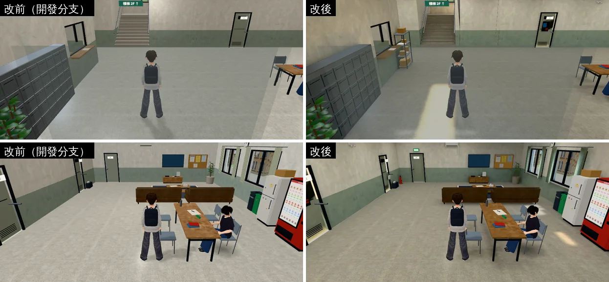
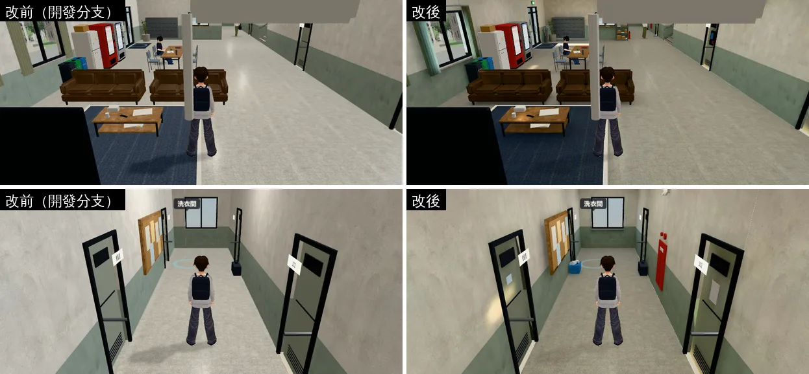
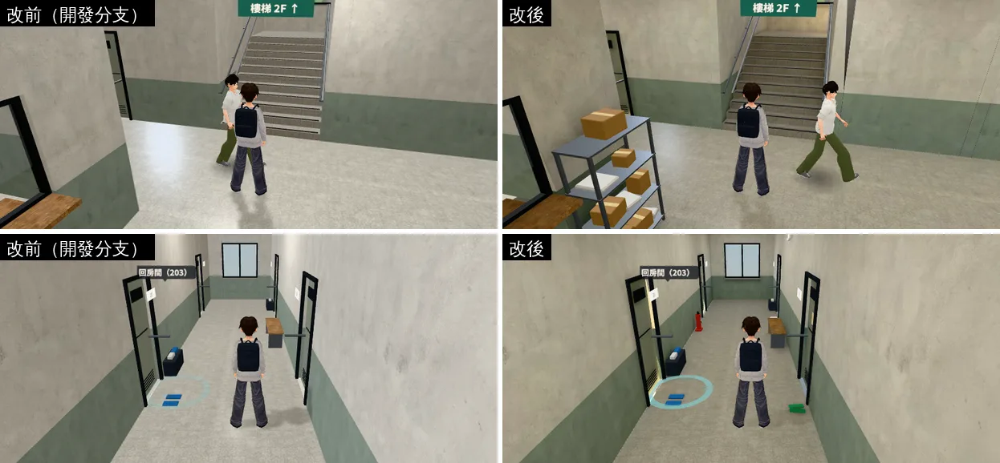
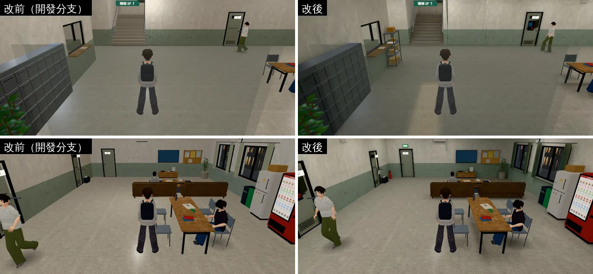
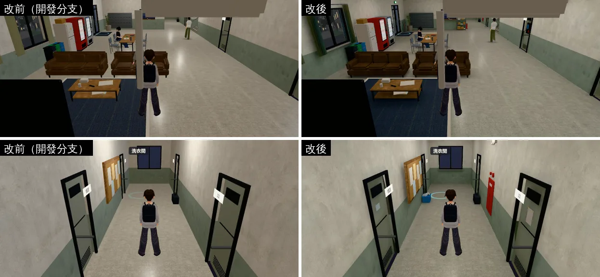
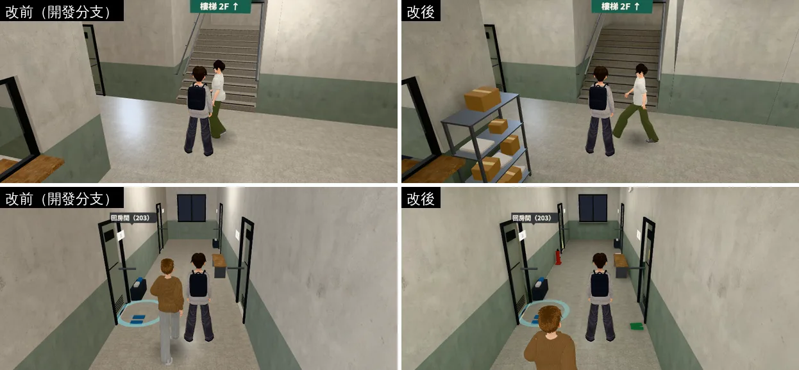
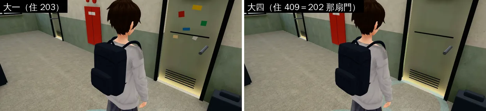
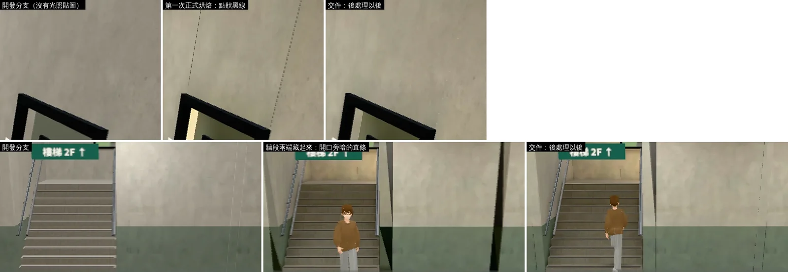

# 男一舍門廳（一樓門廳、交誼廳、走廊、樓梯間、二樓走廊）：擺設＋光照烘焙（DORM-HALL-LM-1028；LAWWW2-C 2026-10-28）

- **起因**：使用者 10-28 P0（UA-LAWWW2-1028-01）「校內建築 空間內配置……廉價手遊感」。
  - 檢討報告 `INTERIOR_AAA_REVIEW_1028.md` 第 5 節：201 → 霖澤館大廳 → 其他。這是第六包。
  - 男一舍是玩家每天起床、出門、回來都會走過的地方。
- **改前的問題**（截圖左邊）：
  - 白天、晚上一樣亮，整片平均，看不出燈在哪裡。
  - 走廊只有一排門，牆上、門口什麼都沒有。
- **做法**：和霖澤館大廳、萬才館同一套。程式兩處（`dorm3d.js` 的 `prop`、大四藏起 202 的貼紙）；光照的接法不用改（`dorm3d.js` 也走 `B3.attachFormal`）。
- **狀態**：`READY_FOR_ART_REVIEW`。建築、場景只有使用者能標 `ART_APPROVED`。
- **怎麼套**：
  1. 程式：`git apply docs/art-rebuild/second_ai/patches/dorm_hall_lm_1028.patch`：
     - `src/data/dorm_layout.js`：八筆擺設。
     - `src/dorm3d.js`：
       - 家具多一種 `prop`（備用方塊＋導航阻擋），和 `building3d.js`、`wancai3d.js` 一樣。
       - 正式模型接上以後，自己住的那一扇門（`HOMES` 的 `rep`）上別人的東西藏起來：大四住 409，用的是 202 那扇門，202 的社團貼紙那一年不顯示。
     - `tools/blender/dorm_hall.py`：模型。開發分支的這支腳本還沒有公用冰箱那段（NPC-POOL-ART-1028 當時只換了二進位檔），這個 patch 一起補上。
     - `tests/dorm_hall_lightmap_unit.js`：新的測試。
     - `LICENSES.md`：男生宿舍室內那一列。
  2. 二進位檔：`assets/models/env/dorm_hall.glb`、`dorm_hall_lm_day.webp`、`dorm_hall_lm_night.webp`。
- **截圖**：遊戲內、玩家鏡頭，手機橫向 844×390，Playwright＋SwiftShader 模擬，**不是 iPhone 實機**。讀檔進宿舍、人放到指定位置是 [捷徑]。

## 同角度對照

白天 14:00（左：開發分支 `a35df1f5c`；右：這包）：

晚上 20:30：

- 看得到的差別：
  - 白天：大門照進來一道陽光（門口地上一塊亮的）；交誼廳窗前的地板比較亮；家具底下、牆角有影子。
  - 晚上：整體暗下來，門口和交誼廳偏暖；燈下面亮、燈和燈中間暗一點。
  - 擺設：門上的紙、貼紙、球鞋，紅色消防栓箱、滅火器、出口燈、包裹架、洗衣籃、二樓門口的拖鞋。
- 大四住 409，用的是 202 那扇門：202 的社團貼紙那一年藏起來，門上也沒有留下貼紙的影子。

- 接縫（放大三倍）：上面是門框上方，下面是樓梯間開口。

## 擺設（照「誰在用、剛發生什麼」）

- **門上的東西照各扇門的旁白**（`dorm_layout.js` 的 `closed`；字由遊戲顯示，模型裡沒有字，D77）：
  - 101「門縫透出檯燈的光」：門板最下面一條暖光（不烘、一直亮）＋一張海報。
  - 102「門上貼著一張紙：期中考週，請小聲，謝謝。」：A4 白紙、兩條膠帶；門口一雙拖鞋。
  - 103「裡面傳出打電動的聲音」：黑底的遊戲海報。
  - 104「門把上掛著一雙還沒乾的球鞋」：鞋帶綁在一起掛在門把上。
  - 202「門上貼著社團的貼紙」：六張大小、顏色不一的貼紙。
  - 206「門上掛著『今天不在』的牌子」：木牌、掛繩、掛勾。
  - 207「門縫傳出吉他的聲音」：吉他社的傳單；門口一雙拖鞋。
  - 洗衣間：使用須知；門口一個洗衣籃。舍監室：值班時間。
  - 自己的房門（203）不加：大二起換到別的門（`dorm3d.js` 的 `HOMES`），203 變成一般關著的門。
  - 大二 312、大三 507、大四 409 分別用 204、201、202 那扇門。204、201 門上沒有東西；202 的貼紙在模型裡單獨一塊（`L1_deco_r202_…`），大四那一年遊戲把它藏起來。
- **公共設施**：
  - 一、二樓走廊：內嵌的消防栓箱（門板只凸出 3 cm）、緊急照明各兩個。
  - 滅火器四支，靠牆、有導航阻擋。
  - 出口燈三個：大門上方、東邊側門上方、二樓樓梯口。
  - 二樓盥洗室旁多一組回收桶。
- **門廳**：
  - 包裹架：西北角、舍監室窗口旁，紙箱、包裹袋。原本放在大門旁邊，但一進門鏡頭在大門外，會從正上方看到架子頂板。
  - 傘架：大門西邊。
- **樓梯間**：平台北牆、窗上面一盞壁燈。原本 6.9 m 高的樓梯間只靠二樓天花板一支燈，烘出來平台和 A 跑很暗。
- 新擺設離劇情、社團站位、路人路線、每一扇門口都夠遠：`dorm_hall_lightmap_unit` 檢查站得住、走得到。

## 光照烘焙（`tools/blender/env_second/lightbake/bake_dorm_hall.sh`）

- 每支日光燈管一個面光源。走廊白天也開燈，所以白天、晚上的走廊差不多亮；靠窗的地方白天比較亮。
  - 一樓走廊 9、門廳和交誼廳 6、二樓走廊 9、樓梯間 2（二樓天花板、平台壁燈）。
  - 舍監室裡面 1 盞：舍監室沒做模型，從窗口看得到裡面，值班的人在那裡。
- **四面都有窗**：走廊兩端、南面門廳和交誼廳、樓梯平台北窗。所以外殼只包上下。
  - 舍監室、洗衣間那一塊沒做模型，南邊、西邊直接是天空，天光會從舍監室窗口照進門廳。
  - 用只在烘焙時存在的擋光板擋住（`dorm_hall.py --bakeblock` 的 `BAKEONLY_`）。烘焙工具多一個 `--drop`，輸出前把它們刪掉。
- **細小零件不烘**（照舊即時光）：頂點色的小東西、門框窗框和門下的百葉、黑色零件、塑膠椅。
  - 原因：一個方塊一面一個島，幾千個島光是 4 像素的間隔就塞不進一張貼圖。第一次試烘時排版器把範圍撐到 2 倍，烘出來全黑。和 201 一樣。
- **看不到的面不分像素**：
  - 走廊兩側牆的背面（後面是沒做模型的寢室）、牆頂（在天花板上面）。烘焙工具的 `lmhide` 現在可以寫 `'N,up'` 這種多個方向。
  - 地板的四邊和底面。
  - 一樓地板只做到舍監室窗口後面 2 m，不再整片鋪到西牆。
- 樓梯只做看得到的面（踏面、踢面、平台的上面），和霖澤館大廳一樣。
- 白平衡比霖澤館大廳輕：照大廳的設定，白天反而比晚上暗。
- **後處理（新工具 `tools/blender/env_second/lightbake/lm_fix_hidden.py`，不用重烘）**：
  - 沒分像素的面、夾在零件中間烘成全黑的面，改接別的面的光。
    - 夾在中間的：接共用一條邊的那一面（光照座標投影到那條邊上）。
    - 露在外面、只是沒分像素的（樓梯間開口的側面）：接附近朝同一個方向的面。
  - 為什麼：方塊拼的牆段在接縫是 T 形接頭（一邊有頂點、一邊沒有），畫的時候會露出一點一點的縫。
    - 第一次正式烘焙：縫裡看到的是夾在中間、烘成黑的端面 → 門框上方一條條點狀黑線（`seam_fix.webp`）。
    - 第二次把牆段兩端都藏起來：樓梯間開口旁的側面拿到別處的亮度 → 兩條暗的直條。
    - 後處理以後：接縫和開口都和開發分支原本的樣子一樣。
  - `bake_dorm_hall.sh` 最後一步就是它，重烘會自動做。

## 光照貼圖的排版（`tools/blender/env_second/lightbake/uv_fill.py`）

- 填滿率 52.3%（1024 × 1024），有到檢討報告第 7 節的 50%。
  - 第一次正式烘焙是 44.0%：牆段的頂面、底面、兩端也分了像素（夾在中間看不到）。拿掉以後主要的面分到比較多。
- 主要的面每公尺的像素：
  - 一樓地板 18、二樓地板 18、樓梯 20。
  - 走廊兩側的牆 13、牆裙 13。
  - 門、交誼廳的家具 17。
  - 天花板 7（`lm 0.35`：鏡頭幾乎都往下看，看得到的時候也是整片平均的亮）。
  - 二樓樓板南邊那一大塊 1：上面被地板蓋住、下面是一樓天花板，幾乎看不到（`lm 0.05`）。
- 沒有 uv1 的網格都是故意的：發光面、玻璃、頂點色的小東西、門框窗框、黑色零件、不鏽鋼、植物。

## 沒有動的（玩法、存檔）

- 原本的家具、互動點、劇情站位、路人路線、樓梯的走法都沒改；配置只多八筆擺設，都靠牆。
- 存檔格式沒改。

## 測試

開發分支 `a35df1f5c`＋`dorm_hall_lm_1028.patch`＋三個二進位檔（工作樹，Node）：
- `tests/dorm_hall_lightmap_unit.js`（新）：ALL PASS。
  - 正式模型：`extras.lightmap`、兩張貼圖在、地板天花板樓梯牆有第二套 UV、日光燈沒有、`BAKEONLY_` 沒有留下。
  - 宿舍真正的建區域流程：接上光照貼圖的材質 45 個；12:00 白天那張、20:00 晚上那張。
  - 八筆擺設都擋住導航；出生點、交誼廳劇情站位、走樓梯路人的路線、每一扇門口、四個年級自己的房門前（28 個）都站得住、走得到。
  - 202 門上的貼紙：大一看得到、大四藏起來。
  - **拿掉 patch 裡 `dorm3d.js` 的改動會 FAIL**：沒有 `prop` 那一行，七筆擺設變成站得上去；沒有藏貼紙那一行，大四的 202 門上還有貼紙。
- `room_ceiling_unit`、`nav_buildings_unit`：ALL PASS。
- 宿舍相關的 36 支 Node 測試（`grep -l "dorm_hall\|DM3\|dorm3d" tests/*.js`）：全部 ALL PASS。
  - 劇情稿比對的幾支要先抓到企劃線的 commit。
  - `bookstore_exit_unit`、`library_copier_unit` 的最後一行是 `}`（印出物件），單獨跑 exit 0、ALL PASS。
- `scan_floors.py`：沒有深色木地板（只標出盆栽的土，和開發分支一樣）。
- 進兩次（同一次遊戲裡進宿舍、出去、再進來）：見下面「效能」一節後面。

## 效能

遊戲內、同角度、白天 14:00，拿掉路人量（`renderer.info`；SwiftShader 模擬，不是手機實機）：

| 鏡頭 | draw call 改前 → 改後 | 三角形 改前 → 改後 |
|---|---|---|
| 門口 | 69 → 73 | 18.0k → 21.2k |
| 交誼廳 | 72 → 72 | 19.7k → 22.7k |
| 交誼廳西邊 | 97 → 105 | 21.4k → 24.5k |
| 一樓走廊往西 | 52 → 57 | 12.3k → 18.0k |
| 樓梯口 | 60 → 68 | 15.7k → 20.4k |
| 二樓走廊 | 78 → 79 | 19.2k → 22.1k |

- draw call 多 0～13%（新擺設、門上的東西、202 的貼紙單獨一塊）；純色的小東西合成一個頂點色材質，材質 37 → 30。
- 模型：3,348,988 → 3,939,160 bytes（第二套 UV、後處理以後有些頂點分開）；網格 70 → 76；三角形 19,304 → 22,326。
- 光照貼圖兩張 WebP：白天 96 KB、晚上 81 KB（1024 × 1024）。
- **進兩次**（`reentry.py`，同一次遊戲裡進宿舍、出去到校園、再進來，晚上 20:30）：兩次都接上光照貼圖的材質 45 個、shader 編不過的 0 個、沒有 JS 錯誤；兩次同角度截圖一樣。

## 缺點、還沒做

- **iPhone 實機沒測**：截圖、效能都是 Playwright＋SwiftShader 模擬。
- **陽光的位置固定**：烘焙時的太陽（方位 165°、仰角 52°，從南面門廳大門照進來）。早上、傍晚太陽不會移動；白天、晚上兩張，黃昏時漸變。
- **細小零件照舊即時光**（頂點色的貼紙、鞋、滅火器、門框窗框、塑膠椅）：晚上在暗的地方會比旁邊亮一點。和 201、霖澤館大廳一樣。
- **門洞、窗洞、樓梯間開口的側面沒有自己的光照**：接附近同方向的牆或旁邊那一面的光（後處理）。看起來和牆一樣，但沒有側面自己的明暗變化。
- **牆段接縫還是 T 形接頭**：放大看，縫裡偶爾有一點一點比牆淺一點的點，和開發分支原本一樣（原本沒有光照貼圖也有）。要完全沒有，得把牆改成格子切法（每一段的邊都對齊），之後的新房間（總圖大廳起）再改。
- **天花板每公尺 6 個像素**（填滿率不夠，給地板和牆）：天花板上看得到的光比較糊。
- **寢室、舍監室、洗衣間裡面沒有模型**：門都關著；舍監室從窗口看進去只有桌子和一盞燈的光。
- **自己房門口的鞋架、拖鞋是模型的一部分，固定在 203 門口**（原本就這樣，這包沒改）：大二起搬到別的門，鞋架還留在 203（現在住別人），新的房門口沒有鞋架。要跟著搬，得把鞋架從模型拆出來、程式放到自己的門口（`dorm3d.js` 程序化的備用模型已經是跟著 `HOMES` 走的）。
- 填滿率 52.3%（目標 50%）；全黑的面還有 254 m²（家具、門框裡面被包住的面），不佔看得到的面的像素，但佔貼圖的位置。
