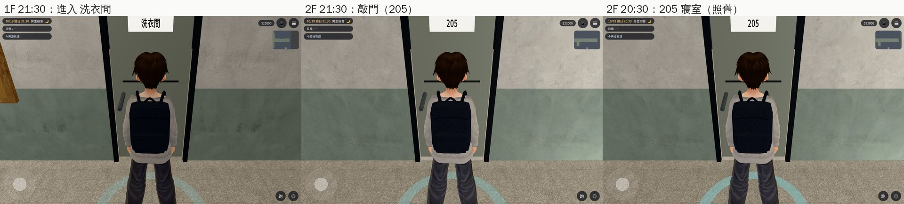
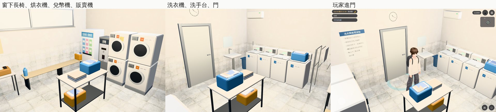
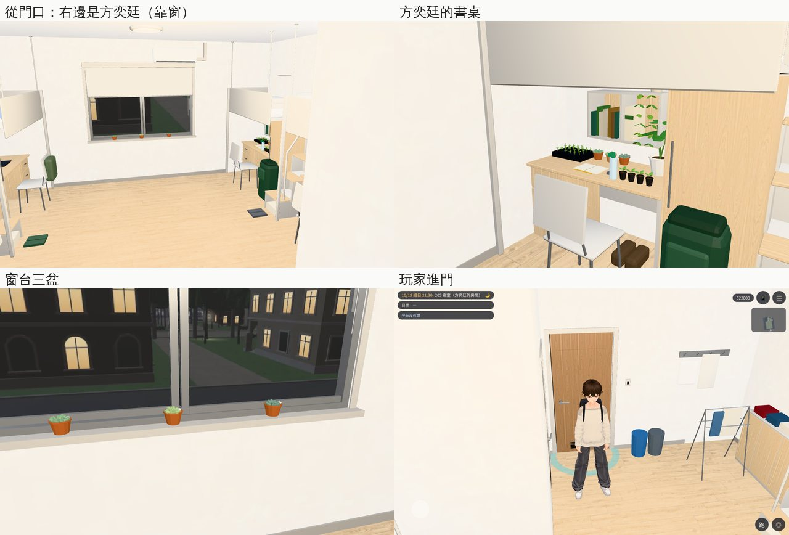

# 宿舍：1F 洗衣間＋205 方奕廷的房間（AA_399 第 11 節；任務 #82 第五間）

- **企劃**：AA_399 第 11 節（AA-B，企劃線 `5d09bb725`）。
  - **洗衣間**：開（全天）。加一個「洗衣服」（40 分）。不加數值，只是生活。
    - 阿凱大一週日 21～22 在這裡，接他的 App 訊息（`y1fill_events.js`）。
    - 第一次遇到：「這台烘衣機要投兩次。第一次是騙你的。」
  - **方奕廷的房間**：大一（2025-09～2026-06）。
    - 他說的「隔壁房」用 205。
    - 21～23 他在的時候可以敲門進去：滿桌的盆栽。找他說話照階梯。
    - 大二起他搬走了，門關著。
  - 其他寢室照舊關著，門上那一句描寫留著。
- **派工**：LAWWW-B 10-24 03:53（P2），任務 #82 第五間。205 的做法 LAWWW-B 06:46 同意：
  - `dorm_room4.py --only 205` 另外出 `dorm_205.glb`；
  - `zones3d.js` 只改 return 那一行，匯出 `attachDormInterior`；
  - 房間配置加 `cam_box`。
- **做的人**：LAWWW2-B。
- **狀態**：`READY_FOR_ART_REVIEW`。場景美術的 `ART_APPROVED` 只有使用者能標。
- **Patch**：`docs/art-rebuild/second_ai/patches/dorm_laundry_205_1024.patch`，對開發 `cc366dbe5` 做的（博雅 203 已經整合在裡面）。模型在我的分支。

## 洗衣間

- **模型**（Blender bpy，`tools/blender/env_second/dorm_laundry.py` → `assets/models/env/second_ai/dorm_laundry.{glb,json,layout.json}`）：
  - 5,672 個三角形；房間 5.2 × 4.4 m。
  - 門在走廊那一側中間，後面高處一排霧面窗（看不清楚外面）。
  - 地板淺灰止滑磁磚，牆的下半段白色磁磚。
  - 照門牌上寫的「投幣式洗衣機、烘衣機各四台」：
    - **東牆**：四台直立式投幣洗衣機（上掀蓋、後面的操作面板有小螢幕、投幣盒、號碼貼紙「洗衣 1～4」）。第 4 台的蓋子上放一個洗衣籃。
    - **西牆**：烘衣機兩兩疊成兩組（前開圓門、黑色玻璃、投幣盒、「烘衣 1～4」），旁邊是兌幣機、洗衣精販賣機。第 4 台烘衣機上貼一張黃色便條「要投兩次」，是阿凱那句的伏筆；AA 不要就拿掉。
    - **中間**：摺衣服的長桌（洗衣籃、摺好的衣服）。
    - **窗下**：長椅，三個位子，可以坐著等。
    - **東北角**：不鏽鋼曬衣架（掛著毛巾）、失物招領的小桌和籃子。
    - **門那一面**：使用須知、時鐘、洗手台（鏡子）、垃圾桶。
  - 字都是一般用語（沒有品牌、價錢；機器上只有「洗衣」「烘衣」和號碼）。
- **配置**（`room_glb_layouts.js` 的 `dorm_laundry`）：
  - 沒有 `open`，一直開。
  - `spots`：
    - `wash`：「洗衣服」站在第 2 台洗衣機前面；
    - `kai`：阿凱坐在長椅中間；
    - `kai_stand`：阿凱站在烘衣機前（「要投兩次」那一句）；
    - `player`：玩家。
  - `interact`：洗衣機、烘衣機、使用須知、失物招領（顯示的字等 AA 寫）。
  - 「洗衣服」（40 分）：`closed3d.js` 原本做在走廊的門上，這次改成裡面的「洗衣機」也能洗（見下面「程式」）。

## 205（方奕廷的房間）

- **模型**（`tools/blender/env_second/dorm_room4.py -- --only 205` → `assets/models/env/second_ai/dorm_205.{glb,json,layout.json}`）：
  - 23,936 個三角形。和祐廷的房間同一型（四組上鋪床桌、洗手間、窗、冷氣都是同一個腳本），只換每個人的東西。
  - **方奕廷**（R1，靠窗那組：盆栽要光）：
    - 「滿桌的盆栽」：
      - 書桌：黑色育苗盤（24 株小苗）、三盆多肉（陶盆）、一盆大葉子（白盆）、一排剛換盆的小黑盆；
      - 層架：上面一盆黃金葛，藤垂到架子前面；架子下面一支植物燈（亮著）。
    - 其他東西：
      - 書桌：攤開的田野筆記、鉛筆、放大鏡、噴水瓶；
      - 層架：植物圖鑑、綠色和咖啡色書背的課本；
      - 地上：書桌下一雙登山鞋，衣櫃前一個深綠色大登山包。
    - **窗台**：三盆多肉，和他送給祐廷、放在祐廷窗台的那三盆是同一種。
  - **其他三位室友**（沒有名字，背景）：
    - R2：大一新生（床欄上的新生手冊、書桌下的紙箱）；
    - L1：筆電、水壺、椅背的後背包；
    - L2：螢幕＋鍵盤、一疊 A4、椅背的外套。
  - **祐廷的房間不受影響**：`dorm_room4.py` 不加 `--only` 時照舊只做 203／412／312／507／409，配置 JSON 每個 byte 一樣。
    - GLB 的二進位資料每次跑都會有一點不同，改之前也一樣：同一支腳本跑兩次就不一樣，是 Blender 匯出的關係。
    - 所以用頂點資料比：124 個網格、每個屬性，差都在 1e-5 以內。
- **配置**（`room_glb_layouts.js` 的 `dorm_205`）：
  - `open`：`{range:['2025-09-01','2026-06-30'], h0:21, h1:23, who:'npc_fangyt'}`：大一 21～23；他不在的日子（`characters.js` 的 `absentDates`：寒假 1/24～2/18 回台中）不開。
  - `spots`：
    - `fang`：方奕廷坐在自己的書桌前；
    - `fang_stand`：站在窗台前；
    - `player`：玩家站在他的書桌旁邊。
  - `seats`：L2 的椅子「坐下（借室友的椅子）」。
  - `interact`：方奕廷的書桌、窗台的盆栽（顯示的字等 AA 寫）。洗手間不放「看」：它的點離進門的位置只有 0.25 m，一進門就會跳出「洗手間（門關著）」。
  - `cam_box`（鏡頭只在中間走道）、`see_thru`（上鋪擋住時網點透空）、`dorm_interior`（燈、植物燈、上鋪透空的材質）：都和祐廷的房間一樣。

## 程式

- **`rooms_glb3d.js`**：
  - `HOST` 多 `dorm_hall`（`DORM_LAYOUT`）：宿舍的門也能接正式房間（`d.to`、有時段的 `d.gate`）。
  - `backSpawn`：配置有 `back_spawn` 就用它。宿舍門前的位置要照走廊算，不能用萬才館、霖澤館那個公式。
  - `open` 多兩個條件：
    - `range`：只有這段日子；
    - `who`：那個人不在的日子不開。
  - 房間配置有這三個的時候：
    - `cam_box`：設 `z.camBox`；
    - `see_thru`：設 `z.seeThru`；
    - `dorm_interior`：正式模型載入後叫 `Z3.attachDormInterior`。
  - 研討室 A／B、系辦、考場、博雅 203 都沒有這些欄位，行為不變。
- **`dorm3d.js`**：走廊上的門有 `d.to` 就是出入口：
  - 洗衣間：「進入 洗衣間」，一直開；
  - 205：時段內「敲門（205）」、其他時間照舊「205 寢室」（門關著）。
  - 其他門照舊。
  - 經濟系、大二以後門牌平移的那段（`ren`）沒有改。
- **`zones3d.js`**：return 多匯出 `attachDormInterior`（只改那一行）。
- **`closed3d.js`**：「洗衣服」（40 分）原本做在走廊上的門（`it.label==='洗衣間'`）。
  - 門變成「進入 洗衣間」以後，那個按鈕就不見了，洗不了衣服（patch 第一版漏了，截圖前查到）。
  - 改成在裡面的「洗衣機」也能洗：阿凱那一句、40 分鐘都一樣。
  - 門口那一條留著（沒有房間的版本用）。
  - `tests/closed_unit.js` 多第 7 節：裡面的洗衣機能洗、烘衣機照舊只是看。

## 給劇情接線（LAWWW-B）

- **洗衣間**：
  - 「洗衣服」（40 分）：已經接在裡面的「洗衣機」（`closed3d.js`）；
  - 阿凱大一週日 21～22 照 `spots.kai`（坐）或 `kai_stand`（站）放；
  - 第一次遇到那一句。
- **205**：
  - 「敲門（205）」進去，方奕廷放 `spots.fang`；
  - 找他說話照階梯。

## 截圖（遊戲內，Playwright＋SwiftShader；不是 iPhone 實機）

開發 `cc366dbe5`＋這份 patch，2025-10-19（日）。

每張的 `post` 都確認：區域、正式模型載入、最近的互動點、205 的開放時段；205 的區域有 `camBox`、`seeThru`。

### 走廊上的門：洗衣間「進入 洗衣間」（一直開）、205 在 21:30 是「敲門（205）」、20:30 照舊是「205 寢室」

### 洗衣間

### 205（方奕廷的房間）：整間、他的書桌、窗台、玩家進門

### 第一輪截圖找到、已經改的

- 洗衣間的霧面玻璃太透明，外面的樓看得一清二楚：透明度 0.82 → 0.94。
- 205：
  - 方奕廷的登山包，口袋變成陶盆的顏色、頂上一塊黑色方塊。
    - 原因：共用的 `painted()` 照面的編號塗色。同一個網格前面做過倒角方塊，編號會亂，塗到別的東西。
    - 改法：205 新的東西改用「新加的面」的集合來塗（`painted2()`）；頂蓋改成深綠色。
    - 祐廷房間原本的東西沒有改（預設輸出照舊）。
  - 一進門就跳「洗手間（門關著）」：洗手間的「看」拿掉。

## 測試

- **`tests/dorm_laundry_unit.js`**（新，10 項；改之前第 1 項就失敗）：
  - 區域、正式模型；
  - 走廊上洗衣間的門只有「進入 洗衣間」，落點＝spawn；
  - 其他門照舊；
  - 回走廊的落點站得住，「離開洗衣間」用的就是它；
  - 引擎的 `simWalk`：長椅三個位子、四個看東西的點、出口都從門口走得到，spots 站得住。
- **`tests/dorm_205_unit.js`**（新，17 項；改之前第 1 項就失敗）：
  - 開放時段：
    - 大一 21～23 開；
    - 20:30、23:00、中午關；
    - 寒假回台中那幾天關、2/19 回來了開；
    - 大一以外關。
  - 走廊的 205 門：
    - 時段內只有「敲門（205）」；
    - 其他時間、大二只有原本的門；
    - 洗衣間的門不受影響。
  - 落點、回走廊。
  - 引擎的 `simWalk`：椅子、書桌、窗台、洗手間、出口。
  - 和祐廷的房間同一型：
    - `camBox`、`seeThru`；
    - 導航阻擋同一組；
    - 方奕廷坐的是 R1 的椅子。
- **相關單元測試**：開發 `cc366dbe5`＋這份 patch，全部 ALL PASS：
  - 用到 `teach3d`／`rooms_glb3d`／`room_glb_layouts`／`dorm3d`／`attachRoomGLB` 的 37 個單元測試（包括 `nav_buildings_unit`、`dorm_lounge_unit`、`seat_reach_unit`、`rooms_glb_unit`、`boya_203_unit`、`wancai_semb_unit`、`linze_office_unit`、`gongtong_3f_unit`）；
  - 另外 `closed_unit`（多第 7 節）、`aa413_wz_unit`（用到 `closed3d.js`）。

## 還沒做／已知

- 人（阿凱、方奕廷）沒有放：位置在 `spots`（LAWWW-B）。
- 「看」的字等 AA 寫。
- 205 的窗景借祐廷房間的 `dorm_room`。205 在走廊南側、祐廷的 203 在北側，窗外其實是另一邊；要的話之後重拍一張。
- 走廊上的門畫的是關著的門，走近按「進入／敲門」就進去。
- 手機效能沒實測（洗衣間 5,672、205 是 23,936 個三角形）。
