# ART-DORM-LOFT：宿舍 203 改成台大四人房

- **起因**：使用者 2026-10-17 01:0x 直接給 LAWWW2-B，附一張實際宿舍照片：
  「台大宿舍是這樣 床在上面 書桌在下面 一個房間有四組這個／門口進來右邊是洗手間 再進來是四組這個／你改」
  （照片有人入鏡，**沒有放進 repo**。）
- **狀態**：**使用者看過 v1、v2 算圖，說「宿舍ok」（2026-10-17 01:3x）**。已交 LAWWW-B。
  - 遊戲程式那一半（走路、座位、睡覺、窗景、年份切換）由 LAWWW-B 做（DORM-LOFT-L）。
  - 場景美術的 `ART_APPROVED` 由使用者決定，接進遊戲後請使用者在遊戲裡再看一次。
- **檔案**：`assets/models/env/second_ai/dorm_room4.glb`（＋`.json`）、配置 `assets/models/env/second_ai/dorm_room4.layout.json`（和這裡的 `layout_v2.json` 相同）。
  - 用新檔名：舊的 `dorm_interior.glb` 照舊，等程式改好再換。不然舊的走路範圍會對不上新家具。
- **腳本**：`tools/blender/env_second/dorm_room4.py`（舊的雙人房 `dorm_interior.py` 保留）。
  ```
  /opt/blenv/bin/python tools/blender/env_second/dorm_room4.py -- --out <glb> --layout <layout.json>
  ```

## 照片裡的東西 → 模型
| 照片 | 模型 |
|---|---|
| 上舖床：白色實心床欄、天花板吊桿、床尾一根白色立柱 | 床板 1.56～1.60 m、床欄頂 2.02 m、兩根吊桿、床尾立柱 |
| 床下：淺木紋書桌、抽屜櫃、白色開放層架 | 書桌 0.76 m、三抽屜櫃、兩格白色層架（木紋背板）、床板下的 LED 燈條 |
| 高衣櫃（木紋） | 階梯旁邊的衣櫃 0.6 m 寬 |
| 木踏板的階梯收納櫃＋白色彎扶手 | 四階（每階 32 cm），踏板下面是朝房間開的格子；扶手兩支 |
| 白色塑膠椅 | 白色椅座＋彎椅背＋四支金屬腳 |
| 淺木紋地板、捲簾、分離式冷氣、圓形吸頂燈 | 都有 |

## 配置（房間大小、門、出口照舊：6×7×3.0 m）
- 進門右邊（+x）是洗手間：x 0.6..2.9、z 1.4..3.4，門開向入口走道。裡面有馬桶、洗手台、鏡子、淋浴間（門關著，鏡頭進去時看得到）。
- 左右兩面牆各兩組床桌，階梯都在靠門那一端：
  - R1（右後，靠窗）＝祐廷；
  - L1（左後）＝阿凱，桌上的東西在 `ROOMMATE_KAI`；
  - R2、L2＝另外兩個床位（`ROOMMATE_C`／`ROOMMATE_D`），有生活痕跡、人不在。要不要有室友由 AA-B／使用者決定。
- 窗移到後牆中間，冷氣在窗的右上方。
- 前左角：鞋櫃、垃圾桶、資源回收、曬衣架。
- 給遊戲的配置：`layout_v1.json`（每組的佔地、書桌中心、椅子位置與朝向、階梯前的點、洗手間門口、窗景）。

## 算圖（Blender Cycles，不是遊戲截圖）
| | |
|---|---|
| 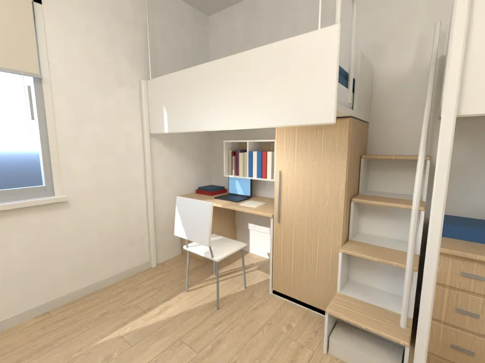 祐廷那一組（靠窗） | 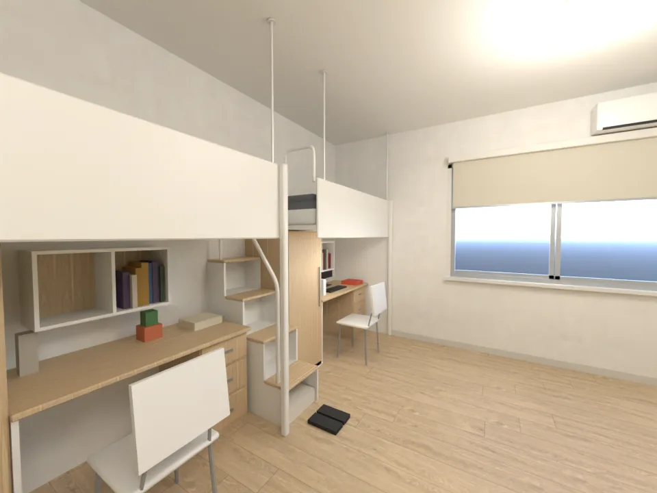 從走道看阿凱那一組 |
| 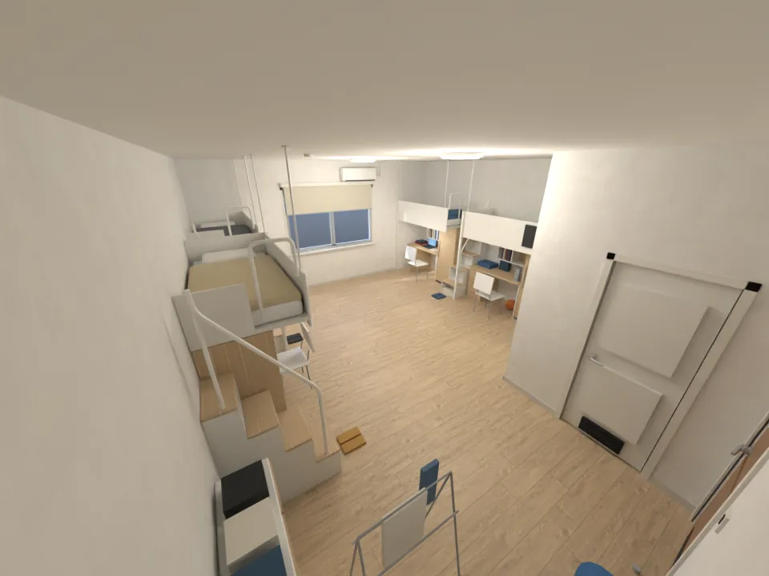 全景 | 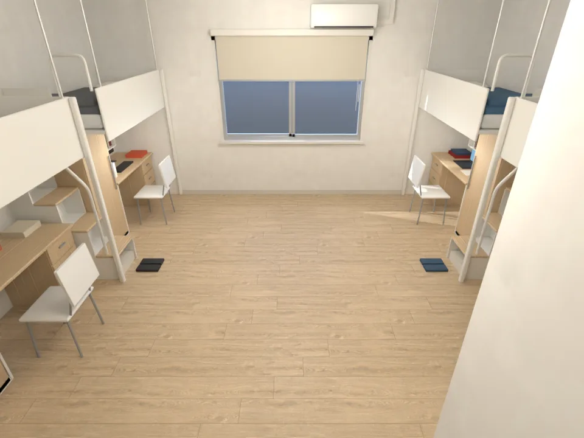 遊戲鏡頭的高度 |
| 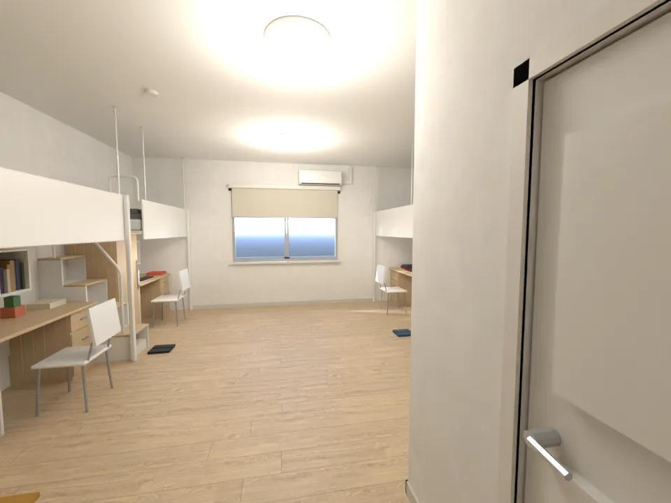 從門口進來 | |

## v2（01:3x）：照 AA_208 放四位室友的東西（AA 分支 65978067；使用者在 AA 對話裡決定「新增兩個室友，用現有人物」）
- 誰用哪一組（同一個模型 203、412 共用，換東西就好）：

| 組 | 位置 | 203（法律系大一） | 412（經濟系那年） |
|---|---|---|---|
| L2 | 左前（門口那組） | **祐廷**：行李箱、《經濟學原理》、舊《民法》、六法、筆電 | **祐廷**：經濟系的書、筆電（第一晚紙箱用 v0_dorm_props，疊在書桌上） |
| R2 | 右前（洗手間旁） | **阿凱**：雙螢幕、電腦主機、耳機、零食 | **阿勳**：v0_dorm_props 的 XUN_DESK、XUN_BOWLING |
| L1 | 左後 | **阿哲**：籃球、一箱零食、桌上型電風扇 | **韋綸**：腳踏車安全帽、椅子上一堆衣服 |
| R1 | 右後（靠窗、先到） | **柏翰**：排得很整齊的書、檯燈、考古題資料夾、耳塞盒 | **唐睿**：劇本、掛在床欄外的戲服 |

- 節點：
  - `Y203_YUTING`、`ROOMMATE_KAI`、`Y203_ZHE`、`Y203_BOHAN`、`Y412_YUTING`、`Y412_TANGRUI`、`Y412_WEILUN`：每個人的東西，可以整組藏起來；
  - `LOFT_<組>_TOP`：1.5 m 以上的床板、床欄、吊桿、床墊、扶手上段，材質是 `seethru_*`（鏡頭擋到時走樹幹透視）；
  - `BEDDING_<組>`：被子、枕頭；
  - `NAMETAG_TANGRUI`、`NAMETAG_WEILUN`：經濟系第一晚空床的名牌（「412 唐睿」「412 韋綸」，貼圖 `textures/gen/dorm_labels.png`）。
- 洗手間門上加了門牌（男女圖示＋「洗手間」）。
- 遊戲要切換的（`layout_v2.json` 的 `sets`）：
  - 203：藏 `Y412_*`、`NAMETAG_*`；
  - 412：藏 `Y203_*`、`ROOMMATE_KAI`；
  - 412 第一晚：再藏 `Y412_TANGRUI`、`Y412_WEILUN`、`BEDDING_R1`、`BEDDING_L1`，顯示名牌。
- 月曆：洗手間北面隔間朝房間那一面留了空牆（`calendar_spot`）。社團傳單：祐廷書桌前、層架旁邊的空牆（`wall_spot_by_desk`）。

| | |
|---|---|
| 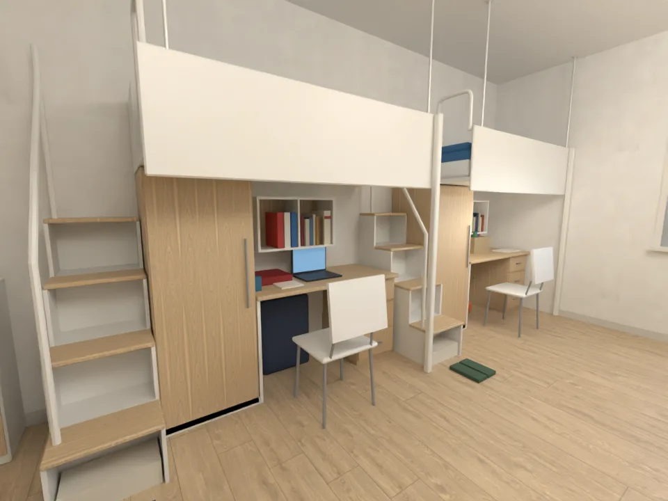 祐廷（門口那組） | 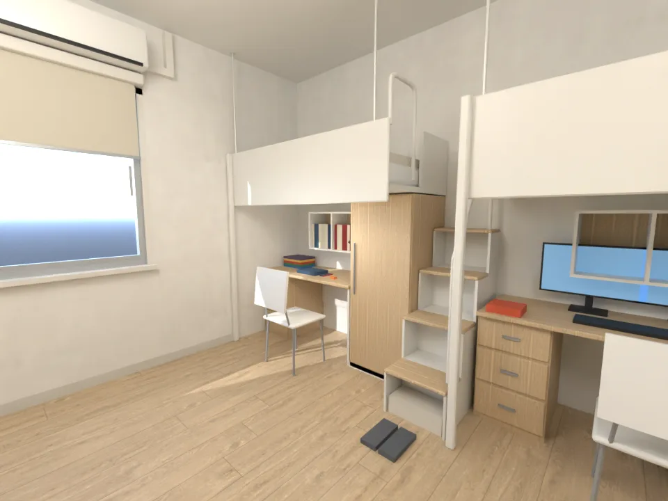 柏翰（靠窗） |
| 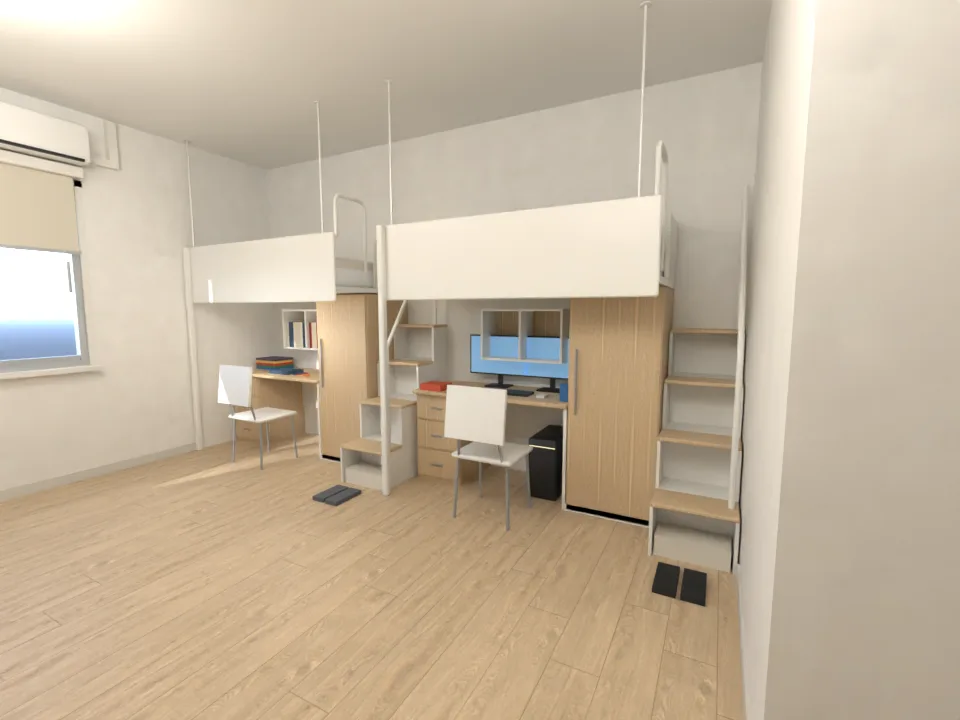 阿凱 | 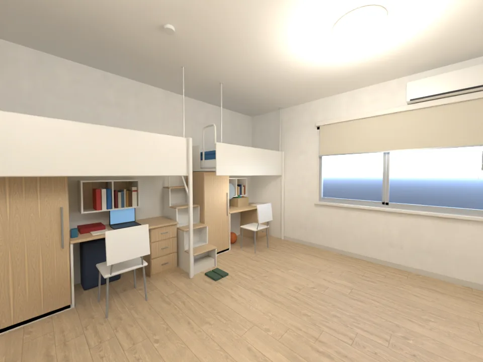 阿哲 |
| 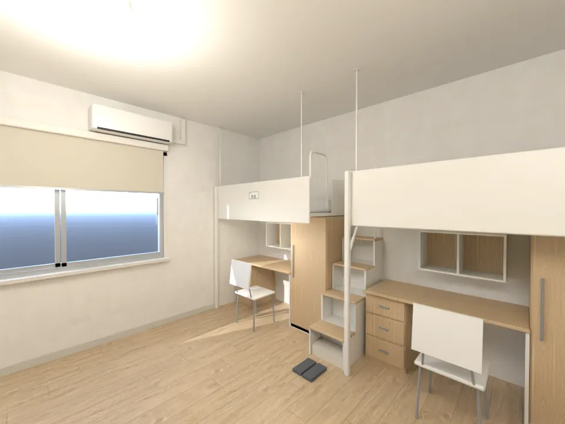 經濟系第一晚：唐睿的空床＋名牌 | 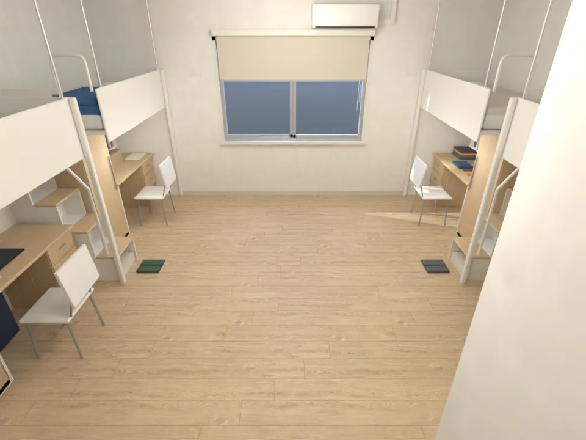 遊戲鏡頭的高度 |

## 遊戲內截圖（交件前檢查）
- 做法：
  - 測試工作樹＝開發分支 `3d477ddb`，把 `dorm_interior.glb` 暫時換成這個模型；
  - 用 JS 藏起 412 的東西和名牌；
  - 也藏起舊位置的月曆、傳單和書桌上的小物（舊配置的座標）。
- 手機模擬（Playwright），**不是真機**。走路、座位還是舊程式，所以只拍畫面。
- 窗外的景還在舊的位置（x 1.5），新窗只有右半邊看得到景；LAWWW-B 改 `winXs [0]` 以後就對了。

| | |
|---|---|
| 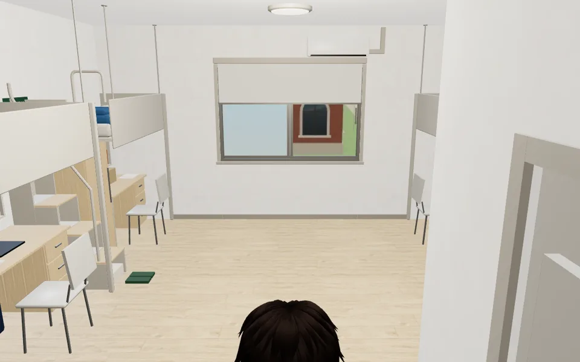 從門口（11:00） | 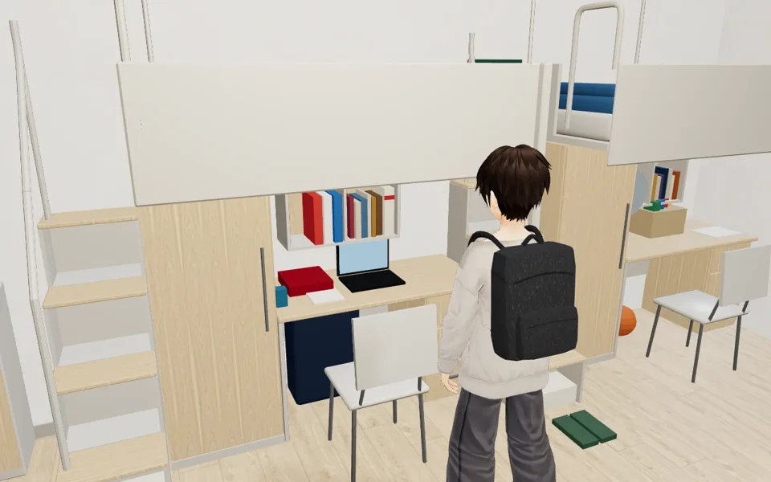 祐廷那組 |
| 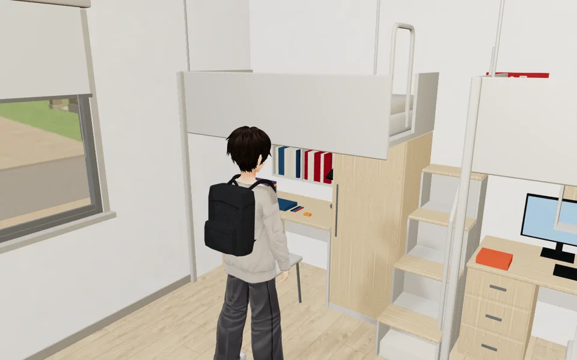 柏翰那組（16:00） | 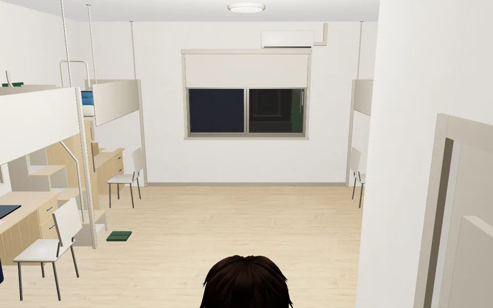 晚上 21:30 |

手機直向 390×844：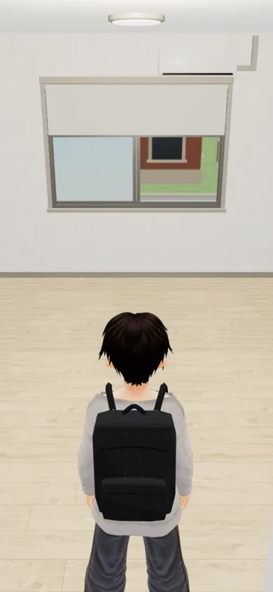

- 疊面掃描（`check_coplanar.py`）：一定會閃 0、遠處才閃 0。203、412 兩套東西互斥，不算。
- 規格：88 個物件、1.45 萬三角形、39 個材質、0.94 MB。

## 還沒做／要決定的
1. 遊戲裡還沒接：導航、坐書桌、睡覺（上舖）、窗景、鏡頭（上舖會擋鏡頭）、年份切換要 LAWWW-B 改 `zones3d.js`（DORM-LOFT-L）。
2. 房間 6 m 寬，中間走道約 4 m，比照片寬（為了第三人稱鏡頭）。要更像實際可以縮到 5 m。
3. 室友與紙箱：AA-B 已定（AA_208，見 v2）。
4. 大二的房間（SCN-V3-01）之後照同一套做。
