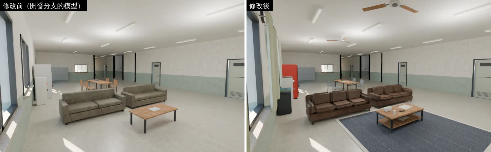
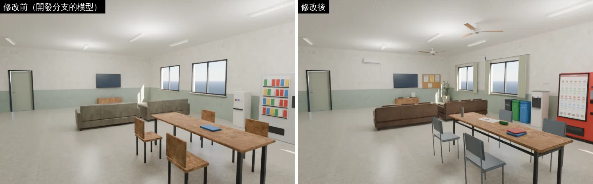
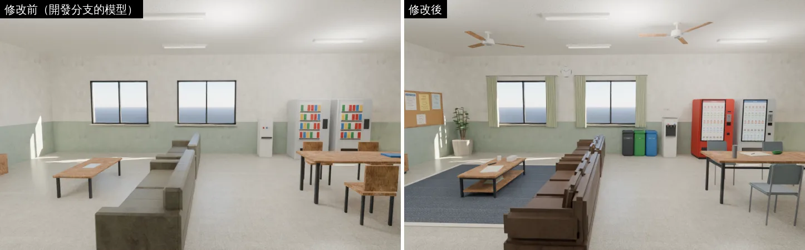
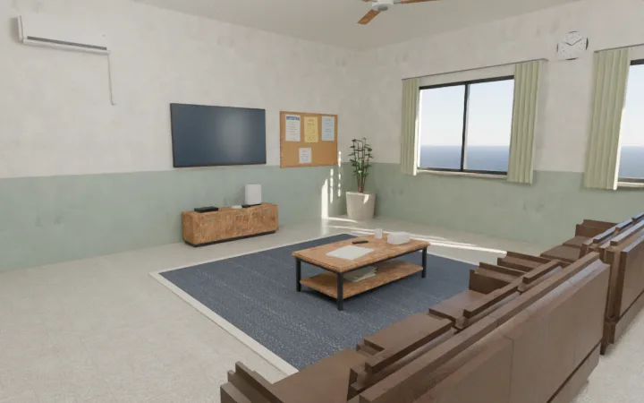
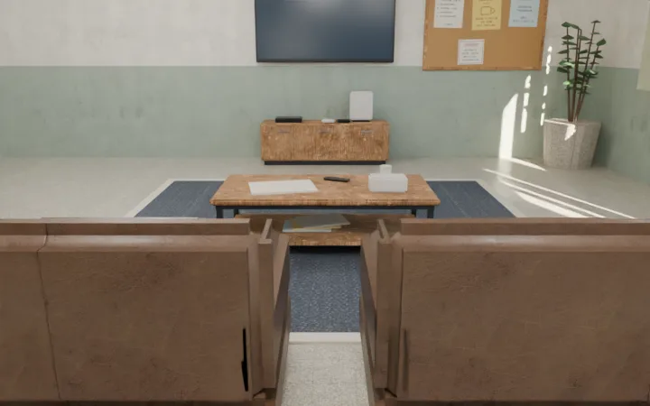

# 男生宿舍交誼廳：家具做細、補上生活感（ART-DORM-LOUNGE-1021）

帳號 A 的 LAWWW2，2026-10-22 02:5x～UTC。狀態：**WIP**——模型、導航 patch、單元測試好了；遊戲內前後截圖、`flow_dorm_hall`、`reachability_all` 排在佇列 j25（跑完才交件）。

任務：LAWWW2-C 清查 B16「男宿交誼廳家具」（P3）。驗收（總表）：GLB＋遊戲內截圖；**交誼廳沙發、電視、販賣機、長桌的導航阻擋不變**。

## 問題

交誼廳 11×6 m，原本只有兩張方塊沙發、一張矮桌、牆上的小電視、兩台一樣的灰色販賣機（彩色小方塊當飲料）、白色方塊飲水機、木板方塊椅子。牆面、天花板全空。照 D38，這是「方塊拼家具」的原型美術。

## 改了什麼（美術總監自己決定的）

| 東西 | 原本 | 現在 |
|---|---|---|
| 沙發（兩張） | 灰綠方塊 | 深咖啡色人造皮三人座：三個坐墊、三個往後傾的靠墊、圓扶手、圓邊椅背、短腳；坐墊面 0.45 m（和原本一樣） |
| 矮桌 | 一塊板＋四腳 | 木桌面＋深色收邊、下層放雜誌；桌上折起來的報紙、遙控器、面紙盒、馬克杯 |
| 電視 | 小黑板 | 貼牆的薄電視；矮電視櫃（三格門片、把手）、機上盒、直立的遊戲機、兩支手把 |
| 自動販賣機 | 兩台一樣的灰盒子 | 一台淺灰、一台紅色；亮著的展示窗（茶、綠茶、紅茶、咖啡、運動飲料，一罐 25）、**最上面一排奶茶亮紅色「售完」**（照遊戲文字「最上面一排的奶茶已經賣完了」）、投幣口、紙鈔口、退幣口、取物口 |
| 飲水機（一樓、二樓） | 白色方塊 | 熱（紅）、溫（白）、冰（藍）三個出水口、滴水盤、指示燈；牆上貼「請自備杯子」（照遊戲文字） |
| 長桌 | 木板方塊椅子 | 灰藍塑膠椅＋鐵管腳；桌上疊著的書、攤開的筆記本和筆、筆袋、保溫瓶 |
| 新加（牆上、天花板） | — | 吊扇兩支、分離式冷氣、時鐘（10 點 10 分）、公告欄（交誼廳使用規則、宿委會招募、洗衣間時間、失物招領）、兩扇窗的窗簾 |
| 新加（地上） | — | 沙發區的地毯（1.4 cm 厚）、資源回收桶三個（一般垃圾、紙類、寶特瓶・鐵鋁罐）、東南角的大盆栽 |

- 公告的字全部虛構，不寫真實宿舍名稱（D44）；字用文泉驛正黑畫成點陣圖（`tools/blender/env_second/dorm_lounge_tex.py`）。
- 吊扇是貼天花板的款式：扇葉在 3.09～3.11 m，比宿舍的鏡頭最高 3.0 m（`dorm3d.js` 的 `camMaxY`）高，**不會擋在鏡頭和人中間**。

## Blender 前後對照（不是遊戲畫面；遊戲內截圖在下一節）

沙發區、從沙發後面看：

## 導航（`patches/dorm_lounge.diff`，對開發分支 `be8c1b0e` 乾淨）

- `src/data/dorm_layout.js`：加兩件地上的家具——回收桶（`type: 'bins'`，(7.45, 7.55)，寬 1.1）、東南角盆栽（`type: 'planter'`，(13.35, 7.4)）。
- `src/dorm3d.js`：一行，`bins` 這一種家具擋住導航格＋備用模型（三個色塊；正式模型載入失敗時看得到，不會變成看不見的牆）。盆栽是原本就有的種類，不用改程式。
- `tests/dorm_lounge_unit.js`（新）：
  - 修改前（只加配置、`dorm3d.js` 沒改）**2 FAIL**：回收桶的位置站得住（人會穿過去）、回收桶沒有備用模型。
  - 修改後 **ALL PASS**：回收桶、盆栽擋住；**原本的家具（沙發、矮桌、電視櫃、販賣機、飲水機、長桌、門廳）導航阻擋一格都沒變**（和拿掉新家具的配置一格一格比）；交誼廳 10 個互動點從大門都走得到（引擎的找路＋移動碰撞，dt 1/30 與 0.1）；飲水機和回收桶中間沒有走得進去出不來的縫。
- 在 `be8c1b0e` 上：`nav_buildings_unit`、`dorm_cam_unit` ALL PASS（Node）。

## 效能（`dorm_hall.glb`，整棟兩層）

| | 修改前 | 修改後 |
|---|---|---|
| 三角形 | 12,116 | 18,490 |
| 網格（同層同材質合併後＝draw call 上限） | 60 | 67 |
| 材質 | 32 | 36 |
| 檔案 | 2.43 MB | 3.30 MB |

新加的材質：公告／時鐘／標籤圖集、販賣機展示窗、窗簾（Poly Haven `rough_linen`）、塑膠椅、地毯（Poly Haven `dirty_carpet`）。

## 遊戲內前後（佇列 j25）

（j25）

## 還不到的地方（誠實寫）

- 吊扇不會轉（模型是靜止的；要轉得寫程式，這一版不做）。
- 時鐘的指針固定在 10 點 10 分，不跟遊戲時間走。
- 電視是關著的（深色螢幕）；遊戲文字寫「在播午間新聞」，要亮起來得由程式在看電視的時候換材質。
- 真機沒看過。

## 接法（LAWWW）

1. `git apply docs/art-rebuild/second_ai/patches/dorm_lounge.diff`（`src/data/dorm_layout.js`、`src/dorm3d.js` 一行、`tests/dorm_lounge_unit.js`）。
2. 換 `assets/models/env/dorm_hall.glb`（我的分支）。
3. 跑 `node tests/dorm_lounge_unit.js`、`node tests/nav_buildings_unit.js`、`tests/flow_dorm_hall.py`。
