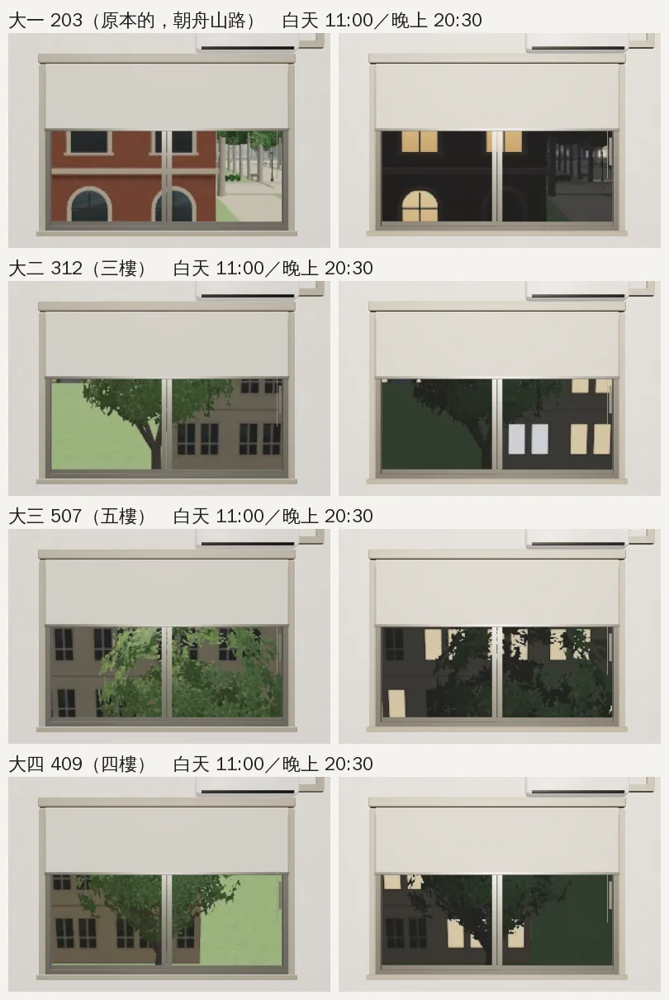
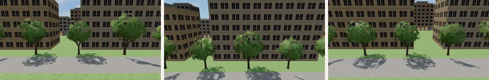
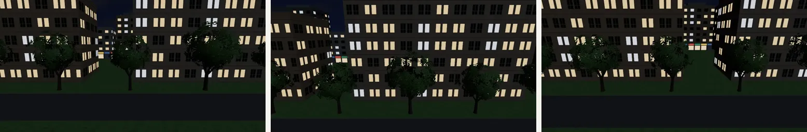
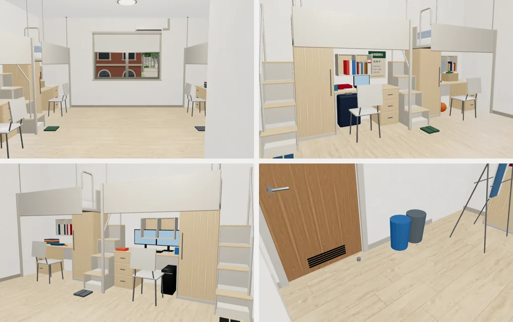
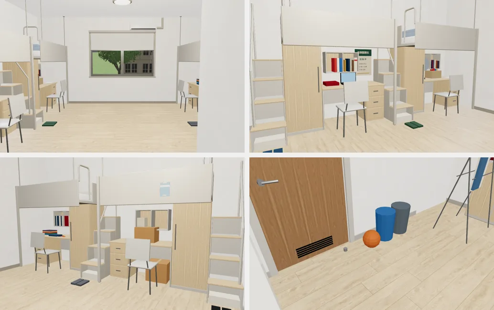
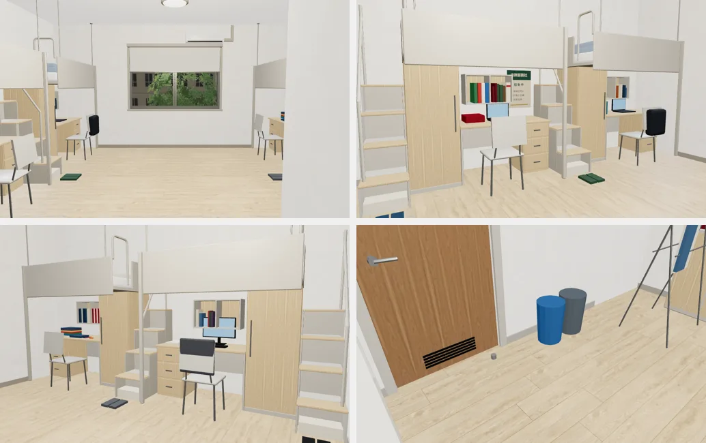
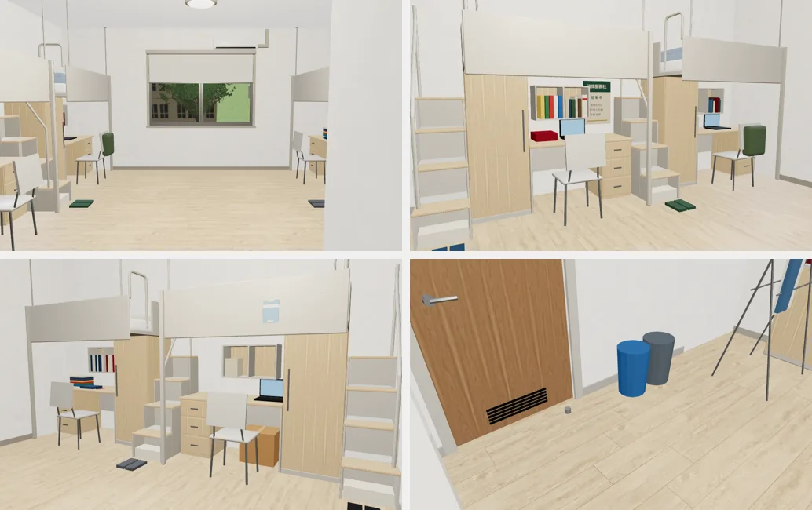

# 宿舍大二～大四：312／507／409 的窗景與擺設｜LAWWW2-C 2026-10-17｜READY_FOR_ART_REVIEW

任務 SCN-V3-01（大二）、SCN-V4-01（大三）、SCN-V5-01（大四）、ART-DORM-Y34；依據 `AA_208` 第 7、8 節（AA-C 2026-10-17 04:4x 定）：
- 同一棟男一舍、同一個四人房模型（`dorm_room4.glb`），換房號、窗外景、室友的東西。
- 祐廷四年都在門口左邊那組（L2）。

| 年 | 房間 | 室友（AA_208） | 窗外（AA_208） |
|---|---|---|---|
| 大二 | 312（三樓） | 阿哲 L1、柏翰 R1、大一學弟 R2（背景） | 看得到另一邊的樹 |
| 大三 | 507（五樓） | 柏翰 R1、大二學弟 L1、別系的同屆 R2（都是背景） | 樹梢和遠一點的屋頂 |
| 大四 | 409（四樓） | 柏翰 R1、大二學弟 L1、大一學弟 R2（背景） | 介於中間 |

> **更正**：`393eda85` 交的 112／218／105 照的是較舊的 `AA_183`，作廢（LAWWW-C 18:1x 轉達 AA_208）。
> - LAWWW-C 的 `7af91062` 已接了 218、105：換成這一版的 patch。
> - 舊的六張照片等換好再刪。

## 窗景（`assets/models/env/views/dorm_room{312,507,409}_{day,night}.webp`，`tools/shots/window_views.py`）
- 男一舍 36×14 m（校園 x 2–38、z 61–75），正面朝舟山路；大一 203、經濟系 412 的窗景是正面。
- 這三間朝**背面**（企劃寫的「另一邊」）：
  - 背面 23 m 外是一排樟樹（遊戲場景裡量的：z 99，x −6、6.6、20.5、33.5），再後面是校外的公寓。
- 房間的窗用視差，只露出照片中間一小塊：
  - 水平約 ±11°，垂直約 +1.5° 到 −7.7°（上半被捲簾蓋住）；
  - 所以每間對準一棵樹，依樓層算俯角：
    - 312（三樓 8.4 m）對 x 20.5 那棵：樹冠＋樹幹；
    - 507（五樓 14.6 m）對 6.6：樹冠的上半＝樹梢；
    - 409（四樓 11.5 m）對 33.5：介於中間。
- 遊戲裡（房間中間往窗戶看）：

- 照片本身（312、507、409）：

## 每個人的東西（`tools/blender/env_second/dorm_room4.py` → `dorm_room4.glb`）
一組一個節點，可以整組藏起來；名字照舊的規則 `Y<房號>_<誰>`：

| 節點 | 東西 |
|---|---|
| `Y312_YUTING`、`Y507_YUTING`、`Y409_YUTING` | 架上：經濟學原理、舊《民法》、課本；講義夾一年多一本（3／4／5）；六法（大三起比較厚）；筆電。**桌面留空**給主線的物件（`dorm_y2_items` 等）；大一的行李箱拿掉 |
| `Y312_ZHE` | **籃球滾到門口**（門框左邊、垃圾桶旁邊，不擋路）、一箱零食、從高雄帶來的電風扇（AA_208 7-1） |
| `Y312_BOHAN`、`Y507_BOHAN`、`Y409_BOHAN` | 照 203 跟著搬：排整齊的書、考古題資料夾（一年比一年多）、**靠窗那組書桌上的檯燈**、耳塞盒；409 的耳塞在枕頭旁邊（「耳塞已經放在枕頭旁邊」） |
| `Y312_FRESH`、`Y409_FRESH` | 大一學弟（背景）：**床欄上貼著新生手冊**（淺藍封面、沒有字）、還沒拆的紙箱（312 兩箱、409 一箱）、架上一疊新課本；409 多一台筆電 |
| `Y507_SOPH`、`Y409_SOPH` | 大二學弟（背景）：筆電、幾本課本、水壺、椅背上的後背包 |
| `Y507_PEER` | 別系的同屆（背景）：一台螢幕＋鍵盤、一疊 A4 影印、椅背上的外套 |

- 舊的 203、412 那幾組**逐位元組不變**：新的東西用自己的亂數，不動到原本那些書的排法。
- 配置檔 `dorm_room4.layout.json`：只有 `sets` 多三年，座標、導航、座位都沒變。
- 疊面檢查（`check_coplanar.py`）：一定會閃 0、遠處才閃 0（新的三年和 203／412 互斥）。
- 檔案 0.94 → 1.22 MB。

遊戲裡（開發分支 `0b116247`＋下面的 patch；每一年四個角度：全景、左邊兩組、右邊兩組、門口）：

大一 203（對照：原本的東西都在、新的都藏起來）

大二 312（門口的籃球、學弟床欄上的手冊、兩個紙箱）

大三 507

大四 409

## 接進遊戲（LAWWW-C 的檔案；`docs/art-rebuild/second_ai/patches/dorm_y234_sets.diff`，對 `0b116247`）
1. `src/zones3d.js`：
   - `DORM_SETS` 多 `'312'`、`'507'`、`'409'`；**舊的四組也要藏 `Y312_`／`Y507_`／`Y409_`**（GLB 和這段要一起換，不然大一會看到別年的東西）。
   - `dormSetKey`：`ROOM_Y4` → 409、`ROOM_Y3` → 507、`ROOM_Y2` → 312。
   - `dormSet` 裡 traverse 的名字規則加這三個字頭。
   - `dormView`：312／507／409。
2. `src/data/dorm_room_layout.js`：用新的 `dorm_room4.layout.json` 跑 `python3 tools/gen_dorm_room_layout.py`（只有 `sets` 不同）。
- 上面的截圖是用 `tools/blender/env_second/shots/fast_shots.py` 直接設旗標拍的（[前置／捷徑]）。沒有從劇情真的搬房間。
- 和你 7af91062 的註解一樣：搬房間的事件在房間裡發生時，要重新呼叫 `z.dormSet(…)`（或重新進房間）擺設和窗外才會換。

## 還沒做到的
- 房號牌：房間裡沒有門牌；走廊上的門牌是 `dorm_hall`（LAWWW 的 dorm3d.js），要不要換號碼由 LAWWW-C 決定。
- 507 企劃寫「遠一點的屋頂」：後面的公寓（校外的背景）比五樓高，看到的是牆面不是屋頂。
- 背景室友的被子沿用那一組原本的顏色（R2 是阿凱那條深灰）。
- 主線的物件（`dorm_y2_items.glb`：軟木板、票根……）是另一份，還沒拍遊戲內截圖、還沒交（8a1af723 的 WIP）。
- 場景美術要使用者看過才標 `ART_APPROVED`。
