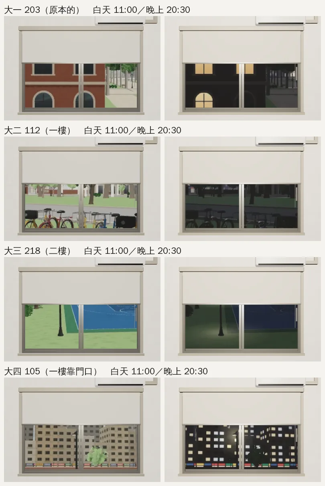
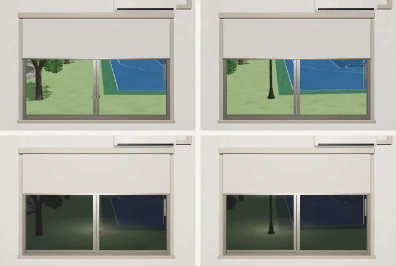
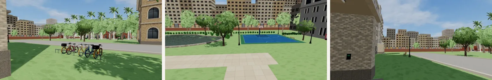
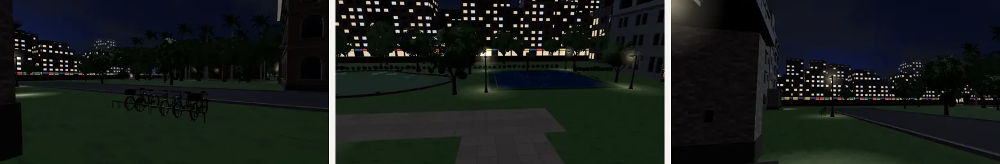

# 宿舍大二～大四的窗景（Y34 房間）｜LAWWW2-C 2026-10-17｜**作廢**

> **作廢（同日 18:1x）**：這一版照的是較舊的 `AA_183`（112／218／105）。`AA_208` 第 7、8 節改成 312／507／409，新的窗景和擺設在 [`../dorm_rooms_y234/README.md`](../dorm_rooms_y234/README.md)。下面留作紀錄。

AA_183 第 5 節：大二～大四同一個宿舍模型，房號、窗外不同。窗外是在遊戲的校園裡拍的照片（`tools/shots/window_views.py`），房間的窗用視差（`W3.windowMat`，景深 25 m）只露出照片中間一小塊。

| 年 | 房間 | 窗景檔 | 企劃寫的窗外 | 在校園的哪裡拍 |
|---|---|---|---|---|
| 大一 | 203 | `dorm_room`（原本的） | — | — |
| 大二 | 112（一樓） | `assets/models/env/views/dorm_room112_{day,night}.webp` | 視線低：腳踏車棚和一棵樹 | 校園西邊的腳踏車架 (-66, 55.4) 東南邊，一樓窗的高度 1.5 m |
| 大三 | 218（二樓的另一頭） | `dorm_room218_{day,night}.webp` | 球場的燈 | 醉月湖東側的系籃球場西北角那盞燈，二樓高度 5.3 m |
| 大四 | 105（一樓，靠門口） | `dorm_room105_{day,night}.webp` | 宿舍門口的路燈和進出的人 | 長椅旁的路燈 (-91.2, 53.5)，1.6 m |

- 照片裡的路人和其他窗景一樣藏起來：一張照片裡固定不動的路人看起來像假人（「進出的人」要靠遊戲裡真的走動的人，窗景做不到）。
- 宿舍旁邊沒有車棚、路燈、球場，所以到校園裡有這些東西的地方拍；窗外的位置和宿舍的實際位置對不上（大一 203 原本也是這樣）。

## 遊戲裡的樣子（房間裡往窗戶看；白天 11:00、晚上 20:30）

大三 218 自己退件的第一版：燈剛好在照片正中間，被窗框中間的直條擋住，晚上只剩一團光。鏡頭往右偏 5°，燈落在左邊那扇窗（下排是改好的）：

照片本身（112、218、105，白天／晚上）：

## 接進遊戲（LAWWW-C 的檔案 `src/zones3d.js`；patch：`docs/art-rebuild/second_ai/patches/dorm_views_y234.diff`）
- 加 `dormView(G)`：經濟系 412 → `dorm_room412`；`ROOM_Y4` → 105、`ROOM_Y3` → 218、`ROOM_Y2` → 112；其他 → `dorm_room`。`dorm.build` 的 `view:` 改成 `dormView(G0)`。
- `ROOM_Y3`、`ROOM_Y4` 是我先取的名字：開發分支目前只有 `ROOM_Y2`（主線 3 第二個房間）。大三、大四搬房間的事件做的時候，換成真正的旗標就好。
- 窗景在 `build()` 時決定：`roomY2InDorm` 是在房間裡發生的，搬完以後要重新進一次房間（或事件裡切一次區域）窗外才會換成 112。
- 上面的遊戲截圖是在開發分支 74a655e8 加這個 patch 拍的（`tools/blender/env_second/shots/fast_shots.py`，旗標直接設好：[前置／捷徑]）；沒有從劇情真的搬過去。

## 還沒達到的
- 「進出的人」沒有（見上）。
- 105 的白天，路燈後面是校園邊界外的城市背景（`TK.bgCity`）的公寓，比較像街邊、不像宿舍門口；企劃說「左邊是宿舍樓」，照片裡看不到宿舍。
- 112 晚上偏暗，腳踏車看得出來、樹看不太出來。
- 場景美術要使用者看過才標 `ART_APPROVED`。
